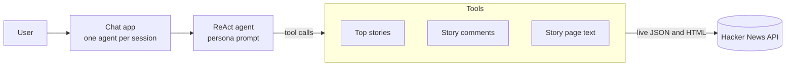
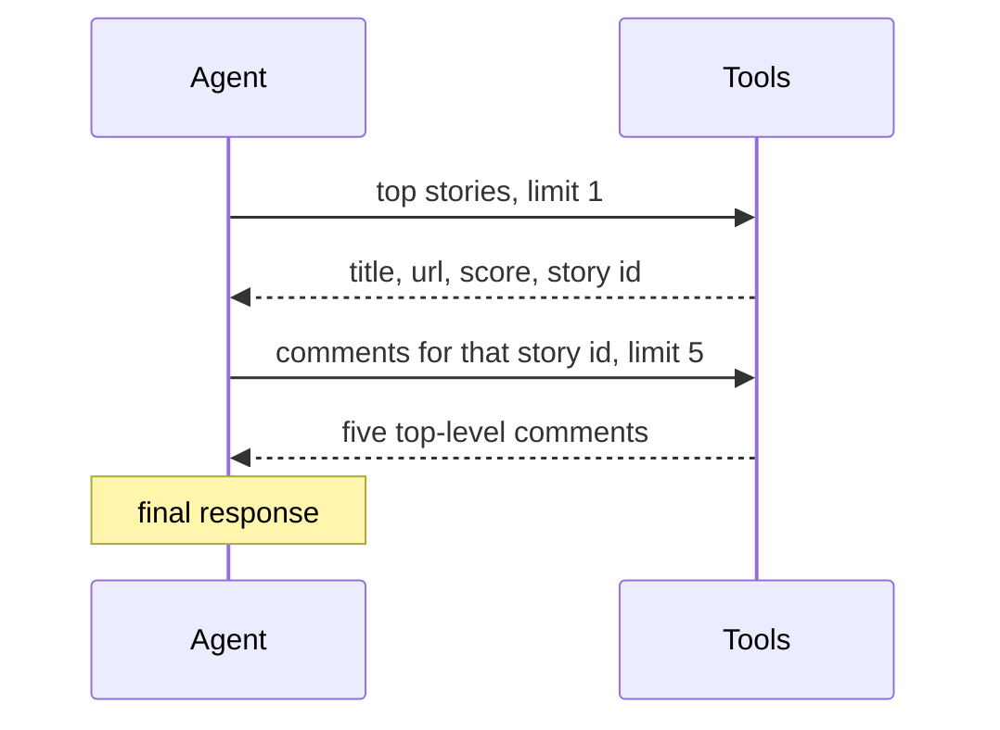

# M22.2 Theory: A real-world agent on raw API calls (Hacker News chatbot)

*[M22 theory](../../../mandatory/theory/README.md) · Lesson 22.2 · Notebooks: [`02a_real_world_agent_hacker_news_chatbot.ipynb`](../../notebook/02a_real_world_agent_hacker_news_chatbot.ipynb) (optional) · [All theory pages](../../../../../THEORY.md)*
<!-- subtitle: A small project: the hand-built ReAct agent from lesson 22.1, three live tools and a chat app -->
<!-- format: approved -->

## The project: a Hacker News chatbot

> **What you'll build**
>
> - **A ReAct agent** that answers questions about Hacker News by choosing between three tools.
> - **Three tools** over the public Hacker News API: top stories, a story's comments, a story's page text.
> - **A small library** that turns the classes from lesson 22.1 into code an app can import.
> - **A chat app** that keeps one agent per browser session.

Lesson 22.1 built reflection, tool use and ReAct inline, one notebook cell at a time. This project puts the ReAct loop to work on a live source. The questions are the kind a reader of Hacker News asks: *What are the top five stories right now?* or *What is the top story, and what are people saying about it?*

The project adds no new pattern. It shows what changes when a pattern leaves the notebook: the code has to be importable, the tools return real and changing data, and a chat app has to remember earlier turns.

## Architecture

*Figure 1: The chatbot. The agent decides which tools to call and in what order; the tools call the public API.*

| Piece | What it does | Built on |
|---|---|---|
| **Agent library** | The tool decorator, the tool class, and the tool-use, ReAct and reflection agents, packaged as importable modules | The classes from lesson 22.1 |
| **Three tools** | Top, new or best stories with their ids; the first few top-level comments of one story; the text of a story's web page | The tool contract from lesson 22.1 |
| **Three helpers** | Fetch one item, fetch a list of story ids, fetch a page's text. Plain functions, not tools | |
| **The bot** | A ReAct agent with the three tools and a system prompt that sets its persona and asks for stories as a table | Lesson 22.1's ReAct loop |
| **Chat app** | A Streamlit page that keeps one agent and the chat history per browser session | |

*Table 1: The project's five pieces.*

The library comes from the open-source, MIT-licensed agentic_patterns project, adapted for the course to use the OpenAI SDK.

## Following a two-step question

Ask *What is the current top story, and what are people saying about it in the first five comments?* The second tool needs an id that only the first tool can supply:

*Figure 2: The dependent call. The story id travels from the first observation into the second call.*

Step through what the agent's history holds after each model call. Stories and comments are live; no fixed values are shown.

<button type="button" data-step="1" aria-pressed="false" aria-controls="hn-step-1">1. Stories</button><button type="button" data-step="2" aria-pressed="false" aria-controls="hn-step-2">2. Comments</button><button type="button" data-step="3" aria-pressed="false" aria-controls="hn-step-3">3. Answer</button>

<section id="hn-step-1" class="step-panel"><h4>1. Ask for the top story</h4><dl><dt>Model reads</dt><dd>the persona prompt, the three tool signatures and the question</dd><dt>Model writes</dt><dd>a thought and a call to the stories tool with a limit of 1</dd><dt>Observation</dt><dd>title, url, score and the story id</dd></dl></section><section id="hn-step-2" class="step-panel"><h4>2. Ask for its comments</h4><dl><dt>Model reads</dt><dd>the history, now holding the story id</dd><dt>Model writes</dt><dd>a call to the comments tool with that id and a limit of 5</dd><dt>Observation</dt><dd>five top-level comments</dd></dl></section><section id="hn-step-3" class="step-panel"><h4>3. Answer</h4><dl><dt>Model reads</dt><dd>both observations</dd><dt>Model writes</dt><dd>a final response; the loop returns after three model calls</dd></dl></section>

<button type="button" data-walk="previous">Previous</button>

<button type="button" data-walk="next">Next call</button>

This is the chaining that one round of tool use cannot do (lesson 22.1's one-shot blindness). The loop handles it with no code specific to this question: the model reads the id in the observation and writes the next call. A question that needs only the story list takes one tool call.

The answers change with Hacker News, and the notebook prints no fixed result. What stays the same from run to run is the order of the calls.

## Design choices worth copying

| Choice | Why |
|---|---|
| **Package the agent code** | An app cannot import from a notebook. The same classes now serve the notebook and the chat app |
| **Keep helpers out of the tool list** | The model sees only decorated tools. Fetching ids or raw pages stays plain code the model cannot call directly |
| **Cap what a tool returns** | Comments stop at a limit and page text is cut to 4,000 characters. One long article would otherwise fill the context |
| **Return failures as text** | A page that cannot be fetched comes back as an informative message, so the model can apologise or try another story |
| **One agent per browser session** | Two people using the app never share a history |

*Table 2: Five choices and what each protects against.*

The fourth row has a cost lesson 22.5 names: a failure returned as text reaches the model as a normal result, so monitoring that counts errors never sees it.

## Limits

- **Live data.** Answers differ on every run, with no expected answer to compare against. To test the bot, check behaviour: which tools it called, in what order, with which ids.
- **Growing memory.** The app puts every earlier answer in front of each new question. The prompt grows each turn (lesson 22.1's context creep), and the user's earlier questions are not kept, only the bot's answers.
- **No round cap in the app.** The app relies on the ReAct agent's default of 10 rounds. After the cap, that agent asks the model once more and returns the raw reply (lesson 22.1). A production version would set the cap explicitly and show a fixed fallback reply.

The notebook runs with an OpenAI key; the Hacker News API needs none. It writes the tools, the bot and the app as files beside itself, and the chat app runs separately with Streamlit.

## References

1. Hacker News, [official API documentation](https://github.com/HackerNews/API).
2. The Neural Maze, [agentic patterns from scratch](https://github.com/neural-maze/agentic-patterns-course), the MIT-licensed library the project adapts.
3. Streamlit, [session state](https://docs.streamlit.io/develop/api-reference/caching-and-state/st.session_state).
4. Yao et al., [ReAct: reasoning and acting together in language models](https://arxiv.org/abs/2210.03629) (arXiv 2210.03629).

## Key Takeaways

- A pattern becomes a product when its code is importable: the same agent class serves a notebook, a script and a chat app.
- Tools over live sources need limits on what they return and readable failure messages, or one call can flood the context or end the run.
- With live data there is no fixed expected answer, so test the agent's behaviour: the tools it chose, their order and the ids it passed.

## Check yourself

1. Why can the chatbot answer what people say about the top story, when one round of tool use could not?

The comments tool needs the story's id, and that id exists only after the stories tool has run. The ReAct loop sends the first observation back to the model, which reads the id and writes the comments call. One round of tool use must write every argument before any tool runs.

2. The stories tool, the comments tool and the page-text tool all return live data. Which two guards keep a single call from flooding the agent's context?

The comments tool returns only the first few top-level comments, up to a limit, and the page-text tool cuts a page to 4,000 characters. Without them, one long thread or article could fill the context window.

3. You want a regression test for the chatbot, but the top stories change every hour. What can the test check?

The behaviour rather than the text: for the two-step question, that the agent called the stories tool first, then the comments tool with the id from the first observation, and then gave a final response. Replacing the tools with stubs that return fixed stories makes the answer text checkable too.

---
*Previous: [22.1 Agentic patterns from scratch: reflection, tool use, ReAct planning](../../../mandatory/theory/01_agentic_patterns_from_scratch_reflection_tool_use_react_planning/README.md). Next: [22.3 Defining tools and binding them to a model](../../../mandatory/theory/03_defining_tools_and_binding_them_to_a_model/README.md).*
