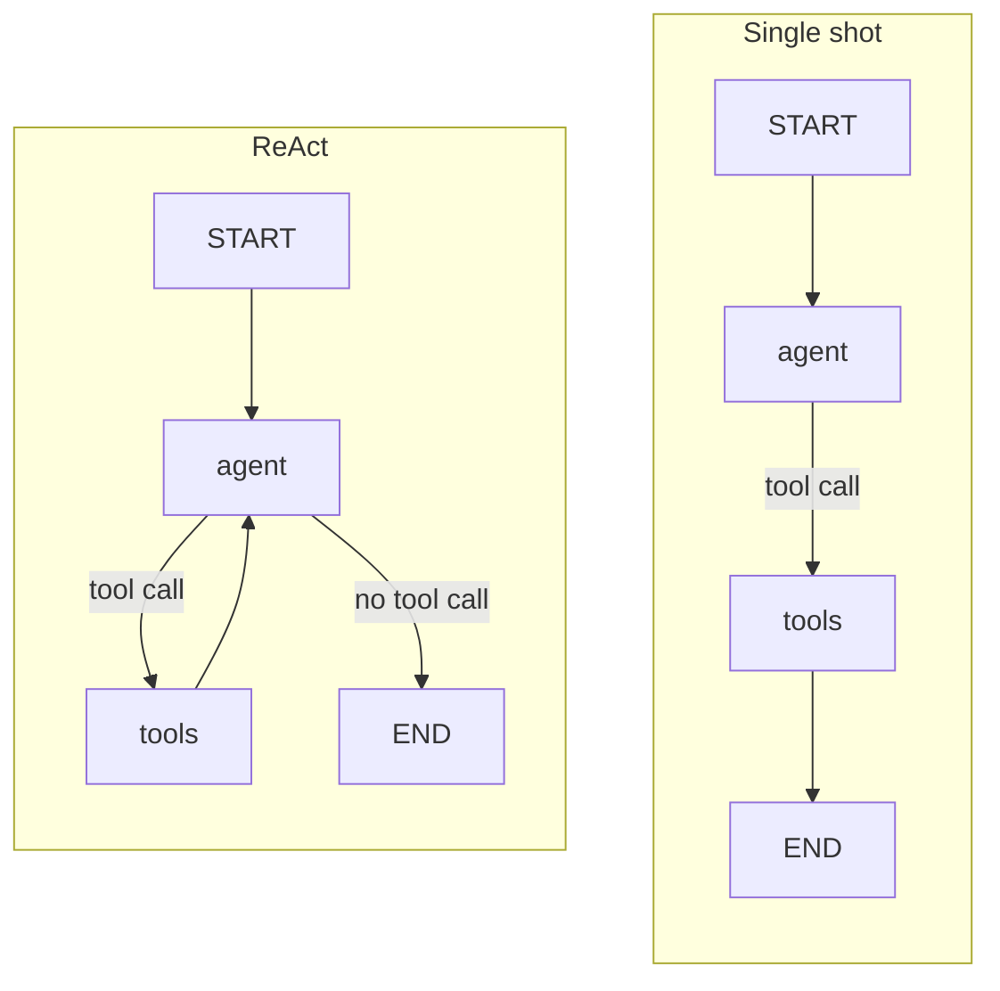
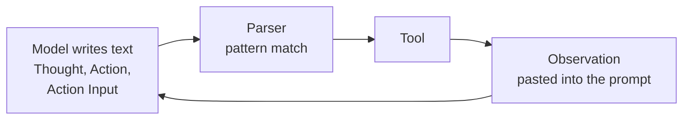
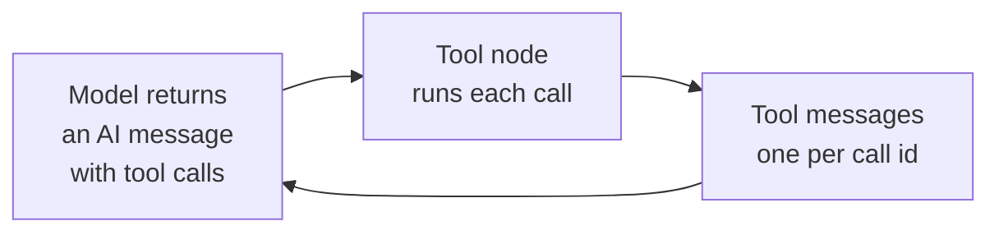
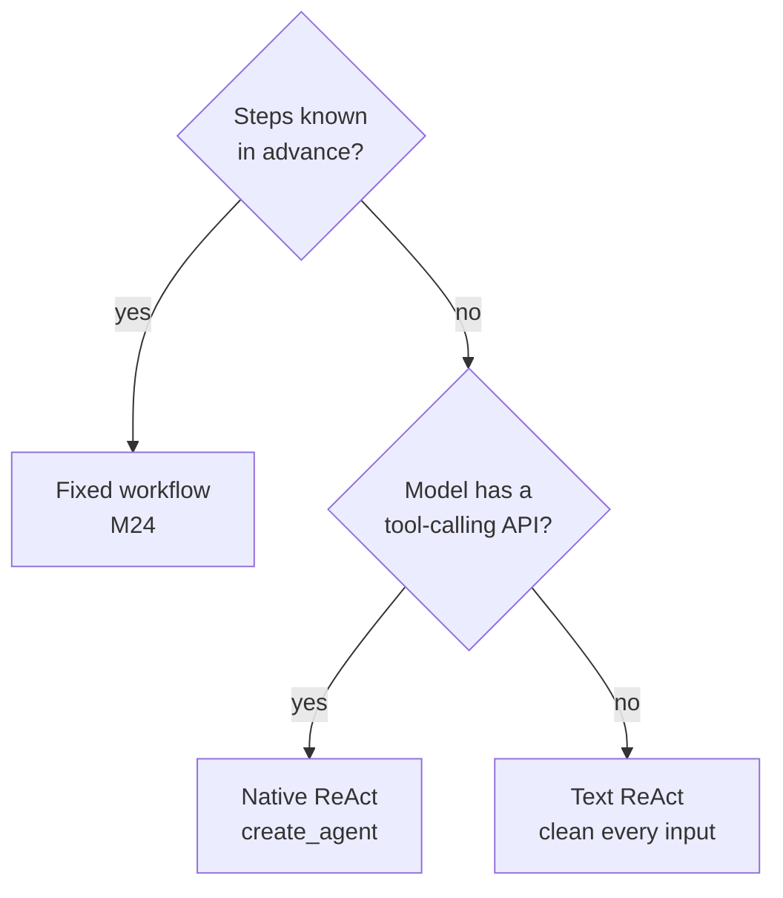

# M23.1 Theory: The ReAct loop in LangGraph; tool calling vs ReAct

*[M23 theory](../README.md) · Lesson 23.1 · Notebooks: [`01a_react_agent_langgraph.ipynb`](../../notebook/01a_react_agent_langgraph.ipynb), [`01b_tool_calling_vs_react.ipynb`](../../notebook/01b_tool_calling_vs_react.ipynb) · [All theory pages](../../../../../THEORY.md)*
<!-- subtitle: One edge turns a tool call into an agent; what the loop buys, what it costs, and how the call travels -->
<!-- format: approved -->

## Reason–act–observe

> **What you'll learn**
>
> - **Explain** the reason, act, observe loop and the one graph edge that creates it.
> - **Trace** a run whose second search depends on what the first one found.
> - **Measure** what the loop buys on the Larkspur golden questions, and what every extra round costs.
> - **Compare** native tool calls with text-based ReAct, and diagnose a failure in the transport between them.

Module M22 built the agent loop by hand: a model that requests tools, a node that runs them, and an edge back to the model. This lesson gives that loop its name, ReAct, and measures what it buys over a single tool call.

Larkspur's support agent gets *How long does a refund take?* Its first handbook search returns the refund-window passage and misses the one that says how many days a refund takes. A single tool call ends there, with half the evidence; finding the rest means reading the result and searching again.

**ReAct** (reason plus act) is an agent that plans one step at a time: it reasons about the next step, calls a tool, observes the result and reasons again, until it replies without asking for a tool. The pattern comes from the ReAct paper by Yao and colleagues (ICLR 2023), listed under References.

### The message list is the trace

In LangGraph the whole run lives in one state key: a list of messages that only ever grows. Every model call sees everything that came before. Each part of the loop leaves one kind of message:

| Message | Written by | What it holds |
|---|---|---|
| Human message | The user | The question |
| AI message with a tool call | The model | The reasoning step turned into an action: which tool, with which arguments |
| Tool message | The tool node | The observation: what the tool returned |
| AI message without a tool call | The model | The final answer, which ends the run |

*Table 1: One ReAct round leaves an AI message and a tool message on the list.*

The model never runs a tool itself: it returns a *request*, and the tool node executes it and appends the result.

### One edge makes the loop

A single-shot graph and a ReAct graph have the same nodes. They differ in where the tool node sends its result:

*Figure 1: Single shot sends the tool result to the end. ReAct sends it back to the model.*

With the edge to the end, the user receives the tool message itself, raw search results, and no search can build on another: the **raw-result handoff**. With the edge back to the agent, a router returns the run to the model after every observation and ends it when the model stops calling tools.

### A question that needs two dependent searches

The recorded comparison asks both graphs one question whose second half depends on the first: *Who is the current CEO of the company that created the sci-fi movie Dune, and what was the budget for that company's most recent film?* Both use the same live web-search tool and the same small model:

| Graph | Round | Search the model wrote | What came back to the user |
|---|---|---|---|
| Single shot | 1 | current CEO of Legendary Entertainment 2023 | The tool message: a list of search results naming the CEO, no budget |
| ReAct | 1 | current CEO of Legendary Entertainment 2023 | (observation, back to the model) |
| ReAct | 2 | budget of Legendary Entertainment's most recent film 2023 | (observation, back to the model) |
| ReAct | 3 | No tool call | An answer naming the CEO and the latest film with its budget |

*Table 2: The multi-hop question on both graphs, one recorded run each.*

The ReAct run's answer combines both observations. The loop costs nothing when no tool is needed: *Explain AI in 2 bullets* went straight to the end in one model call.

> **Pitfall: the lenient judge.** The notebook then asks an LLM judge to score both runs. It gave the raw-result handoff 7 out of 10 for task completion, though the user received only search results, and the ReAct run 10. The judge was the agent's own model. A score that rewards an answer nobody wrote measures the judge. Check its scores against a few runs you grade yourself (lesson 22.5).

## Measuring the loop on Larkspur

The [interactive lab](interactive/react-loop-lab.html) runs this loop over the twelve Larkspur handbook chunks from the M10 lab, with real TF-IDF retrieval (top two per search) and a scripted model that answers once the evidence is in the message list. On the three M10 golden questions:

| Question | Single shot | ReAct | ReAct, call cap 3 |
|---|---|---|---|
| *Can I export my data after I cancel my plan?* | evidence 1.00, raw tool output | 1.00, 2 calls, answered | answered |
| *How long does a refund take?* | 0.50, raw tool output | 1.00, 3 calls, answered | answered |
| *What happens if my server goes down?* | 0.00, raw tool output | 1.00, 4 calls, answered | stopped at the cap, evidence 1.00 |
| Mean, total | 0.50, 3 calls, 0 of 3 answered | **1.00, 9 calls, 3 of 3 answered** | 8 calls, 2 of 3 answered |

*Table 3: Evidence recall, model calls and outcome per golden question in the lab.*

<!-- lab: interactive/react-loop-lab.html -->

Read the evidence and completion columns separately:

- **Single shot equals the M10 baseline.** One top-2 search per question gives the same mean recall, 0.50, and the user receives chunks instead of an answer.
- **The loop recovers vocabulary mismatch by rewording.** The refund question's first search misses the refund-timing chunk, which says "Refunds" where the question says "refund". The second search, written after reading the first result, finds it. The outage question needs three searches: its own words and "server outage" both rank the reboot and sizing chunks first, and "what happens during an outage incident" returns the incidents and SLA chunks.
- **A cap set too low cuts off the answer, not the search.** At a cap of 3 the outage run holds both evidence chunks when it stops; lesson 23.2 sizes the cap.

The refund run in the lab, with its scripted searches and computed scores:

Step through the ReAct run for <em>How long does a refund take?</em> in the lab.

<button type="button" data-step="0" aria-pressed="false" aria-controls="refund-step-0">1. Ask</button><button type="button" data-step="1" aria-pressed="false" aria-controls="refund-step-1">2. First search</button><button type="button" data-step="2" aria-pressed="false" aria-controls="refund-step-2">3. Reword</button><button type="button" data-step="3" aria-pressed="false" aria-controls="refund-step-3">4. Answer</button>

<section id="refund-step-0" class="step-panel" aria-labelledby="refund-heading-0"><h4 id="refund-heading-0">1. Ask</h4><dl><dt>Message list</dt><dd>one human message: the question</dd><dt>Model call 1</dt><dd>no evidence yet, and it requests a search with the question's own words</dd></dl></section><section id="refund-step-1" class="step-panel" aria-labelledby="refund-heading-1"><h4 id="refund-heading-1">2. First search</h4><dl><dt>Observation</dt><dd><code>refund-window</code> (0.227) and <code>reboot</code> (0.194)</dd><dt>Evidence recall</dt><dd>0.50; the single-shot graph would end here and hand these two chunks to the user</dd></dl></section><section id="refund-step-2" class="step-panel" aria-labelledby="refund-heading-2"><h4 id="refund-heading-2">3. Reword</h4><dl><dt>Model call 2</dt><dd>reads the observation and searches for "how many days until refunds reach my payment method"</dd><dt>Observation</dt><dd><code>refund-timing</code> (0.656) and <code>retention</code> (0.100); recall is now 1.00</dd></dl></section><section id="refund-step-3" class="step-panel" aria-labelledby="refund-heading-3"><h4 id="refund-heading-3">4. Answer</h4><dl><dt>Model call 3</dt><dd>both evidence chunks are on the list; it replies without a tool call and the router ends the run</dd><dt>Cost</dt><dd>3 model calls and about 243 tokens of context read, against 1 call and about 7 tokens for the single shot</dd></dl></section>

<button type="button" data-walk="previous">Previous</button>

<button type="button" data-walk="next">Next step</button>

The second search could only be written after the first came back. That dependency is the case for the loop.

### What each round costs

Every model call rereads the whole message list, and each round costs more than the one before it. The lab estimates the context each run reads as characters divided by four:

| Question | Single shot: calls, tokens read | ReAct: calls, tokens read |
|---|---|---|
| Export | 1, about 11 | 2, about 99 |
| Refund | 1, about 7 | 3, about 243 |
| Outage | 1, about 9 | 4, about 451 |

*Table 4: Context read per run in the lab (characters divided by four, an approximation).*

The outage run reads about 50 times the context of its single search to go from 0.00 to 1.00 evidence. Context grows faster than the call count because each round carries every earlier observation: lesson 22.1's context creep, measured.

## Native tool calls vs text-based ReAct

The ReAct paper predates tool-calling APIs. It drove the loop with text: the prompt listed the tools and asked the model to write *Thought*, *Action* and *Action Input* lines. The framework stopped generation at *Observation*, parsed the action out of the text, ran the tool and pasted the result back. **Native tool calling** moves the same loop onto structured tool calls returned by the provider, so nothing is parsed from prose.

In text-based ReAct the action exists only as characters. A parser reads them back out, and whatever it extracts is what the tool receives:

*Figure 2: Text-based ReAct. The parser is the transport, and it passes on quotes and stray whitespace.*

With native tool calling the provider returns the action as a structured field. The tool node reads the name and arguments directly:

*Figure 3: Native tool calling. No parsing step, and several calls can travel in one reply.*

The two transports differ on five points:

| | Native tool calling | Text-based ReAct |
|---|---|---|
| How the call travels | Structured tool calls from the provider API | Free text, parsed with a pattern |
| Needs a tool-calling model | Yes | No, any instruction-following model |
| Parallel calls in one turn | Yes | No, one action per turn |
| Visible reasoning | Optional | Always, the *Thought* lines |
| Typical failure | Wrong tool or bad arguments | Format drift, or arguments polluted by quotes and whitespace |

*Table 5: The same loop on two transports.*

### Planted failure: the quoted argument

The recorded comparison runs both on the same two deterministic stubs: a weather lookup that knows New York, London and Tokyo, and a calculator. The question is *What's the weather in Tokyo and calculate 25% of 80?*

| Run | What the model wrote | What the tool received | Outcome |
|---|---|---|---|
| Text ReAct | Action Input: 'Tokyo', with the quotes | The six characters 'Tokyo', an unknown city | "Weather data not available" |
| Text ReAct | Action Input: '0.25 * 80', with the quotes | A quoted string, which the calculator returned unchanged | Five identical calculator calls, then the run stopped at its limit of 6 steps with no answer |
| Text ReAct, inputs cleaned | The same quoted inputs | Quotes and whitespace stripped first | Answered in 2 tool steps and 3 model calls |
| Native tool calls | Structured arguments | Tokyo and 0.25 * 80 | Both tools requested in one turn; answered in 2 model calls |

*Table 6: One question on four runs, one recorded run each.*

The model knew which tool it wanted every time. The failure was in the **transport**: the tool receives whatever characters the model happened to write. A text-driven agent needs tools that clean their input, and a setting that turns a format break into an observation. Native calls remove the parsing step and let independent calls share a turn, which is why the native run needed one model call fewer. LangChain 1.x builds its agents on them (lesson 23.2); the ReAct idea is unchanged.

### Choosing a driver

ReAct earns its extra calls when the path depends on what the tools return. Two questions settle which loop to build:

*Figure 4: Use a workflow when the path is known; otherwise a native loop wherever the model supports it.*

## Limits of this evidence

- **A scripted model in the lab.** The retrieval and counts are computed; a live model may reword differently or stop earlier.
- **One recorded run per comparison.** The multi-hop run, the judge scores and the quoted-argument failure are single runs with one small model; the quoted argument is frequent with that model, not certain, and live search results change between runs.
- **Lab numbers rerun in the lab's engine.** Every question and cap matches the tables; scikit-learn was not rerun.

## References

- [The ReAct paper (Yao et al., ICLR 2023)](https://arxiv.org/abs/2210.03629): the Thought, Action and Observation format.
- [LangGraph: workflows and agents](https://docs.langchain.com/oss/python/langgraph/workflows-agents): the agent loop as a graph.
- [LangChain: tools](https://docs.langchain.com/oss/python/langchain/tools): tool names, descriptions and arguments.

## Key Takeaways

- A ReAct agent reasons about one step, calls a tool, reads the result and repeats until it replies without a tool call. The edge from the tool node back to the model is what turns a single-shot graph into that loop.
- On the Larkspur golden questions the loop lifts mean evidence recall from 0.50 to 1.00, for 9 model calls instead of 3. Every round rereads the whole message list: the outage run reads about 451 tokens against 9 for one search.
- Prefer native tool calls to text-based ReAct: no parsing, parallel calls in one turn and no quoted-argument failures. Use a fixed workflow when the steps are known.

## Check yourself

1. Why does adding one edge from the tools node back to the agent turn a single-shot graph into a ReAct agent?

With the edge from tools to the end, the last message is the tool message. The user gets raw search results and no search can build on another. With the edge back to the agent, the run returns to the model after every observation, so each search can use what earlier results found. The run ends when the model replies without a tool call.

2. In the lab, the first search for the refund question misses the refund-timing chunk. What does the loop do next, what does the run cost, and what does it gain?

The model reads the first result and rewords its search, and the second search finds the refund-timing chunk, which says "Refunds" where the question says "refund". The run takes 3 model calls and reads about 243 tokens of context, against 1 call and about 7 tokens for the single shot, and lifts evidence recall from 0.50 to 1.00.

3. A text-based ReAct agent picks the weather tool for Tokyo but the tool finds no such city. What failed, and how do you fix it?

The transport failed, not the choice: the model wrote the city with quotes around it, and the tool looked up the quoted string. Clean text inputs before the tool uses them, and turn format breaks into observations the model can read. Native tool calls, which the LangChain 1.x agent uses, remove the parsing step altogether.

---
*Previous: [M23 overview](../README.md). Next: [23.2 ReAct with LangChain `create_agent`](../02_react_with_langchain_create_agent/README.md).*
