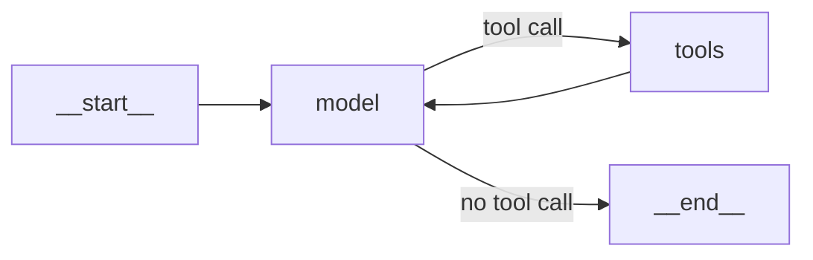

# M23.2 Theory: ReAct with LangChain `create_agent`

*[M23 theory](../README.md) · Lesson 23.2 · Notebooks: [`02a_react_with_create_agent.ipynb`](../../notebook/02a_react_with_create_agent.ipynb) · [All theory pages](../../../../../THEORY.md)*

## create_agent

You need a Larkspur agent that can inspect a tool result and decide whether another lookup is necessary. You will read the graph built by `create_agent`, distinguish dependent from independent calls, and diagnose a loop that repeatedly retrieves documents without the answer.

### Step 1: Inspect the compiled loop

`create_agent(model, tools, system_prompt=...)` from `langchain.agents` builds the loop of lesson 23.1 for you and returns a compiled LangGraph graph (`CompiledStateGraph`). Its compiled structure exposes the loop:

```
nodes: __start__, model, tools, __end__
__start__ -> model
model -> tools      (conditional: the model asked for a tool)
tools -> model      (the ReAct feedback loop)
model -> __end__    (conditional: no tool call)
```



Because it is a graph, everything from M08 and M09 applies: `.stream(..., stream_mode="values")` replaces 0.x's `verbose=True`, and a checkpointer plus a `thread_id` gives memory. Input and output are message lists: `invoke({"messages": [...]})` returns the whole trail, and `result["messages"][-1]` is the answer.

### Step 2: Separate dependent and independent calls

The model decides how much to do per turn:

- **Dependent calls take one turn each.** *Get Google's price, then email it to an analyst* needs `get_stock_price`, an observation, then `send_email`, because the email body needs the price.
- **Independent calls share a turn.** *Weather in Bangalore and Mumbai, and 25 * 4* came back as three tool calls in one `AIMessage`. The `tools` node ran all three before the model's second and last call.

### Step 3: Migrate the input and control settings

What changed from LangChain 0.x, in the migration comparison:

| LangChain 0.x | LangChain 1.x |
|---|---|
| `initialize_agent(...)`, `create_tool_calling_agent` + `AgentExecutor`, or LangGraph's `create_react_agent(prompt=...)` | `create_agent(llm, tools, system_prompt=...)` |
| `max_iterations=3` | `ModelCallLimitMiddleware(run_limit=3)` |
| `verbose=True` | `.stream(..., stream_mode="values")` |
| `memory=ConversationBufferMemory(...)` | `checkpointer=` plus `thread_id` in the config |
| `invoke({"input": ...})` returns `{"output": ...}` | `invoke({"messages": [...]})` returns `{"messages": [...]}` |

Renaming only the function is not enough: the old `prompt=` argument raises `TypeError` on `create_agent`, which takes `system_prompt=`. `create_react_agent` in `langgraph.prebuilt` is deprecated since LangGraph v1.0.

Tools come in three weights. `load_tools` (now in `langchain_community`) gives ready-made ones such as `llm-math`; `@tool` turns a function into a tool. A `BaseTool` subclass carries configuration, such as which vector store to search. In every case the model chooses tools by their name and description, so the description is prompt text.

## Call limits and runaway loops

### Step 1: Reproduce an answerless retrieval

A loop that decides its own length can run long. The controlled failure uses a restaurant FAQ indexed badly, with only the questions stored and the answers lost. Asked *When does the restaurant open?*, the recorded plain-agent run searched once, saw four questions and no hours, and said it could not answer. An agent told to keep searching until it found the answer reworded its query again and again, getting the same answerless questions back each time, until `ModelCallLimitMiddleware(run_limit=3, exit_behavior="end")` ended the run and appended its notice. The cap bounded the bill. The user still had no opening hours.

### Step 2: Fix the evidence before increasing the cap

Rank the fixes by how much they change what the model sees:

| Fix | Where |
|---|---|
| 1. Fix the data: store each question with its answer | ingestion |
| 2. Retrieve more documents (`search_kwargs={"k": 6}`) | the retriever |
| 3. Format results clearly ("Restaurant Information:" headers) | the tool's return value |
| 4. Say in the description what the tool returns | the tool's `description` |
| 5. Raise the call cap | `create_agent(middleware=[...])` |

Fix 5 is the least effective: it buys more attempts at a retrieval problem. With fixes 1 to 4 the same question took one search and one answer, under the same cap.

### Step 3: Budget the final answering call

`ModelCallLimitMiddleware` counts model calls per run (`run_limit`) and per thread across runs (`thread_limit`). It checks before each model call. At the limit, `exit_behavior="end"` jumps to the end with an `AIMessage` such as `Model call limits exceeded: run limit (3/3)`, and `"error"` raises `ModelCallLimitExceededError`. In the [M23.1 lab](../01_the_react_loop_in_langgraph_tool_calling_vs_react/interactive/react-loop-lab.html) the golden questions need 2, 3 and 4 calls. At `run_limit=2` only the export question is answered, even though the refund run already holds both evidence chunks. Set the cap from the call counts your golden set needs, with headroom, and alert when runs hit it.

### Try it yourself

Use the restaurant failure to debug a Larkspur tool that returns only handbook titles. Raising `run_limit` gives more titles, not policy evidence. Write the corrected tool contract: return the relevant passage with its title. Check a trace for one successful search followed by an answer, and leave enough call budget for that final model turn.

### Practice notebook

Use the implementation below to test the exercise and inspect each state update. Follow its provider setup for live model calls. Recorded model responses and timings can change on a new run.

- [The agent factory](../../notebook/02a_react_with_create_agent.ipynb).

## Key Takeaways

- `create_agent` builds the ReAct loop as a compiled LangGraph graph, so streaming, checkpointers and `thread_id` memory work as usual. Pass `system_prompt=`. The old `prompt=` argument raises `TypeError`.
- `ModelCallLimitMiddleware` replaces `max_iterations` and checks before every model call. A cap set below what real questions need stops runs that already hold the evidence.
- When an agent loops without an answer, fix what it retrieves first: the data, `k`, the result format and the tool description. Raising the call cap only buys more attempts at the same problem.

## Check yourself

<details>
<summary>1. Why does the weather-and-arithmetic request finish in two model calls, while fetching a stock price and emailing it needs a separate turn per tool?</summary>

Independent calls share a turn: the model returned three tool calls in one `AIMessage`, and the `tools` node ran all three before the model's second and last call. The email body needs the price, so `get_stock_price` must return its observation before the model can ask for `send_email`.

</details>

<details>
<summary>2. Your golden questions need 2, 3 and 4 model calls. What happens at a run limit of 2, and how should you set the cap?</summary>

Only the export question is answered, even though the refund run already holds both evidence chunks when it stops. Set `run_limit` from the call counts your golden set needs, with headroom, and alert when runs hit it.

</details>

<details>
<summary>3. The restaurant FAQ agent rewords its search until the call cap ends the run, and the user never gets the opening hours. Why is raising the cap the weakest fix?</summary>

The fault is in retrieval: the index stored the questions without their answers, so every search returns answerless questions. A higher cap only buys more attempts at the same problem. Fixing the data, retrieving more, formatting the results and describing what the tool returns got the answer in one search under the same cap.

</details>

---
*Previous: [23.1 The ReAct loop in LangGraph; tool calling vs ReAct](../01_the_react_loop_in_langgraph_tool_calling_vs_react/README.md). Next: [23.3 Models, messages and structured output in LangChain 1.x](../03_models_messages_and_structured_output_in_langchain_1_x/README.md).*
