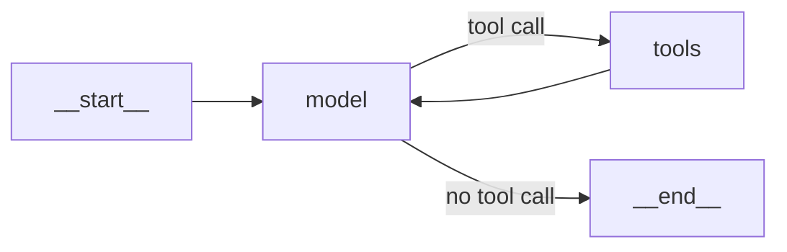
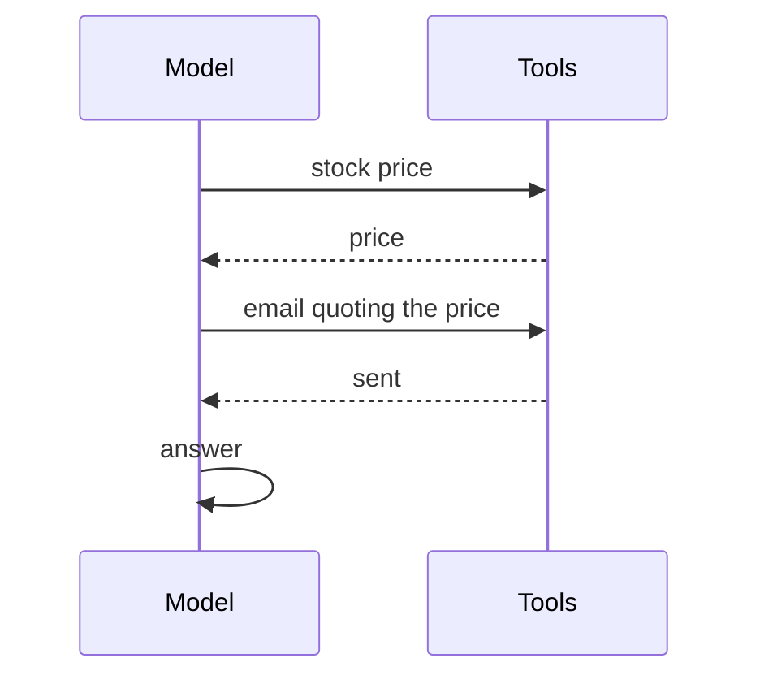
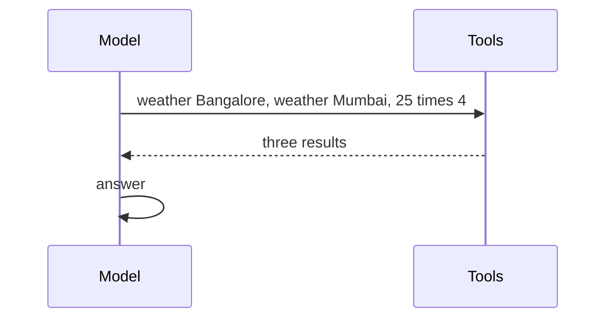
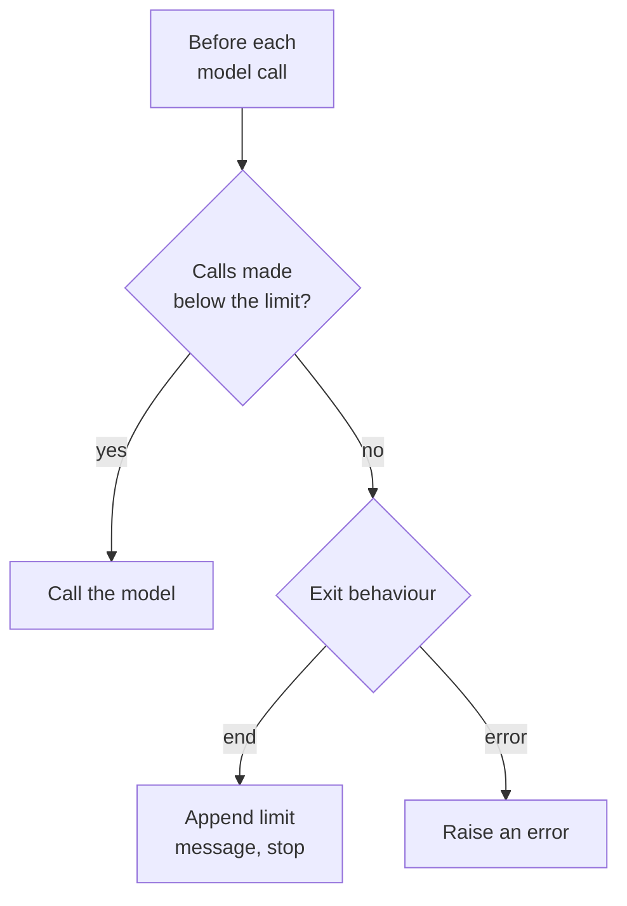

# M23.2 Theory: ReAct with LangChain `create_agent`

*[M23 theory](../README.md) · Lesson 23.2 · Notebooks: [`02a_react_with_create_agent.ipynb`](../../notebook/02a_react_with_create_agent.ipynb) · [All theory pages](../../../../../THEORY.md)*
<!-- subtitle: The loop from lesson 23.1, prepackaged: what the factory builds, and how to stop a loop that finds nothing -->
<!-- format: approved -->

## create_agent

> **What you'll learn**
>
> - **Explain** what the agent factory builds, and why everything from LangGraph still applies to it.
> - **Predict** how many model calls a task needs from whether its tool calls depend on each other.
> - **Diagnose** an agent that searches until its call cap stops it, and rank the fixes.
> - **Choose** a call cap from the call counts your golden questions need.

Lesson 23.1 wired the ReAct loop node by node. Every Larkspur agent would repeat that wiring: a model node, a tool node, a router and the edge back. LangChain 1.x packages the wiring as one function.

**`create_agent`** takes a model, a list of tools and a system prompt, and returns the ReAct loop as a compiled LangGraph graph. Inspecting the graph it returns shows the loop from lesson 23.1, with the nodes renamed:

| Edge | Kind | Taken when |
|---|---|---|
| start to model | Fixed | Every run begins with a model call |
| model to tools | Conditional | The model's reply contains tool calls |
| tools to model | Conditional | Always after the tools run: the feedback loop |
| model to end | Conditional | The model's reply contains no tool calls |

*Table 1: The four edges of the graph the factory returns.*

*Figure 1: The compiled graph. Four nodes, and the same feedback edge as lesson 23.1.*

Because the result is a graph, everything from M08 and M09 applies to it. Streaming shows each new message as it arrives, a checkpointer plus a thread id gives the agent memory, and the input and output are both message lists. The answer is the last message of the returned list; the rest is the trace.

### Dependent and independent calls

The loop is fixed, but the model decides how much to do in each turn. When one call needs another's result, each call waits for its own model turn:

*Figure 2: Dependent calls. The email cannot be written before the price arrives, which costs three model calls.*

When no call needs another, the model asks for all of them in one reply:

*Figure 3: Independent calls. Three lookups share one turn, and the run takes two model calls.*

Two recorded runs with stub tools show the difference:

| Request | Model turn 1 | Model turn 2 | Model turn 3 | Model calls |
|---|---|---|---|---|
| *What's the stock price of Google? Once you get it, send an email to an analyst.* | Stock-price call | Email call, body quoting the price | Answer | 3 |
| *Weather in Bangalore and Mumbai, and 25 times 4* | Three tool calls at once | Answer | | 2 |

*Table 2: Dependent calls take a turn each; independent calls share one.*

- **Dependent calls take one turn each.** The email body needs the price. The email call cannot be written until the price comes back as an observation.
- **Independent calls share a turn.** None of the three lookups needs another's result. The model requested all three in one reply, and the tool node ran them before the model's second and last call.

A third case costs one call: given only a restaurant search tool, the agent answered *Who are the members of the A-Team?* from its own knowledge without searching, because the tool's description said it covers the restaurant.

### Memory is a thread

The factory has no memory class. A checkpointer stores the message list after every step, and runs that pass the same thread id continue the same conversation. Three turns on one thread, then the last question on a fresh one:

| Thread | Question | Messages on the thread | How the question was read |
|---|---|---|---|
| A | *What is the capital of France?* | 2 | Paris |
| A | *Any suggestions what to visit there?* | 4 | "There" resolved to Paris |
| A | *What about China?* | 6 | What to visit in China |
| B (new) | *What about China?* | 4 | As a question about the restaurant, the only context the agent had |

*Table 3: The same words on two threads.*

Thread B shows the failure we call **thread amnesia**: on a new thread a follow-up loses its referent, and the agent fills the gap from whatever it does have, here its restaurant tool.

### Migrating from LangChain 0.x

Older material builds this loop with an agent executor or LangGraph's prebuilt ReAct agent. The mapping:

| LangChain 0.x | LangChain 1.x |
|---|---|
| Agent executor, or the prebuilt ReAct agent with a prompt argument | `create_agent` with a system prompt |
| A maximum iteration count | A model-call limit middleware |
| Verbose printing | Streaming the message list |
| A conversation memory class | A checkpointer plus a thread id |
| Input and output strings | Message lists in, message lists out |

*Table 4: What replaces what.*

Renaming the function is not enough: the factory has no prompt argument. Old code that passes one fails with a type error until it is renamed to the system prompt. LangGraph's prebuilt ReAct agent is deprecated since LangGraph v1.0.

Tools come in three weights: ready-made ones from the community package (an LLM-backed calculator, for example), a decorated function, and a tool class that carries configuration such as which vector store to search. In every case the model chooses tools by name and description, so the description is prompt text.

## Call limits and runaway loops

A loop that decides its own length can run long. The recorded failure uses a restaurant FAQ indexed badly: ten entries stored as questions only, with the answers lost. The question is *When does the restaurant open?*, and every search returns four FAQ questions and no opening hours. We ran three agents against it, each under a cap of 3 model calls:

| Agent | Searches | Model calls | What the user got |
|---|---|---|---|
| Plain prompt | 1 | 2 | "I couldn't find the specific opening hours", with a suggestion to check the website |
| Told to keep searching and never admit failure | 3, each reworded | 3, cap reached | The cap's own notice: "Model call limits exceeded: run limit (3/3)" |
| Fixed tool over the complete FAQ, same cap | 1 | 2 | "Opens at 11:30 AM and closes at 10:00 PM, Tuesday to Sunday" |

*Table 5: One answerless index, three agents, the same cap.*

The second row is a **runaway loop**: the agent rewords its search and gets the same answerless questions back each time. The cap bounded the bill, but the user still has no opening hours, and the message they see was written by the middleware, not the model.

Step through the persistent agent's run under a cap of 3 model calls.

<button type="button" data-step="0" aria-pressed="false" aria-controls="runaway-step-0">1. Search</button><button type="button" data-step="1" aria-pressed="false" aria-controls="runaway-step-1">2. Reword</button><button type="button" data-step="2" aria-pressed="false" aria-controls="runaway-step-2">3. Reword again</button><button type="button" data-step="3" aria-pressed="false" aria-controls="runaway-step-3">4. Cap</button>

<section id="runaway-step-0" class="step-panel" aria-labelledby="runaway-heading-0"><h4 id="runaway-heading-0">1. Search</h4><dl><dt>Model call</dt><dd>1 of 3; asks the FAQ tool when the restaurant opens</dd><dt>Observation</dt><dd>four FAQ questions, no answers, no opening hours</dd></dl></section><section id="runaway-step-1" class="step-panel" aria-labelledby="runaway-heading-1"><h4 id="runaway-heading-1">2. Reword</h4><dl><dt>Model call</dt><dd>2 of 3; the prompt forbids admitting failure, and it searches with other words</dd><dt>Observation</dt><dd>answerless questions again</dd></dl></section><section id="runaway-step-2" class="step-panel" aria-labelledby="runaway-heading-2"><h4 id="runaway-heading-2">3. Reword again</h4><dl><dt>Model call</dt><dd>3 of 3; a third wording</dd><dt>Observation</dt><dd>the same kind of result; nothing in the index can answer</dd></dl></section><section id="runaway-step-3" class="step-panel" aria-labelledby="runaway-heading-3"><h4 id="runaway-heading-3">4. Cap</h4><dl><dt>Before call 4</dt><dd>the middleware counts 3 calls against a limit of 3 and does not call the model</dd><dt>User receives</dt><dd>"Model call limits exceeded: run limit (3/3)", appended by the middleware</dd></dl></section>

<button type="button" data-walk="previous">Previous</button>

<button type="button" data-walk="next">Next step</button>

### Fix what the model sees before raising the cap

Rank the fixes by how much they change what reaches the model:

| Fix | Where it lives |
|---|---|
| 1. Store each question with its answer | Ingestion |
| 2. Retrieve more entries (six instead of four) | The retriever |
| 3. Format results under a clear heading | The tool's return value |
| 4. Say in the description what the tool returns | The tool's description |
| 5. Raise the call cap | The agent's middleware |

*Table 6: Five fixes for a runaway loop, most effective first.*

Fix 5 is the weakest: it buys more attempts at a retrieval problem. With fixes 1 to 4 applied, the third row of Table 5 needed one search and one answer under the same cap.

### How the cap decides

The model-call limit middleware counts model calls per run and, optionally, per thread across runs. It checks the count before each model call:

*Figure 4: The cap is checked before the model runs, and the last allowed call is the one that matters.*

The check runs before the call. A run that needs four model calls is cut off at a cap of 3 even when its evidence is already in the message list. In the [lesson 23.1 lab](../01_the_react_loop_in_langgraph_tool_calling_vs_react/interactive/react-loop-lab.html) the three golden questions need 2, 3 and 4 calls:

| Cap | Export (needs 2) | Refund (needs 3) | Outage (needs 4) | Answered |
|---|---|---|---|---|
| 2 | Answered | Stopped, evidence 1.00 | Stopped, evidence 0.00 | 1 of 3 |
| 3 | Answered | Answered | Stopped, evidence 1.00 | 2 of 3 |
| 4 | Answered | Answered | Answered | 3 of 3 |

*Table 7: Golden questions answered at each cap in the lab.*

We call the stopped-with-evidence rows the **starved final call**: the cap spent its budget on searches and blocked the one call that would have written the answer. Set the cap from the largest call count your golden questions need, add headroom for rewording, and alert when the share of runs that hit it rises. A rising share points at retrieval (Table 6), not at the cap.

## Limits of this evidence

- **Stub tools and a toy index.** The stock, email, weather and restaurant tools return fixed data; the call counts show the loop's shape, not a production workload.
- **One recorded run each.** A live model may search a different number of times; the persistent agent's three searches are one run.
- **A scripted model in Table 7.** The lab's counts are computed, but its searches are the ones a model might write.

## References

- [LangChain: agents](https://docs.langchain.com/oss/python/langchain/agents): what `create_agent` builds and its arguments.
- [LangChain: prebuilt middleware](https://docs.langchain.com/oss/python/langchain/middleware/built-in): the model-call limit and its exit behaviours.
- [LangChain v1 migration guide](https://docs.langchain.com/oss/python/migrate/langchain-v1): the 0.x to 1.x mapping in Table 4.

## Key Takeaways

- `create_agent` returns the ReAct loop as a compiled LangGraph graph: streaming, checkpointers and thread-id memory work as usual. Pass a system prompt; the old prompt argument fails with a type error.
- Dependent tool calls take one model turn each and independent ones share a turn. The same loop costs 2 or 3 model calls depending on the task.
- When an agent loops without an answer, fix the data, the retrieval depth, the result format and the tool description first. A higher cap buys more attempts; a cap below what your golden questions need starves the final answering call.

## Check yourself

1. Why does the weather-and-arithmetic request finish in two model calls, while fetching a stock price and emailing it needs three?

The three weather and arithmetic lookups are independent, so the model requested all of them in one reply and the tool node ran them before the model's second and last call. The email body needs the price, so the stock-price call must return its observation before the model can write the email call, which costs a turn of its own.

2. Your golden questions need 2, 3 and 4 model calls. What happens at a cap of 2, and how should you set the cap?

Only the export question is answered. The refund run already holds both evidence chunks when the cap stops it, and the outage run has found neither. Set the cap from the largest count the golden set needs, with headroom, and alert when runs hit it.

3. The restaurant FAQ agent rewords its search until the call cap ends the run, and the user never gets the opening hours. Why is raising the cap the weakest fix?

The fault is in retrieval: the index stored the questions without their answers, so every search returns answerless questions. A higher cap only buys more attempts at the same problem. Storing each answer, retrieving more, formatting the results and describing what the tool returns got the answer in one search under the same cap.

---
*Previous: [23.1 The ReAct loop in LangGraph; tool calling vs ReAct](../01_the_react_loop_in_langgraph_tool_calling_vs_react/README.md). Next: [23.3 Models, messages and structured output in LangChain 1.x](../03_models_messages_and_structured_output_in_langchain_1_x/README.md).*
