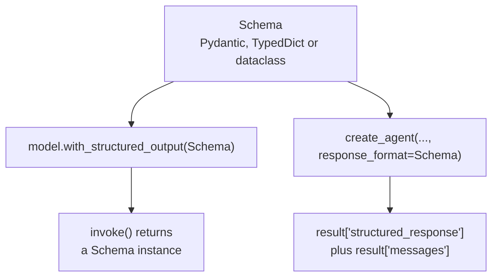

# M23.3 Theory: Models, messages and structured output in LangChain 1.x

*[M23 theory](../README.md) · Lesson 23.3 · Notebooks: [`03c_structured_output.ipynb`](../../notebook/03c_structured_output.ipynb), [`03a_model_integration.ipynb`](../../../optional/notebook/03a_model_integration.ipynb) (optional), [`03b_messages.ipynb`](../../../optional/notebook/03b_messages.ipynb) (optional) · [All theory pages](../../../../../theory/README.md)*

## Structured output

A Larkspur ticket queue needs fields it can validate, such as category and an optional refund amount. Prose alone is hard to route reliably. You will choose where to attach an output schema, inspect what it returns, and distinguish a missing value from a fabricated one.

### Step 1: Choose where the schema is applied

An agent's last message is prose. When the next consumer is code (a ticket queue, a database row, a judge's score), ask for a schema instead. A structured-output integration sends a machine-readable schema, using a provider-supported mechanism such as native structured output or tool calling. Confirm which mechanism your model supports and handle validation failures.

There are two places to attach a schema:



- **On a model.** `llm.with_structured_output(Movie)` returns a new runnable; `llm` itself is unchanged. Its `invoke()` returns a `Movie` instead of an `AIMessage`. The judge in lesson 23.1 is built this way, so its scores are fields rather than sentences.
- **On an agent.** `create_agent(model=llm, response_format=ContactInfo)` runs the agent as usual and adds `structured_response` to the result state, next to `messages`. It selects `ProviderStrategy` where the provider supports native structured output.

### Step 2: Compare returned values and validation

The three schema styles differ in what they check:

| Style | Returns | Validation | Optional field |
|---|---|---|---|
| Pydantic `BaseModel` | an instance | yes, raises on a wrong type | `budget: float \| None = Field(None, description=...)` |
| `TypedDict` | a plain `dict` | none | `Annotated[float \| None, None, "description"]` |
| `@dataclass` | an instance | none | |

Choose Pydantic when the data crosses a trust boundary: if a provider returns a nonnumeric string where you declared an `int`, Pydantic raises and `TypedDict` hands you the string. In the tested schema conversion, there are two `TypedDict` traps: `= Field(...)` inside a `TypedDict` is silently discarded, so the field stays required and its description never reaches the model. `NotRequired[...]` is rejected by LangChain's schema converter (`TypeError: NotRequired accepts only a single type`). Use the middle slot of `Annotated` for the default.

### Step 3: Inspect descriptions and missing values

Three details matter in production:

- **Descriptions are prompt text.** `Field(description="The movie's rating out of 10")` tells the model the scale. Without it the model guesses one.
- **Optional fields allow missing values.** A field the source may not contain (a budget, a refund amount on a question that has none) should be optional with a `None` default, so the schema does not require a number when the source has none. This permits abstention. It does not guarantee factual correctness.
- **`include_raw=True`** returns `{"raw", "parsed", "parsing_error"}`. You keep the `AIMessage` with its `usage_metadata` (119 input and 22 output tokens for the recorded four-field `Movie`), and a parse failure becomes a value you can branch on instead of an exception.

Test missing and invalid values locally. This Pydantic check needs no model and makes the optional-field behaviour observable.

```python
from pydantic import BaseModel, ValidationError

class Ticket(BaseModel):
    refund_amount: float | None = None

print(Ticket().model_dump())
try:
    Ticket(refund_amount="unknown")
except ValidationError as error:
    print(error.errors()[0]["type"])
```

**Expected output**

```text
{'refund_amount': None}
float_parsing
```

Pydantic permits the absent amount but rejects a nonnumeric string. Its default validation can coerce compatible values, such as a numeric string, unless strict types are requested.

### Step 4: Check capability and raw parsing results

Not every model supports structured output. `llm.profile` (LangChain 1.1) reports capabilities from the open `models.dev` data. For `gpt-4o-mini` it lists `structured_output: true`, `tool_calling: true` and `max_input_tokens: 128000`. Branch on it rather than guessing.

The underlying model and message APIs explain what travels through this boundary. `init_chat_model` builds a model for any provider behind one interface, with streaming and batching. Messages are the unit of context: `SystemMessage`, `HumanMessage`, `AIMessage` and `ToolMessage`, and the list you pass is all the model sees. An `AIMessage` that asks for a tool usually has `content=""` and carries the call in `.tool_calls`, so print both when you debug a run.

### Try it yourself

Compare a required `refund_amount: float` with `refund_amount: float | None = None` for a ticket that never mentions a refund. Check that `None` is allowed by the second schema. Then send a nonnumeric string and confirm that Pydantic raises a validation error. A permitted missing value and a supported factual value are different checks.

### Practice notebook

Use the implementation below to test the exercise and inspect each state update. Follow its provider setup for live model calls. Recorded model responses and timings can change on a new run.

- [Structured output](../../notebook/03c_structured_output.ipynb).
- [Model integration](../../../optional/notebook/03a_model_integration.ipynb) (optional).
- [Message types](../../../optional/notebook/03b_messages.ipynb) (optional).

## Key Takeaways

- Ask for a schema when code consumes the output. `with_structured_output()` makes a model return a schema instance, and `response_format=` adds `structured_response` to an agent's result next to `messages`.
- Use Pydantic when data crosses a trust boundary, because it validates types and `TypedDict` does not. Inside a `TypedDict`, `= Field(...)` is silently dropped.
- Field descriptions are prompt text, and optional fields with a `None` default allow missing values. `include_raw=True` keeps token usage and turns a parse failure into a value you can branch on.

## Check yourself

<details>
<summary>1. When should a structured-output schema be a Pydantic model rather than a TypedDict?</summary>

When the data crosses a trust boundary. Pydantic returns an instance and raises if the provider sends a nonnumeric string where you declared an `int`. A `TypedDict` returns a plain `dict` with no validation and hands you the string.

</details>

<details>
<summary>2. A ticket schema has a required refund amount, and the model writes a number even for questions that mention no refund. What schema change allows a missing amount?</summary>

Make the field optional with a `None` default, for example `refund_amount: float | None = Field(None, description=...)`. A required field forces the model to write a value, while an optional one lets it leave a missing fact empty.

</details>

<details>
<summary>3. You add a field description inside a TypedDict with an equals Field call, yet the field stays required and the model never sees the description. What happened?</summary>

`= Field(...)` inside a `TypedDict` is silently discarded. `NotRequired[...]` will not help either, because LangChain's schema converter rejects it. Put the default and description in `Annotated[float | None, None, "description"]`, or switch to Pydantic.

</details>

---
*Previous: [23.2 ReAct with LangChain `create_agent`](../02_react_with_langchain_create_agent/README.md). Next: [23.4 Middleware, including human-in-the-loop](../04_middleware_including_human_in_the_loop/README.md).*
