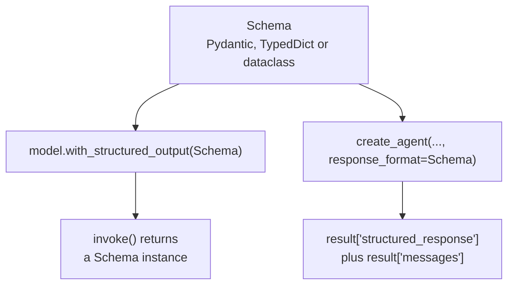
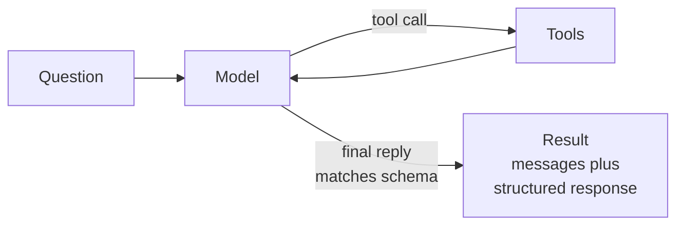

# M23.3 Theory: Models, messages and structured output in LangChain 1.x

*[M23 theory](../README.md) · Lesson 23.3 · Notebooks: [`03c_structured_output.ipynb`](../../notebook/03c_structured_output.ipynb), [`03a_model_integration.ipynb`](../../../optional/notebook/03a_model_integration.ipynb) (optional), [`03b_messages.ipynb`](../../../optional/notebook/03b_messages.ipynb) (optional) · [All theory pages](../../../../../THEORY.md)*
<!-- subtitle: What crosses the model boundary in each direction, and how to get fields a program can check instead of prose -->
<!-- format: approved -->

## Messages: what the model sees

> **What you'll learn**
>
> - **Explain** the four message types and why the message list is the model's whole context.
> - **Read** an agent's trace, including the AI message that looks empty.
> - **Choose** where to attach an output schema: on a model or on an agent.
> - **Diagnose** schema styles that drop a field's description or force the model to invent a value.

Lesson 23.2 handed the loop to a factory that takes message lists in and gives message lists out. This lesson looks at both sides of that boundary: the messages that go into a model, and the shape of what comes back.

Larkspur's ticket queue needs three fields from every support conversation: a category, a priority and a refund amount when there is one. The agent's last message is a paragraph. Getting the fields out of it with string matching breaks the first time the model adds a preamble, and a refund question with no amount invites the model to write one anyway.

### Four message types

A **message** is the unit of context: one turn's content plus the metadata that says who wrote it. The list you pass is everything the model sees, and an agent run is that list growing:

| Type | Written by | Carries |
|---|---|---|
| System message | You | The role and rules, sent first |
| Human message | The user | The question, with optional metadata such as a name and an id |
| AI message | The model | Text, tool calls, or both, plus token usage |
| Tool message | Your tool node | One tool's result, tied to the call by its id |

*Table 1: The message types and their jobs.*

The recorded weather agent shows a trace that looks broken when printed as text:

| # | Message | Content | Tool calls |
|---|---|---|---|
| 0 | Human | What is the weather like in New York? | |
| 1 | AI | *(empty)* | Weather lookup for New York |
| 2 | Tool | The weather in New York is sunny. | |
| 3 | AI | The weather in New York is sunny. | |

*Table 2: Four messages from one agent run. The empty AI message is the tool call.*

Message 1 is the **empty-looking tool call**: when the model only calls a tool, its text is empty and the payload sits in the tool calls. Some providers add a short preamble beside the call. An AI message can carry text, a call, both or neither. Print both fields when you debug a run.

Every AI message also reports its token usage, split into input and output because the two are billed at different rates. A short exchange in the recorded messages notebook used 47 input and 8 output tokens.

### One interface for every provider

LangChain's model initializer builds a chat model from a string such as a provider prefix and a model name. Switching from OpenAI to Gemini or Groq is a one-string change and everything downstream (invoke, stream, batch, tool binding) stays the same. Provider classes remain for settings only one provider has.

Streaming changes when the user sees text, not how much is generated. In one recorded run, the streamed answer showed its first words after 0.56 s and finished after 1.90 s; a separate non-streamed call returned its whole answer after 3.42 s. The two calls generated different text; only the first-word time is a fair comparison.

## Structured output

**Structured output** means asking the model for a reply that matches a schema instead of free text. The schema goes to the provider as a machine-readable description, and the provider constrains the reply to it through native structured output or a tool call, depending on what the model supports.

There are two places to attach a schema:

*Figure 1: The same schema on a model or on an agent.*

- **On a model.** Wrapping a model with a schema returns a new runnable whose result is an instance of the schema; the original model is unchanged. The judge in lesson 23.1 is built this way, and its scores arrive as fields.
- **On an agent.** Passing a schema as the agent's response format runs the loop as usual and adds a structured response next to the messages in the result. The recorded contact-extraction agent returned both keys, with the name, email and phone filled in.

The agent path differs from the model path in when the schema applies. Tools run first, and only the reply that ends the loop is shaped by the schema:

*Figure 2: A schema on an agent. The loop is unchanged; the schema shapes its last reply.*

The same question asked both ways shows the difference:

| Call | Returned | What the program gets |
|---|---|---|
| Plain model call: *Provide details about the movie Inception* | An AI message | A paragraph with a plot summary to parse |
| Same call with a four-field movie schema | A movie instance | Title Inception, year 2010, director Christopher Nolan, rating 8.8 |
| Same, keeping the raw message | Raw message, parsed instance, parsing error | The instance, no error, and token usage: 119 input, 22 output, 141 total |

*Table 3: One prompt, three return shapes, recorded runs.*

Keeping the raw message costs nothing and gives two things in production: the token counts for cost tracking, and a parse failure as a value to branch on instead of an exception that ends the request.

### Three schema styles

| Style | Returns | Validates types | Optional field with a description |
|---|---|---|---|
| Pydantic model | An instance | Yes, raises on a wrong type | A default of none plus a field description |
| Typed dictionary | A plain dict | No | The middle slot of an annotation holds the default |
| Dataclass | An instance | No | |

*Table 4: What each style checks.*

Choose Pydantic when the data crosses a trust boundary. If a provider returns text where you declared a number, Pydantic raises and a typed dictionary hands you the text.

### Planted failures in the schema

Each row was checked offline against the schema converter and validator installed in this repository:

| What was declared | What happened | Why |
|---|---|---|
| Pydantic refund amount, optional, given nothing | Accepted as none | The default allows a missing value |
| Pydantic refund amount, given the text "unknown" | Rejected with a float-parsing error | The value cannot be a number |
| Pydantic refund amount, given the text "42.5" | Accepted as 42.5 | Default validation coerces compatible values unless strict types are requested |
| Typed dictionary field with a Pydantic-style default and description | Schema lists the field as required, with no description | The assignment is silently discarded inside a typed dictionary |
| Typed dictionary field marked not-required | Type error from the schema converter | The converter rejects that marker |
| Typed dictionary field with the default in the annotation's middle slot | Optional, description present | The spelling the converter understands |

*Table 5: Six declarations and what the schema or validator did.*

The fourth row is the **silent default**: the code reads as optional and documented, and the model receives a required field with no description.

> **Pitfall: the forced number.** A ticket schema with a required refund amount makes the model write a number for every conversation, including those that mention no refund. Make the field optional with a default of none. Zero and "no refund" then stay distinct. An optional field permits abstention; it does not check that a number the model does write is true.

### Descriptions and capability

Field descriptions reach the model as part of the schema. They are prompt text: "the movie's rating out of 10" tells the model the scale it would otherwise guess. Before switching models, check that the new one supports structured output. LangChain 1.1 added a capability profile per model, sourced from the open models.dev data; for the course's default model it reports structured output and tool calling as supported and a 128,000-token input limit.

## In practice: Larkspur's ticket fields

The ticket fields go into the support agent in four steps.

Step through adding ticket fields to Larkspur's support agent.

<button type="button" data-step="0" aria-pressed="false" aria-controls="ticket-step-0">1. Declare</button><button type="button" data-step="1" aria-pressed="false" aria-controls="ticket-step-1">2. Attach</button><button type="button" data-step="2" aria-pressed="false" aria-controls="ticket-step-2">3. Keep the raw reply</button><button type="button" data-step="3" aria-pressed="false" aria-controls="ticket-step-3">4. Check the model</button>

<section id="ticket-step-0" class="step-panel" aria-labelledby="ticket-heading-0"><h4 id="ticket-heading-0">1. Declare</h4><dl><dt>Schema</dt><dd>a Pydantic ticket: category from a fixed list, priority, and a refund amount that is optional with a default of none</dd><dt>Descriptions</dt><dd>written as instructions, with units and allowed values</dd></dl></section><section id="ticket-step-1" class="step-panel" aria-labelledby="ticket-heading-1"><h4 id="ticket-heading-1">2. Attach</h4><dl><dt>Where</dt><dd>the support agent's response format</dd><dt>Effect</dt><dd>the loop still runs its tools first; the program reads the structured response</dd></dl></section><section id="ticket-step-2" class="step-panel" aria-labelledby="ticket-heading-2"><h4 id="ticket-heading-2">3. Keep the raw reply</h4><dl><dt>Where a model is called directly</dt><dd>keep the raw message alongside the parsed one</dd><dt>Effect</dt><dd>token usage is logged, and a parse failure is a value to branch on instead of an exception</dd></dl></section><section id="ticket-step-3" class="step-panel" aria-labelledby="ticket-heading-3"><h4 id="ticket-heading-3">4. Check the model</h4><dl><dt>Before a swap</dt><dd>read the new model's capability profile</dd><dt>Look for</dt><dd>structured output and tool calling marked as supported</dd></dl></section>

<button type="button" data-walk="previous">Previous</button>

<button type="button" data-walk="next">Next step</button>

## Limits of this evidence

- **One model.** The movie and contact runs used one small OpenAI model; another provider may use a different mechanism to enforce the schema.
- **Live answers.** The movie fields and the rating come from the model's own knowledge, recorded once; the planted failures in Table 5 are deterministic.
- **Timings from single runs.** The streaming numbers are one run each and depend on load.
- **Table 5 rechecked.** We reran all six declarations against the installed Pydantic and LangChain converter; the results match.

## References

- [LangChain: messages](https://docs.langchain.com/oss/python/langchain/messages): message types, content and token usage.
- [LangChain: structured output](https://docs.langchain.com/oss/python/langchain/structured-output): response formats on agents and models.
- [Pydantic: fields](https://pydantic.dev/docs/validation/latest/concepts/fields/): defaults, descriptions and validation.
- [models.dev](https://models.dev): the open model data behind capability profiles.

## Key Takeaways

- The message list is everything the model sees. An AI message that calls a tool usually has empty text, with the payload in its tool calls: debug with both fields.
- Ask for a schema when code consumes the output: on a model it returns a schema instance, on an agent it adds a structured response next to the messages. Keep the raw message for token usage and parse errors.
- Use Pydantic when data crosses a trust boundary, write field descriptions as instructions, and make fields optional when the source may not contain them. Inside a typed dictionary, a Pydantic-style default is silently dropped.

## Check yourself

1. When should a structured-output schema be a Pydantic model rather than a typed dictionary?

When the data crosses a trust boundary. Pydantic returns an instance and raises if the provider sends text where you declared a number. A typed dictionary returns a plain dict with no validation and hands you the text.

2. A ticket schema has a required refund amount, and the model writes a number even for conversations that mention no refund. What schema change allows a missing amount, and what does it not guarantee?

Make the field optional with a default of none, so the model can leave the amount empty and zero stays distinct from no refund. It permits abstention only: a number the model does write still needs checking against the source.

3. You give a typed dictionary field a Pydantic-style default and description, yet the field stays required and the model never sees the description. What happened, and what fixes it?

Inside a typed dictionary the assignment is silently discarded, so the converter sees a required field with no description. Marking it not-required fails too, because the converter rejects that marker. Put the default and description in the annotation's middle slot, or switch to a Pydantic model.

---
*Previous: [23.2 ReAct with LangChain `create_agent`](../02_react_with_langchain_create_agent/README.md). Next: [23.4 Middleware, including human-in-the-loop](../04_middleware_including_human_in_the_loop/README.md).*
