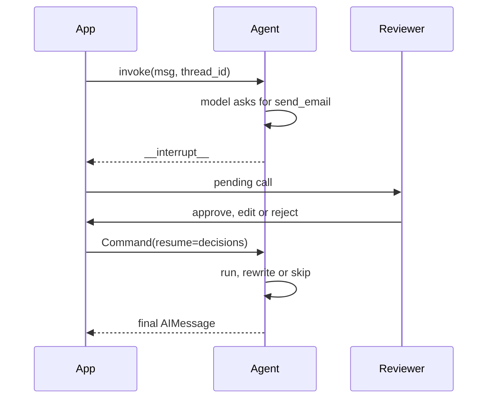

# M23.4 Theory: Middleware, including human-in-the-loop

*[M23 theory](../README.md) · Lesson 23.4 · Notebooks: [`04a_middleware.ipynb`](../../notebook/04a_middleware.ipynb) · [All theory pages](../../../../../THEORY.md)*
<!-- subtitle: Hooks around every model and tool call: compress history, redact, cap, and pause a write for a person -->

## Middleware

> **What you'll learn**
>
> - **Explain** where middleware hooks run in the agent loop, and how they show up in the compiled graph.
> - **Compare** message, token and context-fraction triggers for summarising history.
> - **Trace** an approval through approve, edit and reject, and what each leaves in the message list.
> - **Diagnose** the provider error that a new message on a paused thread causes.

Lesson 23.2 capped the loop with one middleware. This lesson opens the mechanism up and adds the guard every agent with a write tool needs: a person who can stop the call.

Larkspur's support agent may look up an account on its own, but sending the customer an email or issuing a refund must wait for a support engineer. The loop from lesson 23.2 has no place to wait. Rebuilding it as hand-wired graph nodes for every guard would mean rewriting the agent each time a rule is added.

**Middleware** attaches hooks at fixed points of the agent loop: before the model call, after it, and around a model or tool call. Teams use it for observability (logging, timing), transformation (rewriting the prompt, filtering tools), control flow (retries, early exit) and guardrails (call limits, redaction, human approval).

### Hooks are graph nodes

Each hook becomes a node of the compiled graph, named after the middleware and the hook. Listing the nodes of three recorded agents shows where each one sits:

| Middleware | Nodes it added |
|---|---|
| Summarisation | One node before the model call |
| Human approval | One node after the model call |
| Email redaction plus a call limit | Redaction before and after the model call; the limit before and after the model call |

*Table 1: Hook nodes added to the model and tools nodes, recorded graphs.*

The built-ins used in this lesson:

| Middleware | Hook | What it does |
|---|---|---|
| Summarisation | Before the model | Replaces old history with a summary written by a model you choose, keeping recent messages verbatim |
| Human approval | After the model | Pauses before a gated tool call runs and waits for a decision |
| PII redaction | Before and after the model | Replaces one kind of personal data, such as email addresses, in inputs and tool results |
| Model-call limit | Before and after the model | Counts model calls and ends the run at the cap (lesson 23.2) |

*Table 2: Four built-in middlewares.*

Middleware runs in the order you list it. A production stack of redaction, a call limit and a custom timing logger produced its hook nodes in exactly that order.

### Summarising history: three triggers

Summarisation needs a **trigger**, the point at which it fires, and a **keep** setting, how much recent history survives verbatim. Each can be counted in messages, tokens or a fraction of the model's context window. Three recorded runs, with thresholds set deliberately low so they fire within a few turns:

| Turn | Messages trigger (10, keep 4): messages | Tokens trigger (550, keep 200): tokens, messages | Fraction trigger: share of window, messages |
|---|---|---|---|
| 1 | 2 | about 140, 4 | 0.05%, 4 |
| 2 | 4 | about 281, 8 | 0.11%, 8 |
| 3 | 6 | about 422, 12 | 0.16%, 12 |
| 4 | 8 | about 446, 8 | 0.22%, 16 |
| 5 | 10 | about 376, 5 | 0.28%, 20 |
| 6 | 6 | about 465, 5 | 0.33%, 12 |

*Table 3: History size per turn under each trigger. Token figures are a display estimate of characters divided by four.*

- **A message count is predictable** but a poor proxy for pressure: ten short arithmetic turns and ten long tool results count the same.
- **Tokens track what actually runs out.** The token run's history collapsed twice as long hotel listings piled up. The table's estimate is rough, so it does not show the exact point where the middleware's own counter crossed 550.
- **A fraction keeps its meaning when the model changes.** Seven tenths of the window means the same on a 128,000-token model and on one with a million; a hard-coded token count does not. The demo's tiny fractions only make it fire in six turns.

A checkpointer keeps history across invocations, which is what gives summarisation a long history to work on and what lets an approval pause survive. Within one run, summarisation works on whatever history the run has.

### Planted failure: over-redaction

Email redaction ran on a user message and on a tool result. The recorded trail:

| Message | What the model saw |
|---|---|
| Human | I'm [REDACTED_EMAIL]. Look up account 1029 and tell me the balance and the email on file. |
| Tool | Account 1029: balance ₹42,500, status active, email [REDACTED_EMAIL] |
| AI | The balance for account 1029 is ₹42,500, and the email on file is [REDACTED_EMAIL]. |

*Table 4: Redaction before and after the model call.*

The model never saw either address, which is the point. But the user asked for the email on file and received a placeholder. We call this **over-redaction**: a redaction rule that covers a field the user is entitled to see. Decide per field whether the model needs it, and return entitled data to the user through code that bypasses the model.

### Writing your own

A custom middleware subclasses the agent middleware class and overrides the hook it needs. Two rules are easy to break, and both fail quietly or late:

- **Every hook takes the state and the runtime.** A hook defined without the runtime argument raises a type error when the agent runs, not when it is built.
- **A hook returns a state update; it never edits the state it was given.** To hand a value from before the model to after it, declare the key on a custom state schema and return it. The recorded timing logger did this and reported 1.15 s and 0.81 s for the two model calls of one run.

To end a run early, a hook declares that it may jump to the end and returns that jump with a final message, as the call-limit middleware does. The M23 lab's off-topic guard uses the same shape.

## Human approval

The approval middleware turns a consequential tool call into a decision. Gate writes, such as sending email or issuing a refund. Authorised reads can run freely, though a sensitive read may still need access control.

*Figure 1: An approval round trip. The thread is checkpointed at the interrupt and nothing runs until the app resumes it.*

The pause is a real suspension. The state is saved under the thread id, the agent returns an interrupt naming the pending calls, and the app resumes with one decision per gated call. The three decisions, from the recorded trails:

| Decision | Tool runs? | Tool message the model receives | Final answer |
|---|---|---|---|
| Approve | Yes, with the model's arguments | Email sent to john@test.com with subject Hello | Confirms the email was sent |
| Edit | Yes, with the reviewer's arguments | A note that a human reviewer replaced the call before it ran, that this was authorised, and not to re-issue the original | Reports the corrected recipient and subject |
| Reject | No | The user rejected the call, the tool was not executed, and it should not be retried unless the user asks | Says it cannot send the email |

*Table 5: Three decisions on the same send-email request.*

The edit case started from a request with a wrong address. The reviewer replaced the recipient, subject and body, and the model's answer reported the reviewer's values, because the tool message told it what had happened. Prefer edit to reject when the call is right in kind and wrong in detail.

### Planted failure: the orphaned tool call

When the middleware interrupts, the AI message carrying the tool call is already saved on the thread. If the app sends a new user message on that thread instead of resuming it, the history becomes:

| Index | Message | State |
|---|---|---|
| 0 | Human: send an email to … | |
| 1 | AI with a send-email tool call | Never answered |
| 2 | Human: the new message | Where a tool message was required |

*Table 6: The history after a new message on a paused thread.*

The provider rejects the next model call (OpenAI, error 400): an assistant message with tool calls must be followed by tool messages responding to each call id, and the error points at index 2. We call this the **orphaned tool call**. The only valid next step on a paused thread is a resume with decisions. If the user wants a separate conversation, start a new thread.

## In practice: Larkspur's support agent

1. Gate the email and refund tools with human approval; leave the account lookup ungated so approvals stay rare.
2. Show pending interrupts per thread in the support console and block new messages on that thread until a reviewer decides.
3. Trigger summarisation on a fraction of the context window, with a checkpointer for every conversation.
4. Redact payment details before the model, and decide per field what a customer may see in answers.
5. Keep the model-call limit from lesson 23.2, sized from the golden questions, on the same agent: it bounds whatever the other hooks let through.

## Limits of this evidence

- **Toy tools.** The email, hotel and account tools are stubs; the approval trails show the mechanism, not a review workload.
- **Rough token counts.** Table 3's tokens are characters divided by four, for display only.
- **One version.** Hook names and node names come from the installed LangChain 1.x; they have changed between releases.

## Key Takeaways

- Middleware hooks run before, after or around model and tool calls, appear as nodes in the compiled graph, and run in the order you list them. A custom hook takes the state and the runtime and returns a state update.
- Trigger summarisation on tokens or a fraction of the context window rather than a message count, and redact only what the model does not need, or the user loses data they are entitled to.
- Gate consequential writes with human approval and resume a paused thread with one decision per call. A new user message on that thread orphans the tool call, and the provider rejects the next request.

## Check yourself

1. Why should human approval gate tools that write, such as sending email, but not every tool that reads?

The middleware turns an irreversible call into a decision, which is what consequential writes need. Authorised reads can run without a pause, which keeps approvals rare; sensitive reads still need an access policy. The pause is a real suspension checkpointed under the thread id, so approval needs a checkpointer.

2. With summarisation triggered at 10 messages and keeping 4, history grows by two messages a turn. On which turn does it shrink, to how many messages, and why is a token trigger usually better?

On the sixth turn: history grew 2, 4, 6, 8 and 10 and dropped to 6 when the summary replaced the older turns. A message count treats a short arithmetic turn and a long tool result the same, while tokens or a fraction of the window track what actually runs out.

3. An agent paused on a send-email approval is invoked again with a new user message, and OpenAI returns error 400. Why, and what should the app do?

The AI message with the tool call was saved on the thread when the middleware interrupted, and the new message leaves that call without a matching tool message, which the provider rejects. Resume the paused thread with one decision per gated call, or start a new thread for a separate conversation.

---
*Previous: [23.3 Models, messages and structured output in LangChain 1.x](../03_models_messages_and_structured_output_in_langchain_1_x/README.md). Next: [23.5 Exercise: intelligent travel assistant agent (with solution)](../../../optional/theory/05_exercise_intelligent_travel_assistant_agent_with_solution/README.md).*
