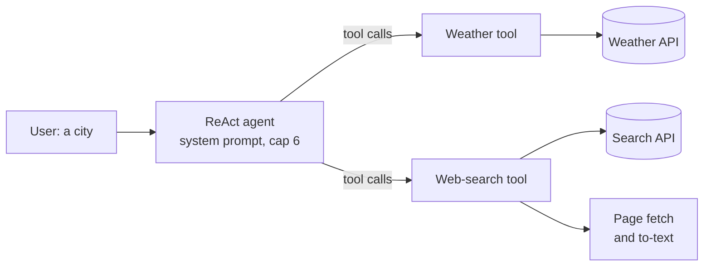

# M23.5 Theory: Exercise: intelligent travel assistant agent (with solution)

*[M23 theory](../../../mandatory/theory/README.md) · Lesson 23.5 · Notebooks: [`05a_intelligent_travel_assistant_agent.ipynb`](../../notebook/05a_intelligent_travel_assistant_agent.ipynb) (optional), [`05b_intelligent_travel_assistant_solution.ipynb`](../../notebook/05b_intelligent_travel_assistant_solution.ipynb) (optional) · [All theory pages](../../../../../THEORY.md)*
<!-- subtitle: A small project: a create_agent ReAct agent with two live tools that turns a city name into attractions and weather -->
<!-- format: approved -->

## The project: an intelligent travel assistant

> **What you'll build**
>
> - **A weather tool** over a public weather API that returns a short summary or a readable error.
> - **A web-search tool** that finds pages about a destination and returns the start of each page's text.
> - **A ReAct agent** built with the agent factory, a use-case system prompt and a model-call cap.
> - **A check of tool selection** before the agent exists, to see whether the tool descriptions lead the model to both tools.

The user types one word, a city such as *Kolkata*, and gets back the top attractions as bullet points plus a line on the current weather. The exercise notebook sets four tasks with a check after each; the solution works them.

The project adds no new pattern: lesson 23.2's agent factory and call cap, on two tools that reach the live web. What changes is that tools now fail in ordinary ways (an unknown city, a slow page, a site that refuses to be read) and return far more text than a stub.

## Architecture

*Figure 1: The travel assistant. The agent chooses the tools; each tool talks to one outside service.*

| Piece | What it does | Built on |
|---|---|---|
| **Weather tool** | Calls the weather API in metric units and returns temperature, condition, humidity and wind, or the API's own reason for failing | The tool contract of lesson 22.3 |
| **Web-search tool** | Finds three pages, fetches them in parallel (a 10-second request timeout, then at most 15 seconds' wait for each result), converts each to text and keeps the first 1,500 characters | Lesson 22.3's tool contract; lesson 22.5's errors returned as text |
| **System prompt** | States the use case: for any destination, search for attractions, get the weather, answer as bullets plus a weather summary | Lesson 23.2's factory |
| **The agent** | The factory's ReAct loop with a model-call cap of 6 that ends the run quietly | Lessons 23.1 and 23.2 |

*Table 1: The four pieces.*

The exercise brief names the LangChain 0.x agent executor; the notebooks use the 1.x factory (lesson 23.2's migration table).

## Following a one-word request

Ask *Kolkata*. Nothing in the word says what to fetch; the system prompt supplies that. The solution expects the run to take this shape:

Step through the call order the solution expects for <em>Kolkata</em>.

<button type="button" data-step="0" aria-pressed="false" aria-controls="kolkata-step-0">1. Both tools</button><button type="button" data-step="1" aria-pressed="false" aria-controls="kolkata-step-1">2. Answer</button><button type="button" data-step="2" aria-pressed="false" aria-controls="kolkata-step-2">3. Thin result</button>

<section id="kolkata-step-0" class="step-panel" aria-labelledby="kolkata-heading-0"><h4 id="kolkata-heading-0">1. Both tools</h4><dl><dt>Model call 1</dt><dd>requests the weather and the web search in one turn, since neither needs the other</dd><dt>What comes back</dt><dd>two tool messages: the weather summary, and three page texts or short error strings</dd></dl></section><section id="kolkata-step-1" class="step-panel" aria-labelledby="kolkata-heading-1"><h4 id="kolkata-heading-1">2. Answer</h4><dl><dt>Model call 2</dt><dd>reads both observations</dd><dt>Reply</dt><dd>attraction bullets, then the weather</dd></dl></section><section id="kolkata-step-2" class="step-panel" aria-labelledby="kolkata-heading-2"><h4 id="kolkata-heading-2">3. Thin result</h4><dl><dt>Model call 3 and on</dt><dd>only when a result is thin: it searches again with other words</dd><dt>Bound</dt><dd>the call cap of 6 ends the run quietly</dd></dl></section>

<button type="button" data-walk="previous">Previous</button>

<button type="button" data-walk="next">Next step</button>

Results change by the hour, and the notebooks print no fixed answer; the solution prints the tools called and the model-call count, which is what a check can rely on. Before building the agent it binds both tools and asks *Show me local attractions in Bangalore and the weather in Bangalore*: the model should return two tool calls. If it returns one, fix the descriptions, not the agent.

## Design choices worth copying

| Choice | Why |
|---|---|
| **Fail soft in every tool** | An exception ends the run; an error string such as "Timeout extracting from" a page lets the agent answer from the pages that did load |
| **Cut each page to 1,500 characters** | Three full pages can fill the context window, and attractions usually sit near the top of a travel page (lesson 22.1's context creep) |
| **Fetch pages in parallel and stop waiting** | One slow site would otherwise stall the whole answer; stragglers are abandoned after 15 seconds |
| **Cap model calls at 6** | Bounds cost if the agent keeps searching on a thin result (lesson 23.2's runaway loop) |
| **No Thought and Action format in the prompt** | Native tool calls need none, and the format would leak into the answer (lesson 23.1) |

*Table 2: Five choices and what each protects against.*

The first row has lesson 22.5's cost: an error returned as text reaches the model as a normal result. Monitoring that counts errors never sees it.

## Limits

- **No expected answer.** Live search and weather mean a test can check behaviour (both tools called, then an answer) but not the text.
- **Single turn.** No checkpointer: a follow-up starts from nothing; the exercise's bonus tasks add memory, more tools, several cities and streaming.
- **Blind truncation.** The first 1,500 characters can be a cookie banner rather than attractions.

The notebooks need an OpenAI key, a Tavily key for search and an OpenWeatherMap key for weather.

## References

- [LangChain: agents](https://docs.langchain.com/oss/python/langchain/agents): the factory the solution uses.
- [OpenWeather: current weather API](https://openweathermap.org/api/current): the weather tool's data source.
- [Tavily documentation](https://docs.tavily.com): the search API behind the web-search tool.

## Key Takeaways

- A use-case system prompt, two well-described tools and the agent factory with a call cap are the whole agent; the work is in making the tools behave on the live web.
- Tools over live sources must fail soft, cap what they return and stop waiting for slow pages, or one call can end the run or flood the context.
- Check tool selection with one bound call before building the loop, and test the agent on its call order, since the answer text changes every run.

## Check yourself

1. The user types only Kolkata. Why does the agent call both tools, and why usually in a single model turn?

The system prompt says that any destination needs attractions and the current weather, so the model knows what the word asks for. Neither tool needs the other's result, so the model can request both in one reply and the tool node runs them before the model's second call.

2. Three pages come back from a search: one loads, one times out after 15 seconds and one blocks the request. What does the agent receive, and why is that better than an exception?

It receives the first 1,500 characters of the page that loaded and two short error strings for the others. An exception would end the run; error strings let the model answer from the page it has. The cost is that monitoring which counts exceptions never sees those failures.

3. In the tool-selection check, the model asks only for the web search when the question names attractions and weather. Where do you look first?

At the weather tool's description, because the model chooses tools from their names and descriptions. A description that does not say to use it whenever a destination, the weather or the temperature comes up leaves the model guessing. Fix it and repeat the one bound call before building the agent.

---
*Previous: [23.4 Middleware, including human-in-the-loop](../../../mandatory/theory/04_middleware_including_human_in_the_loop/README.md). Next: [M23 interview questions](../../../mandatory/theory/README.md#interview-spotlight-5-questions-you-might-get-asked).*
