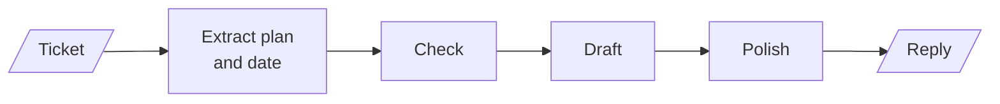
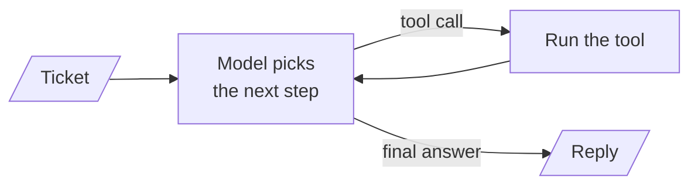
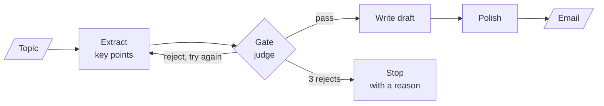

# M24.1 Theory: Prompt chaining with quality gates

*[M24 theory](../README.md) · Lesson 24.1 · Notebooks: [`01a_prompt_chaining_langgraph.ipynb`](../../notebook/01a_prompt_chaining_langgraph.ipynb), [`01b_prompt_chaining_structured_output.ipynb`](../../../optional/notebook/01b_prompt_chaining_structured_output.ipynb) (optional), [`01c_prompt_chaining_lcel.ipynb`](../../../optional/notebook/01c_prompt_chaining_lcel.ipynb) (optional) · [All theory pages](../../../../../THEORY.md)*
<!-- subtitle: Who picks the next step, and the cheap check that stops a chain before it writes from nothing -->
<!-- format: approved -->

## Workflow vs agent

> **What you'll learn**
>
> - **Explain** the difference between a workflow and an agent by who chooses the next step.
> - **Map** each of the five M24 patterns to the one decision it hands the model.
> - **Trace** a gated chain through its pass path and its retry-limit path, call by call.
> - **Diagnose** why a gate leaks, loops or lets an unusable result through.

M23 ended with an agent that picks its own tools. This module goes the other way: five patterns where your code draws the path and the model fills in one kind of decision.

A Larkspur customer writes *I want my money back for last month*. A useful reply needs the plan and the purchase date before it can apply the refund-window policy. A chain that drafts straight away turns those missing inputs into a polished guess. This lesson builds the guard against that, and first separates two kinds of system.

### Who picks the next step

The distinction comes from Anthropic's *Building Effective Agents* (December 2024). In a **workflow**, LLM calls and tools run along code paths you defined in advance. In an **agent**, the model directs its own process: it picks the next tool, reads the result and decides when to stop. The ReAct agent of M23 is an agent. All five M24 patterns are workflows.

In a workflow the refund reply's path exists before the ticket arrives. Every arrow below is an edge in your code:

*Figure 1: A workflow. The model writes inside each box; your code drew every arrow.*

An agent has one loop instead. The model reads the history, chooses a tool or a final answer, and the loop runs until it stops:

*Figure 2: An agent. The number of trips round the loop is the model's choice, bounded only by a step limit.*

The two differ in what you can know before a request runs:

| | Workflow (M24) | Agent (M23) |
|---|---|---|
| Who picks the next step | Your edges; the model at most chooses among edges you wrote | The model, on every turn |
| LLM calls per request | Known, or bounded by a cap in your code | Known only when it stops; bounded by a step limit |
| Testing | Each node and each router, like a function | Whole trajectories, end to end |
| A failed run | Ends at a node you named, with a reason | Shows in the trajectory: a repeated tool call, an early stop |
| Fits | Tasks you can draw before they run | Tasks whose steps depend on what the model finds |

*Table 1: Workflow and agent, side by side.*

A Larkspur refund reply has a shape you can draw: pull out the plan and the date, check them, draft, polish. Investigating why one customer's servers keep rebooting has no such shape, and that is where an agent earns its extra calls.

### One decision per pattern

Each workflow pattern hands the model exactly one kind of decision and keeps the rest in code:

| Pattern | Code fixes | The model decides |
|---|---|---|
| Prompt chaining (24.1) | the order of the steps | each step's content, and a gate's verdict |
| Routing (24.2) | the set of handlers | which single handler runs |
| Parallelization (24.3) | the branches and the merge | each branch's content, each vote |
| Orchestrator-worker (24.4) | the worker's job and the merge | how many workers run, and what each one gets |
| Evaluator-optimizer (24.5) | the criteria and the iteration cap | the grade, and so whether to go round again |

*Table 2: The five patterns by who decides what.*

The gated chain in this lesson shows how little the model controls. Its compiled graph has five nodes and eight edges, and only three edges are conditional:

| From | To | Kind |
|---|---|---|
| start | extract_points | fixed |
| extract_points | check_points | fixed |
| check_points | write_draft | conditional (pass) |
| check_points | extract_points | conditional (reject, try again) |
| check_points | fail_validation | conditional (retries used up) |
| write_draft | polish_final | fixed |
| polish_final | end | fixed |
| fail_validation | end | fixed |

*Table 3: The recorded edge list of the gated chain. All three conditional edges leave the gate.*

Everything the model decides happens inside a node. Where the run goes next is decided by code you can read, which is what the next section relies on.

## Quality gates

**Prompt chaining** splits one task into a fixed sequence of focused calls, each reading the previous step's output. The lesson's chain turns a topic into an email in three steps: extract the key points, draft, polish. A **quality gate** sits between two steps and decides whether the intermediate result may go on.

### Where the gate sits

The gate checks the cheapest artefact that can already be wrong. Failing after extraction costs one check. Failing at the end costs a draft and a polish written from nothing:

<!-- animated: diagrams/gated-chain.anim.html -->

*Figure 3: The gated chain. The gate can pass the key points on, send extraction round again, or stop the run with a reason.*

We call the failure this prevents **writing from nothing**: later steps spend calls polishing a result whose input was never usable.

### The three parts of a gate

A gate is three separate pieces, and keeping them apart is what makes each one testable:

| Part | In the reference chain | Why it is built this way |
|---|---|---|
| **The check** | A `gpt-4o-mini` judge at temperature 0 returns a structured verdict: `actionable` (yes or no) and a one-sentence reason | A keyword rule leaks; a structured verdict cannot come back as free text |
| **The router** | A pure function reads the stored verdict and the attempt count and returns `write_draft`, `regenerate` or `fail` | No LLM call, so it is tested like any function |
| **The bound** | Each extraction adds 1 to a counter; at `MAX_VALIDATION_RETRIES = 3` the router takes the fail edge; a recursion limit of 12 steps backs it up | A rejecting judge cannot keep the chain running |

*Table 4: Check, router and bound.*

The counter uses a **reducer**, a rule for combining a node's update with the value already in state. Here the rule is addition: each extraction returns 1, and the 1s add up to an attempt count.

### Two recorded runs

The two recorded runs take the two exits of Figure 3:

| Topic | Attempts | Gate verdicts | Ended at | LLM calls |
|---|---|---|---|---|
| *Request for project deadline extension due to technical challenges* | 1 | pass: the points outline a request, its reason and a new timeline | the polished email | 4 (extract, judge, draft, polish) |
| *The meaning of life and happiness* | 3 | reject three times: informative points with no request, decision or next step | `fail_validation`, with a reason | 6 (three extracts, three judges) |

*Table 5: Both exit paths, from the notebook's recorded output.*

The second run spent three judge calls to avoid writing and polishing an email with no purpose. It also ended with a message a caller can show or log, which a crash or an empty email would not give.

Replaying the graph with stub nodes in place of the model gives the same node order and call counts as the recorded runs. Choose an exit to follow it node by node:

Follow each recorded topic through the gated chain, one node at a time.

<button type="button" data-mode="pass" aria-pressed="false" aria-controls="gate-exit-pass">Pass on attempt 1</button>
<button type="button" data-mode="limit" aria-pressed="false" aria-controls="gate-exit-limit">Retry limit reached</button>

<section id="gate-exit-pass" class="mode-panel" data-announcement="Pass path selected. Four LLM calls, then the email."><h4>Deadline extension: the pass path</h4><dl><dt>Node order</dt><dd>extract_points, check_points, write_draft, polish_final</dd><dt>State at the end</dt><dd>attempt count 1, gate verdict true, a polished email</dd><dt>LLM calls</dt><dd>4: one each for extraction, the judge, the draft and the polish</dd></dl></section>
<section id="gate-exit-limit" class="mode-panel" data-announcement="Retry limit selected. Six LLM calls and no email."><h4>The meaning of life: the retry-limit path</h4><dl><dt>Node order</dt><dd>extract_points and check_points three times, then fail_validation</dd><dt>State at the end</dt><dd>attempt count 3, gate verdict false, the stop message in place of an email</dd><dt>LLM calls</dt><dd>6: three extractions and three judge calls; the terminal node calls no model</dd></dl></section>

### Planted failures

Each piece of the gate exists because something specific goes wrong without it:

| Planted failure | What happens | The guard |
|---|---|---|
| A keyword gate ("mentions *request*, *deadline*, *support*") | Philosophical key points mention "support" and "progress", and vague topics pass | An LLM judge with a yes-or-no verdict and a reason |
| Extractor at temperature 0 | A regenerated attempt can repeat the rejected key points, and all three tries fail the same way | Extract at 0.7, judge at 0 |
| A bug in the router that never returns `fail` | The reject edge loops forever | The recursion limit of 12 steps stops the run |
| Typed output with useless content | Every field is present and the email still has no purpose | A schema checks shape; the gate still checks content |

*Table 6: One planted case per guard.*

> **Pitfall: the repeating regenerator.** A retry only helps when the next attempt can differ. At temperature 0 the extractor may return the same points, and lower temperature does not guarantee identical output either. Check that retries actually change the result, and that the judge grades the same text consistently.

### Gates in other frameworks

The same gate appears in the two alternative builds of this lesson:

- **LCEL** (LangChain Expression Language, which composes runnable steps with `|`): the gate is a step that passes the payload through or raises a rejection error. A retry wrapper re-runs extraction and gate together, playing the reject edge, and a fallback plays `fail_validation`.
- **Structured output at every hop**: each step returns a validated object. Shape errors are caught without an extra judge call, and shape is all it checks.

## In practice: the Larkspur refund ticket

The refund reply follows the same chain:

1. Extract the plan, the purchase date and the request from the ticket.
2. Gate: check that the ticket names a plan and a purchase date. Without them the refund-window chunk cannot be applied.
3. On pass, draft from the refund policy and polish.
4. On the third reject, end at a terminal node whose reason asks the customer for the missing date.

*I want my money back for last month* fails the gate before any drafting, and the customer is asked one precise question. In lesson 24.2 the same ticket meets a different decision: which queue, and which model, should handle it.

## Limits of this evidence

- **Two runs.** Table 5 comes from one recorded `gpt-4o-mini` run per topic; the notebook ships without outputs. A new run can extract different points, and the judge can word its reasons differently. Our stub replay confirms the node order and call counts, not the verdicts.
- **One judge.** The gate's verdicts were not compared against human labels. Its false-pass rate is unmeasured.
- **Left out:** a gate per step. Add one after drafting when the draft itself can fail a check you can state, such as a missing policy citation.

## References

1. Anthropic, [Building effective agents](https://www.anthropic.com/research/building-effective-agents), December 2024.
2. LangChain, [LangGraph Graph API: conditional edges and state reducers](https://docs.langchain.com/oss/python/langgraph/graph-api).
3. LangChain, [Structured output](https://docs.langchain.com/oss/python/langchain/structured-output).
4. LangChain, [Runnable reference: with_retry and with_fallbacks](https://reference.langchain.com/python/langchain-core/runnables).

## Key Takeaways

- In a workflow your code fixes the path and the model makes one kind of decision; in an agent the model picks every step. Use a workflow for any task you can draw before it runs.
- Put the gate after the cheapest step that can already be wrong. Check with an LLM judge that returns a structured verdict, and route in a pure function you can test without a model.
- Bound retries with a counter and a terminal node that records why the chain stopped. A schema checks shape, never usefulness, so typed output still needs a gate.

## Check yourself

1. Why does the quality gate sit right after extraction instead of checking the finished email?

Failing after extraction costs one check, while failing at the end costs a draft and a polish written from nothing. The gate stops unusable key points before later steps spend calls on them, and the chain ends with a reason a caller can show or log.

2. The topic about the meaning of life is rejected three times. How many LLM calls does the run make, and where does it end?

Six: three extractions and three judge calls. At the third rejection the router takes the fail edge to `fail_validation`, which records why the chain stopped. No draft or polish call runs.

3. You set the extractor to temperature 0, and the gate rejects the same key points three times in a row. Why did regenerating not help?

At temperature 0 the extractor may repeat the points it already produced, so each retry fails the same way. The reference chain extracts at 0.7 so a new attempt can differ, and judges at 0 so the verdict stays as consistent as possible. Neither setting guarantees identical or different output, so check that retries really change the result.

---
*Previous: [M24 overview](../README.md). Next: [24.2 Routing by handler and by model tier](../02_routing_by_handler_and_by_model_tier/README.md).*
