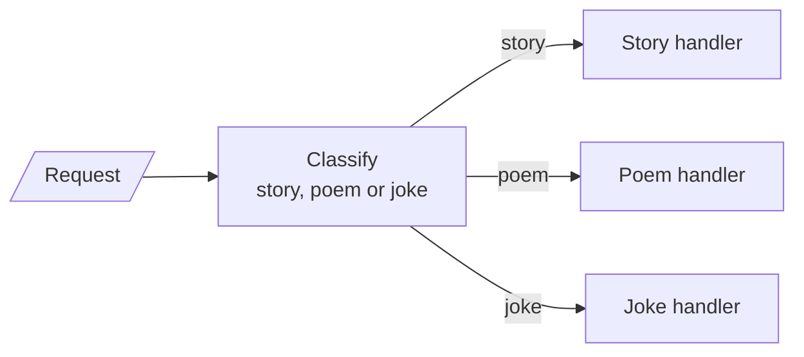
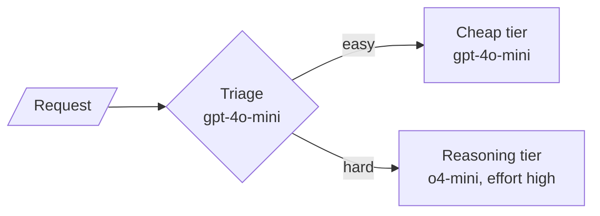
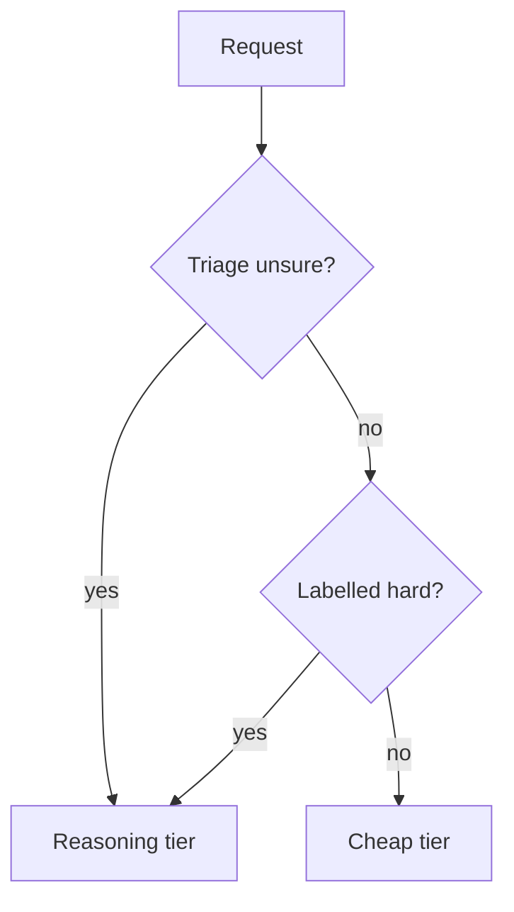

# M24.2 Theory: Routing by handler and by model tier

*[M24 theory](../README.md) · Lesson 24.2 · Notebooks: [`02a_routing_langgraph.ipynb`](../../notebook/02a_routing_langgraph.ipynb), [`02b_routing_by_model_tier.ipynb`](../../notebook/02b_routing_by_model_tier.ipynb), [`02c_routing_lcel_runnable_branch.ipynb`](../../../optional/notebook/02c_routing_lcel_runnable_branch.ipynb) (optional) · [All theory pages](../../../../../THEORY.md)*
<!-- subtitle: One label from a closed set picks the handler, and a cheap triage call decides who pays for reasoning -->
<!-- format: approved -->

## Routing by handler

> **What you'll learn**
>
> - **Explain** why a router asks the model for one label from a closed set and dispatches in plain code.
> - **Compare** all-cheap, all-reasoning and routed strategies on accuracy and reasoning calls.
> - **Diagnose** a router from its confusion matrix, and say which of its two errors costs more.
> - **Choose** the direction a router should err, and when a cheap-first fallback is safe.

Lesson 24.1 sent every request down one chain. Larkspur's tickets are not all the same kind: *I want my money back* belongs in billing, *my server will not boot* in technical support. **Routing** classifies the input once and sends it down exactly one specialist path.

This lesson routes on two axes. The first picks a handler. The second, in the next section, picks a model.

### One label from a closed set

The content router in this lesson has the same two-part shape as the 24.1 gate: a model makes a small, constrained decision, and a pure function acts on it.

- **A constrained classifier.** The model returns structured output whose only field is a content type limited to *story*, *poem* or *joke*. It cannot answer with a label the graph has no edge for.
- **A pure condition function.** A dictionary maps the stored label to a node name, with *story* as the default. Even an unexpected label lands on a real node.

*Figure 1: Routing by handler. The model writes one label; a lookup in code picks the single handler that runs.*

Each request then costs exactly two LLM calls, one to classify and one in the chosen handler, however many handlers exist. A fourth category is one more allowed label, one node and one edge.

### The recorded routes

The recorded test uses phrasing that implies a category without naming it:

| Request | Routed to | Expected |
|---|---|---|
| *Tell me something funny about artificial intelligence* | joke | joke |
| *I want to hear a tale about a brave knight* | story | story |
| *Create something poetic about the ocean* | poem | poem |

*Table 1: Three requests, three correct routes, two LLM calls each.*

The LCEL version dispatches with a branch runnable that runs exactly one specialist chain and must have a default. Its test calls the classifier a second time to print the label: that demo spends three calls per request, where the router alone needs two.

### Planted failures

Both halves of the router have one guard each:

| Planted input | Without the guard | With the guard |
|---|---|---|
| The model answers in free text: "I think they want a poem" | No edge matches the string, so dispatch fails | The closed set makes this answer impossible to return |
| A label slips through that the map does not know | Lookup fails mid-request | The default sends it to the story handler |

*Table 2: The constrained label and the default route.*

For Larkspur the closed set is the ticket queue: billing, technical, sales. The test that matters is the routing decision itself, measured on labelled tickets, because a fluent answer from the wrong queue still reads well.

## Routing by model tier

The second router picks a **model**, not a handler. A cheap model triages each request as *easy* or *hard*. Easy work stays on the cheap model; hard work goes to a reasoning model. Reasoning prices are paid only on the traffic that needs them:

*Figure 2: Routing by model tier. The triage call is the only extra cost on every request.*

Both answering nodes send the same prompt: any difference in the answers belongs to the model. Two details matter on the first real call: o-series reasoning models accept only the default temperature, so the reasoning tier runs at 1, and the reasoning-effort setting only means something to a reasoning model.

### The workload and the three strategies

A router means nothing without "cheaper than what". The recorded comparison runs seven requests, mixed the way real traffic is, mostly easy:

| Kind | Requests |
|---|---|
| Easy (4) | extract an order id from a shipping note; name the capital of Portugal; convert 2:45 pm to 24-hour time; reply with the word *ok* |
| Hard (3) | a deploy-schedule puzzle with ordering constraints; which key an LRU cache evicts; the total wait under exponential backoff |

*Table 3: The labelled workload. Each request carries its true difficulty and an expected answer.*

Each strategy answers all seven, and an answer counts as correct when the expected value appears as a whole word in it:

| Strategy | Correct | Answering time, total | Reasoning calls |
|---|---|---|---|
| All cheap | 71% (5 of 7) | 5.2 s | 0 of 7 |
| **Routed** | **86% (6 of 7)** | **13.4 s** | **1 of 7** |
| All reasoning | 100% (7 of 7) | 20.1 s | 7 of 7 |

*Table 4: The recorded payoff table.*

Read the table for its shape. Routed accuracy should sit near all-reasoning while its reasoning-call count sits near all-cheap. The time column counts answering calls only; the routed strategy also pays one triage call per request, seven in all.

> **Pitfall: the nervous router.** A router that sends everything to *hard* is worse than no router. It pays the full reasoning bill and adds a triage call on top of every request.

### The router's confusion matrix

The router predicts difficulty from the question text. It never observes it. It makes mistakes, and they show up in a **confusion matrix**, a table of predicted against true labels:

| | Sent to reasoning | Sent to cheap |
|---|---|---|
| Truly hard | 1 (the deploy puzzle) | **2** (LRU: wrong answer; backoff: right) |
| Truly easy | 0 | 4 |

*Table 5: Routing decisions against ground truth.*

The two kinds of mistake cost different things:

- **Easy sent to reasoning**: overspend. Bounded, and visible on the bill.
- **Hard sent to cheap**: a confident wrong answer. Invisible until someone acts on it.

We call the second one the **silent downgrade**. In this run it happened twice and cost one wrong answer. Because it costs more than overspend, bias the triage prompt toward *hard* on borderline cases and accept some overspend as insurance.

### Which way to fall back

The same asymmetry decides the fallback direction. "Answer on the cheap model, detect a bad answer, retry on reasoning" only works with a reliable wrong-answer detector, and that detector can miss exactly the confident errors a silent downgrade produces:

*Figure 3: Escalate on uncertainty before answering, not after a bad answer.*

A measured detector can support a cheap-first fallback. Without one, escalate before answering.

## In practice: the 45-day refund question

On Larkspur, *Can I get a refund after 45 days?* is the case to watch. The handbook makes monthly plans non-refundable and prorates annual refunds after day 30: the unused whole months come back, minus a 15% early-termination fee.

Step through both routers on the 45-day refund question (illustrative trace on the handbook's rule).

<button type="button" data-step="0" aria-pressed="false" aria-controls="refund-step-0">1. Pick a queue</button><button type="button" data-step="1" aria-pressed="false" aria-controls="refund-step-1">2. Triage</button><button type="button" data-step="2" aria-pressed="false" aria-controls="refund-step-2">3. Answer</button><button type="button" data-step="3" aria-pressed="false" aria-controls="refund-step-3">4. Measure</button>

<section id="refund-step-0" class="step-panel" aria-labelledby="refund-heading-0"><h4 id="refund-heading-0">1. Pick a queue</h4><dl><dt>Router</dt><dd>the handler router, labels billing, technical or sales</dd><dt>Decision</dt><dd>billing, which is correct</dd></dl></section><section id="refund-step-1" class="step-panel" aria-labelledby="refund-heading-1"><h4 id="refund-heading-1">2. Triage</h4><dl><dt>Router</dt><dd>the tier router, labels easy or hard from the question text alone</dd><dt>Risk</dt><dd>the question reads like a lookup and may be labelled easy</dd></dl></section><section id="refund-step-2" class="step-panel" aria-labelledby="refund-heading-2"><h4 id="refund-heading-2">3. Answer</h4><dl><dt>What the answer needs</dt><dd>the plan type, then for an annual plan the unused whole months (10 of 12 at day 45) minus the 15% fee</dd><dt>Silent downgrade</dt><dd>on the cheap tier, a confident wrong amount, with nothing in the reply that looks broken</dd></dl></section><section id="refund-step-3" class="step-panel" aria-labelledby="refund-heading-3"><h4 id="refund-heading-3">4. Measure</h4><dl><dt>Guard</dt><dd>add questions like this one, labelled hard, to the set the router is scored on</dd><dt>Check</dt><dd>re-read the confusion matrix after every triage-prompt change</dd></dl></section>

<button type="button" data-walk="previous">Previous</button>

<button type="button" data-walk="next">Next step</button>

Lesson 24.3 keeps all the work but runs it at once: several branches in parallel, merged into one answer.

## Limits of this evidence

- **Seven questions.** One question moves accuracy by 14 points. Table 4 shows a shape, not a ranking of models.
- **Token-match grading.** An answer that states the right value in other words counts as wrong.
- **One run.** Times and triage labels come from a single recorded run; the notebook ships without outputs, and a rerun can route differently. We re-solved the seven expected answers by hand (search, B, 14 and the four easy values), and they hold.

## References

1. Anthropic, [Building effective agents](https://www.anthropic.com/research/building-effective-agents), December 2024: the routing pattern.
2. LangChain, [LangGraph Graph API: conditional edges](https://docs.langchain.com/oss/python/langgraph/graph-api).
3. LangChain, [Structured output](https://docs.langchain.com/oss/python/langchain/structured-output).
4. OpenAI, [Reasoning models](https://developers.openai.com/api/docs/guides/reasoning).

## Key Takeaways

- A router asks the model for one label from a closed set and dispatches in plain code, with a default route. Each request costs two calls however many handlers exist.
- Routing by model tier pays reasoning prices only on hard traffic: in the recorded run, 86% correct with 1 of 7 reasoning calls, against 71% all cheap and 100% all reasoning.
- The silent downgrade, hard work sent to the cheap tier, costs more than overspend. Lean triage toward hard on borderline cases and escalate before answering, not after.

## Check yourself

1. Why does the content router classify into a fixed set of labels instead of free text?

With the label limited to story, poem or joke, the model cannot return a value the graph has no edge for, which a free-text answer like "I think they want a poem" could. A pure function then maps the label to a node, with a default so even an unexpected label lands somewhere.

2. A Larkspur customer asks whether they can get a refund after 45 days. Why is this a risky question for the model-tier router?

It looks like a lookup but needs proration arithmetic, so triage may label it easy and send it to the cheap tier. That is a silent downgrade: the cheap model can return a confident wrong answer. Put questions like it in the labelled set the router is measured on.

3. A teammate proposes answering on the cheap model first and retrying on the reasoning model when the answer is bad. Why is this risky?

It needs a reliable wrong-answer detector, and the detector can miss the confident errors a cheap model makes on hard questions. A measured detector may support the fallback, but without one, escalate on uncertainty before answering and bias triage toward hard on borderline cases.

---
*Previous: [24.1 Prompt chaining with quality gates](../01_prompt_chaining_with_quality_gates/README.md). Next: [24.3 Parallelization: sectioning and voting](../03_parallelization_sectioning_and_voting/README.md).*
