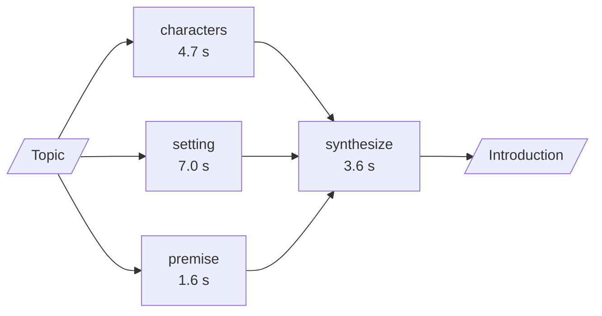

# M24.3 Theory: Parallelization: sectioning and voting

*[M24 theory](../README.md) · Lesson 24.3 · Notebooks: [`03a_parallelization_langgraph.ipynb`](../../notebook/03a_parallelization_langgraph.ipynb), [`03b_parallelization_sectioning_and_voting.ipynb`](../../notebook/03b_parallelization_sectioning_and_voting.ipynb), [`03c_parallelization_lcel.ipynb`](../../../optional/notebook/03c_parallelization_lcel.ipynb) (optional) · [All theory pages](../../../../../THEORY.md)*
<!-- subtitle: Run independent branches at once, merge them safely, and know what the slowest branch and a rate limit cost you -->

## Fan-out / fan-in

> **What you'll learn**
>
> - **Explain** how a graph starts branches together, waits for all of them and merges their writes.
> - **Calculate** a fan-out's wall time from its branch durations, with and without a concurrency cap.
> - **Diagnose** a lost or rejected write when two branches update the same state key.
> - **Choose** between sectioning and voting, and set a vote threshold knowingly.

Chaining runs steps one after another, and routing runs one of several. **Parallelization** runs all of a fixed set of branches at once and merges what they return.

A Larkspur reply about an outage needs three pieces of evidence: the handbook's outage policy, the status page, and the customer's account. None of the three lookups needs another's result, yet a chain would run them back to back. Running them together cuts the wait to the slowest one, provided the merge is defined.

### Fan-out, fan-in and the sync point

In LangGraph the graph and its state schema decide both the scheduling and the merging:

- **Fan-out**: several edges leave one node, and their targets run in the same step, concurrently.
- **Fan-in**: several edges enter one node, and it waits until every one of them has finished.
- **Sync point**: when one path is longer (A to B to X, beside A to C), an edge from the list of both endpoints into the next node makes it wait for the longer path explicitly.

The lesson's sectioning graph writes a story's characters, setting and premise in parallel, then synthesizes an introduction:

*Figure 1: The recorded sectioning run. Each branch is labelled with the time it finished.*

### Two branches, one key

The merge needs one more rule. A **reducer** says how to combine a node's update with the value already in a state key. Branches that each own a key, as the three story sections do, need none. Branches that write the same key in the same step do.

We ran a model-free fan-out in which a handbook branch and an account branch each append their name to one shared list, in the LangGraph version this course pins (1.2.18):

| Shared key declared as | Both branches write in one step | Result |
|---|---|---|
| a list with an addition reducer | yes | both names kept: account, handbook |
| a plain list, no reducer | yes | `InvalidUpdateError`: the key "can receive only one value per step" |

*Table 1: The same two-branch graph with and without a reducer.*

We call this failure **colliding writes**. Here it fails loudly, which is the useful outcome; the fix is to declare the reducer on any key that more than one parallel branch writes.

### The critical path

Wall time follows the longest path through the graph, not the sum of the steps. The recorded timing runs measure it first with nodes that sleep 0.5 s each, then with real LLM calls:

| Graph | Wall time | Why |
|---|---|---|
| A, B, C, D in a line | 2.01 s | four steps, one after another |
| A, then B and C in parallel, then D | 1.51 s | B and C overlap: three steps' worth |
| A, then B to X beside C, then D | 2.02 s | paced by the longer path A, B, X, D |
| Three story sections, then synthesis | 10.6 s | sections finished at 1.6, 4.7 and 7.0 s; in sequence they take about 13.4 s |

*Table 2: Recorded wall times.*

The synthesis step overlaps nothing, because it needs every section. So a fan-out costs the step before, plus the slowest branch, plus the merge: 7.0 s for the slowest section plus 3.6 s of synthesis gives the 10.6 s total.

### Concurrency caps and submission order

Production adds a limit the toy graphs lack. The API behind the branches is rate-limited, so you cap how many branches run at once. In LCEL the cap is a setting on the call: six 0.5 s branches took 0.51 s unbounded and 1.51 s two at a time, three rounds of two.

Under a cap, order starts to matter. The [interactive lab](interactive/fan-out-lab.html) schedules the recorded section durations the way a thread pool does: branches are submitted in order and each starts on the first free slot. On the story sections:

| Cap | Submitted | Merge starts | Wall time |
|---|---|---|---|
| 3 (all at once) | as written | 7.0 s | 10.6 s |
| 2 | as written | 7.0 s | **10.6 s** |
| 2 | fastest first | 8.6 s | 12.2 s |
| 1 | any order | 13.3 s | 16.9 s |

*Table 3: The lab's schedule of the recorded durations.*

<!-- lab: interactive/fan-out-lab.html -->

A cap of 2 costs nothing as written: the 7.0 s setting branch gets a slot at once, and the premise runs after the characters in the other slot, finishing at 6.3 s. Submit the fast branches first and the setting waits 1.6 s for a slot, which the whole request pays. We call that the **queued straggler**: the slowest branch held behind faster ones. Start long branches first when you know their durations. The lab adds the printed one-decimal times, so its sequential total shows 13.3 s where the recorded run printed 13.4 s.

## Sectioning and voting

The same fan-out mechanics serve two different jobs, and they buy different things:

| | Sectioning | Voting |
|---|---|---|
| Branches do | different parts of one task | the same kind of check, independently |
| Lesson example | characters, setting and premise of a story | three security reviews of one function |
| State | one key per branch, no reducer | one shared list of votes, reducer required |
| Fan-in | an LLM call that weaves the parts together | plain code that counts flags against a threshold |
| Buys you | latency | confidence |

*Table 4: Two uses of one mechanism.*

### The recorded security vote

The voting graph gives each reviewer one concern (injection, secrets handling, input validation), and no reviewer sees another's vote. Each returns a structured vote, flagged or not, with a reason. The aggregator blocks the code when at least 2 of 3 reviewers flag it:

| Snippet | Injection | Secrets | Validation | Verdict |
|---|---|---|---|---|
| SQL built from user input by string interpolation; hard-coded password written to the log | flagged | flagged | flagged (SQL injection) | BLOCK, 3 of 3 |
| Parameterised query, validated username, password read from the environment | clear | clear | clear | APPROVE, 0 of 3 |

*Table 5: The two recorded reviews.*

### Setting the threshold

The threshold trades false alarms against misses. On the two recorded snippets every setting gives the same verdict, because the votes were unanimous:

| Threshold | Blocks when | Unsafe snippet | Safe snippet | Trade-off |
|---|---|---|---|---|
| 1 of 3 | any reviewer flags | BLOCK | APPROVE | most false alarms, fewest misses |
| 2 of 3 (reference) | a majority flags | BLOCK | APPROVE | balanced |
| 3 of 3 | every reviewer flags | BLOCK | APPROVE | fewest false alarms, most misses |

*Table 6: Thresholds on the recorded votes. Only split votes would separate them.*

The unsafe run also shows a planted weakness. The validation reviewer flagged the SQL injection, which is the injection reviewer's concern, so the votes are not fully independent. We call this **correlated reviewers**: two flags can be one finding counted twice. Allow for it before lowering the threshold, and test thresholds on snippets where the reviewers disagree.

## In practice: Larkspur's outage reply

Both uses appear in one Larkspur reply:

1. **Sectioning for evidence.** Fan out to the handbook index, the status page and the account. The answer waits for the slowest source, so each branch gets a timeout and a fallback value, and each result keeps its source label so the reply can cite it.
2. **Voting before sending.** Three narrow reviewers check the draft: does it promise a refund the policy does not allow, does it quote the right refund window, does it commit to a support response time. A threshold over three narrow checks is easier to tune than one judge asked about everything.

Lesson 24.4 removes the last fixed piece: an orchestrator decides at run time how many branches there are.

## Limits of this evidence

- **One run per graph.** The LLM timings in Tables 2 and 3 come from one recorded run; another run will finish its branches at different times.
- **Unanimous votes only.** Neither recorded snippet split the reviewers, so the threshold's effect is reasoned, not measured.
- **Left out:** per-branch timeouts and fallback values. Add them when a branch calls a service that can hang.

## Key Takeaways

- A fan-out costs the step before, plus the slowest branch, plus the merge. Declare a reducer on any state key that parallel branches share, or the writes collide.
- Rate limits force a concurrency cap, and then submission order matters: a queued straggler delays the whole request, so start long branches first.
- Sectioning splits one task to cut latency; voting repeats one check to raise confidence. The threshold trades false alarms against misses, and correlated reviewers can count one finding twice.

## Check yourself

1. Why does a fan-out's wall time follow its slowest branch rather than the sum of its branches?

The targets of a fan-out run in the same step, concurrently, and the fan-in node waits until all of them finish. So the cost is the step before, plus the slowest branch, plus the merge: the three story sections took 10.6 s in all, against about 13.4 s for the same calls in sequence.

2. Under a concurrency cap of 2, the story sections take 1.6, 4.7 and 7.0 seconds. Should you submit the fastest or the slowest branch first?

The slowest first. Submitted as written, the 7.0 s setting branch gets a slot at once and the request takes 10.6 s, the same as with no cap. Submitted fastest first, it waits 1.6 s for a slot, the merge starts at 8.6 s and the request takes 12.2 s.

3. The security vote blocks code at 2 of 3 flags and raises too many false alarms. Which way do you move the threshold, and what does it cost?

Raise it to 3 of 3. The aggregator then blocks less often: fewer false alarms, but more misses. Allow for correlated reviewers too, since the validation reviewer flagged the SQL injection outside its own concern, and check the change on snippets where the reviewers disagree.

---
*Previous: [24.2 Routing by handler and by model tier](../02_routing_by_handler_and_by_model_tier/README.md). Next: [24.4 Orchestrator-worker with the Send API](../04_orchestrator_worker_with_the_send_api/README.md).*
