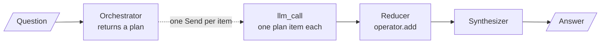

# M24.4 Theory: Orchestrator–worker with the Send API

*[M24 theory](../README.md) · Lesson 24.4 · Notebooks: [`04a_orchestrator_worker_send_api.ipynb`](../../notebook/04a_orchestrator_worker_send_api.ipynb), [`04b_orchestrator_worker_lcel_map.ipynb`](../../../optional/notebook/04b_orchestrator_worker_lcel_map.ipynb) (optional) · [All theory pages](../../../../../THEORY.md)*
<!-- subtitle: Let a planner decide how many workers run, and make sure the plan, not the wiring, drives them -->

## Dynamic fan-out with Send

> **What you'll learn**
>
> - **Explain** how orchestrator-worker differs from parallelization: who decides the branches, and when.
> - **Trace** a plan from the orchestrator through one worker per item to the merged result.
> - **Diagnose** a padded plan, a decorative plan and an empty plan from what ran.
> - **Compare** LangGraph's `Send` with LCEL's map for failures and durability.

Lesson 24.3 ran branches you wrote into the graph. Larkspur questions do not all have the same number of parts. *Can I export my data after I cancel my plan?* needs two answers: how to export, and how long data stays after cancellation. *How long does a refund take?* needs one. A fixed set of branches either wastes calls on the second question or misses half of the first.

**Orchestrator-worker** lets an orchestrator LLM decide, per input, how many subtasks there are and what each one covers. A worker runs once per subtask, and a final step merges the results.

### A plan instead of fixed branches

The pattern looks like parallelization from outside. The difference is who decides the branches, and when:

| | Parallelization (24.3) | Orchestrator-worker (24.4) |
|---|---|---|
| Who decides the subtasks | you, when you build the graph | the orchestrator, at run time |
| Number of branches | fixed | follows the input |
| Branch identity | known in advance (characters, setting, premise) | generated (whatever sections this input needs) |
| Graph shape | static fan-out edges | one conditional edge returning a list of `Send` |

*Table 1: Fixed branches against a run-time plan.*

The same graph is often called **map-reduce**: the plan is the list, the fan-out maps one worker over it, and the synthesizer reduces the results to one answer:

<!-- animated: diagrams/send-fanout.anim.html -->

*Figure 1: Orchestrator-worker. The dotted edge fires once per plan item, a number the graph learns only after the orchestrator runs.*

### From plan item to worker

Four pieces make the plan load-bearing:

| Piece | What it does | Why it matters |
|---|---|---|
| **A variable-length plan** | The orchestrator returns structured output: a list of sections, each with a name and a description | The list length is the number of workers |
| **Dispatch from the plan** | The conditional edge returns one `Send` per section, each naming the worker node and carrying its own payload | A normal edge returns one node; this returns as many runs as the plan has items |
| **A narrow worker state** | Each worker sees the topic and its one section, and writes from that section's description | The worker does what the plan asked, nothing else |
| **A reducer for results** | The results key concatenates lists, so any number of workers can write it in the same step | Without it the parallel writes collide, as in 24.3 |

*Table 2: The four pieces of a Send fan-out.*

A **`Send`** is an instruction to run a named node with a given input. The graph drawing shows the orchestrator-to-worker edge once, because the count is unknown until the plan exists.

### Tracing dispatch

We ran a model-free graph of the same shape, with hand-written plans in place of the orchestrator's, in the LangGraph version this course pins (1.2.18):

| Plan | `Send`s created | Workers ran | Synthesizer ran | Answer |
|---|---|---|---|---|
| export instructions; retention after cancellation | 2 | 2 | yes | both sections |
| refund timing | 1 | 1 | yes | one section |
| (empty) | 0 | 0 | **no** | **none, and no error** |

*Table 3: Dispatch follows the plan, including when the plan is empty.*

The last row is a planted failure we call the **silent empty plan**. With nothing to dispatch, no worker runs, the synthesizer is never reached, and the run ends without an answer or an exception. A caller that only checks for errors sees success.

### Finish order and merge order

Workers finish in whatever order their calls return, but the reducer does not merge them in that order. In the same model-free graph, an export worker took 0.3 s and a retention worker 0.05 s:

| View | Order |
|---|---|
| Streamed updates, as workers finish | retention, export |
| Merged results key in the final state | export, retention |

*Table 4: Completion order against merge order.*

The merged list follows the order the `Send`s were created, which is the plan order, so the final report reads in the planned order whichever worker finishes first. The notebook's own order check makes the same point.

### Planted failures

Each guard answers one way the plan stops driving execution:

| Failure | What it looks like | The guard |
|---|---|---|
| **Padded plan** | A planner told "simple topics might need 2 sections, broad topics 5+" returned five sections, Introduction and Conclusion included, for every topic | Ask for one section per distinct question and ban padding sections |
| **Decorative plan** | The orchestrator plans, but five fixed workers wired with plain edges ignore it; the same five run for every input | Dispatch one `Send` per plan item, and have each worker use its section's description |
| **Silent empty plan** | Table 3: no workers, no synthesizer, no answer, no error | Decide in code what an empty plan returns |
| **Runaway plan** | A planner that splits one question into many sub-questions multiplies calls | Cap the number of `Send`s in code, not only in the prompt |

*Table 5: Four ways the plan fails, and the guard for each.*

> **Pitfall: the decorative plan.** If the set of workers that ran is identical for every input while the plan changes, the plan drives nothing. That graph is parallelization with an extra LLM call in front.

### Send compared with LCEL's map

LCEL can express the fan-out by mapping one runnable over the plan's list. It covers the shape, with four gaps:

| | LangGraph `Send` | LCEL map |
|---|---|---|
| Worker identity | each `Send` names its own target node | every item goes to the same runnable |
| Results land in | shared state, merged by a reducer | an ordered list matching the input |
| One worker fails | the graph can route around it | the whole batch raises and the good results are lost, unless failures are returned as values |
| Durability | per-worker checkpoints, interrupts, resume | none: the chain is stateless |

*Table 6: The same fan-out in two runtimes.*

The LCEL notebook plants a failing worker to show the third row: the mapped call raised and kept nothing, while a batch call that returns exceptions kept the successes and reported the failure.

## In practice: decomposing the export question

This is the shape of query decomposition (M17) and of the module lab:

1. The orchestrator splits *Can I export my data after I cancel my plan?* into "how do I export?" and "what happens to my data after I cancel?".
2. Two workers each retrieve and answer one sub-question. Their evidence is the `export` and `retention` chunks of the M10 golden set.
3. The synthesizer writes one reply from both, in plan order.
4. *How long does a refund take?* gets a plan of one item; a one-item plan can skip the fan-out and answer directly.
5. An empty plan returns a fixed reply instead of ending silently, and the plan size has a cap.

Lesson 24.5 adds the last ingredient the patterns so far lack: a loop that goes back and tries again.

## Limits of this evidence

- **Model-free traces.** Tables 3 and 4 come from our own graph of the same shape with hand-written plans; the notebook's live planner was not rerun.
- **Padded plans from one model.** The five-section result is the notebook's report for `gpt-4o-mini` with that prompt; other models pad differently.

## Key Takeaways

- In orchestrator-worker an LLM decides at run time how many subtasks there are, and a conditional edge returns one `Send` per plan item. A reducer merges the results in plan order.
- Make the plan drive execution: each worker gets only its own section and writes from its description. Fixed workers that ignore the plan make it decorative.
- Guard the plan in code: ban padding in the prompt, cap the number of `Send`s, and decide what an empty plan returns, because it otherwise ends with no answer and no error.

## Check yourself

1. Both orchestrator-worker and parallelization run several LLM calls at once and merge them. What separates them?

Who decides the branches, and when. In parallelization you wrote them into the graph as fixed edges. In orchestrator-worker an LLM decides at run time how many subtasks there are and what each covers, and one conditional edge returns a list of Send, one per plan item.

2. The orchestrator returns an empty plan for a Larkspur question. What does the caller get, and what should you add?

No worker runs, the synthesizer is never reached, and the run ends with no answer and no error, so a caller that only checks for errors sees success. Decide in code what an empty plan returns, such as a direct answer or a fixed reply, and cap the plan size as well.

3. The orchestrator's plan changes with every topic, yet the same five workers run every time. What is wrong?

The plan drives nothing: five fixed workers wired with plain edges ignore the orchestrator's output, so the graph is parallelization with a decorative LLM call in front. Dispatch one Send per section, and have each worker write from its section's description.

---
*Previous: [24.3 Parallelization: sectioning and voting](../03_parallelization_sectioning_and_voting/README.md). Next: [24.5 Evaluator-optimizer loops, always bounded: LangGraph vs LCEL](../05_evaluator_optimizer_loops_always_bounded_langgraph_vs_lcel/README.md).*
