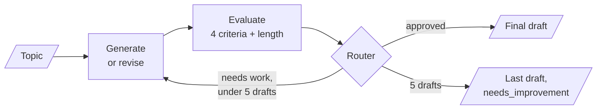
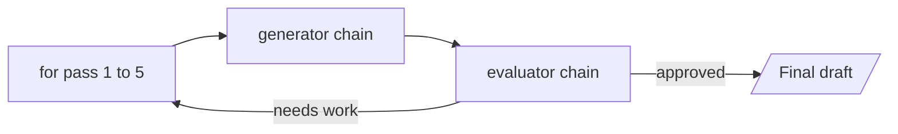
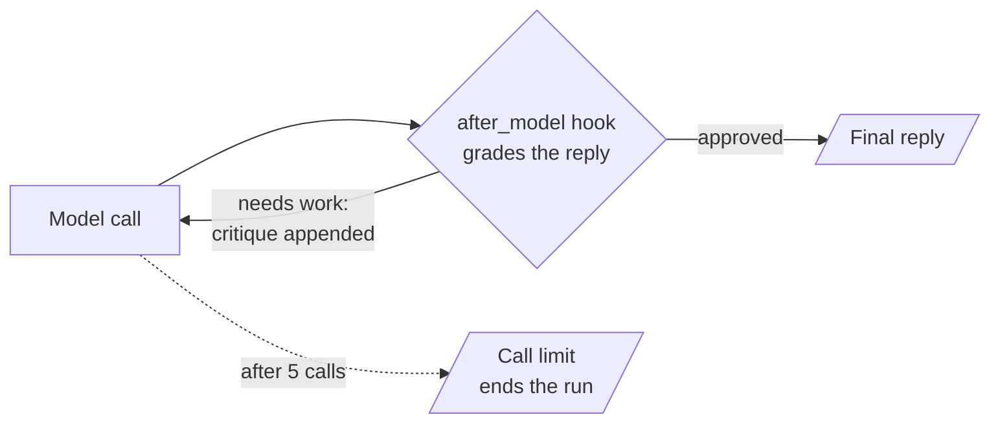

# M24.5 Theory: Evaluator–optimizer loops, always bounded: LangGraph vs LCEL

*[M24 theory](../README.md) · Lesson 24.5 · Notebooks: [`05a_evaluator_optimizer_langgraph.ipynb`](../../notebook/05a_evaluator_optimizer_langgraph.ipynb), [`05b_evaluator_optimizer_lcel.ipynb`](../../notebook/05b_evaluator_optimizer_lcel.ipynb) · [All theory pages](../../../../../THEORY.md)*
<!-- subtitle: Feed a critique into the next draft until it passes, and prove the loop stops when it never does -->
<!-- format: approved -->

## Bounded loops

> **What you'll learn**
>
> - **Explain** how an evaluator-optimizer loop feeds a critique back into the next draft.
> - **Design** criteria an evaluator can pass, with the verdict computed in code.
> - **Prove** that a loop ends when the evaluator never approves, and count its worst-case calls.
> - **Choose** where the loop lives: LangGraph, a Python loop around LCEL, or agent middleware.

Lessons 24.1 to 24.4 all run forward: every step happens once, or a fixed number of times. The 24.1 gate could retry, but it only re-ran extraction blind. This lesson's pattern sends the reason for a rejection back to the step that can fix it.

A Larkspur answer can cite the handbook and still promise a refund the policy does not allow. A reviewer that names that problem, and a generator that revises with the review in hand, can catch it. The risk is a reviewer that never says yes.

### Generate, evaluate, revise

**Evaluator-optimizer** generates a draft, grades it against explicit criteria and feeds the critique into the next draft, until the grade passes or a cap is reached. The 24.1 gate decided whether a result may proceed; this loop sends feedback to the generator. It pays off when two things hold: the criteria are clear, and feedback measurably improves the next attempt.

The lesson's loop writes a short joke about agentic AI:

*Figure 1: The bounded loop. Approval ends it, and so does the fifth draft.*

The generator runs at temperature 0.7: a revision can differ from the draft before it. The evaluator runs at 0 to keep grading as consistent as possible, though the same draft can still get a different grade on another call. From the second pass on, the generator receives the previous draft and the feedback. It revises instead of starting over.

### Criteria an evaluator can pass

The evaluator is only as useful as its criteria. A first version of the notebook asked for one holistic grade against loose criteria such as "is it genuinely funny?", and with `gpt-4o-mini` the loop almost never converged: the evaluator kept finding something that could be better. We call this the **moving bar**. The bounded version changes three things:

| Change | In the reference loop | Why |
|---|---|---|
| **One yes-or-no per criterion** | clear punchline; a punchline that depends on agentic AI specifically; no stock template; appropriate | A met criterion passes even when the joke could be better |
| **Code checks what code can check** | Length is a word count of at most 40, computed in code | A model should not be asked to count |
| **The verdict is computed** | *approved* only when every criterion and the length check pass; otherwise *needs improvement*, with one fix named per failed criterion | The model never asserts the grade itself |

*Table 1: From a holistic grade to computed criteria.*

### Proving the loop stops

A structured verdict does not guarantee the evaluator will ever approve. So the router checks two things in order: approval first, then the iteration count against a cap of 5. We ran the reference stopping rule on four states:

| Grade | Iteration | Router returns | What happens |
|---|---|---|---|
| needs improvement | 1 | refine | the generator revises with the feedback |
| needs improvement | 5 | cap reached | the run ends with the last draft, marked *needs improvement* |
| approved | 5 | approved | the run ends with the draft |
| approved | 2 | approved | the run ends early |

*Table 2: The router's decisions. Approval is checked first, and no state starts a sixth draft.*

The notebook proves the cap on a live generator with a stub reviewer that rejects every draft and makes no LLM call. Without the cap branch, that cell would never finish. With it, the run ends after five drafts.

The cap also bounds cost. Each pass is one generator call and one evaluator call:

| Outcome | Passes | LLM calls |
|---|---|---|
| Approved on the first draft | 1 | 2 |
| Approved on the third draft | 3 | 6 |
| Never approved | 5 | 10, the worst case |

*Table 3: Calls per run under a cap of 5.*

### Planted failures

Each guard has a case that shows why it is there:

| Planted failure | What happens | The guard |
|---|---|---|
| The moving bar: one holistic grade | The loop almost never converges | Yes-or-no criteria, verdict computed in code |
| A reviewer that rejects everything | Without a cap, the loop never ends | The router's iteration cap |
| A model asked to count words | Length checks drift | A word count in code |
| A cap set only by the framework | The pinned LangGraph's default recursion limit is 10,007 steps, about 5,000 passes | The cap in the router; an explicit recursion limit as a second net, as 24.1 sets |

*Table 4: One planted case per guard.*

> **Pitfall: the capped success.** A run that ends at the cap returns a draft that did not pass. Count it as a failure, and watch the share of runs that end there: it rises when criteria drift or a new evaluator model is stricter than the old one.

### Where the bound lives

The bound sits in a different place in each implementation:

| Implementation | The loop is | The bound is |
|---|---|---|
| LangGraph | a conditional edge back to the generator | the iteration cap checked in the router |
| LCEL plus Python | a `for` loop around two chains | the loop's range, 1 to the cap |
| Agent middleware | a hook after each model call that jumps back to the model | a model-call limit of 5 that ends the run |

*Table 5: Three homes for the same bound.*

For Larkspur, an answer-quality check is the natural evaluator, written as yes-or-no criteria: does the reply cite a handbook chunk, does it state the refund window the chunk states, does it avoid promising anything the handbook does not say, and is it under a length limit counted in code. Here is that evaluator on two drafts of a reply to an annual-plan customer on day 12 (an illustrative trace; the handbook allows a full refund within 30 days only under 100 GB of outbound traffic):

Compare the computed verdict on the first draft and on the revision.

<button type="button" data-mode="draft1" aria-pressed="false" aria-controls="eval-draft-1">First draft</button>
<button type="button" data-mode="draft2" aria-pressed="false" aria-controls="eval-draft-2">Revision</button>

<section id="eval-draft-1" class="mode-panel" data-announcement="First draft selected. Needs improvement."><h4>First draft: "You will get a full refund."</h4><dl><dt>Criteria</dt><dd>cites the refunds chunk: yes; states the 30-day window: yes; promises nothing unsupported: no, it skips the traffic condition; length in code: passes</dd><dt>Computed verdict</dt><dd>needs improvement, with one fix: state the 100 GB condition</dd><dt>Next step</dt><dd>the router sends the draft and the fix back to the generator</dd></dl></section>
<section id="eval-draft-2" class="mode-panel" data-announcement="Revision selected. Approved."><h4>Revision: full refund if outbound traffic stayed under 100 GB</h4><dl><dt>Criteria</dt><dd>all four pass</dd><dt>Computed verdict</dt><dd>approved, on pass 2: four LLM calls in all</dd><dt>Next step</dt><dd>the router ends the run with this draft</dd></dl></section>

CRAG (M29) applies the same loop to retrieval: grade the documents, rewrite the query, try again, within a bound.

## Where LCEL stops

**LCEL**, the LangChain Expression Language, composes runnable steps into a flow. Every earlier M24 pattern is a flow without cycles, and each maps onto an LCEL building block. This one has a cycle, and LCEL has no block for "go back and try again until a check passes":

| Pattern | LangChain 1.x building block | Full coverage |
|---|---|---|
| Prompt chaining | the pipe, plus retry and fallback wrappers | yes |
| Routing | a branch runnable | yes |
| Parallelization | a parallel runnable | yes |
| Orchestrator-worker | mapping a runnable over a list | the fan-out; shared state and per-worker durability need `Send` |
| Evaluator-optimizer | a Python loop, or a middleware hook that jumps back to the model | yes, outside LCEL itself |

*Table 6: The five patterns and their LCEL coverage.*

Two tempting shortcuts fail:

- **Piping generator, evaluator, generator** builds a three-step chain that runs the generator twice. It never loops.
- **A retry wrapper** re-runs a step blind, with no memory of why the last attempt failed. Feeding the critique forward is the point of the pattern.

### Choosing the runtime around the loop

In the first, plain Python owns the cycle and calls two stateless chains on each pass:

*Figure 2: A Python loop around LCEL. The loop's range is the bound.*

In the second, the cycle lives inside one agent run. A hook after each model call grades the reply and either lets the run end or jumps back to the model with the critique:

*Figure 3: The middleware loop. A model-call limit of 5 ends the run if the hook never approves.*

The two LangChain loops differ in what surrounds them:

| | Python loop around LCEL | Agent middleware |
|---|---|---|
| Reads as | a plain `for` loop | one agent run with every pass nested |
| State | a dict you shape | the full message history |
| Tracing | each pass as separate chain runs | one run |
| Streaming, persistence | none | inherited from the agent runtime |
| How the critique arrives | passed into the next prompt | appended to the conversation as a user message |

*Table 7: Two ways to loop without LangGraph.*

In the middleware version the hook must declare that it may jump back to the model; that declaration is what creates the conditional edge. When the loop needs checkpoints, interrupts or a human in it, move it to LangGraph.

## Limits of this evidence

- **No recorded convergence counts.** The notebooks ship without outputs. How many passes a real joke needed is not measured here; the "almost never converged" result is the notebook's own report on its first version.
- **Model-free router trace.** Table 2 runs the reference stopping rule on hand-set states, not a live loop.
- **One task.** Jokes are a cheap stand-in; the Larkspur evaluator above is an illustrative trace, not a run.

## References

1. Anthropic, [Building effective agents](https://www.anthropic.com/research/building-effective-agents), December 2024: evaluator-optimizer.
2. LangChain, [LangGraph Graph API: conditional edges and recursion limits](https://docs.langchain.com/oss/python/langgraph/graph-api).
3. LangChain, [Middleware: hooks and model-call limits](https://docs.langchain.com/oss/python/langchain/middleware/overview).
4. Madaan and others, [Self-Refine: iterative refinement with self-feedback](https://arxiv.org/abs/2303.17651), 2023.

## Key Takeaways

- Evaluator-optimizer feeds a critique into the next draft until the grade passes. Use it only when the criteria are clear and feedback measurably improves the next attempt.
- Grade with one yes-or-no per criterion, check length in code and compute the verdict from the checks. A single holistic grade becomes a moving bar the loop rarely clears.
- Cap every loop in your own code, count a run that hits the cap as a failure, and do not rely on the framework's default limit. LCEL cannot express the cycle, so use a Python loop or middleware, and LangGraph when you need checkpoints or interrupts.

## Check yourself

1. Why did replacing one holistic grade with one yes-or-no per criterion make the joke loop converge?

Against a loose holistic grade the evaluator kept finding something that could be better, a moving bar. With yes-or-no criteria, a met criterion passes even if the joke could improve, length is counted in code, and approval is computed only when every check passes, so the model never asserts the grade itself.

2. With a cap of 5 iterations, how many LLM calls can one run make at most, and how should you count a run that hits the cap?

Ten, because each pass makes one generator call and one evaluator call. A run that ends at the cap returns its last draft marked needs improvement, so count it as a failure and watch the share of runs that end there.

3. A teammate builds the loop in LCEL by piping generator, evaluator and generator again, or by adding a retry. Why does neither work?

Piping builds a three-step chain that runs the generator twice; it never loops. A retry re-runs a step blind, with no memory of why the last attempt failed, while feeding the critique forward is the point of the pattern. Use a Python loop or a middleware hook that jumps back to the model, and move to LangGraph when the loop needs checkpoints or interrupts.

---
*Previous: [24.4 Orchestrator-worker with the Send API](../04_orchestrator_worker_with_the_send_api/README.md). Next: [M24 interview questions](../README.md#interview-spotlight-5-questions-you-might-get-asked).*
