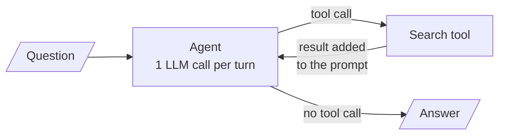
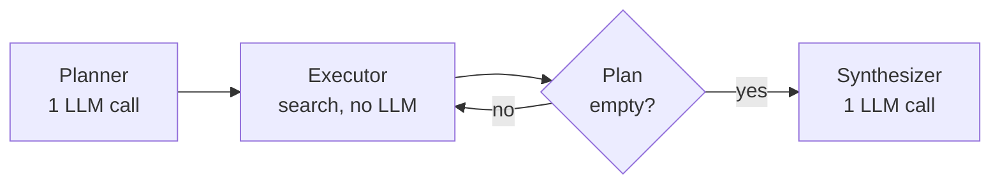
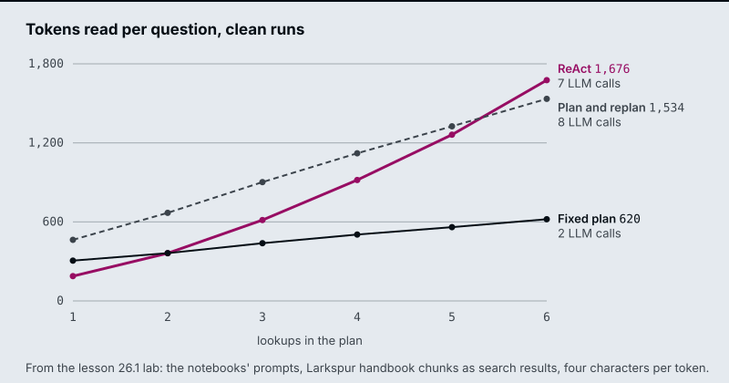
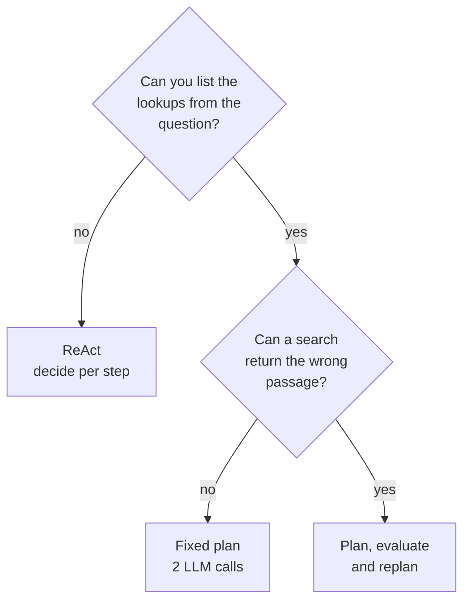
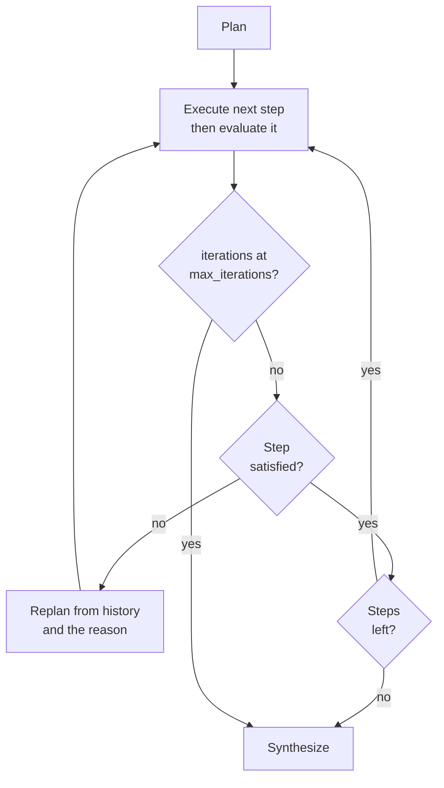

# M25.1 Theory: Plan-and-execute vs ReAct; decompose, execute, replan

*[M25 theory](../README.md) · Lesson 25.1 · Notebooks: [`01a_planning_react_vs_plan.ipynb`](../../notebook/01a_planning_react_vs_plan.ipynb), [`01b_planning_decompose_execute_replan.ipynb`](../../notebook/01b_planning_decompose_execute_replan.ipynb) · [All theory pages](../../../../../THEORY.md)*
<!-- subtitle: Writing the lookups down first saves calls, and a check on every result is what keeps a plan honest -->
<!-- format: approved -->

## Plan-and-execute

> **What you'll learn**
>
> - **Compare** a ReAct agent and a plan-and-execute agent by LLM calls and tokens read on the same question.
> - **Explain** why a fixed plan writes a wrong search result straight into the answer.
> - **Trace** an evaluate-and-replan loop through a rejected step, and count what the rejection costs.
> - **Size** an executed-step cap from the plan and the retries you allow.

A Larkspur Cloud customer wants to cancel an annual plan. The answer needs up to six handbook facts: the refund rule, how long a refund takes, what happens to the servers, how long data is kept, what an export includes and how fast support answers. The search for the refund rule comes back with the passage on refund timing instead. The search ran without error. Whether that passage reaches the customer depends on how the agent decides its steps.

M22 and M23 built the ReAct loop, where the model reads each result and then decides the next step:

*Figure 1: ReAct. Every turn re-reads the whole conversation, and a turn without a tool call ends the run.*

A **plan-and-execute agent** decides all its steps first and then runs them. The fixed-plan notebook builds it from three nodes:

| Node | What it does | LLM calls |
|---|---|---|
| Planner | One structured-output call returns the plan, a list of search queries with one fact each | 1 |
| Executor | Pops the next query and runs the search tool | 0 |
| Synthesizer | Reads every collected result and writes the answer, including any arithmetic | 1 |

*Table 1: The three nodes of a fixed plan and the LLM calls each one makes.*

One pure router drives the loop. After planning and after every execution it asks whether the plan is empty:

*Figure 2: The fixed plan. Only the planner and the synthesizer call the model.*

Each step is a plain query. The executor needs no model, and the agent makes 2 LLM calls however long the plan is. ReAct makes one call per search plus one to answer, and each call re-reads every earlier result.

### A promise is not a tool call

A recorded comparison of four runs shows what ReAct's flexibility costs in reliability. On a three-capitals task, the ReAct agent stopped after the capitals in 4 of 4 runs. Each time it wrote *"Next, I will find the current population of the United States"* as text instead of a tool call. LangGraph's `tools_condition` ends the loop on any turn without a tool call. The promised search never ran.

We call this the **unkept promise**: ReAct keeps its to-do list in the model's head, and a turn of plain text ends the run. The planner wrote the missing lookup into its plan before the first search, where nothing could drop it.

### What each agent reads on a clean run

The [interactive lab](interactive/plan-or-react-lab.html) runs the comparison on the Larkspur cancellation question, with the reference prompts and the handbook chunks as search results. On clean runs, where every search returns the right chunk:

| Lookups | ReAct calls | ReAct tokens | Fixed plan calls | Fixed plan tokens |
|---|---|---|---|---|
| 2 | 3 | ~362 | 2 | ~363 |
| 4 | 5 | ~918 | 2 | ~504 |
| 6 | 7 | ~1,676 | 2 | ~620 |

*Table 2: LLM calls and input tokens on clean runs, from the lab.*

The same numbers as a chart, with the replanning agent from the next section added:

*Figure 3: Tokens read against lookups. ReAct's line bends upward because its prompt grows with every result. The chart's caption still names the lab as lesson 26.1, its number before the course was renumbered.*

At two lookups the two agents read about the same. At six, ReAct reads 2.7 times as much, because it pays for its growing prompt on every call. Wall time is a different matter: the searches dominate it and the executor runs them one after another. Either agent can be faster from run to run.

### When a plan fits

A plan suits steps you can list from the question, as in "find these four facts and compare them". ReAct suits work where the next step depends on what the last one found, as in troubleshooting a server that will not start:

*Figure 4: Choosing between ReAct, a fixed plan and a plan that replans.*

The plan's weakness is the reverse of its strength. It was fixed before the first search, and nothing in the graph checks a result. The refund-timing passage from the opening counts as a finished step.

## Replanning

**Replanning** treats the plan as a living document: after every step an evaluator judges the result, and a failed step sends the run to a replanner that rewrites the steps still to come. The evaluator asks one structured question, *does this result state the fact the step asks for, about the right entity?* The notebook stores the verdict as `StepEvaluation.satisfied` with a one-sentence reason, and pure routers read it:

*Figure 5: The replanning loop. The cap is checked before the verdict.*

Three rules make the loop safe:

- **A replan rewrites the remaining steps.** The replanner sees the goal, the history of OK and INSUFFICIENT steps and the reason the last one failed, then writes a new list of steps still to do. It is told never to resubmit a failed step unchanged.
- **Only accepted results reach the answer.** The synthesizer gets the satisfied results as data and is told to say a fact could not be found rather than fill it in from memory.
- **A cap ends the loop.** `max_iterations` counts executed steps. The router checks it before the verdict, which sends a run at the cap straight to the synthesizer.

### A wrong result becomes a revised search

In the notebook's controlled test, a stub search returns the U.S. state of Georgia for a question about the country. The evaluator marks the step INSUFFICIENT, the replanner rewrites the query and the next result is accepted. A fixed plan would have popped the step and written the state's 11 million people into the country's row. We call that the **silent wrong fact**: the search ran, the step counted as done and the answer is confidently wrong. A dead search tool, which never finds anything, runs until the cap and returns an honest "not found".

The lab plants the same failure in the Larkspur question. Follow the refund-rule step through the replanning agent with four lookups (scripted models, the lab's own text):

Step through one rejected lookup, from the plan to the answer.

<button type="button" data-step="0" aria-pressed="false" aria-controls="replan-step-0">1. Plan</button><button type="button" data-step="1" aria-pressed="false" aria-controls="replan-step-1">2. Search</button><button type="button" data-step="2" aria-pressed="false" aria-controls="replan-step-2">3. Evaluate</button><button type="button" data-step="3" aria-pressed="false" aria-controls="replan-step-3">4. Replan</button><button type="button" data-step="4" aria-pressed="false" aria-controls="replan-step-4">5. Retry</button><button type="button" data-step="5" aria-pressed="false" aria-controls="replan-step-5">6. Answer</button>

<section id="replan-step-0" class="step-panel" aria-labelledby="replan-heading-0"><h4 id="replan-heading-0">1. Plan four lookups</h4><dl><dt>Step 1</dt><dd>refund rule for an annual plan</dd><dt>LLM calls so far</dt><dd>1 (the planner)</dd></dl></section><section id="replan-step-1" class="step-panel" aria-labelledby="replan-heading-1"><h4 id="replan-heading-1">2. The search returns the wrong chunk</h4><dl><dt>Result</dt><dd>refund-timing: refunds take 5 to 10 business days to appear on the statement</dd><dt>Fixed plan</dt><dd>would pop the step here and keep the timing passage as the refund rule</dd></dl></section><section id="replan-step-2" class="step-panel" aria-labelledby="replan-heading-2"><h4 id="replan-heading-2">3. The evaluator rejects it</h4><dl><dt>Verdict</dt><dd>satisfied false, reason: the result is about a different topic</dd><dt>Route</dt><dd>replan, since 1 executed step is under the cap</dd></dl></section><section id="replan-step-3" class="step-panel" aria-labelledby="replan-heading-3"><h4 id="replan-heading-3">4. The replanner rewrites what is left</h4><dl><dt>Reads</dt><dd>the goal, the history line marked INSUFFICIENT and its reason</dd><dt>New first step</dt><dd>full refund window for an annual plan, in days</dd></dl></section><section id="replan-step-4" class="step-panel" aria-labelledby="replan-heading-4"><h4 id="replan-heading-4">5. The retry is accepted</h4><dl><dt>Result</dt><dd>refund-window: a full refund within 30 days of purchase if the account used less than 100 GB of outbound traffic</dd><dt>Verdict</dt><dd>satisfied true; the other three lookups pass on the first try</dd></dl></section><section id="replan-step-5" class="step-panel" aria-labelledby="replan-heading-5"><h4 id="replan-heading-5">6. The answer uses accepted results only</h4><dl><dt>Totals</dt><dd>5 searches and 8 LLM calls: 1 plan, 5 evaluations, 1 replan, 1 final answer</dd><dt>Left out</dt><dd>the rejected timing passage, as evidence for the refund rule</dd></dl></section>

<button type="button" data-walk="previous">Previous</button>

<button type="button" data-walk="next">Next step</button>

With four lookups and that one wrong first result, the three agents end like this:

| Agent | LLM calls | Searches | Tokens read | Answer |
|---|---|---|---|---|
| ReAct, at its best | 6 | 5 | ~1,211 | Complete |
| Fixed plan | 2 | 4 | ~500 | One wrong fact |
| Plan and replan | 8 | 5 | ~1,582 | Complete |

*Table 3: Four lookups with one wrong first result, from the lab.*

### What a rejection costs

The replanner's bill follows from its graph. Here is the arithmetic for N lookups and f wrong results under the cap:

| Part | Calls |
|---|---|
| Planner | 1 |
| Evaluator, one per executed step (N + f steps) | N + f |
| Replanner, one per rejected step | f |
| Synthesizer | 1 |
| **Total** | **N + 2 + 2f** |

*Table 4: LLM calls of the replanning agent.*

On a clean run that is N + 2, one more than ReAct, and the extra machinery changes nothing in the answer. The evaluator is the bottleneck. Too lenient, and wrong data slips through. Too strict, and the agent replans good results and pays 2 calls for each.

### Sizing the cap

Six lookups with one wrong result need 7 executed steps. At the notebook's `max_iterations = 6`, the lab's run stops with one lookup unanswered after 9 LLM calls. At 7 it completes in 10, which is N + 2 + 2f with N = 6 and f = 1. We call this the **short cap**: a limit set from the plan's length that forgets a retry is an execution too.

ReAct has its own ceiling. The reference implementation runs it with `recursion_limit = 20` graph steps, and each search costs two (an agent turn and the tool). Six lookups with four wrong results need 10 searches and 21 steps, so LangGraph raises `GraphRecursionError` and the user gets no answer at all. Open the [plan or react lab](interactive/plan-or-react-lab.html), set six lookups with one wrong result and move the cap from 6 to 7:

<!-- lab: interactive/plan-or-react-lab.html -->

## In practice: the cancellation assistant

For Larkspur's cancellation question, the choices above become four settings:

1. **Plan the lookups.** The six facts are known from the question, and a planner writes them as six queries.
2. **Evaluate every result.** Each search result must state the fact its step names, about the right subject (refund rule, not refund timing).
3. **Cap from the plan.** Six lookups plus one allowed retry gives `max_iterations = 7`, and the synthesizer reports any fact still missing.
4. **Count from state.** Log planned, executed and rejected steps per run. A rising replan rate then shows up before customers notice.

> **Key distinction:** the plan buys cheap, visible work, and the evaluator buys correctness. A plan without the evaluator saves calls and passes wrong results straight through.

## Limits of this evidence

- **Scripted models.** The lab's numbers are exact for these prompts and chunks, not for a live model. They match the reference node and router code run under LangGraph with the same scripted models on all 1,764 settings. A real ReAct agent may stop early, and a real replanner may need more than one rewrite.
- **Small samples.** The unkept promise was seen in 4 of 4 runs with `gpt-4o-mini`. A stronger prompt makes it rarer, but nothing in the ReAct graph checks that the task is finished.
- **Judging the answer is its own problem.** The notebook's first judge asked yes or no per requirement and passed an answer that only promised the U.S. lookup. Its fix asks the judge to copy each figure or write `none`, and code decides.

Lesson 25.2 keeps the planner and replanner and hands each step to a whole research workflow instead of one search.

## References

1. Yao et al., [ReAct: Synergizing Reasoning and Acting in Language Models](https://arxiv.org/abs/2210.03629), 2022.
2. Wang et al., [Plan-and-Solve Prompting](https://arxiv.org/abs/2305.04091), 2023.
3. LangChain, [Plan-and-Execute Agents](https://www.langchain.com/blog/planning-agents).
4. LangChain, [LangGraph Graph API](https://docs.langchain.com/oss/python/langgraph/graph-api).

## Key Takeaways

- Use a plan when the steps are knowable from the question and ReAct when each step depends on the last result. ReAct can promise a search in text and stop, while a plan writes every lookup down.
- A fixed plan never checks a result, so a wrong search lands in the answer. Replanning evaluates each step and rewrites the remaining steps from the failure reason instead of retrying unchanged.
- Size caps from the call arithmetic: N + 2 + 2f calls for N lookups and f wrong results. The evaluator decides quality, since too lenient lets wrong data through and too strict replans good results.

## Check yourself

1. Why does the plan-and-execute agent make two LLM calls whatever the length of its plan?

The planner writes every step as a plain search query in one structured-output call, the executor runs each query with no LLM, and the synthesizer makes the one call that writes the answer. ReAct makes one call per search plus one to answer, and each call re-reads the whole conversation.

2. On clean runs with six lookups, how many tokens does ReAct read compared with the fixed plan, and why the gap?

About 1,676 against about 620, 2.7 times as much. ReAct's prompt grows with every result and it pays for that prompt on every call. At two lookups the two read about the same (about 362 and 363).

3. A replanning run with six lookups and one wrong result stops with one lookup unanswered. What caused it, and what fixes it?

The cap: `max_iterations = 6` counts executed steps, and six lookups with one wrong result need 7. The run stops after 9 LLM calls. At 7 it completes in 10. Size the cap from N + 2 + 2f calls for N lookups and f wrong results.

---
*Previous: [M25 overview](../README.md). Next: [25.2 Deep-research and reflective dynamic planners](../02_deep_research_and_reflective_dynamic_planners/README.md).*
