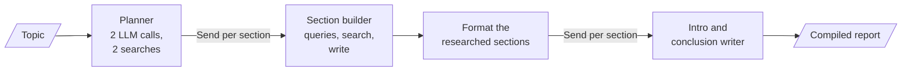
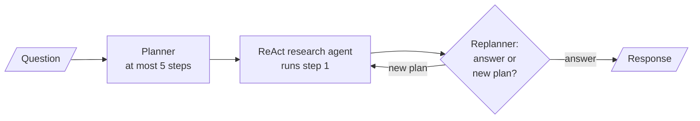

# M25.2 Theory: Deep-research and reflective dynamic planners

*[M25 theory](../README.md) · Lesson 25.2 · Notebooks: [`02a_planning_agent_deep_research.ipynb`](../../notebook/02a_planning_agent_deep_research.ipynb), [`02b_reflective_dynamic_planning_agent.ipynb`](../../../optional/notebook/02b_reflective_dynamic_planning_agent.ipynb) (optional) · [All theory pages](../../../../../THEORY.md)*
<!-- subtitle: A small project: the planner from lesson 25.1 hands each step to a whole workflow or agent, with every cost capped in code -->

## The project: two research planners

> **What you'll build**
>
> - **A report planner** that researches a topic briefly, then plans the report's sections as structured output.
> - **A nested section builder** (queries, web search, writing) that runs once per planned section, in parallel.
> - **A reflective planner** that hands each step to a ReAct research agent and replans after every step.
> - **Caps in code** on sections, searches, page text and steps, each proved without trusting the prompt.

Lesson 25.1 planned single searches. This project makes each planned step bigger: a report section that a nested workflow researches and writes, or a sub-question that a whole ReAct agent answers before a replanner decides what is left.

It adds no new pattern. It combines lesson 25.1's planning and replanning with the Send fan-out from [M24](../../../../../p06_agent_foundations/m24_agentic_workflow_patterns/mandatory/theory/README.md). What changes is that each step now costs live web searches, which puts the planner in charge of how much the run spends.

## Architecture

The report planner is a **compound agent**: one system with one state, whose section builder is a compiled graph used as a single node:

*Figure 1: The report planner. Both fan-outs use Send, and the planner's outline decides how many branches run.*

The reflective planner nests an agent instead of a workflow, which makes it a **hierarchical compound agent**:

*Figure 2: The reflective planner. The replanner sees every step done so far and returns either a shorter plan or the final response.*

| Piece | What it does | Built on |
|---|---|---|
| **Report planner** | Writes planning queries, searches, then returns sections with a name, a description and a research flag | Plan-and-execute, lesson 25.1 |
| **Section builder** | Turns a section into targeted queries, runs them concurrently, writes the section from truncated sources | Prompt chaining, M24 |
| **Fan-out with Send** | One branch per researched section, gathered by an append reducer | Orchestrator-worker, M24 |
| **ReAct research agent** | Answers one step with a web-extraction tool, trimming its history to a token budget | The ReAct loop, M23 |
| **Replanner** | Returns either a plan of the steps still needed or the final answer | Replanning, lesson 25.1 |

*Table 1: The pieces of both builds and the lessons they reuse.*

## Following one research run

The report notebook researches *How to build agentic AI systems: design patterns and current frameworks*. A Larkspur team could point the same graph at *How do rival hosts price GPU servers?* and the call order would be identical:

| Stage | LLM calls | Searches |
|---|---|---|
| Planner: write planning queries | 1 | |
| Planner: search, then plan sections | 1 | 2 |
| Section builder, per researched section (2 kept): queries and writing | 2 × 2 = 4 | 2 × 2 = 4 |
| Introduction and conclusion, written from the researched sections | 2 | |
| Compile in the planned order | 0 | |
| **Total** | **8** | **at most 6** |

*Table 2: One report run with the notebook's settings and the template's introduction and conclusion. Search results are live. Only the order and the counts repeat.*

The introduction and conclusion run last, written from the finished sections. They summarise what the research found rather than what the planner guessed.

The reflective planner is less predictable by design. On its notebook question (who founded Microsoft, the founder's hometown and the history of both), the replanner usually stops before the last planned step, often "compile the answer", because the results already cover it.

## Design choices worth copying

The report planner's cost is multiplicative: sections × queries per section × results per query × tokens per result. The notebook's first version had no section cap and ran tens of searches and well over 100k tokens. The arithmetic for one researched section's source text:

| Setting | Queries | Results each | Raw tokens kept per source | Upper bound per section |
|---|---|---|---|---|
| First version | 3 | 6 | 4,000 | 72,000 tokens |
| Current knobs | 2 | 3 | 800 | 4,800 tokens |

*Table 3: Source text one section writer may read, before duplicate URLs are removed.*

| Choice | Why |
|---|---|
| **Cap the plan in code** | The prompt can ask for fewer sections. Only code keeps the first two researched sections and guarantees the 6-search bound the run then checks |
| **Count real searches** | A log of every query sent turns the cost claim into an assertion at the end of the run |
| **Return copies from parallel branches** | Each section builder returns an updated section, and branches never mutate shared objects |
| **Bound the agent's context** | The research tool keeps 4,000 tokens of page text per call (the first version allowed 127,000), and the agent trims its history to 50,000 tokens |
| **Overrule the replanner at a step cap** | After 6 executed steps the replan node stops with the findings so far, whatever the model wants |

*Table 4: Five choices and what each protects against.*

The last row guards against a replanner that always finds one more thing to look up. The notebook proves it without a live model: a stub executor returns canned text, a stub replanner always asks for one more step, and the run still stops after exactly 6 steps.

## Limits

- **Live data.** Reports and answers change with the web, which leaves no expected text to compare. Test the call order, the search count and the cap instead.
- **No result check.** Neither build evaluates a search result the way lesson 25.1's evaluator does. A wrong page reaches the section writer or the replanner as evidence, and lesson 25.4's verification is the missing step.
- **Silent search failures.** A failed search is dropped from its batch, and a section can end up written from fewer sources than planned.

Both notebooks need an OpenAI key and a Tavily key, and every run issues real searches against your Tavily quota.

## Key Takeaways

- A research planner decides which pieces of work exist, so the plan sets the bill. Cap sections, queries, results and source length in code, and check the real search count against the bound.
- Nesting a workflow (one section builder per section) or an agent (one ReAct run per step) inside a plan gives one system with one state, a compound agent, and Send sizes the fan-out at run time.
- A replanner that reviews every step can stop early or add a step. It needs a step cap that overrules it, proved with stubs that never finish.

## Check yourself

1. Why can the report planner not use a fixed edge for each section builder?

The planner decides at run time how many researched sections exist, so the graph cannot know the number of branches in advance. A Send per researched section starts one section builder each, and an append reducer gathers their completed sections.

2. With the notebook's settings, how many searches and LLM calls does one report use, and where does each come from?

At most 6 searches: 2 to plan and 2 for each of the 2 researched sections. 8 LLM calls when the plan has the template's introduction and conclusion: 2 in the planner, 2 per researched section for queries and writing, and 1 each for the introduction and the conclusion.

3. A reflective planner keeps running because its replanner always proposes one more step. What stops it, and how do you show the guard works?

A step cap in the replan node: after 6 executed steps it returns the findings so far instead of calling the replanner. Building the graph around swappable parts lets a stub executor and a stub replanner that never answers reproduce the case with no model calls, and the run stops after exactly 6 steps.

---
*Previous: [25.1 Plan-and-execute vs ReAct; decompose, execute, replan](../01_plan_and_execute_vs_react_decompose_execute_replan/README.md). Next: [25.3 Reflection and Reflexion agents](../03_reflection_and_reflexion_agents/README.md).*
