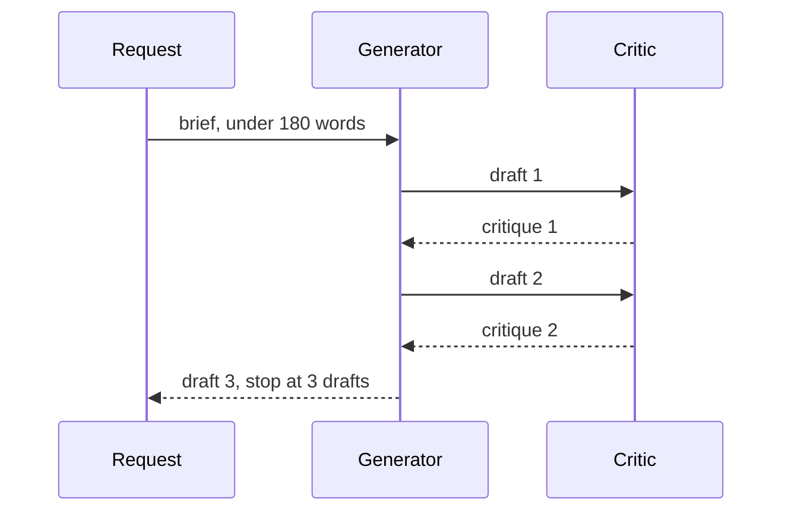
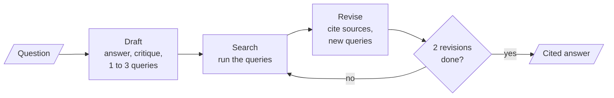
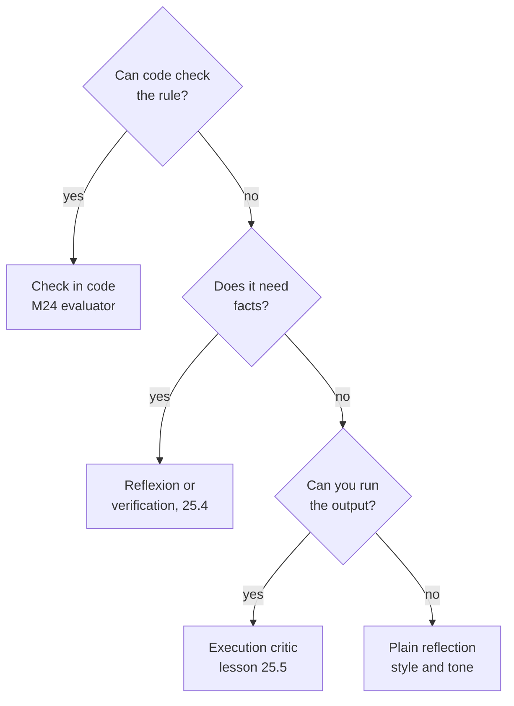

# M25.3 Theory: Reflection and Reflexion agents

*[M25 theory](../README.md) · Lesson 25.3 · Notebooks: [`03a_reflection_agents.ipynb`](../../notebook/03a_reflection_agents.ipynb), [`03b_reflexion_agents.ipynb`](../../notebook/03b_reflexion_agents.ipynb), [`03c_reflection_architecture.ipynb`](../../../optional/notebook/03c_reflection_architecture.ipynb) (optional) · [All theory pages](../../../../../THEORY.md)*
<!-- subtitle: A critic with only its own opinion polishes style, and a critic that can look things up or run tests fixes facts -->

## Reflection: a writer and a critic

> **What you'll learn**
>
> - **Explain** the reflection loop: one model in two roles, with the conversation as the state.
> - **Diagnose** three ways self-critique fails: a rule nobody checks, an invented fact and a critic that believes its own guess.
> - **Compare** reflection with Reflexion, which turns the critique into searches and cites what it finds.
> - **Choose** the critic for a task by asking what evidence it can reach.

Lessons 25.1 and 25.2 checked whether a search result answered its step. This lesson turns the check on the model's own output: draft, critique, revise.

Larkspur's status team wants an agent that drafts a short post after an incident, under 180 words. A reflection loop sounds ideal: a writer drafts, a critic says what is weak, the writer revises. In practice the critic asks for "a statistic to build trust", the writer adds "99.99% uptime", and the post grows past its limit. The handbook guarantees 99.95%, and nothing in the loop ever looked.

A **reflection agent** is one model playing two roles in a loop. The **generator** drafts and revises. The **critic** (or reflector) reviews the latest draft and returns free-text, actionable feedback. The idea comes from Self-Refine (Madaan et al., 2023). The reflection notebook drafts LinkedIn posts. The mechanism is the same for Larkspur's status post:

*Figure 1: The reflection loop with the notebook's cap of three drafts, the first draft plus two revisions.*

In LangGraph the whole exchange is one message list, and two details make it work. The generator sees each critique as the next human message and answers it with a revised draft. The critic sees the conversation with the roles swapped, which makes the writer's drafts arrive as the user's input it has to review. A pure router counts the drafts written and stops at `MAX_DRAFTS = 3`.

The finished state holds six messages:

| # | Role the writer sees | Content |
|---|---|---|
| 1 | Human | The brief: an incident post under 180 words |
| 2 | AI | Draft 1 |
| 3 | Human | Critique 1 |
| 4 | AI | Draft 2 |
| 5 | Human | Critique 2 |
| 6 | AI | Draft 3, the answer |

*Table 1: The message trace of one reflection run. The router counts the AI messages.*

Two LLM calls per round, plus the first draft, gives 5 calls for three drafts. The cap is a count in code. In an agentic version the critic could also decide when the draft is good enough, which needs a cap even more, because a critic can be too easily satisfied or never satisfied.

## Where self-critique stops helping

The loop gives the model more attempts. It does not give the critic anything to check against. Three recorded failures show what that costs:

| Planted failure | What happened | Why |
|---|---|---|
| A length limit in the brief | In an earlier version of the notebook, drafts 2 and 3 reached 251 and 282 words against a limit of 180 | The critic commented on hooks, hashtags and calls to action, and the writer added what it asked for |
| A critic asks for a number | The writer supplied "up to 30% more productive" with no source | Nothing in the loop can look a fact up |
| A critic judges code it cannot run | It answered `has_errors = False` for drafts that failed half of the hidden tests | Its verdict is an opinion formed without execution |

*Table 2: Three failures of self-critique, from the reflection notebooks' recorded runs.*

Each one gets a name we reuse. The **unchecked rule** is a constraint in the brief that no step verifies. Revisions drift past it. The **invented fact** is a number or claim the writer supplies because the critic asked for one. **Self-bias** is the critic flagging only the problems it can imagine and trusting its own guess about the rest.

The fix for the unchecked rule is to check it in code. Word counts, required phrases and formats are deterministic, which is why [M24](../../../../../p06_agent_foundations/m24_agentic_workflow_patterns/mandatory/theory/README.md)'s evaluator-optimizer moves checkable criteria out of the critic. The other two failures need evidence, which the next two sections add in different forms.

## Measuring one structured pass

The optional reflection-architecture notebook runs the smallest structured version: generate, critique, refine, once, with no loop. Each role returns a typed object. The critique has fields `has_errors`, `is_efficient`, a list of suggested improvements and a summary. Its verdict becomes a claim we can test.

The task is a duration parser that turns strings like "1h30m" or "2h5m10s" into seconds. The request says nothing about bad input. Ten hidden tests, which neither generator nor critic sees, define what a reasonable user expects:

| Group | Inputs | Expected |
|---|---|---|
| Valid durations | "1h30m", "45s", "2h5m10s", "90m" | 5400, 45, 7510, 5400 seconds |
| Surrounding spaces | " 2h " | 7200 seconds |
| Malformed input | "abc", "", "5x", "1h1h", "h" | A `ValueError` for each |

*Table 3: The ten hidden tests, run in code against the draft and the refined version.*

The notebook runs the whole pass four times and compares the critic's belief with the measured score. Refinement helps when the critique happens to name what the tests check ("validate the input", "raise a ValueError for unknown units"). It is not reliable. Across runs the refined code can pass the same number of tests as the draft, or fewer, when a refiner "simplifies" the parser with a regular expression and drops validation. One run is an anecdote, which is why the comparison repeats.

> **Pitfall: self-bias.** A critic that cannot run the code, look up the fact or see the rule's check will sound equally confident when it is wrong. Treat its verdict as a hypothesis and measure the output.

## Reflexion: critique backed by search

**Reflexion** (Shinn et al., 2023) extends reflection in two ways: the critique must say what is missing, and the gaps turn into external research that the revision has to cite. In the paper an **actor** attempts the task, an evaluator scores it, and a self-reflection step writes a verbal lesson that is kept in memory for the next attempt. The paper reports a Reflexion agent reaching 91% pass@1 on the HumanEval coding benchmark against 80% for GPT-4 without it, and 130 of 134 AlfWorld tasks solved.

The Reflexion notebook implements the within-task form with a search tool:

*Figure 2: The Reflexion loop. The model's own queries are what the search step runs.*

Three design decisions carry the pattern:

- **One structured response.** The draft holds the answer, a reflection with two fields (what is missing, what is superfluous) and 1 to 3 research queries. The schema is bound as a tool the model must call, and the response arrives as a tool call that a tool node can "execute" by running its queries.
- **Strict schemas, with a retry behind them.** Without OpenAI's strict schema mode, `gpt-4o-mini` left out the revision's required sources field in 3 of 4 test calls, often on every retry. A responder that feeds the validation error back and asks again (up to 3 attempts) stays as the fallback for providers without strict mode.
- **A revisor that must change something.** With the first guidelines the revision copied the draft almost word for word, attached sources without citing them and re-issued the same queries. Two added rules (add at least one fact from the results, cite it as a numbered reference) and a temperature of 0.7 fixed that, because at temperature 0 a second revision repeated the first.

The cost of one run follows from the graph:

| Step | LLM calls | Searches |
|---|---|---|
| Draft with critique and queries | 1 | |
| Search the draft's queries | | 1 to 3 |
| Revision 1, with new queries | 1 | |
| Search revision 1's queries | | 1 to 3 |
| Revision 2, the answer | 1 | |
| **Total, without schema retries** | **3** | **2 to 6** |

*Table 4: One Reflexion run with `MAX_REVISIONS = 2`.*

The router counts revisions directly. The notebook's first version counted trailing messages, which hid the real limit. After the run, code checks the guidelines itself: a body of at most 300 words, numbered citations in the text and at least one source URL. The model's claim to have followed them is not evidence.

> **Key distinction:** reflection asks "what would make this better?" and answers from memory. Reflexion asks "what is missing?" and goes to get it.

## Choosing a critic

The critic is only as good as what it can reach. Four kinds appear in this module, and each catches a different failure:

*Figure 3: Pick the strongest critic the task allows, and fall back to plain reflection only for judgment calls.*

| | Reflection | Structured pass | Reflexion | Execution critic |
|---|---|---|---|---|
| Evidence the critic uses | Its own opinion | Its own opinion, typed | Search results | Exceptions and test results |
| Catches style problems | ✓ | ✓ | ✓ | ✗ |
| Catches invented facts | ✗ | ✗ | ✓ | ✗ |
| Catches broken code | ✗ | Sometimes | ✗ | ✓ |
| LLM calls for 2 revisions | 5 | 3 (one pass) | 3 plus searches | 1 per attempt |

*Table 5: The critics side by side.*

## In practice: Larkspur's incident post

For the status team's post, the choices combine:

1. **Draft and critique** with a reflection loop for tone and clarity, capped at three drafts.
2. **Check the limit in code**: the word count and the required link to the status page.
3. **Ground every number** Reflexion-style, with the handbook as the search tool. The critique names "uptime figure unverified", the query retrieves the SLA chunk, and the revision cites 99.95% monthly availability and the 72-hour root-cause report.
4. **Score in code** after the loop, and route a post that still fails to a person.

Lesson 25.4 makes the fact check stricter by answering one question per claim in a call that never sees the draft.

## References

1. Madaan et al., [Self-Refine: Iterative Refinement with Self-Feedback](https://arxiv.org/abs/2303.17651), NeurIPS 2023.
2. Shinn et al., [Reflexion: Language Agents with Verbal Reinforcement Learning](https://arxiv.org/abs/2303.11366), 2023.

## Key Takeaways

- Reflection is one model as writer and critic, with the conversation as the state and a cap on drafts. It improves what the critic can judge from opinion, mostly style and structure.
- Self-critique fails on unchecked rules, invented facts and self-bias. Check hard rules in code, and measure the output instead of trusting the critic's verdict.
- Reflexion makes the critique name what is missing and turns it into searches that the revision must cite, at 3 LLM calls and up to 6 searches for two revisions.

## Check yourself

1. In the reflection graph, why does the critic see the conversation with the roles swapped?

The critic must review the writer's drafts as if they were the user's input, so AI messages become human messages for it. Its feedback then goes back as a human message, so the writer treats the critique as the user's reply and answers it with a revised draft.

2. The incident-post loop asked for under 180 words and the critic asked for a statistic. What went wrong in each case, and what fixes it?

The length limit is an unchecked rule: no step counted words, so revisions drifted past it, as when earlier drafts reached 251 and 282 words. The statistic is an invented fact, because nothing in the loop can look it up. Check the word count in code, and ground the number with a Reflexion-style search of the handbook, which says 99.95%.

3. A team wants reflection to catch bugs in generated code, and the critic reports has_errors as False. Should they trust it?

No. The critic reads the code without running it, and in the notebook's runs it answered False for drafts that failed half of the hidden tests. That is self-bias. Run hidden tests in code, or use a critic that executes the code (lesson 25.5).

---
*Previous: [25.2 Deep-research and reflective dynamic planners](../02_deep_research_and_reflective_dynamic_planners/README.md). Next: [25.4 Chain-of-verification and constitutional critique](../04_chain_of_verification_and_constitutional_critique/README.md).*
