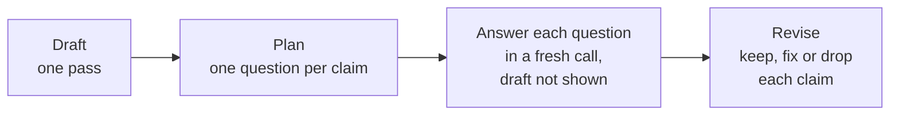
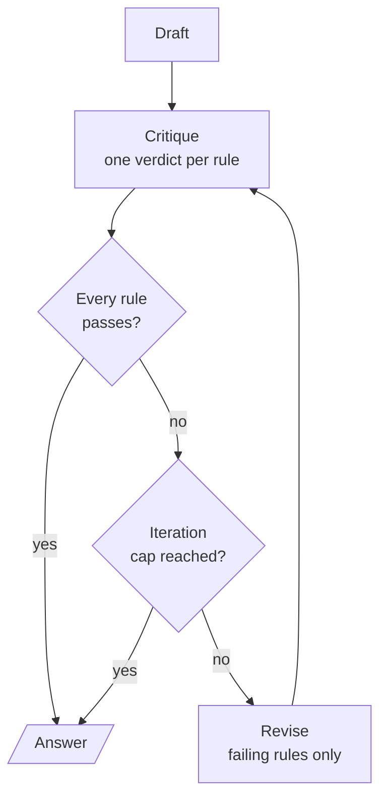

# M25.4 Theory: Chain-of-verification and constitutional critique

*[M25 theory](../README.md) · Lesson 25.4 · Notebooks: [`04a_chain_of_verification.ipynb`](../../notebook/04a_chain_of_verification.ipynb), [`04b_constitutional_ai_critique_loop.ipynb`](../../../optional/notebook/04b_constitutional_ai_critique_loop.ipynb) (optional) · [All theory pages](../../../../../THEORY.md)*
<!-- subtitle: Check each claim in a call that cannot see the draft, and judge each written rule on its own -->
<!-- format: approved -->

## Chain-of-verification

> **What you'll learn**
>
> - **Explain** why verification questions are answered in calls that never see the draft.
> - **Write** verification questions that stand alone and test the property the user asked about.
> - **Diagnose** a reviser that removes a correct claim and calls it a fix.
> - **Compare** factual verification with critique against a written constitution.

Lesson 25.3 showed that a critic re-reading its own draft tends to agree with it. If the model did not know a fact was wrong the first time, the draft sitting in the prompt rarely changes its mind.

A Larkspur cancellation draft promises a full refund and 90 days of data retention. Both promises have to be checked against policy before the answer goes out, and asking the same model "is this right?" with the draft in view is the weak check lesson 25.3 measured.

**Chain-of-verification** (CoVe, from Dhuliawala et al., 2023) checks claims in calls that cannot see the draft. It has four steps:

<!-- animated: diagrams/cove.anim.html -->

*Figure 1: Chain-of-verification. Only the last step sees the draft and the independent answers together.*

### The four steps, with structured output at each

The verification notebook runs every step after the draft as a structured-output call:

1. **Draft.** Answer in one pass. The recorded example asks for 8 U.S. presidents born in Ohio when only 7 exist (Grant, Hayes, Garfield, Benjamin Harrison, McKinley, Taft and Harding). The model has to pad the list.
2. **Plan.** One atomic, self-contained question per claim. Say what to verify: a prompt that asked only for "one question per factual claim" produced *"Who was the 18th President?"*, which checks a claim nobody doubted. Tying each question to the property the user asked about ("born in Ohio" becomes "Where was X born?") fixed it.
3. **Verify.** Each question goes to its own call with no draft, no other questions and no earlier answers. The calls are independent, and the notebook sends them as one batch.
4. **Revise.** Only now does the model see the draft next to every pair of question and independent answer. It returns the final list and a list of the corrections it made (`corrections_made`), and code scores both against the ground truth.

We call the step-2 failure the **doubtless question**: a verification question that tests something true and leaves the doubtful property unchecked.

### Why the verifier must not see the draft

Independence is the whole mechanism. The same question asked two ways shows the difference:

Check the draft's retention claim with and without the draft in the prompt. The exchange is illustrative.

<button type="button" data-mode="with-draft" aria-pressed="false" aria-controls="verify-with-draft">Draft in view</button>
<button type="button" data-mode="independent" aria-pressed="false" aria-controls="verify-independent">Fresh call, draft hidden</button>

<section id="verify-with-draft" class="mode-panel" data-announcement="Draft in view selected. The check confirms the draft."><h4>Draft in view</h4><ul><li>The prompt holds the draft's sentence "your data is kept for 90 days" and asks whether it is right.</li><li>The model reads its own claim back and tends to confirm it: the check inherits the error it was meant to catch.</li></ul></section>
<section id="verify-independent" class="mode-panel" data-announcement="Fresh call selected. The answer comes from policy, not from the draft."><h4>Fresh call, draft hidden</h4><ul><li>The prompt holds only "How long is data kept after a Larkspur plan is cancelled?"</li><li>The answer has nothing to agree with. With retrieval it returns the policy: 30 days, then permanent deletion. The reviser then sees 90 against 30 and fixes the claim.</li></ul></section>

The question also has to stand on its own: "How long is data kept after cancelling *the plan*?" would need the draft to say which plan.

### What verification can and cannot fix

The recorded findings set the limits:

| Finding | Evidence | Consequence |
|---|---|---|
| It raises precision and leaves recall alone | A president the draft left out is still missing after revision | CoVe checks claims that were made and adds none |
| The reviser can add errors | It removed Rutherford B. Hayes, whose verified birthplace is "Delaware, Ohio", apparently reading Delaware as the state, and its own corrections list called that a fix | Only scoring in code exposed it |
| It is bounded by what the verifier knows | If the model also answers the narrow question wrongly, CoVe agrees with the draft | Ground the answers in retrieval |
| It costs 1 + 1 + N + 1 calls for N claims | Against 1 call for the draft alone | Batch the N independent calls |
| It must leave a right answer alone | A control asks for 5 presidents born in Virginia, where 8 exist and the draft is usually right | Measure on easy questions too |

*Table 1: The limits of chain-of-verification, from the notebook's recorded runs.*

The Hayes case gets a name: the **overeager reviser**, which removes or changes a correct claim and reports the change as a correction. Its own corrections list cannot catch it, because that list is the reviser's opinion of its work.

### Verifying the Larkspur cancellation draft

In a RAG system the third limit is the one to remove: answer each verification question from retrieved chunks instead of the model's memory. The following example is an illustrative application of that retrieval-backed check; the chunk text is the handbook's own. A customer cancels an annual plan 20 days after buying it, and the draft makes three claims:

| Draft claim | Verification question | What the retrieved chunk says | Verdict |
|---|---|---|---|
| You get a full refund, because you are within 30 days | What are the conditions for a full refund on a Larkspur annual plan? | `refund-window`: within 30 days, if the account used less than 100 GB of outbound traffic | Fix |
| The refund appears in 5 to 10 business days | How long does a Larkspur refund take to appear? | `refund-timing`: 5 to 10 business days | Keep |
| Your data is kept for 90 days after cancelling | How long is data kept after a Larkspur plan is cancelled? | `retention`: 30 days, then permanently deleted | Fix |

*Table 2: Three claims, three self-contained questions and three chunks (illustrative).*

The revised answer adds the traffic condition to the first claim and changes 90 days to 30 in the third. Each verification question names "a Larkspur annual plan" instead of "the plan", so retrieval for it works without the draft, and each correction traces to one question and one chunk. Three claims cost 1 + 1 + 3 + 1 = 6 calls.

To measure it on a golden set, count two numbers per answer, before and after:

- **Unsupported claims**: claims no retrieved chunk supports. Verification should lower this.
- **Correct claims removed**: claims that were right in the draft and are gone or changed after revision. This should stay at zero.

A drop in the first with a rise in the second is the overeager reviser at scale. Constitutional critique applies the same draft, critique and revise shape to a different kind of check.

## Constitutional critique

**Constitutional critique** runs the draft, critique and revise loop against a written list of named rules, a constitution, and gives each rule its own verdict. The idea comes from Constitutional AI (Bai et al., 2022), which used written principles to align a model. The optional notebook implements only the critique mechanism:

*Figure 2: The constitutional loop. Only the failing rules' critiques go back to the reviser, and the revision is judged against the whole constitution again.*

The pieces, as the notebook builds them:

- **A constitution as data.** Five named rules kept as a list: Helpful and Direct, No Professional Advice, No Speculation as Fact, Be Concise and Acknowledge Uncertainty. Each gets its own verdict instead of one blended "looks fine".
- **A verdict per rule.** One structured call returns a list of verdicts, each with the rule's name, pass or fail and a critique. A typed list lets code pick out the failing rules.
- **A bounded loop.** `MAX_ITERATIONS = 2` stops it even when a rule keeps failing and reports what still fails; the verdict history shows which rule changed what.
- **A stress test.** The prompt asks about a knee that has hurt for two weeks since the user started running again, and invites a confident diagnosis. The draft is written with no constitution in view, so it has real rules to break.

Step through the longest run the cap allows: the draft and two revisions, six calls at most.

<button type="button" data-step="0" aria-pressed="false" aria-controls="cai-step-0">1. Draft</button><button type="button" data-step="1" aria-pressed="false" aria-controls="cai-step-1">2. Critique</button><button type="button" data-step="2" aria-pressed="false" aria-controls="cai-step-2">3. Revise</button><button type="button" data-step="3" aria-pressed="false" aria-controls="cai-step-3">4. Stop or repeat</button>

<section id="cai-step-0" class="step-panel" aria-labelledby="cai-heading-0"><h4 id="cai-heading-0">1. Draft, iteration 0</h4><dl><dt>Calls</dt><dd>1, with no rules in the prompt</dd><dt>Writes</dt><dd>the first answer to the knee question</dd></dl></section><section id="cai-step-1" class="step-panel" aria-labelledby="cai-heading-1"><h4 id="cai-heading-1">2. Critique against every rule</h4><dl><dt>Calls</dt><dd>1 for the four judgment rules; the word limit is counted in code</dd><dt>Writes</dt><dd>five verdicts, each with pass or fail and a critique</dd></dl></section><section id="cai-step-2" class="step-panel" aria-labelledby="cai-heading-2"><h4 id="cai-heading-2">3. Revise the failing rules</h4><dl><dt>Reads</dt><dd>the question, the current answer and only the failing critiques</dd><dt>Calls</dt><dd>1 revision, then 1 new critique of the whole constitution</dd></dl></section><section id="cai-step-3" class="step-panel" aria-labelledby="cai-heading-3"><h4 id="cai-heading-3">4. Stop or repeat</h4><dl><dt>Stop</dt><dd>when every rule passes, or after the second revision, printing any rule still failing</dd><dt>Most calls</dt><dd>1 + 1 + 2 × (1 + 1) = 6</dd></dl></section>

<button type="button" data-walk="previous">Previous</button>

<button type="button" data-walk="next">Next step</button>

One rule taught the module's recurring lesson. The original "Be Concise" rule ("tight and focused, no padding") never converged: the critic found something to trim in every revision, so the loop always hit its cap. A limit of 150 words, checked in code and left out of the critic's prompt, replaced it and was both stricter and stable. We call this the **moving bar**: a fuzzy rule an LLM judge can always find fault with.

> **Pitfall: the moving bar.** A rule a critic can always find fault with turns a bounded loop into one that always runs to its cap. Make the rule countable and check it in code.

The notebook labels the loop a teaching pattern, not a safety system. Production guardrails need adversarial testing, a calibrated independent judge, human review and monitoring.

| | Chain-of-verification | Constitutional critique |
|---|---|---|
| What it checks | Factual claims | Behaviour against written rules |
| Independence | Questions answered without the draft | One verdict per rule from one call, draft in view |
| Main risk | The overeager reviser | The moving bar |
| Calls per round | 1 + 1 + N + 1 for N claims | 1 critique + 1 revision |

*Table 3: Two checks with the same draft, critique, revise shape.*

## In practice: verified cancellations

For Larkspur's cancellation assistant, verification slots in after the draft:

1. **Plan one question per claim**, self-contained and tied to the property the customer asked about.
2. **Answer each from retrieval**, in parallel, without the draft.
3. **Revise**, then score in code: unsupported claims and correct claims removed, as two numbers.
4. **Add a short constitution** for behaviour (no promises outside policy, say when a fact was not found), with countable rules checked in code.

## Limits of this evidence

- **Recorded runs, one model.** The Hayes removal, the doubtless question and the "Be Concise" behaviour come from the notebooks' runs with `gpt-4o-mini`; a different run can pad, verify or revise differently.
- **The Larkspur check is illustrative.** The chunk text matches the handbook; the draft and the verdicts were written for this page, not produced by a run.
- **Memory-only verification.** The notebook verifies from the model's own knowledge. Retrieval removes that bound only when the right chunk is retrieved.

Lesson 25.5 moves the extra calls to before the answer, and to a critic that runs the output.

## References

1. Dhuliawala et al., [Chain-of-Verification Reduces Hallucination in Large Language Models](https://arxiv.org/abs/2309.11495), 2023.
2. Bai et al., [Constitutional AI: Harmlessness from AI Feedback](https://arxiv.org/abs/2212.08073), 2022.

## Key Takeaways

- Chain-of-verification drafts, plans one question per claim, answers each in a fresh call without the draft, then revises. Tie each question to the property the user asked about, or it checks claims nobody doubted.
- It raises precision, not recall, costs 1 + 1 + N + 1 calls for N claims and is bounded by what the verifier knows. In a RAG system, answer each verification question from retrieved chunks.
- The reviser can remove correct claims and call it a fix. Score in code, and track unsupported claims and correct claims removed as two separate numbers.

## Check yourself

1. Why does chain-of-verification answer each verification question in a call that cannot see the draft?

If the model did not know a fact was wrong the first time, re-reading rarely shows it: with the draft in the prompt, the model agrees with itself. A fresh call with no draft, no other questions and no earlier answers checks each claim on its own.

2. A customer cancels an annual plan 20 days after buying it, and the draft promises a full refund and 90 days of data retention. What does the revised answer change?

It adds the condition from the `refund-window` chunk: a full refund within 30 days only if the account used less than 100 GB of outbound traffic. It changes 90 days to 30, then permanent deletion, from the `retention` chunk. The claim that the refund appears in 5 to 10 business days is kept.

3. After adding verification, unsupported claims per answer fall, but the count of correct claims removed rises. What is happening?

The reviser is adding errors, as when it removed Rutherford B. Hayes, whose verified birthplace was "Delaware, Ohio", and its own `corrections_made` called that a fix. Only scoring in code against the ground truth exposes it, which is why the removed correct claims are counted as a separate number.

---
*Previous: [25.3 Reflection and Reflexion agents](../03_reflection_and_reflexion_agents/README.md). Next: [25.5 Self-Discover and reflective code generation](../../../optional/theory/05_self_discover_and_reflective_code_generation/README.md).*
