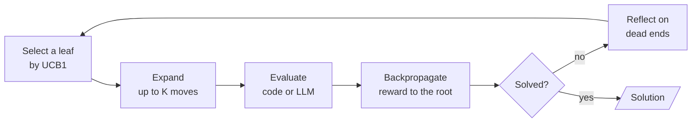

# M25.6 Theory: Self-consistency, tree of thoughts and LATS

*[M25 theory](../README.md) · Lesson 25.6 · Notebooks: [`06a_self_consistency.ipynb`](../../notebook/06a_self_consistency.ipynb), [`06b_tree_of_thoughts.ipynb`](../../notebook/06b_tree_of_thoughts.ipynb), [`06c_lats.ipynb`](../../../optional/notebook/06c_lats.ipynb) (optional) · [All theory pages](../../../../../THEORY.md)*

## Tree of thoughts / LATS

Sampling more answers helps only if you can choose a better one. You will compare voting over complete answers with searching intermediate states, using arithmetic problems whose moves can be checked in code. Then you will decide whether that extra search has a useful evaluator for Larkspur's support questions.

### Step 1: Choose where extra model calls go

A single chain of thought is one sample from many possible reasoning paths. The three implementations spend extra LLM calls on more paths, each in a different place:

| Pattern | Where the extra calls go | What picks the answer | Fails when |
|---|---|---|---|
| Self-consistency (Wang et al., 2022) | N whole answers to the same prompt at temperature above 0 | A majority vote over the final answers | The error is systematic: the samples agree on the same wrong answer |
| Tree of thoughts (Yao et al., 2023) | Several proposed next steps from every state, level by level | An evaluator scores each state; the best `BEAM` survive | The evaluator prunes the state that leads to the solution |
| LATS (Zhou et al., 2024) | One leaf at a time, chosen by Monte Carlo tree search | Rewards backpropagated to the root, plus lessons from dead ends | The value model misleads selection |

### Step 2: Check whether agreement hides a shared error

Self-consistency needs short, comparable answers (a number, a label) and nothing else. The self-consistency experiments include both cases. On the sum of all digits from 1 to 100 the wrong answers were scattered, which a vote washes out. On three-digit numbers whose digits add up to 10, most wrong answers were the same number, 55, which a vote locks in. High agreement is a cheap confidence signal, but consistent is not the same as correct.

### Step 3: Validate proposed moves before scoring them

Tree of thoughts (ToT) spends its calls on intermediate steps instead. The tree-of-thoughts example uses the Game of 24, the benchmark from the ToT paper: combine four numbers with `+ - * /` to make 24. A state is the numbers still in play. A thought is one move. Four pieces make the search:

- **Rules in code.** Moves are applied with exact fractions, so an illegal or mis-computed proposal is dropped and the tree holds only legal states.
- **A proposer.** The LLM, at temperature 0.7, suggests up to `PROPOSALS = 8` moves per state.
- **An evaluator.** With three numbers left, an LLM at temperature 0 judges `sure`, `likely` or `impossible` (scores 3, 1, 0). With two left, code checks the six operations exactly. Where code can decide it should: while prototyping, an LLM judged `[4, 24]` as `sure` because 24 was in the list.
- **Beam search.** `expand → evaluate` in a LangGraph loop keeps the best `BEAM = 5` states per level, and a pure router stops at a solution, an empty frontier or the depth limit.

The reported runs show that in its runs single-pass CoT solved between a twentieth and a quarter of the samples, while ToT solved about half of the eight puzzles at roughly 10 to 15 LLM calls per puzzle. Every returned ToT solution is checked in code. Failed searches can result from a solving state being scored `impossible` and pruned, or from the proposer never generating the needed move.

Check the two-number boundary with exact arithmetic. A model saying that a state is promising cannot override these operations.

```python
from fractions import Fraction

a, b = Fraction(4), Fraction(24)
results = [a + b, a - b, b - a, a * b, a / b, b / a]
print([str(value) for value in results])
print(Fraction(24) in results)
```

**Expected output**

```text
['28', '-20', '20', '96', '1/6', '6']
False
```

The target appearing among the inputs is insufficient. Both remaining inputs must be used in a legal operation.

### Step 4: Follow one leaf through selection and feedback

LATS replaces the level-by-level beam with Monte Carlo tree search, one leaf per iteration:



Selection walks down from the root, at each level taking the child with the best average value plus an exploration bonus:

```
UCB1(child) = child.value / child.visits + c * sqrt(ln(parent.visits) / child.visits)
```

An unvisited child scores infinity, so every child is tried once. The LATS configuration sets `c = 1.4`, `K_CANDIDATES = 4`, `MAX_ITERATIONS = 10` and rewards of 1, 0.33 and 0 for `sure`, `likely` and `impossible`. A node whose children all died gets one more expansion (`MAX_EXPANSIONS = 2`) with the latest reflections in its prompt, then is pruned for good. Each dead end becomes a one-sentence lesson that later proposals read, which is Reflexion (lesson 25.3) used inside a search.

### Step 5: Compare the saved results and limits

On these eight puzzles LATS did not win: the reported runs show it solved 2 to 4 of 8, the ToT beam about 4, and LATS spent more LLM calls. Its solved runs finished in two or three iterations, because it stops at the first success. LATS was designed for problems with a larger branching factor and a better value model.

For a Larkspur support assistant most questions have one good path, and lessons 25.1 and 25.4 are the tools to reach for. Reach for these patterns when one path is not reliable enough and something can score a partial answer: a code check, a test suite, or a judge you have measured. Without that evaluator, more branches only multiply the calls.

### Try it yourself

List the possible operations with just 4 and 24 remaining. Check addition, subtraction in both directions, multiplication and division in both directions. None gives 24, even though 24 is already one input. Use that case to explain why a code-based two-number check should override an evaluator that says `sure`, and why a high vote count alone cannot establish correctness.

### Practice notebook

Use the implementation below to test the exercise and inspect each state update. Follow its provider setup for live model calls. Recorded model responses and timings can change on a new run.

- [Self-consistency voting](../../notebook/06a_self_consistency.ipynb).
- [Tree of thoughts](../../notebook/06b_tree_of_thoughts.ipynb).
- [LATS tree search](../../../optional/notebook/06c_lats.ipynb) (optional).

## Key Takeaways

- Self-consistency votes over N sampled answers and needs short, comparable answers. It washes out scattered errors but locks in systematic ones, so high agreement signals confidence, not correctness.
- Tree of thoughts proposes several moves per state, scores them and keeps the best `BEAM` per level. Enforce the rules in code and let code judge whatever it can decide exactly.
- LATS picks one leaf at a time by UCB1 and learns from dead ends, yet on the Game of 24 it did not win. Use these searches only when something reliable can score a partial answer.

## Check yourself

<details>
<summary>1. When does a majority vote over sampled answers fail to fix a wrong answer?</summary>

When the error is systematic and the samples agree on the same wrong answer. On three-digit numbers whose digits add up to 10, most wrong answers were 55, which a vote locks in. On the sum of the digits from 1 to 100 the wrong answers were scattered and the vote washed them out. Consistent is not the same as correct.

</details>

<details>
<summary>2. In the Game of 24 search, an LLM evaluator judged the state with 4 and 24 left as sure. What should judge two-number states instead?</summary>

Code. With two numbers left, the implementation checks the six operations exactly, because where code can decide, it should. The LLM said `sure` only because 24 was in the list.

</details>

<details>
<summary>3. Should Larkspur's support assistant answer handbook questions with tree of thoughts or LATS?</summary>

Usually not. Most of its questions have one good path, and plan-and-execute or chain-of-verification fit them. Reach for these search patterns only when one path is not reliable enough and something can score a partial answer: a code check, a test suite or a judge you have measured. Without that, more branches only multiply the calls.

</details>

---
*Previous: [25.4 Chain-of-verification and constitutional critique](../04_chain_of_verification_and_constitutional_critique/README.md). Next: [M25 interview questions](../README.md#interview-spotlight-5-questions-you-might-get-asked).*
