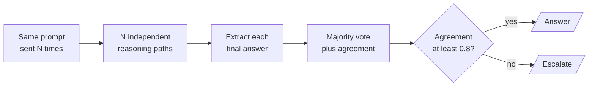
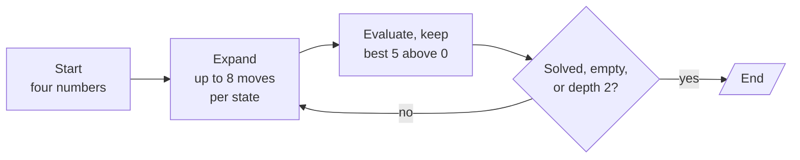
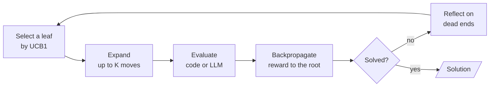
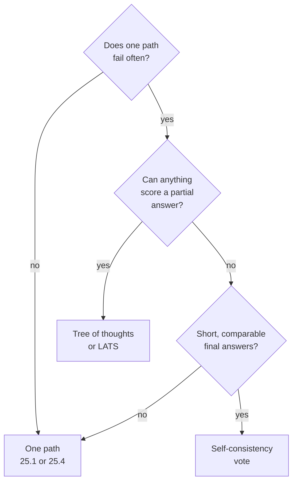

# M25.6 Theory: Self-consistency, tree of thoughts and LATS

*[M25 theory](../README.md) · Lesson 25.6 · Notebooks: [`06a_self_consistency.ipynb`](../../notebook/06a_self_consistency.ipynb), [`06b_tree_of_thoughts.ipynb`](../../notebook/06b_tree_of_thoughts.ipynb), [`06c_lats.ipynb`](../../../optional/notebook/06c_lats.ipynb) (optional) · [All theory pages](../../../../../THEORY.md)*
<!-- subtitle: More reasoning paths help only when something can tell a good path from a bad one -->
<!-- format: approved -->

## When five samples agree on the wrong answer

> **What you'll learn**
>
> - **Compare** where self-consistency, tree of thoughts and LATS spend their extra LLM calls.
> - **Diagnose** a majority vote that locks in a systematic error.
> - **Explain** why legal moves and two-number states are judged in code, not by the model.
> - **Choose** whether a Larkspur question deserves tree search at all.

Ask `gpt-4o-mini` how many three-digit numbers have digits that add up to 10. The right answer, counted in code, is 54. In the notebook's prototyping runs the model was right about 40% of the time, and most wrong answers were the same number, 55. Ask five times and take a majority, and you get 55 more reliably than from a single sample.

Lesson 25.5 spent extra calls on one better path. This lesson spends them on several paths at once and keeps the best, which helps only if something can pick the better path. The notebooks test three patterns on arithmetic, where code checks every answer. The question for Larkspur is whether its support questions have anything like that check.

## Tree of thoughts / LATS

**Tree of thoughts** searches over intermediate reasoning states, scoring each and expanding the best. **LATS** (language agent tree search) runs the same kind of search one leaf at a time with Monte Carlo tree search. Both rest on the idea that self-consistency tests first: more paths plus a selector can beat one path. The three patterns differ in where they spend the extra calls and in what does the picking:

| Pattern | Where the extra calls go | What picks the answer | Fails when |
|---|---|---|---|
| Self-consistency (Wang et al., 2022) | N whole answers to the same prompt at temperature above 0 | A majority vote over the final answers | The error is systematic: the samples agree on the same wrong answer |
| Tree of thoughts (Yao et al., 2023) | Several proposed next steps from every state, level by level | An evaluator scores each state, and the best `BEAM` survive | The evaluator prunes the state that leads to the solution |
| LATS (Zhou et al., 2024) | One leaf at a time, chosen by Monte Carlo tree search | Rewards passed back up to the root, plus lessons from dead ends | The value estimate misleads selection |

*Table 1: Three ways to spend extra calls on more reasoning paths.*

### Self-consistency: vote over whole answers

Self-consistency sends the same chain-of-thought prompt N times at temperature 0.7. No sample sees another. Code extracts each final answer from a fixed `Final Answer:` line and counts them:

*Figure 1: Self-consistency. The vote needs short, comparable answers, and the agreement share is a free confidence signal.*

The notebook samples 5 answers, three times per question, and votes. Its prototyping runs, 20 samples per question, show the three cases a vote can meet:

| Question | Right answer | Single samples | What the vote does |
|---|---|---|---|
| A bakery word problem | 2 | Right every time | Nothing but add cost |
| Sum of all the digits from 1 to 100 | 901 | Right about 80% of the time; the wrong answers scattered | Washes the scattered errors out |
| Three-digit numbers whose digits add up to 10 | 54 | Right about 40% of the time; most wrong answers were 55 | Locks the shared error in |

*Table 2: Easy, random and systematic errors under a majority vote. Right answers computed in code, rates from the notebook's recorded runs.*

We call the third row the **confident wrong majority**: the samples agree, and they agree on the wrong answer. The notebook uses the agreement share to act on high agreement and escalate low agreement, with a threshold of 0.8. That flags a guessing model. It cannot flag the confident wrong majority, because consistent is not the same as correct.

### Tree of thoughts on the Game of 24

Tree of thoughts (ToT) spends its calls on intermediate steps instead of whole answers. The notebook uses the Game of 24, the benchmark from the ToT paper: combine four numbers with addition, subtraction, multiplication and division, each number once, to make 24. A **state** is the numbers still in play, and a **thought** is one move.

*Figure 2: The ToT beam search. A pure router reads the state the evaluate step wrote.*

Four pieces make the search:

- **Rules in code.** Moves are applied with exact fractions. An illegal or mis-computed proposal is dropped, and two paths to the same numbers count as one state, so the tree holds only distinct legal states.
- **A proposer.** The model, at temperature 0.7, suggests up to `PROPOSALS = 8` moves per state.
- **An evaluator.** With three numbers left, the model at temperature 0 judges `sure`, `likely` or `impossible` (scores 3, 1 and 0). With two left, code checks the six possible operations exactly.
- **Beam search.** An expand and evaluate loop in LangGraph keeps the best `BEAM = 5` states per level, and a pure router stops at a solution, an empty frontier or the depth limit.

The two-number rule exists because of a planted failure found while prototyping. The model judged the state with 4 and 24 left as `sure`, because 24 was in the list. Exact arithmetic says otherwise:

| Operation | Result |
|---|---|
| 4 plus 24 | 28 |
| 4 minus 24 | minus 20 |
| 24 minus 4 | 20 |
| 4 times 24 | 96 |
| 4 divided by 24 | 1/6 |
| 24 divided by 4 | 6 |

*Table 3: Every operation on the state with 4 and 24 left, computed with exact fractions. None gives 24, which makes the state a dead end.*

Both remaining numbers must be used in one legal operation, and the target appearing among the inputs is not enough. We call this the **lucky-looking state**, and it is why code judges every state it can decide: a model saying a state is promising cannot override arithmetic.

On eight solvable puzzles, single-pass chain of thought solved between a twentieth and a quarter of the samples in the recorded runs; its expressions often used a number twice or skipped one. ToT solved about half of the puzzles at roughly 10 to 15 LLM calls per puzzle, and every returned solution is valid by construction because code applied each step. A search fails in two ways: a solvable state is scored `impossible` and pruned, or the proposer never generates the move the solution needs.

### LATS: one leaf at a time

LATS replaces the level-by-level beam with Monte Carlo tree search, one leaf per iteration:

*Figure 3: One LATS iteration. Rewards flow back to the root, and dead ends become lessons for later proposals. In the notebook a reflection is written only for a child that dead-ended, so an iteration with none goes straight back to selection.*

Selection walks down from the root, at each level taking the child with the best **UCB1** score: its average value (total value divided by visits) plus an exploration bonus of *c* times the square root of ln(parent visits) divided by the child's visits. An unvisited child scores infinity, which tries every child once. A child visited often earns a smaller bonus, which is what stops the search from only ever deepening its current favourite.

An illustrative case shows the bonus at work. The root was expanded into four children, A, B, C and D, rated `likely`, `sure`, `impossible` and `likely`. Selection then picked B (UCB1 2.65 against 1.98 for A and D), and all four of B's two-number children were dead ends. Now the root has 8 visits:

| Child | Visits | Average value | Bonus | UCB1 |
|---|---|---|---|---|
| A | 1 | 0.33 | 2.02 | 2.35 |
| B | 5 | 0.20 | 0.90 | 1.10 |
| C | 1 | 0.00 | 2.02 | 2.02 |
| D | 1 | 0.33 | 2.02 | 2.35 |

*Table 4: UCB1 at the root after B's children died, with c = 1.4. Illustrative rewards; values computed from the notebook's formula.*

B's average fell and its bonus shrank, and the next selection moves to A. The notebook's settings:

| Setting | Value | What it controls |
|---|---|---|
| Exploration constant *c* | 1.4 | How much the bonus favours rarely visited children |
| Candidates per expansion | 4 | Moves proposed from a selected leaf |
| Iterations | 10 | Leaves selected before the search gives up |
| Rewards | 1, 0.33, 0 | Values for `sure`, `likely` and `impossible` |
| Expansions per node | 2 | A node whose children all died gets one more try, then is pruned for good |

*Table 5: The LATS configuration in the notebook.*

Each two-number dead end becomes a one-sentence lesson, and every later expansion prompt carries the latest three. That is Reflexion from lesson 25.3 used inside a search.

Step through one LATS iteration and the state each step changes.

<button type="button" data-step="0" aria-pressed="false" aria-controls="lats-step-0">1. Select</button><button type="button" data-step="1" aria-pressed="false" aria-controls="lats-step-1">2. Expand</button><button type="button" data-step="2" aria-pressed="false" aria-controls="lats-step-2">3. Evaluate</button><button type="button" data-step="3" aria-pressed="false" aria-controls="lats-step-3">4. Backpropagate</button><button type="button" data-step="4" aria-pressed="false" aria-controls="lats-step-4">5. Reflect</button>

<section id="lats-step-0" class="step-panel" aria-labelledby="lats-heading-0"><h4 id="lats-heading-0">1. Select a leaf</h4><dl><dt>Reads</dt><dd>visits and values of the live children at each level</dd><dt>Does</dt><dd>takes the best UCB1 child down to a leaf; a node whose children all died is retried once, then marked dead</dd></dl></section><section id="lats-step-1" class="step-panel" aria-labelledby="lats-heading-1"><h4 id="lats-heading-1">2. Expand it</h4><dl><dt>Reads</dt><dd>the leaf's numbers, its steps and the latest three lessons</dd><dt>Does</dt><dd>asks for up to 4 moves, keeps the legal ones whose state is new to that node</dd></dl></section><section id="lats-step-2" class="step-panel" aria-labelledby="lats-heading-2"><h4 id="lats-heading-2">3. Evaluate each child</h4><dl><dt>Two numbers left</dt><dd>code: 1 and solved, or 0 and dead</dd><dt>Three numbers left</dt><dd>one LLM verdict: 1, 0.33 or 0</dd></dl></section><section id="lats-step-3" class="step-panel" aria-labelledby="lats-heading-3"><h4 id="lats-heading-3">4. Backpropagate</h4><dl><dt>Does</dt><dd>adds one visit and the reward to the child and every ancestor up to the root</dd><dt>Stops</dt><dd>the whole search at the first solved child</dd></dl></section><section id="lats-step-4" class="step-panel" aria-labelledby="lats-heading-4"><h4 id="lats-heading-4">5. Reflect on dead ends</h4><dl><dt>When</dt><dd>a two-number child cannot make 24</dd><dt>Writes</dt><dd>one specific lesson that names numbers, read by later expansion prompts</dd></dl></section>

<button type="button" data-walk="previous">Previous</button>

<button type="button" data-walk="next">Next step</button>

On these eight puzzles LATS did not win. In the recorded runs it solved 2 to 4 of 8, the ToT beam about 4, and LATS spent more LLM calls. Its solved runs finished in two or three iterations, because it stops at the first success, while unsolved ones used the whole budget or ran out of live branches. LATS was designed for problems with a larger branching factor and a better value estimate than eight small puzzles offer.

The three patterns side by side:

Choose a pattern and compare what it spends, what selects, and what the notebook measured.

<button type="button" data-mode="sc" aria-pressed="false" aria-controls="search-sc">Self-consistency</button><button type="button" data-mode="tot" aria-pressed="false" aria-controls="search-tot">Tree of thoughts</button><button type="button" data-mode="lats" aria-pressed="false" aria-controls="search-lats">LATS</button>

<section id="search-sc" class="mode-panel"><h4>Self-consistency</h4><dl><dt>Spends</dt><dd>5 whole answers per vote</dd><dt>Selects with</dt><dd>a majority vote; agreement below 0.8 escalates</dd><dt>Measured</dt><dd>scattered errors washed out; 55 locked in for a right answer of 54</dd></dl></section>
<section id="search-tot" class="mode-panel"><h4>Tree of thoughts</h4><dl><dt>Spends</dt><dd>up to 8 proposals per state, two levels deep</dd><dt>Selects with</dt><dd>LLM verdicts at three numbers, exact code at two; best 5 kept</dd><dt>Measured</dt><dd>about half of 8 puzzles at roughly 10 to 15 calls each</dd></dl></section>
<section id="search-lats" class="mode-panel"><h4>LATS</h4><dl><dt>Spends</dt><dd>one leaf per iteration, up to 10 iterations</dd><dt>Selects with</dt><dd>UCB1 over backpropagated rewards, plus lessons from dead ends</dd><dt>Measured</dt><dd>2 to 4 of 8 puzzles, more calls than the beam</dd></dl></section>

## Choosing whether to search

All three patterns multiply calls, and each needs something to select with. The decision for any task comes down to the selector:

*Figure 4: Search only where an evaluator or a vote can pick the better path.*

For a Larkspur support assistant most questions have one good path, and plan-and-execute (lesson 25.1) or chain-of-verification (lesson 25.4) are the tools to reach for. Reach for these patterns when one path is not reliable enough and something can score a partial answer: a code check, a test suite or a judge you have measured. A sizing calculation with a checkable result could qualify. A refund question answered from one handbook chunk does not.

Without that evaluator, more branches only multiply the calls.

## Limits of this evidence

- **Recorded runs.** Accuracy rates and call counts come from the notebooks' recorded `gpt-4o-mini` runs; we did not call a model for this page, and sampled runs vary.
- **Computed in code.** The right answers 2, 901 and 54, the six results in Table 3 and the UCB1 values in Table 4 were recomputed for this page. Table 4's rewards are illustrative.
- **One small benchmark.** Eight puzzles show how ToT and LATS spend a budget, not which one is better in general.

## References

1. Wang et al., [Self-Consistency Improves Chain of Thought Reasoning in Language Models](https://arxiv.org/abs/2203.11171), 2022.
2. Yao et al., [Tree of Thoughts: Deliberate Problem Solving with Large Language Models](https://arxiv.org/abs/2305.10601), 2023.
3. Zhou et al., [Language Agent Tree Search Unifies Reasoning Acting and Planning in Language Models](https://arxiv.org/abs/2310.04406), 2024.

## Key Takeaways

- Self-consistency votes over N sampled answers and needs short, comparable answers. It washes out scattered errors but locks in systematic ones. High agreement signals confidence and says nothing about correctness.
- Tree of thoughts proposes several moves per state, scores them and keeps the best `BEAM` per level. Enforce the rules in code and let code judge whatever it can decide exactly.
- LATS picks one leaf at a time by UCB1 and learns from dead ends, yet on the Game of 24 it did not win. Use these searches only when something reliable can score a partial answer.

## Check yourself

1. When does a majority vote over sampled answers fail to fix a wrong answer?

When the error is systematic and the samples agree on the same wrong answer. On three-digit numbers whose digits add up to 10, most wrong answers were 55, which a vote locks in. On the sum of the digits from 1 to 100 the wrong answers were scattered and the vote washed them out. Consistent is not the same as correct.

2. In the Game of 24 search, an LLM evaluator judged the state with 4 and 24 left as sure. What should judge two-number states instead?

Code. With two numbers left, the implementation checks the six operations exactly, because where code can decide, it should. The six results are 28, minus 20, 20, 96, 1/6 and 6. The state is a dead end, and the LLM said `sure` only because 24 was in the list.

3. Should Larkspur's support assistant answer handbook questions with tree of thoughts or LATS?

Usually not. Most of its questions have one good path, and plan-and-execute or chain-of-verification fit them. Reach for these search patterns only when one path is not reliable enough and something can score a partial answer: a code check, a test suite or a judge you have measured. Without that, more branches only multiply the calls.

---
*Previous: [25.5 Self-Discover and reflective code generation](../../../optional/theory/05_self_discover_and_reflective_code_generation/README.md). Next: [25.7 Simulator-in-the-loop, metacognition and exemplar memory](../../../optional/theory/07_simulator_in_the_loop_metacognition_and_exemplar_memory/README.md).*
