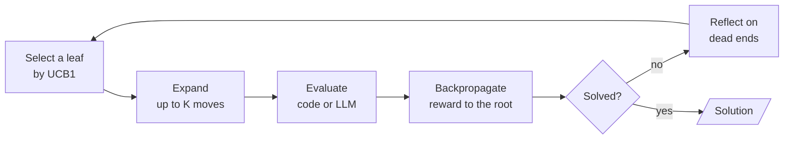
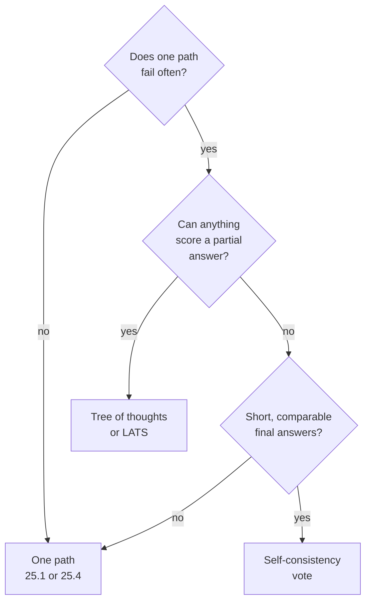

# M25.6 Theory: Self-consistency, tree of thoughts and LATS

*[M25 theory](../README.md) · Lesson 25.6 · Notebooks: [`06a_self_consistency.ipynb`](../../notebook/06a_self_consistency.ipynb), [`06b_tree_of_thoughts.ipynb`](../../notebook/06b_tree_of_thoughts.ipynb), [`06c_lats.ipynb`](../../../optional/notebook/06c_lats.ipynb) (optional) · [All theory pages](../../../../../THEORY.md)*
<!-- subtitle: More reasoning paths help only when something can tell a good path from a bad one -->

## Tree of thoughts / LATS

> **What you'll learn**
>
> - **Compare** where self-consistency, tree of thoughts and LATS spend their extra LLM calls.
> - **Diagnose** a majority vote that locks in a systematic error.
> - **Explain** why legal moves and two-number states are judged in code, not by the model.
> - **Choose** whether a Larkspur question deserves tree search at all.

Lesson 25.5 spent extra calls on one better path: a reasoning structure before the answer, or a critic after it. This lesson spends them on several paths at once and keeps the best.

A single chain of thought is one sample from many possible reasoning paths. Sampling more answers helps only if you can pick a better one, and the three patterns here differ in where they spend the extra calls and in what does the picking. The notebooks test them on arithmetic, where every answer can be checked in code. The question for Larkspur is whether its support questions have anything like that check.

| Pattern | Where the extra calls go | What picks the answer | Fails when |
|---|---|---|---|
| Self-consistency (Wang et al., 2022) | N whole answers to the same prompt at temperature above 0 | A majority vote over the final answers | The error is systematic: the samples agree on the same wrong answer |
| Tree of thoughts (Yao et al., 2023) | Several proposed next steps from every state, level by level | An evaluator scores each state, and the best `BEAM` survive | The evaluator prunes the state that leads to the solution |
| LATS (Zhou et al., 2024) | One leaf at a time, chosen by Monte Carlo tree search | Rewards passed back up to the root, plus lessons from dead ends | The value estimate misleads selection |

*Table 1: Three ways to spend extra calls on more reasoning paths.*

**Tree of thoughts** searches over intermediate reasoning states, scoring each and expanding the best. **LATS** (language agent tree search) does the same search one leaf at a time with Monte Carlo tree search. Both rest on the idea self-consistency tests first: whether more paths plus a selector beat one path.

### When agreement hides a shared error

Self-consistency needs short, comparable answers (a number, a label) and nothing else. The notebook samples 5 answers at temperature 0.7, three times per question, and votes. Its prototyping runs, 20 samples per question, show both sides of the vote:

| Question | Right answer | Single samples | Wrong answers |
|---|---|---|---|
| Sum of all the digits from 1 to 100 | 901 | Right about 80% of the time | Scattered, so a vote washes them out |
| Three-digit numbers whose digits add up to 10 | 54 | Right about 40% of the time | Mostly the same number, 55, so a vote locks it in |

*Table 2: Random and systematic errors under a majority vote. Right answers computed in code, rates from the notebook's recorded runs.*

We call the second row the **confident wrong majority**: the samples agree, and they agree on the wrong answer. High agreement is a cheap confidence signal, and consistent is not the same as correct.

### Tree of thoughts on the Game of 24

Tree of thoughts (ToT) spends its calls on intermediate steps instead of whole answers. The notebook uses the Game of 24, the benchmark from the ToT paper: combine four numbers with addition, subtraction, multiplication and division to make 24. A **state** is the numbers still in play, and a **thought** is one move. Four pieces make the search:

- **Rules in code.** Moves are applied with exact fractions, and an illegal or mis-computed proposal is dropped and the tree holds only legal states.
- **A proposer.** The model, at temperature 0.7, suggests up to `PROPOSALS = 8` moves per state.
- **An evaluator.** With three numbers left, the model at temperature 0 judges `sure`, `likely` or `impossible` (scores 3, 1 and 0). With two left, code checks the six possible operations exactly.
- **Beam search.** An expand and evaluate loop in LangGraph keeps the best `BEAM = 5` states per level, and a pure router stops at a solution, an empty frontier or the depth limit.

The two-number rule exists because of a planted failure found while prototyping. The model judged the state with 4 and 24 left as `sure`, because 24 was in the list. Exact arithmetic says otherwise:

| Operation | Result |
|---|---|
| 4 plus 24 | 28 |
| 4 minus 24 | minus 20 |
| 24 minus 4 | 20 |
| 4 times 24 | 96 |
| 4 divided by 24 | 1/6 |
| 24 divided by 4 | 6 |

*Table 3: Every operation on the state with 4 and 24 left, computed with exact fractions. None gives 24, which makes the state a dead end.*

Both remaining numbers must be used in one legal operation, and the target appearing among the inputs is not enough. We call this the **lucky-looking state**, and it is why code judges every state it can decide: a model saying a state is promising cannot override arithmetic.

In the recorded runs, single-pass chain of thought solved between a twentieth and a quarter of the samples. ToT solved about half of the eight puzzles at roughly 10 to 15 LLM calls per puzzle, and every returned solution is checked in code. A search fails in two ways: a solvable state is scored `impossible` and pruned, or the proposer never generates the move the solution needs.

### LATS: one leaf at a time

LATS replaces the level-by-level beam with Monte Carlo tree search, one leaf per iteration:

*Figure 1: One LATS iteration. Rewards flow back to the root, and dead ends become lessons for later proposals.*

Selection walks down from the root, at each level taking the child with the best **UCB1** score: its average value (total value divided by visits) plus an exploration bonus of *c* times the square root of ln(parent visits) divided by the child's visits. An unvisited child scores infinity, which tries every child once, and a child visited often earns a smaller bonus. The bonus is what stops the search from only ever deepening its current favourite.

The notebook's settings:

| Setting | Value | What it controls |
|---|---|---|
| Exploration constant *c* | 1.4 | How much the bonus favours rarely visited children |
| Candidates per expansion | 4 | Moves proposed from a selected leaf |
| Iterations | 10 | Leaves selected before the search gives up |
| Rewards | 1, 0.33, 0 | Values for `sure`, `likely` and `impossible` |
| Expansions per node | 2 | A node whose children all died gets one more try, then is pruned for good |

*Table 4: The LATS configuration in the notebook.*

The second expansion carries the latest reflections in its prompt. Each dead end becomes a one-sentence lesson that later proposals read, which is Reflexion from lesson 25.3 used inside a search.

On these eight puzzles LATS did not win. The recorded runs show it solved 2 to 4 of 8, the ToT beam about 4, and LATS spent more LLM calls. Its solved runs finished in two or three iterations, because it stops at the first success. LATS was designed for problems with a larger branching factor and a better value estimate than eight small puzzles offer.

## Choosing whether to search

All three patterns multiply calls, and each needs something to select with. The decision for any task comes down to the selector:

*Figure 2: Search only where an evaluator or a vote can pick the better path.*

For a Larkspur support assistant most questions have one good path, and plan-and-execute (lesson 25.1) or chain-of-verification (lesson 25.4) are the tools to reach for. Reach for these patterns when one path is not reliable enough and something can score a partial answer: a code check, a test suite or a judge you have measured. A sizing calculation with a checkable result could qualify. A refund question answered from one handbook chunk does not.

Without that evaluator, more branches only multiply the calls.

## Key Takeaways

- Self-consistency votes over N sampled answers and needs short, comparable answers. It washes out scattered errors but locks in systematic ones. High agreement signals confidence and says nothing about correctness.
- Tree of thoughts proposes several moves per state, scores them and keeps the best `BEAM` per level. Enforce the rules in code and let code judge whatever it can decide exactly.
- LATS picks one leaf at a time by UCB1 and learns from dead ends, yet on the Game of 24 it did not win. Use these searches only when something reliable can score a partial answer.

## Check yourself

1. When does a majority vote over sampled answers fail to fix a wrong answer?

When the error is systematic and the samples agree on the same wrong answer. On three-digit numbers whose digits add up to 10, most wrong answers were 55, which a vote locks in. On the sum of the digits from 1 to 100 the wrong answers were scattered and the vote washed them out. Consistent is not the same as correct.

2. In the Game of 24 search, an LLM evaluator judged the state with 4 and 24 left as sure. What should judge two-number states instead?

Code. With two numbers left, the implementation checks the six operations exactly, because where code can decide, it should. The six results are 28, minus 20, 20, 96, 1/6 and 6. The state is a dead end, and the LLM said `sure` only because 24 was in the list.

3. Should Larkspur's support assistant answer handbook questions with tree of thoughts or LATS?

Usually not. Most of its questions have one good path, and plan-and-execute or chain-of-verification fit them. Reach for these search patterns only when one path is not reliable enough and something can score a partial answer: a code check, a test suite or a judge you have measured. Without that, more branches only multiply the calls.

---
*Previous: [25.5 Self-Discover and reflective code generation](../../../optional/theory/05_self_discover_and_reflective_code_generation/README.md). Next: [25.7 Simulator-in-the-loop, metacognition and exemplar memory](../../../optional/theory/07_simulator_in_the_loop_metacognition_and_exemplar_memory/README.md).*
