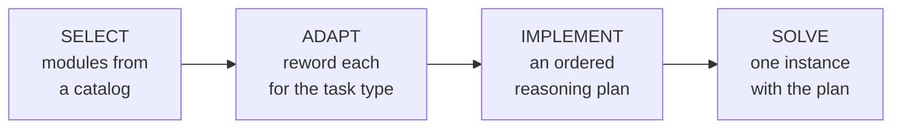
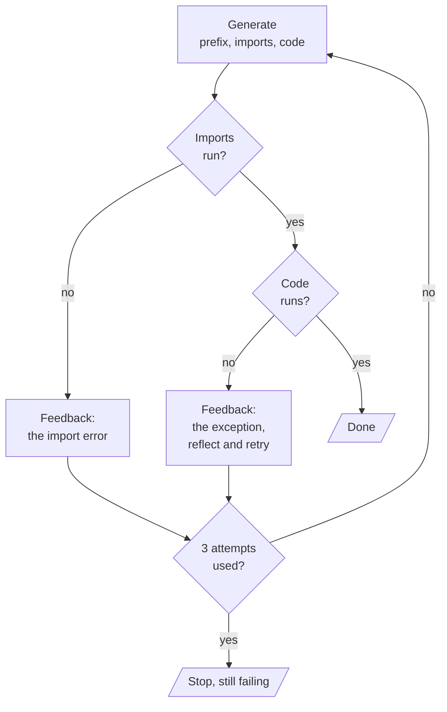

# M25.5 Theory: Self-Discover and reflective code generation

*[M25 theory](../../../mandatory/theory/README.md) · Lesson 25.5 · Notebooks: [`05a_self_discover.ipynb`](../../notebook/05a_self_discover.ipynb) (optional), [`05b_reflective_code_generation_agent.ipynb`](../../notebook/05b_reflective_code_generation_agent.ipynb) (optional) · [All theory pages](../../../../../THEORY.md)*
<!-- subtitle: Spend extra calls before the answer on how to reason, or after it on running what the model wrote -->

## Self-Discover: plan the reasoning first

> **What you'll learn**
>
> - **Explain** Self-Discover's four stages and why only the last one sees the specific problem.
> - **Measure** a reasoning structure against direct answers with a brute-force ground truth.
> - **Explain** how running generated code turns critique from opinion into evidence.
> - **Choose** between spending calls before an answer and spending them after it.

Lessons 25.3 and 25.4 spent their extra calls after a draft existed, on critique and verification. This lesson spends them in two other places: before the answer, on working out how to reason about this kind of problem, and after it, on a critic that runs the output instead of reading it.

Larkspur's sales assistant gets the same kind of question every day: *which plan and server sizes fit this workload?* The answer depends on several constraints at once (server count, peak memory, backup needs), and a model answering off the top of its head tends to drop one. It might pick Starter for a customer who runs five servers, when Starter allows three.

**Self-Discover** (Zhou et al., 2024) has the model compose a reasoning plan for the type of task before it attempts any instance. It runs in four stages:

*Figure 1: Self-Discover. The first three stages see only the task type, and SOLVE is the only stage that sees the instance.*

1. **SELECT** picks the relevant entries from a fixed catalog of generic reasoning modules. The notebook's catalog has 10, among them Decomposition, Constraint Propagation, Case Analysis and Verification.
2. **ADAPT** rewords each selected module as an instruction for this type of task.
3. **IMPLEMENT** orders the instructions into a structured plan with numbered steps: the discovered structure, still not an answer.
4. **SOLVE** gives the model the structure and one instance, and it returns a worked trace and a typed answer.

Because stages 1 to 3 never see an instance, their output is reusable across every instance of the type, and you can read it before any effort goes into a specific case. The catalog is fixed, and the structure is built from named, inspectable moves rather than an opaque chain of thought.

### A puzzle with a known answer

The notebook tests it on a scheduling puzzle. Priya, Quinn and Rae each take one interview slot, 9:00 AM, 11:00 AM or 2:00 PM, under four clues: Priya is not at 9:00, Quinn is earlier than Rae, if Priya is at 2:00 then Quinn is at 9:00, and Rae is not at 11:00. Code brute-forces all six assignments and keeps the ones that satisfy every clue. Every model answer can be checked against it:

| Priya | Quinn | Rae | Clues broken |
|---|---|---|---|
| 9:00 | 11:00 | 2:00 | 1 |
| 9:00 | 2:00 | 11:00 | 1, 2, 4 |
| **11:00** | **9:00** | **2:00** | **none** |
| 11:00 | 2:00 | 9:00 | 2 |
| 2:00 | 9:00 | 11:00 | 4 |
| 2:00 | 11:00 | 9:00 | 2, 3 |

*Table 1: The six assignments and the clues each one breaks, from running the notebook's brute-force check. Exactly one satisfies all four.*

The direct baseline asks for the final answer only, five times at temperature 0.7. In the notebook's recorded runs it was rarely right, between 0 of 5 and 2 of 6, and usually wrong the same way: Rae at 11:00 AM, the fifth row, which breaks only clue 4. The Self-Discover answers reused one discovered structure and were right 3 of 3, 4 of 4 and 2 of 3 in recorded runs.

We call the direct baseline's failure the **dropped constraint**: an answer that satisfies most clues and quietly ignores one. The structure did not add knowledge. It made the steps that catch the dropped constraint (enumerate the cases, check every clue against the final assignment) mandatory instead of optional.

The gain has a ceiling. On a harder five-person version of the puzzle, `gpt-4o-mini` failed with and without the structure. A checklist helps a model apply reasoning it can do, and adds nothing beyond its reach.

### What the structure costs

The three discovery stages run once per task type, and SOLVE runs once per instance:

| Instances of the type | Direct answers | Self-Discover |
|---|---|---|
| 1 | 1 call | 3 + 1 = 4 calls |
| 3 | 3 calls | 3 + 3 = 6 calls |
| 100 | 100 calls | 3 + 100 = 103 calls |

*Table 2: LLM calls, with the discovery cost shared across instances.*

The structure pays off on a task type you see often, where its fixed cost spreads thin. For a one-off question it quadruples the calls.

## Execution as the critic

Lesson 25.3's optional notebook showed a critic that reads code and believes its own guess about bugs. The reflective code-generation agent replaces that critic with the Python interpreter. **Execution as the critic** means running the generated code and treating any exception as the feedback for the next attempt. An exception is evidence, where a reviewer's "this looks fine" is an opinion.

*Figure 2: Generate, check, retry. The router ends on success or at the attempt cap.*

The generator returns a structured object with three fields: a prefix describing the approach, the import statements and the code. Splitting them lets the checker run the imports first, and a missing library produces a precise message. The code then runs with the imports, and an exception goes back as a user message that asks the model to say what went wrong and return the full solution. A pure router stops when the code runs or after `MAX_ATTEMPTS = 3` generations.

The notebook proves all three paths, two of them without depending on the model to fail on demand:

| Run | Generator | What happens |
|---|---|---|
| Real task: a pandas pivot table | The model | Usually runs on the first attempt, the happy path |
| Repair path | A stub whose first solution uses `statistics` without importing it, then the real model | The check raises a `NameError`, the model sees the real error and repairs the import |
| The cap | A stub that always returns code raising an error, no LLM calls | Stops after exactly 3 attempts and reports the code as still failing |

*Table 3: The three paths the notebook runs. The stubs make the repair and the cap repeatable.*

Two failure modes limit the pattern. The first is the **runs-but-wrong** answer: code that executes cleanly and computes the wrong result, which this critic cannot see. "It runs" is a weak test. Add assertions or hidden tests, as lesson 25.3's ten-test parser check does, when correctness matters. The second is the **unfixable environment**: a task that needs an API key, a network call or a model download fails for reasons no rewrite of the code can repair, and the loop hits its cap.

> **Pitfall: running model-written code.** The notebook executes the generated code directly on the machine. That is acceptable for a small, self-contained task. Anything untrusted belongs in a sandbox, such as the hosted code interpreter from M22.

## Before the answer or after it

The module now has extra calls in four places. Each fixes a different failure:

| Where the calls go | Pattern | Fixes | Leaves |
|---|---|---|---|
| Before the answer, on how to reason | Self-Discover | Dropped constraints within the model's reach | Reasoning beyond its reach |
| After, on opinion | Reflection, lesson 25.3 | Style and structure | Facts and bugs |
| After, on independent questions | Chain-of-verification, lesson 25.4 | Unsupported claims | Missing claims |
| After, on running the output | Execution critic | Crashes and import errors | Code that runs and is wrong |

*Table 4: Four places to spend extra calls.*

## In practice: fitting a Larkspur plan

An illustrative application to the sales question:

1. **Discover once.** Run SELECT, ADAPT and IMPLEMENT on the task type "fit a workload to a Larkspur plan and server sizes". A good structure starts from the hardest constraint: the server count fixes the plan (Starter up to 3, Business up to 50, Enterprise unlimited), then each server's peak memory picks its size (4, 16 or 64 GB), then every constraint is checked against the final answer.
2. **Solve per question.** A customer with five servers, one of them peaking at 40 GB, gets Business and a Large server, because Medium has 16 GB. The structure's final check catches a Starter answer.
3. **Verify in code.** The plan limits and sizes fit in a table, and a short function can check every answer the way the brute force checked the puzzle.
4. **Run what is written.** When the assistant writes a sizing script for the customer, an execution critic runs it with test inputs before it is shared.

Lesson 25.6 spends the extra calls on several reasoning paths at once, and needs a scorer for the same reason this lesson needed a ground truth.

## Key Takeaways

- Self-Discover composes a reasoning plan from a fixed catalog for a task type, once, and reuses it for every instance. It makes checks like case analysis and final verification mandatory, and helps only within the model's reach.
- Measure a reasoning strategy against a ground truth computed in code, over several samples. The puzzle's direct answers dropped a constraint, and the structured answers mostly did not.
- Running generated code makes the critique evidence. Cap the retries, prove the repair and the cap with stubs, and add tests, because code that runs can still be wrong.

## Check yourself

1. Why do the SELECT, ADAPT and IMPLEMENT stages never see the specific puzzle?

They work out how to reason about the task type, so their output is a reusable structure for every instance of that type and can be inspected before any instance is solved. Only SOLVE sees the instance, and it follows the structure step by step.

2. The direct answers to the interview-slot puzzle usually put Rae at 11:00 AM. What went wrong, and what did the discovered structure change?

That assignment breaks only clue 4, which says Rae is not at 11:00, so the model dropped one constraint. The structure did not add knowledge. It made enumerating the cases and checking every clue against the final assignment mandatory, and the structured answers were right far more often.

3. A code-generation agent with an execution critic reports success, yet the function returns wrong totals. How did that pass, and what should be added?

The critic only checks that the imports and the code run without an exception, and wrong output raises none. Add assertions or hidden tests with expected values, so the check measures correctness as well as whether the code runs.

---
*Previous: [25.4 Chain-of-verification and constitutional critique](../../../mandatory/theory/04_chain_of_verification_and_constitutional_critique/README.md). Next: [25.6 Self-consistency, tree of thoughts and LATS](../../../mandatory/theory/06_self_consistency_tree_of_thoughts_and_lats/README.md).*
