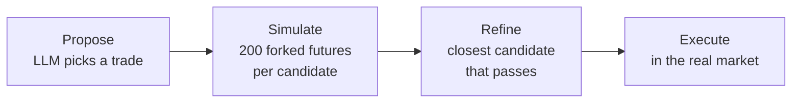
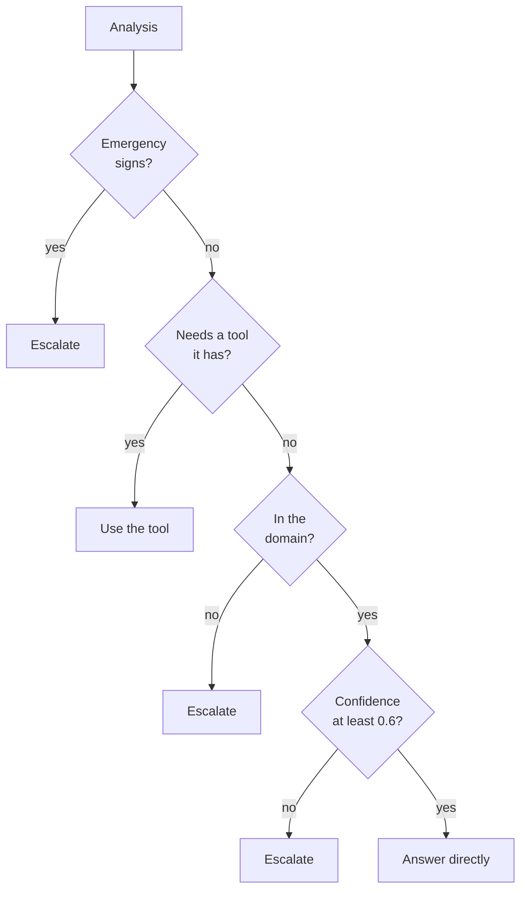
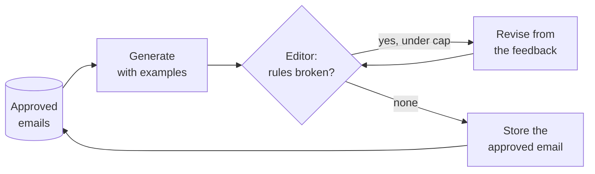

# M25.7 Theory: Simulator-in-the-loop, metacognition and exemplar memory

*[M25 theory](../../../mandatory/theory/README.md) · Lesson 25.7 · Notebooks: [`07a_mental_loop_simulator.ipynb`](../../notebook/07a_mental_loop_simulator.ipynb) (optional), [`07b_reflexive_metacognitive.ipynb`](../../notebook/07b_reflexive_metacognitive.ipynb) (optional), [`07c_self_improving_exemplar_memory.ipynb`](../../notebook/07c_self_improving_exemplar_memory.ipynb) (optional) · [All theory pages](../../../../../THEORY.md)*
<!-- subtitle: Test an action before taking it, decide whether to answer at all, and carry approved work into the next task -->

## Simulate before you act

> **What you'll learn**
>
> - **Explain** how a simulator lets an agent evaluate an action before it becomes irreversible.
> - **Trace** a proposal through simulation and refinement, with the rollout numbers that changed it.
> - **Design** a self-model and ordered rules that decide whether to answer, use a tool or escalate.
> - **Measure** what a memory of approved outputs changes, and what it cannot.

Lesson 25.6 searched over reasoning steps. The three patterns here look at different things: the consequences of an action, the agent's own competence, and what it learned on earlier tasks. In all three the model proposes or assesses, and code makes the decision.

Larkspur's operations team wants an agent that can act, not only answer. It might resize servers before a traffic spike, reply to customers about their servers, or draft incident notices. Each action has a failure that planning and verification do not cover. A resize restarts the server once, and customers feel a bad one immediately. A reply about a server that is missing from the tool's records can sound reassuring and be wrong. And every incident notice starts from zero, repeating the mistakes the last one fixed.

A **mental loop** (simulator in the loop) tests a proposed action in a copy of the world before taking it in the real one. The notebook's world is a toy stock market, a random walk whose drift depends on a news headline, and the action is a trade. It is a teaching example and not trading advice. The loop has four nodes:

*Figure 1: Propose, simulate, refine, execute. Only the first node calls the model.*

- **Propose.** The analyst model reads the price, the headline and the portfolio and returns buy, sell or hold with a size: small (10% of cash or shares) or large (50%). Code turns that into a share count.
- **Simulate.** Code forks the market and rolls the proposal forward 10 days, 200 times, then does the same for progressively safer versions: a buy at ½, ¼ and ⅛ of the size and then nothing, or a sell at 2 and 4 times the size and then everything.
- **Refine.** Code keeps the candidate closest to the proposal whose 5th-percentile return is no worse than minus 5%. If none passes, it takes the safest.
- **Execute.** The chosen trade runs in the real market, which then moves one day with its own randomness.

The **5th percentile** is the "how bad can it get" number: in 1 simulated future out of 20, the portfolio does at least this badly. The same class serves as the real market and the sandbox, and a deep copy forks it. A simulation can never touch the real portfolio. Seeded random generators make the rollouts reproducible.

### The same proposal in two worlds

Two scenarios look identical to the analyst: $100 price, a good-news headline, $10,000 in cash. They differ only in volatility (2% or 8% daily), which only the simulator knows. A stub analyst that always proposes a large buy (50 shares) gives these rollouts:

| Market | Candidate | Mean 10-day return | 5th percentile | Passes |
|---|---|---|---|---|
| Calm, 2% | Buy 50 | +4.92% | minus 0.63% | ✓ executed |
| Turbulent, 8% | Buy 50 | +3.99% | minus 16.03% | ✗ |
| Turbulent, 8% | Buy 25 | +1.99% | minus 8.02% | ✗ |
| Turbulent, 8% | Buy 12 | +0.96% | minus 3.85% | ✓ executed |

*Table 1: One proposal, two worlds. From running the notebook's simulator in the scratchpad with its seed, 200 rollouts and a 10-day horizon.*

In the calm market the loop costs time and changes nothing. In the turbulent one the same headline would have put half the cash at risk with a tail loss three times the limit, and the refine step shrinks the trade to 12 shares. The direction of "safer" depends on the action. In the third scenario the account holds 40 shares on bad news, and if the analyst proposes a small sell of 4 shares, the candidates (sell 4, 8, 16, then all 40) have 5th percentiles of minus 8.63%, minus 7.67%, minus 5.75% and 0%, so the loop sells everything.

Two lessons came out of building it. A numeric rule belongs in code: while prototyping, an LLM "risk manager" given the minus 5% rule in its prompt answered *hold* even when the proposal passed. And the loop is only as good as its world model. We call this the **simulation-reality gap**: if the real volatility were 8% while the simulator assumed 2%, the loop would approve the risky trade with full confidence. A real simulator's parameters are estimated from data, re-checked, and given a margin.

## Metacognition: decide whether to answer

A **metacognitive agent** keeps an explicit model of itself (what it knows, which tools it has, when it must stop) and first analyses each request against that model instead of answering it. Routing in [M24](../../../../../p06_agent_foundations/m24_agentic_workflow_patterns/mandatory/theory/README.md) asked what kind of request this is. Metacognition asks whether the agent is competent and safe to handle it.

The notebook's agent gives preliminary medical information, a deliberately high-stakes teaching domain. Its **self-model** is a configuration object with a domain list (common cold, influenza, allergies, headaches, basic first aid), one tool (a drug-interaction checker over a two-pair mock database) and a confidence threshold of 0.6. The analysis step fills in separate fields: in domain, emergency signs, the tool needed and its arguments, a confidence from 0 to 1 and a short reason. Separate yes and no fields are easier for the model to get right, and easier to check, than one free-text choice of strategy.

Then code decides, with rules ordered by severity:

*Figure 2: The strategy rules. Each returns the reason it fired, and every route can be explained.*

Because the rule function is pure, every branch is tested with hand-built analyses and no model call, emergency signs beating a tool request among them. The notebook's five demo queries each take a different route:

| Query | Route | Reason |
|---|---|---|
| Symptoms of a common cold | Answer directly | In the domain, low risk, confident |
| Ibuprofen with lisinopril | Use the tool | The pair is in the database |
| Sertraline with tramadol | Escalate | The tool has no entry for the pair |
| Crushing chest pain, numb left arm | Escalate | Emergency signs |
| Filing taxes as a freelancer | Escalate | Outside the domain |

*Table 2: Five queries and their expected routes. The notebook checks each one over three runs.*

The third row is the lesson. The analysis routed it to the tool, correctly, but the database had no entry. A naive agent would pass "no interaction found" to the writer and produce a reassuring answer about a pair that is in fact a well-known serious interaction. We call that the **empty-result reassurance**: a tool's "not in my data" read as "safe". The agent counts its tool's coverage as part of its limits and escalates. The escalate branch here returns a referral, and [M27](../../../../m27_human_approval_applied_agents/mandatory/theory/README.md) puts a real human decision there.

## Exemplar memory: better first drafts

The refine loops of lesson 25.3 and M24 improve one output and then forget. A **self-improvement loop** works on two time scales:

- **Intra-task**: draft, critique, revise until approved or capped. The output improves and the next task starts from scratch.
- **Inter-task**: approved outputs are stored and shown to the generator on later tasks. Its first drafts start closer to the bar.

The notebook builds a marketing-email writer for a company called Northwind. The writer never sees the house style guide. Only the editor knows it, and the editor is plain code with six checkable rules: a subject of 45 characters or fewer, no exclamation marks, a body of 60 to 110 words, exactly one call-to-action line, a fixed sign-off and at least one concrete number. A sample email with a 57-character subject and an 11-word body breaks all six, which the scratchpad run of the editor confirms.

*Figure 3: The refine loop with a memory. Only approved emails are stored, and a draft that hit the cap of 4 revisions is not.*

The experiment runs three new briefs twice each, with an empty memory and with two approved emails from seed runs:

| Measure | Without memory | With memory |
|---|---|---|
| Rules broken by the first draft | 3 to 6 of 6 | 1 to 3 of 6 |
| Average revisions to approval | 2.0 | From 1.3 to 2.5 across runs |

*Table 3: What the memory changes, from the notebook's recorded runs.*

The first-draft gain is clear. The revision count is noisy, because a revision often fixes one rule and breaks another (a draft that fixed its word count gained an exclamation mark). The loop guarantees the rules are eventually met, and the memory moves the starting point.

Three cautions apply. It is in-context learning: no weights change, and deleting the memory deletes the improvement. The name "RLHF" is only an analogy. The memory inherits the editor's blind spots, which we call **approved-error spread**: a wrong or missing rule reaches every future task through the examples. And memories grow. A real system retrieves the few most relevant examples per task, the long-term memory problem of M34.

## In practice: Larkspur's operations agent

An illustrative application of all three:

1. **Simulate resizes.** Before moving a server to a smaller size, replay the last month's peak memory against the smaller size's memory (16 GB for Medium, 4 GB for Small) and refuse if the peak does not fit. Code applies the rule.
2. **Write the self-model.** Domain: billing, refunds, exports, outages, server sizing. Tool: server status. Escalate on suspected security incidents (the handbook's Security ticket category), on low confidence, and whenever the status tool has no record of the server.
3. **Keep approved notices.** Store incident notices that passed the editor's checks (status-page link, root-cause promise within 72 hours, no exclamation marks), retrieve the two most similar for each new incident, and keep a record of who approved each one.

> **Key distinction:** in all three patterns the model proposes or assesses, and code decides: a percentile limit, an ordered rule list, a rule-checking editor. The model's judgment is an input, never the gate.

## Key Takeaways

- A simulator turns "is this action safe?" into numbers a rule in code can check before the action is irreversible, and its decisions are only as good as its model of the world.
- A metacognitive agent analyses each request against an explicit self-model, then ordered rules in code choose to answer, use a tool or escalate. "Not in my database" is a reason to escalate.
- A memory of approved outputs improves the next task's first draft without changing any weights, and it spreads whatever the editor wrongly approves.

## Check yourself

1. The analyst sees the same price, headline and portfolio in the calm and the turbulent market. Why does the agent execute different trades?

Volatility is known only to the simulator. In the calm market the proposed 50-share buy has a 5th-percentile return of minus 0.63%, inside the minus 5% limit, so it runs unchanged. In the turbulent market the same buy reaches minus 16.03%, and refinement shrinks it to 12 shares, the closest candidate that passes at minus 3.85%.

2. A drug-interaction question is routed to the tool, and the tool returns nothing for that pair. What should the agent do, and why?

Escalate. An empty result means the pair is not in the database, which says nothing about whether the drugs interact. Passing "no interaction found" to the writer produces a reassuring answer the agent cannot support, so the tool's coverage counts as one of the agent's limits.

3. With two approved emails in memory, first drafts break fewer rules, but some runs need more revisions than without memory. How can both be true?

The memory moves the starting point, and the revision count depends on how each revision goes. A revision often fixes one rule and breaks another, so the number of rounds stays noisy even when the first draft is better. The loop is what guarantees the rules are eventually met.

---
*Previous: [25.6 Self-consistency, tree of thoughts and LATS](../../../mandatory/theory/06_self_consistency_tree_of_thoughts_and_lats/README.md). Next: [M25 interview questions](../../../mandatory/theory/README.md#interview-spotlight-5-questions-you-might-get-asked).*
