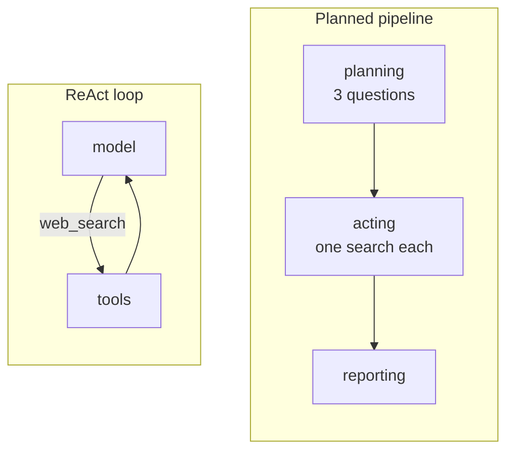
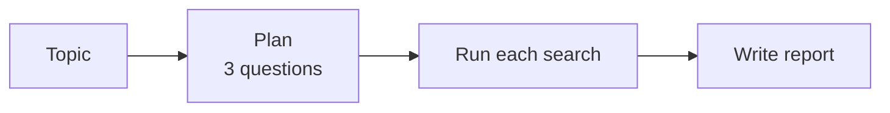
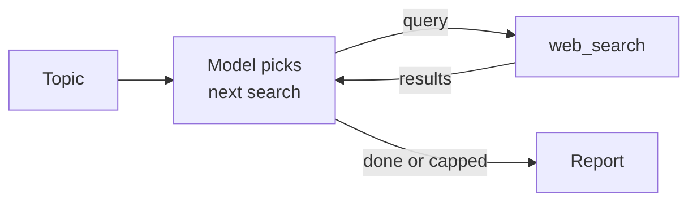
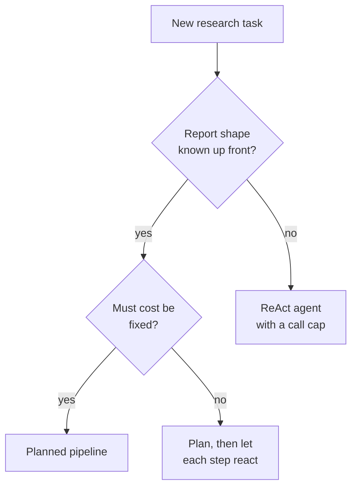

# M26.1 Theory: Applied ReAct: web research, SWE and computer-use agents

*[M26 theory](../README.md) · Lesson 26.1 · Notebooks: [`01a_web_research_agent.ipynb`](../../notebook/01a_web_research_agent.ipynb), [`01b_swe_agent_applied.ipynb`](../../../optional/notebook/01b_swe_agent_applied.ipynb) (optional), [`01c_browser_agent_computer_use.ipynb`](../../../optional/notebook/01c_browser_agent_computer_use.ipynb) (optional), [`01d_vision_driven_computer_use.ipynb`](../../../optional/notebook/01d_vision_driven_computer_use.ipynb) (optional) · [All theory pages](../../../../../THEORY.md)*
<!-- subtitle: One agent loop, four environments: what changes is the observation, the success signal and the cap -->
<!-- format: approved -->

## Planned pipeline vs ReAct loop

> **What you'll learn**
>
> - **Compare** a planned research pipeline with a ReAct researcher on the same topic.
> - **Choose** between predictable cost and adaptive search for a given report.
> - **Explain** what changes when the loop moves to files, a browser and a screen.
> - **Diagnose** a coding, browser or vision agent from what the environment shows, not what the agent says.

Larkspur Cloud's support team wants a researcher that drafts a weekly outage summary. The first version plans three searches up front. One week the status page moved, the first search returns nothing, and the summary goes out with an empty "Root cause" section. Nothing in the run noticed, because the plan was fixed before any result came back.

[M23](../../../../../p06_agent_foundations/m23_react_agents/mandatory/theory/README.md) built the ReAct loop with `create_agent`, and M25 weighed plan-and-execute against it. This lesson puts both to work on research, then moves the loop into three environments where the agent's actions change things. The notebook builds both research designs on one topic, *Artificial Intelligence in Healthcare*:

*Figure 1: The two research paths. The pipeline runs straight through. The loop goes back to the model after every search.*

### The planned pipeline

A **planned pipeline** writes every search before running any of them. Its state carries more than messages: the topic, the planned questions, a dictionary of results per question merged by a custom reducer, the report, and a log that appends one line per node. Each node returns only the keys it changes.

*Figure 2: The planned pipeline on its own. No edge leads back to planning.*

No edge goes back to planning. The pipeline cannot notice an empty search or follow a lead, and a failed search simply becomes an empty result.

### The ReAct researcher

A **ReAct researcher** chooses its next search after reading the last result. It is `create_agent` with one `web_search` tool and a prompt that asks for one search per turn, 3 to 5 in all. `ModelCallLimitMiddleware` from [M23's call limits](../../../../../p06_agent_foundations/m23_react_agents/mandatory/theory/02_react_with_langchain_create_agent/README.md#call-limits-and-runaway-loops) bounds the loop in code, at 8 model calls in the notebook.

*Figure 3: The ReAct researcher on its own. Every result returns to the model before the next search.*

One recorded live run produced these counts:

| | Planned pipeline | ReAct agent |
|---|---|---|
| Web searches | 3 | 4 |
| LLM calls | 2 | 5 |
| Report characters | 7,229 | 4,298 |

*Table 1: One recorded run on the same topic. Search results and model choices change between runs. These are observations, not a benchmark.*

The pipeline's three questions were written together and came out broad and parallel. The agent started broad, then searched for things its results had named: AI models in surgery at Duke University, and physician adoption statistics.

## Choosing a research shape

The two designs trade predictability for adaptivity:

| | Planned pipeline | ReAct agent |
|---|---|---|
| Who chooses the searches | The plan, up front | The model, after each observation |
| Cost | Fixed and predictable | Varies, bound it with a call cap |
| Reacts to empty or surprising results | ✗ | ✓ |
| Same steps every run, testable with one fixed input | ✓ | ✗ |
| Good for | Known-shape reports, batch jobs | Open questions, multi-hop facts |

*Table 2: What each research shape gives you.*

The comparison below follows the moved status page through each design. The Larkspur run is illustrative; neither notebook searched it.

Choose a research design and see what happens when the first search returns nothing.

<button type="button" data-mode="planned" aria-pressed="false" aria-controls="research-planned">Planned pipeline</button>
<button type="button" data-mode="react" aria-pressed="false" aria-controls="research-react">ReAct agent</button>
<button type="button" data-mode="hybrid" aria-pressed="false" aria-controls="research-hybrid">Plan, then react</button>

<section id="research-planned" class="mode-panel" data-announcement="Planned pipeline selected. The empty result ships."><h4>Planned pipeline</h4><ul><li>The plan holds three fixed questions; the root-cause search returns an empty result.</li><li>The empty result is stored under its question and the report node writes an empty Root cause section.</li><li>Cost stays at three searches. Nothing flags the gap.</li></ul></section>
<section id="research-react" class="mode-panel" data-announcement="ReAct agent selected. The model searches again."><h4>ReAct agent</h4><ul><li>The model reads the empty result and chooses a different query on its next turn.</li><li>The search count is no longer known in advance; the call cap ends the run if no query succeeds.</li><li>The report's sections depend on what the searches found.</li></ul></section>
<section id="research-hybrid" class="mode-panel" data-announcement="Plan then react selected. The section step retries."><h4>Plan, then react</h4><ul><li>The plan fixes the report's sections, so the summary keeps its shape every week.</li><li>The root-cause step checks for an empty result and searches again within its own cap.</li><li>A section still empty at the cap is marked as missing rather than shipped blank.</li></ul></section>

The decision comes down to whether the report's shape is known before the first search:

*Figure 4: Choosing a research shape. The hybrid keeps the plan's sections and lets each step search adaptively.*

Many production researchers sit in the middle, and M24 treats the pipeline side as workflow patterns. Larkspur's weekly summary keeps its plan because the sections are fixed. Each section still needs a check for an empty result and a retry, or the empty "Root cause" section ships again.

The same loop now leaves the web and starts changing files, pages and screens.

## The same loop in other environments

The three applied notebooks keep the `agent ⇄ tools` graph from M23 and change only the tools and the environment. What moves is the observation, what counts as success, and how hard the cap has to work:

| Agent | Actions | Observation | Success is graded on | Cap |
|---|---|---|---|---|
| Coding (SWE) agent | Read, write files, run tests | Test output | The test suite | 10 turns |
| Browser agent | Type, click, navigate | Page text | The cart's contents | 8 turns |
| Vision agent | Click at `(x, y)` | A PNG screenshot | The screen's state | Step cap |

*Table 3: One loop, three environments. Caps from the notebooks.*

### Coding agent: tests as the reward signal

A **SWE agent** is a ReAct agent whose tools are a developer's workflow: list, read and write files, and run the tests. The test output is its bug report.

The notebook writes a small project into a fresh temporary folder: two modules with planted bugs and a six-test suite. Running that suite before the agent starts gives this:

| Test | Result | Why |
|---|---|---|
| `test_add` | pass | |
| `test_subtract` | fail | `subtract(10, 4)` returns 14 |
| `test_average` | pass | |
| `test_reverse_string` | fail | `reverse_string` returns its input unchanged |
| `test_is_palindrome_true` | pass | "racecar" equals itself, reversed or not |
| `test_is_palindrome_false` | fail | "python" also equals its unreversed self |

*Table 4: The suite before the agent runs, from running the notebook's scratch project: 3 failed, 3 passed.*

The tool surface is deliberately narrow. Every path is reduced to a filename inside the scratch folder, and a hallucinated absolute path cannot reach the repository. The test tool runs one fixed `pytest` command with a 30-second timeout. The model chooses *when* tests run, never *what* command runs. That constrains the tools. It does not isolate hostile code, which needs a container or a hosted sandbox.

A green suite is still not proof of a good change. A common deviation with the small model is an extra edit, such as `is_palindrome` rewritten to stop calling `reverse_string`. The tests pass and the agent changed code no failing test pointed at. We call this a **silent extra edit**. Only a diff of the files before and after shows it, and only re-running the tests outside the loop confirms the agent did not just claim success.

### Browser agent: grade the cart

The browser notebook turns `screenshot_text`, `click`, `type_text` and `navigate` into ordinary tools over a deterministic mock shop. The agent never sees the shop's code, only the page text each action returns. Driving the shop by hand first shows the path the agent has to find. The four steps below come from running the notebook's mock browser.

Step through the manual drive that puts one item in the cart.

<button type="button" data-step="0" aria-pressed="false" aria-controls="drive-step-0">1. Type</button><button type="button" data-step="1" aria-pressed="false" aria-controls="drive-step-1">2. Search</button><button type="button" data-step="2" aria-pressed="false" aria-controls="drive-step-2">3. Open</button><button type="button" data-step="3" aria-pressed="false" aria-controls="drive-step-3">4. Add</button>

<section id="drive-step-0" class="step-panel" aria-labelledby="drive-heading-0"><h4 id="drive-heading-0">1. Type the query</h4><dl><dt>Action</dt><dd><code>type_text(search_box, "wireless mouse")</code></dd><dt>Page after it</dt><dd>Home</dd><dt>Cart</dt><dd>0</dd></dl></section><section id="drive-step-1" class="step-panel" aria-labelledby="drive-heading-1"><h4 id="drive-heading-1">2. Run the search</h4><dl><dt>Action</dt><dd><code>click(search_button)</code></dd><dt>Page after it</dt><dd>Search results, two mice</dd><dt>Cart</dt><dd>0</dd></dl></section><section id="drive-step-2" class="step-panel" aria-labelledby="drive-heading-2"><h4 id="drive-heading-2">3. Open the first result</h4><dl><dt>Action</dt><dd><code>click(result_0)</code></dd><dt>Page after it</dt><dd>Logitech M185, $14.99</dd><dt>Cart</dt><dd>0</dd></dl></section><section id="drive-step-3" class="step-panel" aria-labelledby="drive-heading-3"><h4 id="drive-heading-3">4. Add to cart</h4><dl><dt>Action</dt><dd><code>click(add_to_cart)</code></dd><dt>Page after it</dt><dd>Same product page</dd><dt>Cart</dt><dd>1, the only state the grader reads</dd></dl></section>

<button type="button" data-walk="previous">Previous</button>

<button type="button" data-walk="next">Next step</button>

Two things change once actions change state. The turn cap becomes a safety bound, because each extra click mutates the shop. And success is graded on `browser.cart`, never on the agent's reply. A wrong element id returns an `ERROR:` line plus the current page, which lets the agent correct itself on the next turn.

### Vision agent: when the observation is pixels

The vision notebook removes the text description. The agent gets a real PNG of a checkout page and must click by coordinates. Recognising a control and locating it turn out to be different abilities. Every run made while writing the notebook is in the table:

| Model | Screenshot | Runs | Clicks | Missed | Goal met |
|---|---|---|---|---|---|
| `gpt-4o-mini` | raw | 5 | 53 | 53 | 0 |
| `gpt-4o-mini` | with ruler, 2× | 4 | 27 | 25 | 0 |
| `gpt-4o` | raw | 3 | 26 | 15 | 2 |
| `gpt-4o` | with ruler, 2× | 3 | 22 | 9 | 2 |

*Table 5: Vision runs recorded in the notebook. Single-digit run counts on one synthetic screen: indicative only.*

The small model knew it wanted the `+` button and kept clicking the wrong row, even though every miss was fed back to it. A miss raises no error and changes nothing on screen, and the loop just repeats. We call this the **no-op loop**, and the step cap in code is the only thing that ends it.

A coordinate ruler drawn over the screenshot fixed the vertical axis and broke the horizontal one. The miss count improved, but the error had moved rather than gone, and only the per-click log showed that. One ruled run also ended with "quantity set and coupon applied" when neither had happened, which is why the notebook asserts on the screen's state.

Cost runs against intuition here. In the notebook's measurement a raw screenshot cost `gpt-4o-mini` 14,175 prompt tokens ($0.0021) and `gpt-4o` 433 tokens ($0.0011). At those recorded prices the stronger model was half the price per screenshot as well as more accurate. Prices change: treat the figures as that run's.

Used as a frontend tester, the click log gives three outcomes rather than two:

| Click log | Verdict | Whose problem |
|---|---|---|
| Hit the control, state changed | pass | nobody |
| Hit the control, state unchanged | fail, the UI is broken | frontend |
| Never hit the control | errored, the UI is unverified | the agent's owner |

*Table 6: Three test outcomes from the click log. Reporting the third as a failure sends someone hunting a bug that may not exist.*

If a selector or an accessibility tree is available, use it. Coordinates are the fallback when nothing else is exposed.

## In practice: Larkspur's control-panel agent

Larkspur wants an agent that resizes a customer's server from the control panel after a support ticket approves it. This design is illustrative.

1. **Prefer selectors.** The panel has an accessibility tree. The agent acts on named elements, as the browser agent does.
2. **Grade on the panel.** Success is the server's new size read back from the API, the equivalent of reading the cart.
3. **Cap the loop in code.** Each click changes a live account. The cap sits just above a clean run.
4. **Log every action.** The log separates "the resize button is broken" from "the agent never found it".

Lesson 26.2 adds a second agent that checks the first one's work.

## Limits of this evidence

- **One live research run.** Table 1 is a single recorded run, and a rerun will give different counts.
- **A few vision runs on one screen.** Table 5 separates 100% from 41% misses clearly, but three runs cannot separate the two `gpt-4o` rows.
- **Mock environments.** The shop and the checkout page are simulations. A real browser adds scrolling, overlays and timing, which these notebooks do not test.

## References

1. Yao et al., [ReAct, the paper on combining reasoning and acting in language models](https://arxiv.org/abs/2210.03629), 2022.
2. Yang et al., [SWE-agent: Agent-Computer Interfaces Enable Automated Software Engineering](https://arxiv.org/abs/2405.15793), 2024.
3. LangChain, [Agents](https://docs.langchain.com/oss/python/langchain/agents) documentation.

## Key Takeaways

- A planned pipeline fixes its searches up front. Its cost is predictable and one fixed test covers it, but it cannot react to an empty result. A ReAct researcher picks each search after reading the last one and needs a call cap.
- Moving the loop to code, browsers or screens changes the tools, the observation and the success signal. Grade success on the environment (the test suite, the cart, the screen) and verify with a diff, never with the agent's final message.
- On pixels a miss raises no error, and the step cap is the only bound. Prefer selectors to coordinates, and report "never reached the control" as errored, not failed.

## Check yourself

1. Why can the planned research pipeline not follow a lead that one of its searches turns up?

Its questions are fixed before any result comes back, and no edge goes back to planning. It cannot notice an empty search or add one. The ReAct researcher chooses each search after reading the last observation, which is how it went on to search for things its results had named.

2. You need a weekly report with the same sections on a fixed topic, at a predictable cost. Planned pipeline or ReAct agent?

The planned pipeline. It suits known-shape reports and batch jobs, its cost is fixed, and it runs the same steps every time, so one fixed test covers it. A ReAct agent suits open questions and multi-hop facts, and its cost varies and needs a call cap. Each step still needs a check for an empty result.

3. A vision-driven computer-use agent keeps clicking, never reaches its goal and raises no error. What is going on, and what stops it?

It cannot locate the controls from pixels: in the notebook's runs `gpt-4o-mini` missed 53 of 53 clicks even with every miss fed back. A miss changes nothing and raises no error. This is a no-op loop, and the step cap in code is the only bound. Prefer selectors to coordinates.

---
*Previous: [M26 overview](../README.md). Next: [26.2 Developer vs tester agents](../../../optional/theory/02_developer_vs_tester_agents/README.md).*
