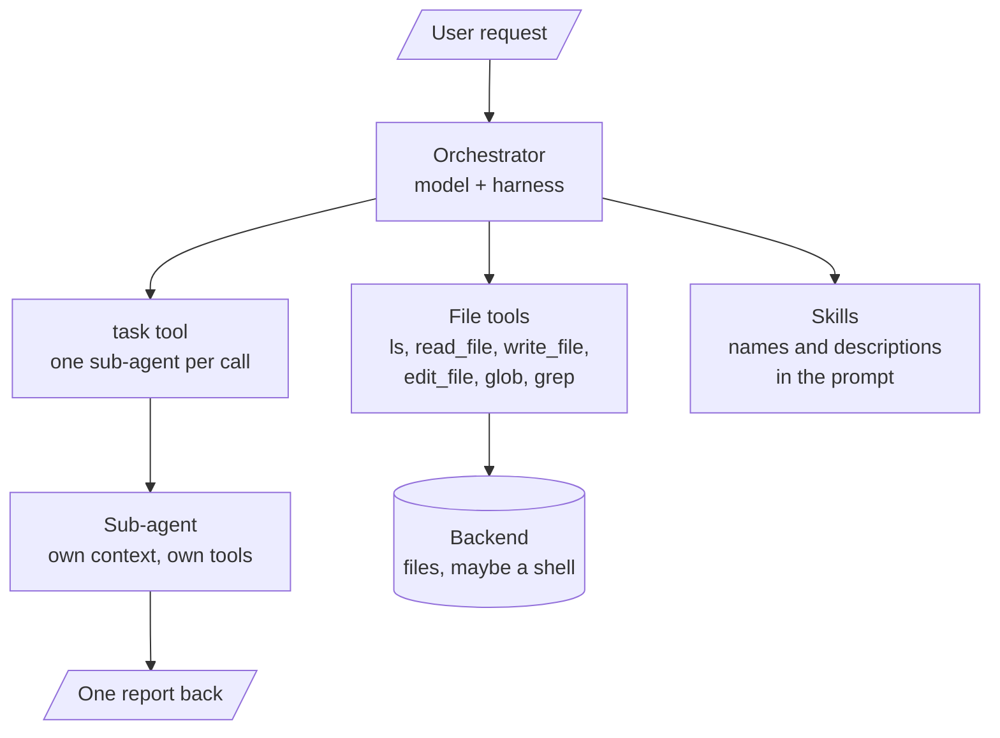
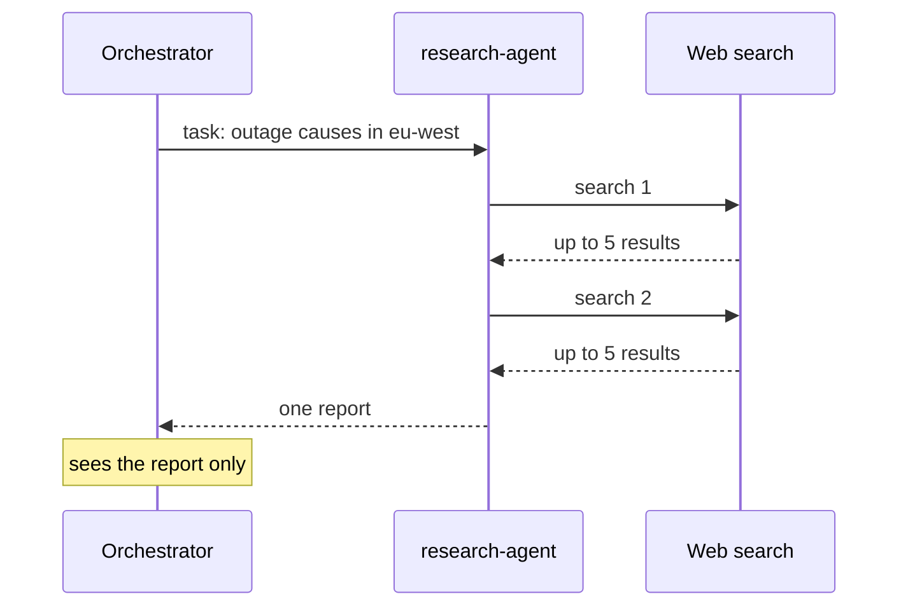
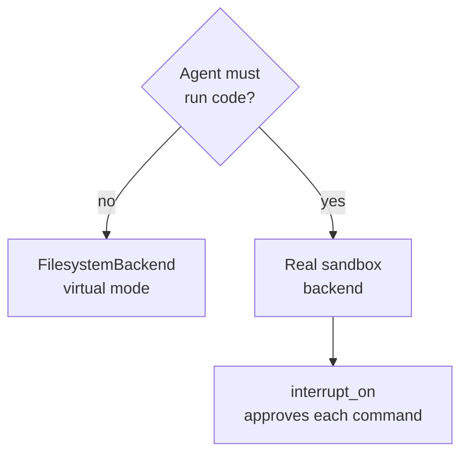

# M26.3 Theory: Deep agents: orchestrator, sub-agents, skills and long-term memory

*[M26 theory](../README.md) · Lesson 26.3 · Notebooks: [`03a_simple_coding_agent.py`](../../notebook/03a_simple_coding_agent.py), [`03b_long_term_memory_agent.py`](../../../optional/notebook/03b_long_term_memory_agent.py) (optional), [`03c_skills`](../../../optional/notebook/03c_skills) (optional) · [All theory pages](../../../../../THEORY.md)*
<!-- subtitle: Configure a harness instead of wiring a graph, then check what its backend and memory really do -->
<!-- format: approved -->

## Deep-agent harness

> **What you'll learn**
>
> - **Explain** what a deep-agent harness gives one orchestrator model: files, sub-agents, skills, a backend and memory.
> - **Trace** why a sub-agent's work stays out of the orchestrator's context.
> - **Diagnose** a backend setting that sounds safer than it is.
> - **Separate** conversation state from long-term memory, and spot a memory shared by every user.

Lesson 26.2 wired two agents into a graph node by node. This lesson starts from the other end, with a ready-made harness you configure instead of a graph you draw. The examples are two command-line scripts, `03a_simple_coding_agent.py` and its long-term-memory variant `03b_long_term_memory_agent.py`, plus the eight skill folders in `03c_skills`.

Larkspur Cloud wants one assistant for its support engineers. It should research an outage on the web, draft a fix to a billing script, and remember that one engineer wants refund answers as a checklist. Built as a graph, that is a node per specialist, a router, a file store, a memory store and the edges between them. A **deep agent** is the shortcut: one orchestrator model inside a **harness**, a prebuilt set of tools and middleware that gives it files, sub-agents, skills, an execution backend and memory.

The scripts use the `deepagents` library's `create_deep_agent`. The tool and backend behaviour below is that of `deepagents` 0.7.32, the version in this course's lock file:

*Figure 1: The harness around one orchestrator. You configure each box instead of drawing edges between them.*

The scripts configure each part as follows:

| Part | What it gives the orchestrator | In the scripts |
|---|---|---|
| Built-in tools | File operations (`ls`, `read_file`, `write_file`, `edit_file`, `glob`, `grep`), `execute` for shell commands, and `task` to call a sub-agent | Added by `create_deep_agent`. `execute` returns an error unless the backend can run commands |
| Custom tools | Domain actions | 03a: `name_project`, `internet_search` (Tavily, 5 results by default) and four Databricks Genie tools for an insurer's customer, distribution, policy and claims data. 03b adds `save_memory`, `recall_memories`, `forget_memory` |
| Sub-agents | Specialists, each a dict of `name`, `description`, `system_prompt`, `skills` and `tools` | 03a: 7 (`senior-developer`, `code-reviewer`, `research-agent` and four insurer analytics agents). 03b adds `memory-manager` |
| Skills | Instructions in `SKILL.md` files under `/skills/` | 8 skills, one per sub-agent. Each sub-agent's prompt says to follow its skill |
| Backend | Where files live and whether commands run | A `CompositeBackend` that routes `/skills/` to the skills folder and everything else to `FilesystemBackend(virtual_mode=True)`, or to `LocalShellBackend` when `USE_SANDBOX=true` |
| Checkpointer | Memory within one thread | `MemorySaver`, one `thread_id` per task |
| Model | The orchestrator's model | `databricks-claude-opus-4-6`, temperature 0.1 |

*Table 1: The harness as the two scripts configure it.*

Because the harness is a configuration, you audit it by reading the configuration. The next three sections take its parts one at a time.

## Sub-agents keep context small

A call to `task` runs the named sub-agent with its own messages and tools, and only its final message returns to the orchestrator:

*Figure 2: Delegation through `task`. The searches and the sub-agent's notes stay in its own context.*

The research agent's search calls and its notes never enter the orchestrator's transcript. After a dozen searches the orchestrator holds the task it sent and one report. That is what lets a deep agent run long jobs without **context creep**, the slow growth of a transcript until the model loses the thread.

The trade is visibility. The orchestrator cannot check a claim against raw results it never saw. A sub-agent's report should name its sources.

## Skills load only when a task needs them

A `SKILL.md` starts with YAML frontmatter holding a `name` and a `description` (the library caps the description at 1,024 characters). The harness puts only those two fields in the system prompt and tells the model to `read_file` the full instructions when a task matches the description. This is **progressive disclosure**: eight skills cost eight short lines until one is needed.

The `memory-manager` skill shows what the full body holds once read:

| Section | What it tells the sub-agent |
|---|---|
| Workflow | Assess the request, then save, recall or forget |
| Recall | Search broadly first with an empty query, then narrow by category or keyword |
| Categories | Five labels: preference, fact, decision, project, feedback |
| Forgetting | Confirm with the user before deleting, unless the request is unambiguous |

*Table 2: The `memory-manager` skill body, read only when a memory task comes up.*

The path from a request to a loaded skill, for an engineer who asks the assistant to remember a preference:

Step through how the memory-manager skill goes from one line in the prompt to full instructions.

<button type="button" data-step="0" aria-pressed="false" aria-controls="skill-step-0">1. Prompt</button><button type="button" data-step="1" aria-pressed="false" aria-controls="skill-step-1">2. Match</button><button type="button" data-step="2" aria-pressed="false" aria-controls="skill-step-2">3. Read</button><button type="button" data-step="3" aria-pressed="false" aria-controls="skill-step-3">4. Follow</button>

<section id="skill-step-0" class="step-panel" aria-labelledby="skill-heading-0"><h4 id="skill-heading-0">1. The prompt lists every skill briefly</h4><dl><dt>Context holds</dt><dd>eight name and description pairs from the frontmatter, and no skill bodies</dd></dl></section><section id="skill-step-1" class="step-panel" aria-labelledby="skill-heading-1"><h4 id="skill-heading-1">2. The request matches a description</h4><dl><dt>Request</dt><dd>remember that I want refund answers as a checklist</dd><dt>Model decides</dt><dd>the memory-manager description covers saving preferences</dd></dl></section><section id="skill-step-2" class="step-panel" aria-labelledby="skill-heading-2"><h4 id="skill-heading-2">3. The full body is read</h4><dl><dt>Call</dt><dd><code>read_file</code> on the skill's <code>SKILL.md</code> under <code>/skills/</code></dd><dt>Context gains</dt><dd>the workflow, recall, categories and forgetting rules in Table 2</dd></dl></section><section id="skill-step-3" class="step-panel" aria-labelledby="skill-heading-3"><h4 id="skill-heading-3">4. The instructions guide the action</h4><dl><dt>Does</dt><dd>saves the note under the preference category</dd><dt>Other skills</dt><dd>still cost one line each</dd></dl></section>

<button type="button" data-walk="previous">Previous</button>

<button type="button" data-walk="next">Next step</button>

Because the model matches a task against the description alone, a description that does not say when the skill applies is a skill that never loads. We call this a **silent skill**. Adding eight more skills is cheap in tokens, but each new description has to be distinct enough that the model picks the right one.

## The backend decides what can run

The backend is where files live and whether a command can run at all. Two settings in the scripts look safer than they are:

| Setting | What it sounds like | What it does |
|---|---|---|
| `FilesystemBackend(virtual_mode=True)` | A sandbox | Anchors paths under the root folder and blocks traversal such as `..`. The library's docstring says it provides no sandboxing or process isolation |
| `USE_SANDBOX=true` | A LangSmith cloud sandbox, as the script's comment says | Selects `LocalShellBackend`, which the library documents as unrestricted shell execution on the host |
| Neither, and `execute` called | A shell | An error, because the backend cannot run commands |

*Table 3: Three backend settings and what they really do.*

We call the middle row **sandbox by name**: a flag whose name promises isolation the code does not provide. The library does ship a separate `LangSmithSandbox` backend, but the script never selects it.

The same request, *run the billing script's tests*, under each choice:

Choose a backend and see what happens when the agent calls execute.

<button type="button" data-mode="virtual" aria-pressed="false" aria-controls="backend-virtual">Virtual-mode files</button>
<button type="button" data-mode="localshell" aria-pressed="false" aria-controls="backend-localshell">USE_SANDBOX=true</button>
<button type="button" data-mode="sandbox" aria-pressed="false" aria-controls="backend-sandbox">Real sandbox with approval</button>

<section id="backend-virtual" class="mode-panel" data-announcement="Virtual-mode files selected. Execute returns an error."><h4>Virtual-mode files (the default)</h4><ul><li>File tools work on paths anchored under the root; <code>..</code> is blocked.</li><li><code>execute</code> returns an error, so no test runs.</li><li>Safe for drafting files, useless for checking them.</li></ul></section>
<section id="backend-localshell" class="mode-panel" data-announcement="LocalShellBackend selected. The command runs on the host."><h4>USE_SANDBOX=true</h4><ul><li>The script selects <code>LocalShellBackend</code>.</li><li>The test command runs on your machine with your permissions, and so would any other command the model writes.</li><li>Nothing pauses for a person: sandbox by name.</li></ul></section>
<section id="backend-sandbox" class="mode-panel" data-announcement="Sandbox with approval selected. The command waits for a person."><h4>Real sandbox with approval</h4><ul><li>A sandbox backend such as <code>LangSmithSandbox</code> runs the command away from the host.</li><li><code>interrupt_on</code> pauses before each <code>execute</code> until a person approves it.</li><li>The tests run, and a person sees every command first.</li></ul></section>

The choice of backend follows from what the agent needs to run:

*Figure 3: Choosing a backend. Code execution needs both a real sandbox and a person approving commands.*

`create_deep_agent` takes `interrupt_on` to pause before chosen tools, which is how a person approves each `execute` call. Lesson 26.2's Python tool gives the same advice for its own runner, and [M27](../../../../m27_human_approval_applied_agents/mandatory/theory/README.md) builds the approval step.

## Three layers of memory

The memory variant keeps three layers apart:

| Layer | Scope | Store in 03b | Store in the deployed version |
|---|---|---|---|
| Conversation | One thread | `MemorySaver` checkpointer, lost on restart | The same |
| Long-term | Every thread, every session | A JSON file, `long_term_memories.json`, under the key `memories:<user id>` | A Delta table, `agent_memories`, with `user_id`, `content`, `category` and `saved_at` |
| Artifacts | Project files the developer agent writes | `projects/` beside the script | A Unity Catalog volume |

*Table 4: Thread state, long-term memory and artifacts.*

The orchestrator's prompt tells it to recall memories at the start of each conversation and to save preferences, facts, decisions, project context and feedback as they come up. Running the script's own memory functions against a scratch file shows two limits the code carries:

| Call | Returned | Why |
|---|---|---|
| Engineer A saves "Prefers refund answers as a bulleted checklist" | Saved | |
| Engineer B recalls everything | Found 2 memories, A's included | `CURRENT_USER_ID` is fixed to `default-user`. Every user shares one namespace |
| Recall "refund" | Found 1 | The query is a substring of the stored text |
| Recall "bullet points" | No match | "bulleted" does not contain "bullet points". A paraphrase finds nothing |
| Forget "e" | Deleted the checklist note | The first memory containing the substring goes |

*Table 5: The 03b memory tools on a scratch file, from our run.*

The second row is a **shared namespace**, and in a multi-user deployment it leaks one engineer's notes into another's session. The user key has to come from authentication. The fourth row is the cost of substring search, and the script's comment names `PostgresStore` as the production replacement.

The module's deployed design, described in [the deep agent overview](../../../../../p10_multi_agent_systems/m37_multi_agent_applied_builds/assets/deep_agent_overview.md), runs the same harness behind a FastAPI backend with Server-Sent Events, eight sub-agents and a recursion limit of 100.

## In practice: Larkspur's support deep agent

1. **Delegate research.** A `research-agent` sub-agent searches outage reports, and the orchestrator reads one report per task.
2. **Write a skill per specialist.** A `billing-fixes` skill's description says when it applies (changes to refund or proration scripts). The model loads it only for those tasks.
3. **Pick the backend on purpose.** The default is virtual-mode files with no execution. Running a billing test needs a real sandbox backend and `interrupt_on` approval for every command.
4. **Key memory on the user.** Each engineer's preferences live under their authenticated id, and recall uses search that tolerates a paraphrase.

## Limits

- **No recorded run.** The scripts need a model-serving endpoint and a Tavily key. This page describes their configuration and the library's behaviour rather than a measured run.
- **One library version.** Tool names and backend behaviour are those of `deepagents` 0.7.32. Check them again after an upgrade.

## References

1. LangChain, [Deep Agents overview](https://docs.langchain.com/oss/python/deepagents/overview) documentation.
2. Anthropic, [Equipping agents for the real world with Agent Skills](https://www.anthropic.com/research/equipping-agents-for-the-real-world-with-agent-skills), 2025.

## Key Takeaways

- A deep agent is one orchestrator configured with file tools, sub-agents through `task`, skills and a backend. Only a sub-agent's final message returns, which keeps the orchestrator's context small.
- Skills put only their `name` and `description` in the prompt and are read in full when a task matches, so each description must say when its skill applies.
- Audit the harness by its configuration. `FilesystemBackend(virtual_mode=True)` blocks traversal without isolating anything, `LocalShellBackend` runs unrestricted shell on the host, and memory keyed to one fixed user id is shared by everyone.

## Check yourself

1. How does a call to the task tool keep the research agent's searches out of the orchestrator's context?

The `task` tool runs the sub-agent with its own messages and tools, and only its final message returns to the orchestrator. The search calls and notes stay in the sub-agent's context, and the orchestrator reads only the report.

2. The harness loads eight skills from 03c_skills. What does the orchestrator's system prompt hold for them before any is needed?

Only each skill's `name` and `description` from the `SKILL.md` frontmatter, eight short lines in all. When a task matches a description, the model calls `read_file` for the full instructions. This is progressive disclosure.

3. A teammate sets USE_SANDBOX=true, believing the agent's commands now run in a cloud sandbox. Are they safe?

No. Despite the script's comment, the code selects `LocalShellBackend`, which the library documents as unrestricted shell execution on the host with no isolation. Code execution belongs in a real sandbox backend, with a person approving each command through `interrupt_on`.

---
*Previous: [26.2 Developer vs tester agents](../../../optional/theory/02_developer_vs_tester_agents/README.md). Next: [M26 interview questions](../README.md#interview-spotlight-5-questions-you-might-get-asked).*
