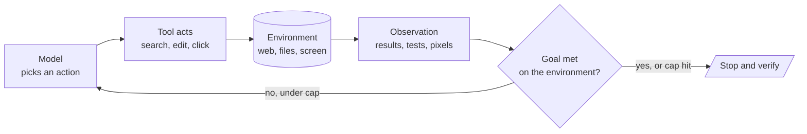

# M26 Theory: Coding, computer-use and deep agents

*Part VII · Advanced Agents · [Module README](../../README.md) · [All theory pages](../../../../THEORY.md)*

Agents that write code, drive a browser or run for hours need a harness: sub-agents, a file system, skills and a tester that checks the work. This module moves the ReAct loop from web search into files, browsers and screens, pairs a developer agent with a tester agent, and then configures a deep agent instead of wiring a graph node by node. The M26 notebooks build on two ideas: the same agent loop running in new environments, and a deep-agent harness around one orchestrator. Each idea has a page in the folder of the lesson that teaches it, listed under [Lessons](#lessons). This page has the overview, the interview questions and the takeaways.

The lessons keep the notebooks' own examples, because their numbers come from those runs: a research report on *Artificial Intelligence in Healthcare*, a coding agent fixing a six-test project in a temporary folder, a mock shop with a cart, a checkout page read from pixels, two small games for the developer and tester pair, and an insurer's analytics agents in the deep-agent scripts. Each lesson and the interview questions then move the same designs onto Larkspur Cloud, the fictional host whose handbook runs through the course: a weekly outage summary, a control-panel agent that resizes servers, a refund-proration helper, and a deep agent for support engineers that delegates research and remembers each engineer's preferences.

## TL;DR

- A planned research pipeline fixes its searches before any result comes back. A ReAct researcher picks each search after reading the last one. In one recorded run the pipeline made 3 searches and 2 LLM calls, the agent 4 searches and 5 LLM calls, which is an observation and not a benchmark.
- Moving the loop to code, browsers or screens keeps the `agent ⇄ tools` graph and changes the tools, the observation and the success signal. Tests grade the coding agent (3 of its 6 tests fail before it starts), the cart grades the browser agent. On pixels, `gpt-4o-mini` missed 53 of 53 clicks, and `gpt-4o` missed 15 of 26 and met the goal in 2 of 3 runs.
- A developer and tester pair is a critique-and-revise loop that ends by a rule in code: a reflection counter in state, a pure router and a `recursion_limit` of 2r + 4. Stub nodes show the developer runs r + 1 times and the tester r times, with zero model calls. A tester without a Python tool only estimates its pass rate.
- A deep agent is one orchestrator inside a harness: file tools, a `task` tool that runs each sub-agent in its own context, skills whose `name` and `description` alone sit in the prompt, a backend and memory. `03a_simple_coding_agent.py` configures 7 sub-agents and 8 skills.
- The backend decides what code can do. `FilesystemBackend(virtual_mode=True)` blocks path traversal without isolating anything, and `USE_SANDBOX=true` selects `LocalShellBackend`, unrestricted shell on the host.

## Mental model

Every lesson keeps this loop and changes one part of it. Lesson 26.1 swaps the environment: search results, a test run, a mock browser, a screenshot. Lesson 26.2 adds a tester whose critique becomes the next observation, and a counter in state ends the loop. Lesson 26.3 wraps the model in a harness whose backend decides whether an action can run at all. In each case the success check and the stop belong to code or to the environment, never to the agent's final message.

## Lessons

| Lesson | Topic | Theory |
|---|---|---|
| 26.1 | Applied ReAct: web research, SWE and computer-use agents | [Planned pipeline vs ReAct loop](01_applied_react_web_research_swe_and_computer_use_agents/README.md#planned-pipeline-vs-react-loop) [Choosing a research shape](01_applied_react_web_research_swe_and_computer_use_agents/README.md#choosing-a-research-shape) [The same loop in other environments](01_applied_react_web_research_swe_and_computer_use_agents/README.md#the-same-loop-in-other-environments) |
| 26.2 | Developer vs tester agents | [The project: a developer and tester pair](../../optional/theory/02_developer_vs_tester_agents/README.md#the-project-a-developer-and-tester-pair) |
| 26.3 | Deep agents: orchestrator, sub-agents, skills and long-term memory | [Deep-agent harness](03_deep_agents_orchestrator_sub_agents_skills_and_long_term_memory/README.md#deep-agent-harness) [The backend decides what can run](03_deep_agents_orchestrator_sub_agents_skills_and_long_term_memory/README.md#the-backend-decides-what-can-run) [Three layers of memory](03_deep_agents_orchestrator_sub_agents_skills_and_long_term_memory/README.md#three-layers-of-memory) |

## How it connects

- **Before:** [M23](../../../../p06_agent_foundations/m23_react_agents/mandatory/theory/README.md) teaches the ReAct loop, `create_agent` and middleware such as `ModelCallLimitMiddleware`, which lesson 26.1 uses as the researcher's bound. [M25](../../../m25_planning_reflection_reasoning/mandatory/theory/README.md) weighs plan-and-execute against ReAct and builds reflection loops. The planned pipeline of lesson 26.1 and the developer and tester pair of lesson 26.2 are applied versions of both. M24 treats the pipeline side as workflow patterns.
- **Next:** [M27](../../../m27_human_approval_applied_agents/mandatory/theory/README.md) adds human approval with `interrupt()`, the mechanism behind the `interrupt_on` approval a deep agent's `execute` calls need. [M37](../../../../p10_multi_agent_systems/m37_multi_agent_applied_builds/mandatory/theory/README.md) builds multi-agent systems from the other end, with a coordinator and specialists wired node by node and routing, caps and checks kept in code.

## Interview Spotlight: 5 Questions You Might Get Asked

*Production questions of the kind asked in applied AI engineering interviews.*

### 1. You ship a deep agent to Larkspur's support engineers, built like `03b_long_term_memory_agent.py`. Someone sets `USE_SANDBOX=true` expecting cloud isolation, and the memory panel shows one engineer's notes in another's session. What is wrong?

**What a strong answer covers:**
- The script's comment promises a LangSmith sandbox, but the flag selects `LocalShellBackend`, which the library documents as unrestricted shell execution on the host
- `FilesystemBackend(virtual_mode=True)` blocks path traversal and is not a sandbox either. Code execution needs a real sandbox backend and approval on each command through `interrupt_on`
- Long-term memory is keyed by `CURRENT_USER_ID`, fixed to `default-user`, and every engineer reads and writes one namespace. The key must come from the authenticated user
- `recall_memories` matches a substring of the stored text, and a paraphrase finds nothing. The script names `PostgresStore` as the production replacement

### 2. Larkspur wants two research agents: one writes the weekly outage summary with the same sections every week, the other answers open questions from support engineers. Which gets a planned pipeline and which a ReAct loop?

**What a strong answer covers:**
- The weekly summary is a known-shape report. A planned pipeline has a fixed, predictable cost and runs the same steps every time, so one fixed test covers it
- The open questions are multi-hop. A ReAct agent picks each search after reading the last result and can follow a lead the plan could not foresee
- The ReAct agent's cost varies. It needs a call cap such as `ModelCallLimitMiddleware` and an observable goal, such as evidence for each section, instead of trusting its claim that research is complete
- The pipeline still needs a check for an empty search result per section. Many production researchers combine the two: plan first, then let each step react

### 3. A developer and tester pair writes a refund-proration helper for Larkspur's billing code. After one round the tester reports 100% of its tests passing and a score of 9 out of 10. How do you know the code works?

**What a strong answer covers:**
- A tester without a Python tool writes tests in its report and reasons about them. Its pass rate and score are the model's estimates, not executed results
- Giving the tester the Python tool makes the results real, at roughly twice the cost. Otherwise run the tests yourself, diff the changes and re-run them rather than trusting the final message
- Log per run the reflection count against the cap, the developer and tester turn counts (r + 1 and r), and whether the last code block parses
- Run model-written code in a fresh process with a timeout, closed standard input and an empty environment, and remember that this is a guard, not a sandbox

### 4. A vision-driven computer-use agent for Larkspur's control panel keeps clicking, never reaches its goal and raises no error. What is going on, and how do you stop it?

**What a strong answer covers:**
- When the observation is pixels, locating a control is the hard part. In the module's runs `gpt-4o-mini` missed 53 of 53 clicks even with every miss fed back
- A miss raises no error and changes nothing. The step cap is the only bound on the loop and has to be set in code
- Success is graded on the environment, as the browser agent is graded on the cart's contents, and a run that never touched the control is reported as errored, not failed
- Prefer selectors to coordinates. Where pixels are unavoidable, the stronger model in the same runs (`gpt-4o`, 15 misses in 26 clicks, goal met in 2 of 3 runs) costs half as much per screenshot

### 5. Larkspur's deep agent delegates web research to a sub-agent, and an engineer asks why the orchestrator's context stays small even after dozens of searches. Then they ask to give it eight more skills. What do you tell them?

**What a strong answer covers:**
- A call to `task` runs the sub-agent with its own messages and tools, and only its final message returns. The searches and notes stay in the sub-agent's context
- Skills use progressive disclosure: only each `SKILL.md`'s `name` and `description` sit in the system prompt, and the model calls `read_file` for the full instructions when a task matches
- Eight more skills add eight more short lines to the prompt until one is needed, and each description has to say when its skill applies, because that is what the model matches a task against
- Before adding skills that run code, check the backend: `execute` returns an error unless the backend can run commands, and `LocalShellBackend` runs them on the host

## Key Takeaways

- Keep the agent loop and change the tools: when the loop moves to code, browsers or screens, decide the observation, the success signal and the cap for each new environment.
- Grade success on the environment (tests, the cart, the files written) and stop the loop with a counter or cap in code, never with the agent's own claim that it is done.
- A tester that only reads code estimates. A tester that runs code measures. Pay for the measurement when the result matters.
- A deep agent's safety comes from its harness: check which backend actually runs, which tools each sub-agent has, and which user key its memory uses.

---
*Previous: [M25 Planning, reflection and reasoning patterns](../../../m25_planning_reflection_reasoning/mandatory/theory/README.md). Next: [M27 Human approval and applied single-agent builds](../../../m27_human_approval_applied_agents/mandatory/theory/README.md).*
