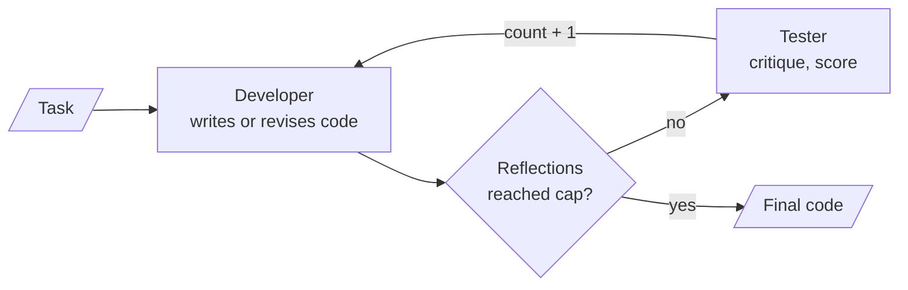
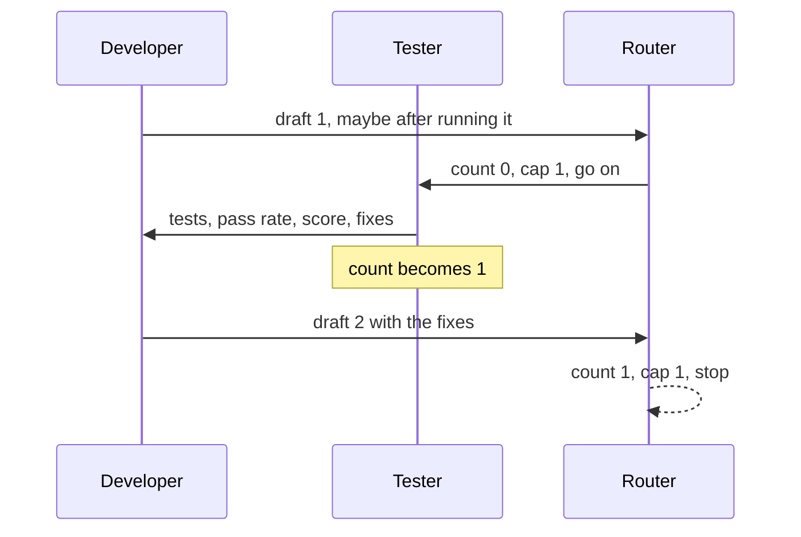

# M26.2 Theory: Developer vs tester agents

*[M26 theory](../../../mandatory/theory/README.md) · Lesson 26.2 · Notebooks: [`02a_developer_vs_tester_agents.ipynb`](../../notebook/02a_developer_vs_tester_agents.ipynb) (optional) · [All theory pages](../../../../../THEORY.md)*
<!-- subtitle: A small project: a developer agent and a tester agent in a critique-and-revise loop that ends by a counter in code -->
<!-- format: approved -->

## The project: a developer and tester pair

> **What you'll build**
>
> - **A developer agent** that writes Python and can run it with a timed Python tool.
> - **A tester agent** that reviews the code, writes unit tests in its report, scores it and lists fixes.
> - **A two-node graph** that loops developer, tester, developer until a reflection counter reaches its cap.
> - **Two small games**, FLAMES and Tic-Tac-Toe, built by the pair and checked against hand-written references.

Lesson 26.1 graded a coding agent on a test suite someone had already written. Larkspur Cloud's billing team has no such suite for a new proration helper, and a reviewer agent that reports "9 out of 10, all tests pass" sounds like one. This project asks a second agent to supply the critique, and then checks how much that critique is worth.

It is the critique-and-revise (reflection) pattern from [M25](../../../../m25_planning_reflection_reasoning/mandatory/theory/README.md), with a **generator** (the developer) and a **reflector** (the tester) taking turns on one shared conversation. The project adds no new pattern. It shows what two agents in one loop need: a stop rule no model can talk its way past, a safe-enough way to run model-written code, and a line between a test that ran and a test the tester only imagined.

## Architecture

The graph has two nodes and one decision:

*Figure 1: The critique-and-revise loop. The router reads a counter in state. Code decides the stop.*

| Piece | What it does | Built on |
|---|---|---|
| **Developer** | A `create_agent` agent with one Python tool, its own tool loop capped at 12 steps, which sees the whole conversation on every turn | M23's `create_agent` |
| **Tester** | A prompt piped into the model, no tools. Its report enters the conversation as a user message, because to the developer it is feedback | M25's reflector |
| **Python tool** | Runs each snippet as a script in a new isolated Python process, in an empty folder, with no environment variables, closed standard input and a 10-second timeout | |
| **State** | The conversation, the cap and a `reflection_count` that each tester turn adds 1 to | M08 reducers |
| **Router** | A pure function that ends the run once the count reaches the cap | [M37's capped quality loop](../../../../../p10_multi_agent_systems/m37_multi_agent_applied_builds/mandatory/theory/04_research_systems_supervisor_financial_research_summarisation_full_research_system/README.md#a-quality-loop-with-a-cap-in-code) |

*Table 1: The project's five pieces.*

The notebook checks the Python tool's guards without a model. Keyboard input fails at once with `EOFError`, and an endless loop is killed at its timeout (2.0 s with a 2-second limit in our run).

## Following one FLAMES request

The task is *Write a Python program for the FLAMES game, plus a short example that calls it with two fixed names*, with a cap of one reflection:

*Figure 2: One reflection round. The developer speaks twice, the tester once.*

The same round, one state change at a time:

Step through one reflection round with a cap of 1 and watch the counter decide the stop.

<button type="button" data-step="0" aria-pressed="false" aria-controls="round-step-0">1. Draft</button><button type="button" data-step="1" aria-pressed="false" aria-controls="round-step-1">2. Route</button><button type="button" data-step="2" aria-pressed="false" aria-controls="round-step-2">3. Critique</button><button type="button" data-step="3" aria-pressed="false" aria-controls="round-step-3">4. Revise</button><button type="button" data-step="4" aria-pressed="false" aria-controls="round-step-4">5. Stop</button>

<section id="round-step-0" class="step-panel" aria-labelledby="round-heading-0"><h4 id="round-heading-0">1. Developer drafts</h4><dl><dt>Reads</dt><dd>the task</dd><dt>Does</dt><dd>writes draft 1, and may run it with the Python tool inside its own loop of at most 12 steps</dd><dt>Counter</dt><dd>0</dd></dl></section><section id="round-step-1" class="step-panel" aria-labelledby="round-heading-1"><h4 id="round-heading-1">2. Router checks the count</h4><dl><dt>Reads</dt><dd>count 0, cap 1</dd><dt>Decides</dt><dd>go on to the tester</dd></dl></section><section id="round-step-2" class="step-panel" aria-labelledby="round-heading-2"><h4 id="round-heading-2">3. Tester critiques</h4><dl><dt>Reads</dt><dd>the whole conversation, with no tools</dd><dt>Writes</dt><dd>tests, an estimated pass rate, a score and fixes, added as a user message</dd><dt>Counter</dt><dd>1</dd></dl></section><section id="round-step-3" class="step-panel" aria-labelledby="round-heading-3"><h4 id="round-heading-3">4. Developer revises</h4><dl><dt>Reads</dt><dd>the conversation including the critique</dd><dt>Does</dt><dd>writes draft 2 with the fixes</dd></dl></section><section id="round-step-4" class="step-panel" aria-labelledby="round-heading-4"><h4 id="round-heading-4">5. Router stops</h4><dl><dt>Reads</dt><dd>count 1, cap 1</dd><dt>Decides</dt><dd>end, whatever the tester said. Draft 2 is the final code</dd></dl></section>

<button type="button" data-walk="previous">Previous</button>

<button type="button" data-walk="next">Next step</button>

The loop's arithmetic holds for any cap. Stub nodes that only append a message, with zero model calls, give these counts:

| Cap `r` | Developer turns | Tester turns | Graph steps used | `recursion_limit` (2r + 4) |
|---|---|---|---|---|
| 0 | 1 | 0 | 1 | 4 |
| 1 | 2 | 1 | 3 | 6 |
| 3 | 4 | 3 | 7 | 10 |

*Table 2: Stub runs from the notebook's own graph builder. The developer runs r + 1 times, the tester r times, and the recursion limit leaves 3 spare steps as a second guard.*

After the run, code checks how many times each agent spoke and whether the last answer holds a Python block that parses. Parsing does not prove the game is right.

A hand-written reference does. For John and Jane it finds 4 letters left, crosses out M, L, F, A and S in turn, and lands on Enemy. The notebook records two mistakes one model run made: it restarted counting from the start of FLAMES after each removal, and read S as "Sister" rather than "Sibling". The Tic-Tac-Toe reference plays three scripted games (a win, a draw, a move onto an occupied square) and all three end as expected.

## What the tester's verdict is worth

The tester's report can rest on three kinds of evidence, and they are not equally strong. The comparison uses the same FLAMES draft that restarted its count after each removal.

Choose where the verdict comes from and see what it can catch.

<button type="button" data-mode="estimated" aria-pressed="false" aria-controls="verdict-estimated">Tester without tools</button>
<button type="button" data-mode="executed" aria-pressed="false" aria-controls="verdict-executed">Tester runs its tests</button>
<button type="button" data-mode="reference" aria-pressed="false" aria-controls="verdict-reference">Hand-written reference</button>

<section id="verdict-estimated" class="mode-panel" data-announcement="Tester without tools selected. The pass rate is an estimate."><h4>Tester without tools (the notebook's design)</h4><ul><li>The tests exist only as text in the report; nothing executes them.</li><li>The pass rate and score are the model's estimates. A counting bug can pass if the tester reasons it through the same wrong way.</li><li>Cost: one model call per round.</li></ul></section>
<section id="verdict-executed" class="mode-panel" data-announcement="Tester runs its tests selected. The results are real."><h4>Tester runs its tests</h4><ul><li>Given the Python tool, the tester executes the tests it wrote, so a failure is a real failure.</li><li>The tests are still the tester's own; a test built on the same misreading of the rules still passes.</li><li>Cost: roughly twice the tester's calls.</li></ul></section>
<section id="verdict-reference" class="mode-panel" data-announcement="Reference selected. The answer is checked against a fact."><h4>Hand-written reference</h4><ul><li>Code compares the draft's output for John and Jane against the reference's Enemy.</li><li>Restarting the count at F after each removal lands on Love, so the draft fails the check with no model call.</li><li>Cost: someone writes the reference once.</li></ul></section>

We call the first mode's number an **estimated pass rate**. It is useful as a list of fixes and worthless as a gate.

## Design choices worth copying

| Choice | Why |
|---|---|
| **Counter in state, pure router** | The loop ends by a rule in code, not when a model decides it is happy |
| **`recursion_limit` as a second guard** | If the router were ever broken, the run still stops after 2r + 4 steps |
| **Prove the cap with stubs** | Zero model calls make the termination test free and repeatable |
| **Ask for code driven by fixed inputs** | The tool closes standard input. An interactive game would only raise `EOFError` |
| **Check against a reference** | The tester's verdict is a model's opinion. A hand-written implementation is a fact |

*Table 3: Five choices and what each protects against.*

## Limits

- **The tester estimates.** It has no tools, so its pass percentage and score are an estimated pass rate, not executed results. Giving it the Python tool makes the results real, at roughly twice the cost.
- **Fixed rounds, not "until the tests pass".** The loop stops at the cap even if the tester still lists failures. The module's lab brief asks for iteration until tests pass, which needs a router that also reads an executed test result.
- **A guard, not a sandbox.** The Python tool runs model-written code with your user's permissions. It can still read your files and reach the network, and anything beyond a demo needs a container or a hosted sandbox (lesson 26.3).
- **No recorded model run.** The notebook ships without outputs and the drafts change each run. This page quotes only the deterministic checks.

The notebook needs an OpenAI key for the two agents. The stub runs, the tool guards and both references run without one.

## References

1. Madaan et al., [Self-Refine: Iterative Refinement with Self-Feedback](https://arxiv.org/abs/2303.17651), 2023.
2. LangGraph, [Graph API overview](https://docs.langchain.com/oss/python/langgraph/graph-api) documentation.

## Key Takeaways

- Stop a two-agent loop with a counter in state and a pure router, back it with a `recursion_limit`, and prove the counts with stub nodes before spending a model call.
- A tester without a way to run code only estimates its pass rate. Run the tests, or check against a reference, before trusting the verdict.
- Running model-written code in a fresh process with a timeout, no environment and closed input keeps a demo from hanging or leaking keys, but it is not a sandbox.

## Check yourself

1. With a cap of three reflections, how many times does each agent run, and what stops the loop?

The developer runs four times (a first draft plus one revision per critique) and the tester three times. The router stops the loop once the reflection counter in state reaches the cap, and a recursion limit of 2r + 4, here 10 steps, stops it even if the router were broken.

2. After one round the tester reports 100% of its tests passing and a score of 9 out of 10. How much does that tell you?

Little. The tester has no tools. It wrote the tests in its report and reasoned about them. The pass rate and score are the model's estimates. Run the tests, give the tester the Python tool at roughly twice the cost, or compare against a hand-written reference.

3. Why does the Tic-Tac-Toe task ask for a function that plays a fixed list of moves?

The developer's Python tool closes standard input and kills a snippet after a timeout. A game that waits for a player would raise an error at once or be stopped. The task asks for a version the tool can run and check without a keyboard.

---
*Previous: [26.1 Applied ReAct: web research, SWE and computer-use agents](../../../mandatory/theory/01_applied_react_web_research_swe_and_computer_use_agents/README.md). Next: [26.3 Deep agents: orchestrator, sub-agents, skills and long-term memory](../../../mandatory/theory/03_deep_agents_orchestrator_sub_agents_skills_and_long_term_memory/README.md).*
