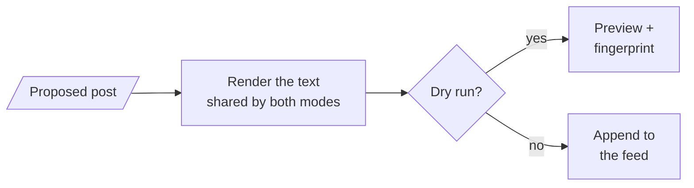
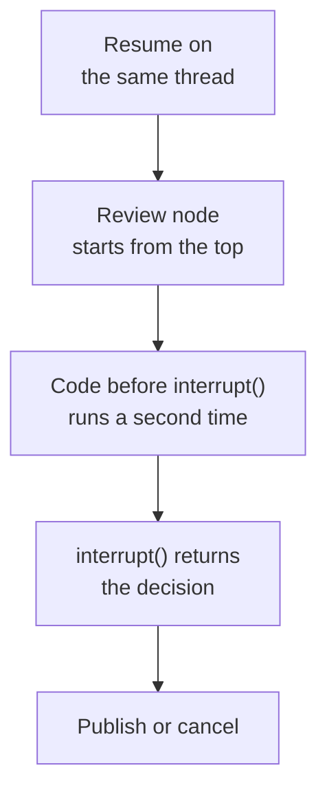
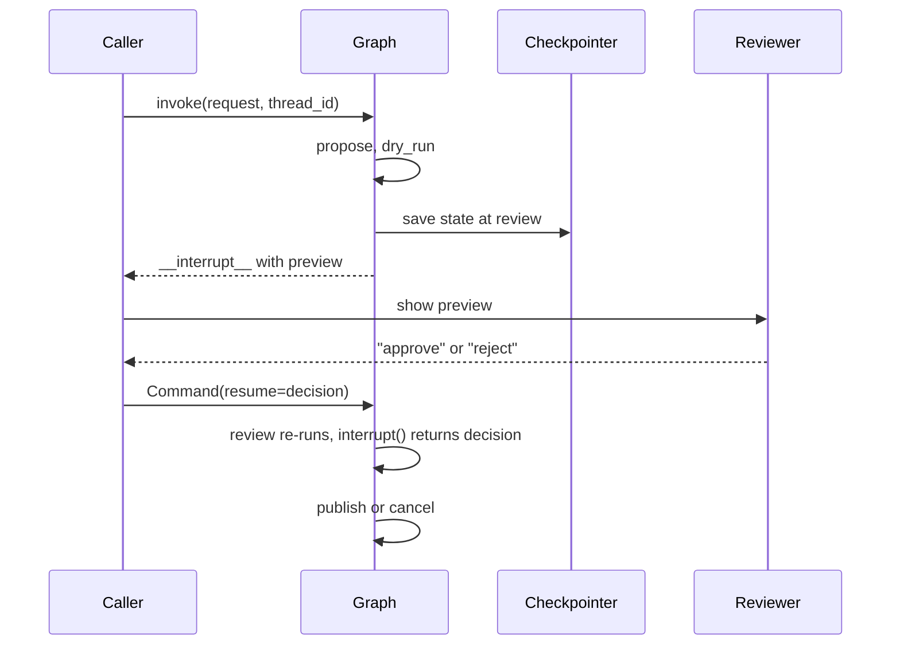

# M27.1 Theory: Dry-run harness and human approval

*[M27 theory](../README.md) · Lesson 27.1 · Notebooks: [`01a_dry_run_harness.ipynb`](../../notebook/01a_dry_run_harness.ipynb) · [All theory pages](../../../../../THEORY.md)*
<!-- subtitle: Preview the effect, pause for a person, and publish only the exact text they approved -->

## The post nobody previewed

> **What you'll learn**
>
> - **Explain** what a dry run is and the three properties that make its preview trustworthy.
> - **Trace** a paused graph from `interrupt()` to `Command(resume=...)` on the same thread.
> - **Diagnose** an unclear answer and an edit made after review, and say why each one must stop the post.
> - **Choose** where the dry run sits in the graph, and what the approval has to cover.

M26 gave agents real reach: they write files, run commands and drive a browser. Every one of those agents ends a turn by doing something, and so far nothing stood between the model's decision and its effect.

Larkspur's operations agent drafts posts for the status feed. After the eu-west outage it writes *"The eu-west outage is resolved and all servers are back online. Engineers will publish a root-cause report within 72 hours of recovery."* With a plain tool call, the model proposes the post and the same call publishes it. A wrong number, a promise the engineers never made or a jab at a competitor reaches every customer before anyone reads it.

A plain tool call joins two moments that need to stay apart: the model *proposing* an action and the system *executing* it. This lesson separates them with two pieces. A **dry run** shows the reviewer the exact effect. An **approval gate** pauses the run until a person decides, and ties that decision to the preview they saw.

## Dry run

**A dry run executes an action's plan without its effect, and reports what the effect would be.** The idea is old: `rsync --dry-run`, `apt-get --simulate` and `terraform plan` all print the changes before anyone applies them.

The lesson's tool is a mock social-media API that stands in for the Larkspur status feed. It has one method that publishes a post, with a dry-run switch, and one rendering step shared by both modes:

*Figure 1: One code path, two outcomes. The preview and the published text come from the same rendering step.*

The two calls return different things, and only one of them touches the feed:

| Call | Returns | Changes the feed |
|---|---|---|
| Publish with dry run on | Status `DRY_RUN`, the rendered preview, fingerprint `c4e9e330698e` | No |
| Publish with dry run off | Status `PUBLISHED`, post id `post_1` | Appends one post |

*Table 1: The two modes for the eu-west post. The fingerprint is the lab's value.*

The **fingerprint** is the first 12 hex digits of a SHA-256 hash over the rendered text, post body plus hashtags. It names the exact text that was previewed, and the approval gate relies on it.

### Three properties that make a preview trustworthy

A preview is worth reading only if it predicts the live call. Three properties make that hold:

- **The preview comes from the live code path.** Both modes render the post the same way. The reviewer reads the text the platform will receive. A preview built by a separate "describe the action" function can drift away from what the live call does. Call that a **drifting preview**: the reviewer approves one thing and another thing runs.
- **"Nothing happened" is checked, not assumed.** The mock feed is a list the notebook can read back, and every claim that a dry run published nothing is an assertion that the feed is still empty. A real tool needs the same: a sandbox, a staging target or a way to read state back.
- **The dry run is its own graph node, before the pause.** On resume, LangGraph re-runs the paused node from the top. Anything placed before `interrupt()` inside the review node runs a second time. A preview generated there could differ from the one the reviewer approved.

The third property hides until the graph resumes:

*Figure 2: What a resume does. Only code that is safe to repeat may sit above the pause.*

### The cost: every consequential tool needs a preview

Each tool that changes the world needs its own preview, showing what the reviewer must judge:

| Action | What the dry run must show |
|---|---|
| Publish a status post | The rendered text, hashtags included |
| Send an email | The rendered message and every recipient |
| Issue a refund | The amount, the account and the invoice it reverses |
| Delete a server | The server name and what is stored on it |

*Table 2: Preview contents per action (illustrative examples beyond the notebook's post).*

With a trustworthy preview in hand, the next job is to stop the run until someone has read it.

## Approval gates

**An approval gate is a node that pauses the run, hands the preview to a reviewer and resumes only with their decision.** In the harness the gate is the review node. It calls `interrupt()` with three things: the question, the preview and the fingerprint.

### Parking and resuming the same thread

LangGraph stops the run at that call, saves its state in the checkpointer under the run's `thread_id`, and returns the payload to the caller under `__interrupt__`. Nothing more happens until someone invokes the graph again with `Command(resume=decision)` on the same thread:

*Figure 3: One pause and one resume. The state waits in the checkpointer for as long as the reviewer takes.*

The notebook wraps that exchange in a small pause-and-resume loop: invoke, and while the result holds an interrupt, pass the payload to a reviewer function and resume with its answer. Only the reviewer function changes between uses:

- **A script**: approves the launch post and rejects the post that says the new model makes every competitor obsolete. An automated run then shows both outcomes.
- **A policy check**: an automated rule, configured explicitly.
- **A console prompt**: a person types the answer.
- **A review UI**: answers hours later, from another process.

An answer that arrives hours later from another process needs a persistent checkpointer, such as SQLite or Postgres, in place of the notebook's in-memory one.

### Binding the decision to the preview

Pausing is the mechanism. Three rules make the gate safe:

- **Fail closed.** The decision is normalised by stripping spaces and lowercasing, and only the exact word `approve` approves. Everything else counts as a rejection.
- **Approve what was previewed.** The approval stores the preview's fingerprint. The publish node recomputes the fingerprint of the post it is about to send and refuses if the two differ.
- **Log every decision** with the reviewer, the reason, the fingerprint and the time.

Here is the fail-closed rule against the answers reviewers actually type:

| Answer typed | Decision | Why |
|---|---|---|
| `approve` | approve | The exact word |
| `␣Approve␣` | approve | Spaces stripped, case ignored |
| `approved` | reject | Not the exact word, logged as an unclear answer |
| `yes` | reject | Logged as an unclear answer |
| `sure, why not` | reject | Logged as an unclear answer |
| `reject` | reject | The reviewer's own reason is kept |

*Table 3: Planted answers through the decision rule. An ambiguous answer never publishes.*

A console, a script and a web form all feed the same rule, and the audit entry keeps the original answer beside the decision. The opposite design, where "yes" counts, is a **lenient gate**. It approves whatever a person half-meant.

### Planted failure: an edit after approval

The second rule is the one that catches **post-approval drift**, any change between what the reviewer read and what is about to run. The notebook plants it by editing the paused post directly in the checkpointed state, appending " Buy now!!!", and then approving.

The [approval-gate lab](interactive/approval-gate-lab.html) runs the same harness in the page, with the decision rule and the SHA-256 fingerprint ported from the reference implementation. Checked against the reference graph on 315 runs (3 drafts, 3 kinds of edit, 35 typed answers), it agrees on every final status, fingerprint and audit entry. With the eu-west post approved:

| Change after the preview | Fingerprint at publish | Final status |
|---|---|---|
| None | `c4e9e330698e` | `PUBLISHED as post_1` |
| "72 hours" edited to "48 hours" | `11673ae3c1d4` | `REFUSED: the post differs from the approved preview` |
| " Buy now!!!" appended (the notebook's test) | `78879f196e7d` | `REFUSED: the post differs from the approved preview` |

*Table 4: One approval, three versions of the post. The fingerprints were recomputed from the lab's post text.*

<!-- lab: interactive/approval-gate-lab.html -->

A one-phrase edit changes the fingerprint as completely as a new sentence. Any edit after review needs a new preview and a new decision. In both refused runs the audit log still shows an `approve`. That entry is correct. The reviewer approved `c4e9e330698e`, and the text that tried to publish was something else.

> **Pitfall: the gate is only as good as its reviewer.** Approve the uptime post in the lab ("Larkspur Cloud now beats every other host on uptime") and it reaches the feed. The gate enforces the decision, and it cannot judge the content. The module page's interview questions cover how to measure whether reviewers read.

The same pause exists ready-made. `HumanInTheLoopMiddleware` from [M23's middleware lesson](../../../../../p06_agent_foundations/m23_react_agents/mandatory/theory/04_middleware_including_human_in_the_loop/README.md) gives a `create_agent` agent a pause before a tool call, built on the same `interrupt()` and checkpointer from M09. Building the gate by hand adds the two parts this lesson needs: a preview of the effect, and a fingerprint that ties the approval to it.

## In practice: the eu-west status post

Here is the whole harness on Larkspur's post, in the order the graph runs it:

1. **Propose.** The model drafts the post and its hashtags as structured output.
2. **Dry run.** Its own node renders the text and computes `c4e9e330698e`. The feed is still empty.
3. **Review.** The graph pauses and the checkpointer holds the run. The on-call lead reads the preview.
4. **Decide.** The lead types `approve`. The audit log records the reviewer, the reason, the fingerprint and the time.
5. **Publish.** The recomputed fingerprint matches, and the post goes out as `post_1`. An edit in the meantime would have been refused.

Lesson 27.2 builds agents that only read: they search the web and return a brief. Their risk is a wrong claim, and the guard moves from a person's approval to checks in code.

## Limits

The harness tested an unclear answer and an edit after the preview, on a mock feed. It leaves out:

- **Staleness.** The fingerprint covers the text, not the world it describes. A post approved four hours later still matches even if the incident reopened. Add an approval expiry or a precondition checked at publish time.
- **Persistence.** The in-memory checkpointer loses a paused run on restart. Add SQLite or Postgres before reviewers answer from another process.
- **Reviewer quality.** Nothing measures whether approvals are read. Add approval-rate and time-to-decision monitoring.

## Key Takeaways

- A dry run renders the effect through the same code path as the live call and changes nothing. Check that by reading state back, and put the dry run in its own node before the pause.
- The gate pauses with `interrupt()`, saves state under the `thread_id` and waits for `Command(resume=...)`. Accept only the exact word `approve` and log every decision with reviewer, reason, fingerprint and time.
- Tie the approval to a fingerprint of the previewed text and recompute it before publishing. Any edit after review, even one phrase, needs a new preview and a new decision.

## Check yourself

1. Why must the dry run be its own graph node before the review node, rather than code inside the review node?

On resume LangGraph re-runs the paused node from the top, so anything placed before `interrupt()` in the review node runs twice. A preview generated there could differ from the one the reviewer approved.

2. The eu-west post is approved, then 72 hours is edited to 48 hours before it publishes. What happens, and what does the audit log show?

The fingerprint at publish is `11673ae3c1d4`, not the approved `c4e9e330698e`, so the publish node returns `REFUSED: the post differs from the approved preview`. The audit log still shows an `approve`, and that is correct: the reviewer approved `c4e9e330698e`. Any edit after review needs a new preview and a new decision.

3. A reviewer answers the approval prompt with yes. Does the post go out, and why is that the right behaviour?

No. The gate fails closed: the answer is stripped and lowercased, and only the exact word `approve` approves, so `yes` and `approved` are rejections, logged as unclear answers. An ambiguous answer should never publish.

---
*Previous: [M27 overview](../README.md). Next: [27.2 Research and competitive-intelligence agents](../02_research_and_competitive_intelligence_agents/README.md).*
