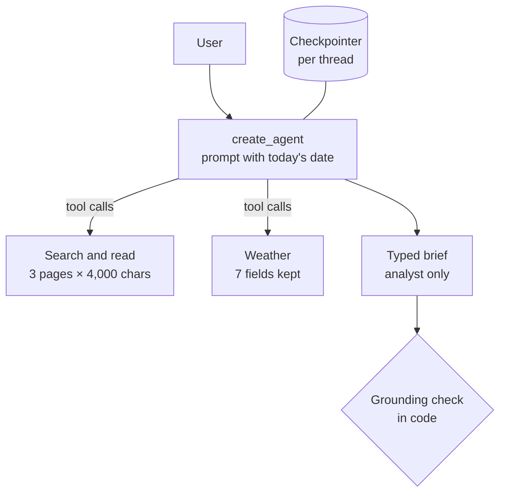
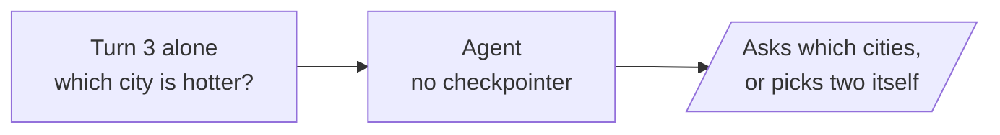
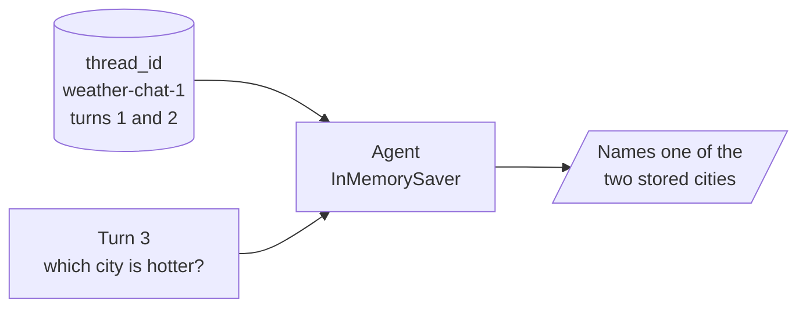

# M27.2 Theory: Research and competitive-intelligence agents

*[M27 theory](../README.md) · Lesson 27.2 · Notebooks: [`02a_research_assistant_agent.ipynb`](../../notebook/02a_research_assistant_agent.ipynb), [`02b_competitive_intelligence_agent.ipynb`](../../../optional/notebook/02b_competitive_intelligence_agent.ipynb) (optional) · [All theory pages](../../../../../THEORY.md)*
<!-- subtitle: A small project: two web-research agents, budgeted tools, memory, and a source check in code -->
<!-- format: approved -->

## The project: research and market-brief agents

> **What you'll build**
>
> - **A research assistant** that searches the web, reads the pages it finds and checks the current weather.
> - **Budgeted tools** that return at most three pages of 4,000 characters per search.
> - **Conversation memory** that lets a follow-up such as *"And in Dubai?"* refer to the earlier turn.
> - **A competitive-intelligence analyst** that returns a typed brief with a source URL per competitor and a field for data it could not find.
> - **A grounding check** in code that flags any cited URL the run never saw.

Lesson 27.1 guarded an agent that acts. These two agents only read. Their risk is a wrong claim rather than a wrong action. Both are `create_agent` agents from [M23](../../../../../p06_agent_foundations/m23_react_agents/mandatory/theory/README.md) with tools in the M22 style. The first answers general research questions. The second specialises the same idea into a retail analyst that watches clothing-store competitors in Bangalore. For Larkspur, the same build would watch competing hosts' pricing pages.

The project adds no new pattern. It shows what changes on the live web: each tool call costs tokens, the data changes between runs, and there is no fixed expected answer. Each check therefore compares the answer with the tool data from the same run.

## Architecture

The two builds share one shape and differ in what comes out:

*Figure 1: Pieces of both builds. The weather tool and memory belong to the assistant, the typed brief and its check to the analyst.*

| Piece | What it does | Built on |
|---|---|---|
| **Search-and-read tool** | Up to three search results, each page fetched in parallel, converted to text and cut to 4,000 characters. After 15 seconds it falls back to the snippet | M22 tool schemas |
| **Weather tool** | Current weather, trimmed from about 40 fields to 7. An unknown city returns a sentence | M22 tool errors as messages |
| **Tool-choice check** | Reads which tool the model would call for three questions (earnings, weather, arithmetic), running none | M22 native tool calls |
| **The assistant** | A prompt with today's date: search first, cite URLs, admit empty results | M23 `create_agent` |
| **Memory** | An in-memory checkpointer keyed by a thread id | M09 checkpointers |
| **Analyst persona** | A prompt for owners, marketers, location analysts and investors, and one search tool (five results) | |
| **Brief schema** | Area, audience, up to five competitors with an evidence URL each, opportunities, risks and data gaps | M23 structured output |
| **Grounding check** | Tests each evidence URL against every URL the search returned in the run | |

*Table 1: The project's pieces.*

## Following a follow-up question

The assistant's memory test asks three questions on one thread. The last one only makes sense with the first two:

| Turn | Tool call | What the thread holds after |
|---|---|---|
| 1. *How is the weather in Bangalore right now?* | Weather for Bangalore | The question, the call, its result and the answer |
| 2. *And in Dubai?* | Weather for Dubai | Both cities' results |
| 3. *Which of the two cities is hotter right now?* | None needed | An answer drawn from turns 1 and 2 |

*Table 2: Three turns on one thread. The data is live, and no values are fixed.*

The notebook asks turn 3 twice: once to an agent with no checkpointer, and once on the thread that holds turns 1 and 2. The two set-ups differ only in what the agent reads before it answers.

*Figure 2: Without memory. The agent sees one message and no weather results.*

*Figure 3: With memory. The checkpointer loads the earlier turns, tool results included, before the model runs.*

Choose how the agent receives the follow-up, and see what it has to work with.

<button type="button" data-mode="stateless" aria-pressed="false" aria-controls="memory-stateless">Fresh thread</button>
<button type="button" data-mode="thread" aria-pressed="false" aria-controls="memory-thread">Same thread</button>

<section id="memory-stateless" class="mode-panel" data-announcement="Fresh thread selected. The agent has no cities to compare."><h4>Fresh thread, no checkpointer</h4><dl><dt>Messages read</dt><dd>one: the follow-up</dd><dt>Weather results</dt><dd>none</dd><dt>Likely answer</dt><dd>a question back, or two cities the user never named</dd><dt>Answer check</dt><dd>nothing to check against</dd></dl></section>
<section id="memory-thread" class="mode-panel" data-announcement="Same thread selected. The agent compares the two stored results."><h4>Same thread, InMemorySaver</h4><dl><dt>Messages read</dt><dd>every message of turns 1 and 2, then the follow-up</dd><dt>Weather results</dt><dd>Bangalore and Dubai, as the tool returned them</dd><dt>Likely answer</dt><dd>one of the two cities, with no new tool call</dd><dt>Answer check</dt><dd>compares the first line with the hotter city in the stored results</dd></dl></section>

Without the thread the agent cannot know which two cities you mean. We call that failure a **phantom referent**: a follow-up answered about something the conversation never named.

The check after turn 3 reads the temperatures from the weather results stored in the thread, keyed by the city name the agent asked for (the API can report Bangalore as "Bengaluru"). It finds the hotter city and tests whether the answer's first line names it. It never trusts the model's own comparison.

The analyst's brief gets the same treatment for sources.

Step through one analyst run, from the question to the grounding check.

<button type="button" data-step="0" aria-pressed="false" aria-controls="ground-step-0">1. Ask</button><button type="button" data-step="1" aria-pressed="false" aria-controls="ground-step-1">2. Search</button><button type="button" data-step="2" aria-pressed="false" aria-controls="ground-step-2">3. Brief</button><button type="button" data-step="3" aria-pressed="false" aria-controls="ground-step-3">4. Check</button>

<section id="ground-step-0" class="step-panel" aria-labelledby="ground-heading-0"><h4 id="ground-heading-0">1. Ask</h4><dl><dt>Question</dt><dd>the top five clothing-store competitors near Koramangala, Bangalore, and their busiest hours</dd></dl></section><section id="ground-step-1" class="step-panel" aria-labelledby="ground-heading-1"><h4 id="ground-heading-1">2. Search</h4><dl><dt>Tool</dt><dd>the search tool, five results per call, as many calls as the agent chooses</dd><dt>Kept in the run</dt><dd>every result URL, inside the tool messages</dd></dl></section><section id="ground-step-2" class="step-panel" aria-labelledby="ground-heading-2"><h4 id="ground-heading-2">3. Brief</h4><dl><dt>Output</dt><dd>a typed brief: area, audience, competitors with one evidence URL each, opportunities, risks, data gaps</dd><dt>Busiest hours</dt><dd>belong under data gaps unless a search result gave them</dd></dl></section><section id="ground-step-3" class="step-panel" aria-labelledby="ground-heading-3"><h4 id="ground-heading-3">4. Check</h4><dl><dt>Compare</dt><dd>each evidence URL with the set of URLs the searches returned in this run</dd><dt>Report</dt><dd>how many competitors cite a seen URL, and the name and URL of each one that does not</dd></dl></section>

<button type="button" data-walk="previous">Previous</button>

<button type="button" data-walk="next">Next step</button>

To see the check fail, the notebook appends one invented competitor to a real brief:

| Competitor entry | Evidence URL | In this run's search results |
|---|---|---|
| Entries from the agent's brief | URLs the search returned | Grounded |
| "Urban Threads Koramangala", busiest 6 to 9 pm on weekends | An `example.com` footfall report | Flagged as not from this run's searches |

*Table 3: The grounding check on a planted entry. A plausible line from memory has no URL the run saw.*

## Design choices worth copying

| Choice | Why |
|---|---|
| **Today's date in the system prompt** | Without it, "most recent quarter" means the latest one in the training data |
| **Budget every tool's output** | A full page can be tens of thousands of tokens. Three pages of 4,000 characters cap a search at 12,000 |
| **Return failures as text** | The agent adapts instead of crashing. Lesson 22.5 names the cost: error monitoring never sees these |
| **Check tool choice before the loop** | One model call per question, and no tool runs |
| **Make data gaps a field** | The original prompt asked for "example insights" when data was missing, an invitation to invent footfall figures. The field makes "no data" a visible answer |
| **One evidence URL per claim, checked in code** | Separates claims from this run's searches from claims out of the model's memory |

*Table 4: Six choices and what each one protects against.*

## Limits

- **Live data.** Answers differ on every run and there is no expected answer. Test behaviour instead: which tools were called, in what order, and whether the answer agrees with the tool results stored in the run.
- **A URL proves sight, not support.** The grounding check shows the agent saw the page in this run. It does not show the page says what the brief claims. That needs a person, or a second check that quotes the page.
- **Memory lives in the process.** The in-memory checkpointer loses every thread on restart.
- **Snippets are weaker evidence.** A blocked or slow page leaves the agent a two-line snippet.

The assistant needs OpenAI, Tavily and OpenWeatherMap keys, and the analyst needs OpenAI and Tavily. We did not run either agent for this page: it describes what the notebooks' code checks, and quotes no live results.

## References

1. LangChain, [Agents](https://docs.langchain.com/oss/python/langchain/agents).
2. LangChain, [Structured output](https://docs.langchain.com/oss/python/langchain/structured-output).
3. LangChain, [LangGraph persistence](https://docs.langchain.com/oss/python/langgraph/persistence).
4. Tavily, [Search API reference](https://docs.tavily.com/documentation/api-reference/endpoint/search).
5. OpenWeather, [Current weather data API](https://openweathermap.org/api/current).
6. Microsoft, [MarkItDown](https://github.com/microsoft/markitdown).

## Key Takeaways

- An agent over live sources needs budgets on what each tool returns and failures returned as readable text, or one call floods the context or ends the run.
- Give the agent today's date and memory per thread, then check its answers against the tool data stored in the same run rather than its own summary.
- Make missing data a field of the output and check every cited source against the URLs the run actually retrieved.

## Check yourself

1. Why does the research assistant's system prompt include today's date?

The model does not know the date. Without it, "most recent quarter" means the most recent one in its training data, so the agent searches for an old quarter and reports it as current.

2. A brief lists a competitor whose evidence URL never appeared in the run's search results. What does the grounding check conclude, and what does it not prove?

It flags the entry as not from this run's searches. The URL came from the model's memory or was invented, and the claim needs checking by hand. A URL that passes proves only that the agent saw the page in this run, not that the page supports the claim.

3. A fresh thread receives the question of which of the two cities is hotter. What goes wrong, and what fixes it?

With no earlier turns, the agent asks which cities, or picks two of its own and answers confidently. A checkpointer with a thread id carries the Bangalore and Dubai weather results into the follow-up, and the check reads those stored results to confirm the answer.

---
*Previous: [27.1 Dry-run harness and human approval](../01_dry_run_harness_and_human_approval/README.md). Next: [27.3 Financial analyst agent](../../../optional/theory/03_financial_analyst_agent/README.md).*
