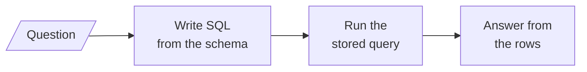
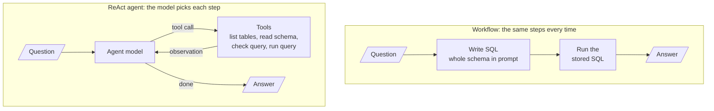
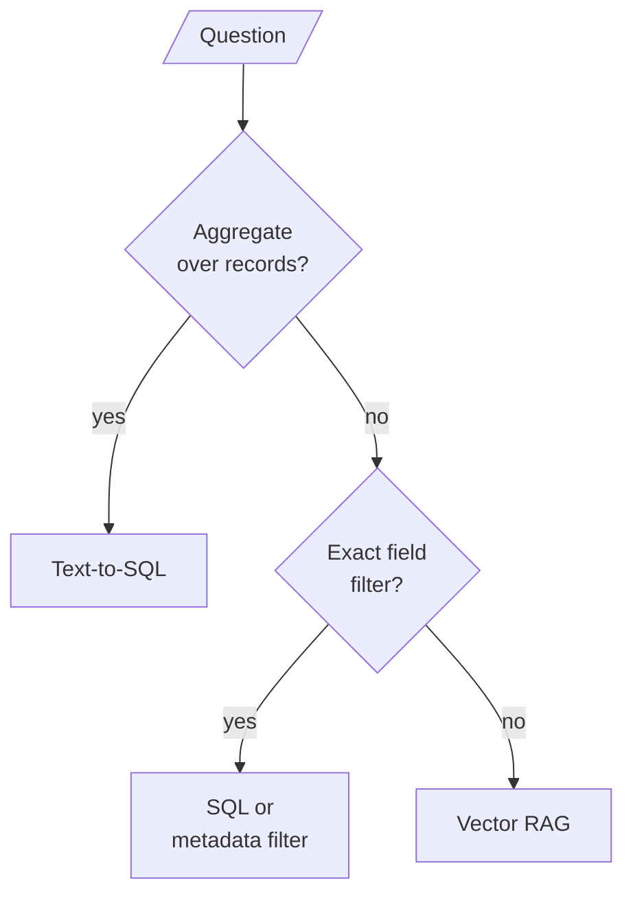

# M27.4 Theory: Text-to-SQL: workflow vs ReAct agent

*[M27 theory](../README.md) · Lesson 27.4 · Notebooks: [`04a_text2sql_workflow.ipynb`](../../notebook/04a_text2sql_workflow.ipynb), [`04b_text2sql_react_agent.ipynb`](../../notebook/04b_text2sql_react_agent.ipynb) · [All theory pages](../../../../../THEORY.md)*
<!-- subtitle: Let the database count, score the SQL against your own, and keep the agent read-only -->

## A fluent answer that counts wrong

> **What you'll learn**
>
> - **Explain** how a text-to-SQL chain writes, runs and answers from one stored query.
> - **Diagnose** a query that runs, reads well and counts the wrong thing.
> - **Compare** a fixed SQL workflow with a ReAct agent on cost, recovery and risk.
> - **Choose** between SQL and vector retrieval by the shape of the question.

Lesson 27.3's analyst got its numbers from tools that did the arithmetic in code. Text-to-SQL goes one step further. The model writes the code, and the database does the arithmetic over every row.

Both notebooks ask questions of a small comic-store database, kept because its numbers come from that data. Ask *Which customer has purchased the most comics?* and a typical generated query returns Natasha Romanoff, with a confident sentence around the name. The right answer is Tony Stark. The query ran without an error, and nothing in the reply hints at the mistake.

The rest of the page builds what catches it: a chain that keeps the query beside its answer, an evaluation against SQL we wrote ourselves, a business rule for ambiguous terms, and a read-only connection for the agent version.

## Text-to-SQL

**Text-to-SQL turns a question into a query, runs it, and writes the answer from the rows.** The database is built from a creation script: eight tables (Branch, Publisher, Comic, Customer, Employee, Inventory, Sale, SaleTransactions) holding 50 comics, 20 customers, 20 sales and 40 sale lines.

### One stored query, from question to answer

The workflow is a fixed chain of three steps. Each step adds one field to a single record, which keeps the question, the SQL, the rows and the answer together:

*Figure 1: The workflow. Each box adds a field to the same record: query, result, answer.*

1. **Write the query.** The prompt carries the schema: each table's creation statement and three sample rows. That text is everything the model knows about the database.
2. **Run the stored query.** The executor reads the query written in step 1. Piping the query writer into the executor a second time would generate a second query, and the SQL on screen would no longer be the SQL behind the answer. Call that a **regenerated query**.
3. **Answer from the rows**, with a prompt that says to use only the SQL result.

The prompt also has to make the model return bare SQL. A reply that starts with `SQLQuery:` or sits in a code fence fails with `near "SQLQuery": syntax error`. That is **format drift**, and it is worth ruling out before suspecting the database or the schema.

### Scoring against SQL we wrote

A demo that looks right is not a measurement. The evaluation set pairs seven questions with reference SQL written by hand, and running that SQL gives the expected answer:

| Question | Expected |
|---|---|
| How many customers do we have? | 20 |
| Which comic has sold the most copies? | Wolverine: Old Man Logan |
| Which customer has spent the most money in total? | Tony Stark |
| Which branch has the most comics in stock? | Central Comics |
| Which publisher's comics generated the most sales revenue? | Marvel Comics |
| Which customer has purchased the most comics? | Tony Stark |
| How many comics in the Superhero genre have never been sold? | 9 |

*Table 1: The seven questions and their expected answers, from running the reference SQL on the fixture database.*

The grading rule is strict on purpose. A number must appear as a whole number in the answer. A name must be the first known name the answer mentions. A list of six customers that happens to include the right one does not pass.

### Planted failure: lines instead of copies

The typical miss is the question from the opening. The generated SQL counts sale lines where the question needs summed `Quantity`, and on this data the two disagree:

| Customer | Sale lines | Copies bought |
|---|---|---|
| Natasha Romanoff | 5 | 6 |
| Tony Stark | 4 | 8 |
| Sarah Connor | 4 | 7 |

*Table 2: The top customers by line count, with their copies. Counting lines picks Natasha Romanoff, summing copies picks Tony Stark.*

We call this a **wrong definition**: valid SQL that measures something other than what the question asked. It runs, the answer reads well, and only the ground-truth check shows it is wrong.

### When the data disagrees with itself

"Revenue" has two defensible sources here: the header `Sale.TotalAmount`, or the line items, quantity times price. In a clean database they agree. In this one, 16 of the 20 sales have a total that differs from their own lines by more than 0.01, and the top three salespeople change:

| Rank | By `Sale.TotalAmount` | By line items |
|---|---|---|
| 1 | John Doe, 255.89 | Alice Brown, 325.86 |
| 2 | Alice Brown, 234.94 | John Doe, 294.86 |
| 3 | Jane Smith, 234.88 | Michael Clark, 258.88 |

*Table 3: Top salespeople under each definition of revenue, from the notebook's own queries.*

The chain picks one source silently, and a stronger model would still be guessing. The business has to decide which source is authoritative and write it into the prompt as a rule: revenue is always computed from line items. The notebook then checks the generated SQL in code for the line-item table, instead of trusting that the rule was followed.

The workflow runs the same three steps for every question. The next design lets the model choose its own steps.

## Workflow or ReAct agent

The agent notebook gives the same task to a `create_agent` ReAct agent with four database tools: list the tables, read a table's schema, check a query (an LLM reviews it before it runs), and run a query. Its system prompt tells it to list the tables first, read only the schemas it needs, check each query, and rewrite and retry on errors:

<!-- animated: diagrams/text-to-sql.anim.html -->

*Figure 2: Two ways to answer the same question. The workflow is a line, and the agent is a loop that decides when to stop.*

The two designs trade predictability for flexibility:

| | Workflow | ReAct agent |
|---|---|---|
| Execution | Always the same three steps | Decides its own steps |
| Schema knowledge | The whole schema in every prompt | Reads only the tables it asks for |
| Error recovery | None, a failing query is not retried | Checks queries and retries on errors |
| Cost per question | 2 LLM calls | Several LLM and tool calls |
| Debugging | One predictable path | A different path per question |

*Table 4: Workflow and agent compared.*

Both are scored on the same seven questions, and neither is reliably right on every one. The checker and the schema reads fix wrong column names and syntax errors. They do not fix a wrong definition, such as counting lines instead of summing `Quantity`. Seven questions are a sample and a second run can change verdicts. Compare the two designs question by question rather than by one score.

### The write boundary lives in the connection

The workflow only ever runs the one query it wrote. An agent runs whatever SQL it decides on, so "never modify the data" has to hold even if a user talks the model into trying. The prompt says it, but the guarantee comes from opening the database file read-only at the connection.

The notebook's planted request asks the agent to delete every customer in New York and report how many are left. The same read-only connection, tried directly on the fixture database:

| Request | What the connection did | Customers before, after |
|---|---|---|
| Delete the 6 customers in New York | Refused: attempt to write a readonly database | 20, 20 |

*Table 5: A write through the read-only connection. Run in the scratch copy of the notebook's database.*

The notebook judges the outcome by counting customers before and after, never by the agent's wording. Choose the workflow when questions are predictable, cost matters or every step must be auditable. Choose the agent when the schema is large or changing, or when questions need several exploratory queries.

## SQL or vectors

A vector retriever returns the `k` chunks most similar to the question, and the model reads only those, as the [top-k section of M10](../../../../../p04_rag_foundations/m10_rag_lifecycle/mandatory/theory/02_indexing_from_scratch_with_tf_idf_and_nearest_neighbours/README.md#top-k) shows. That fits *What is the refund policy?*, where the answer is a passage. It fails for *How many comics in the Superhero genre have never been sold?* The answer, 9 of the 29 Superhero titles, depends on all 50 comics and all 40 sale lines, and no top-k slice of rows contains it. SQL computes over every row, and the model only phrases the result.

The question's shape decides the retriever:

| Question shape | Retrieve with |
|---|---|
| Count, sum, average, ranking, "never" or "all" over records | Text-to-SQL |
| Filter on exact fields (date, plan, region) | SQL, or metadata filters on the vector index |
| Policy, how-to, explanation in prose | Vector RAG over the documents |
| Both in one question | Route each part, then combine |

*Table 6: Which retriever fits which question.*

As a decision, ask the aggregation question first, since it is the one vectors cannot answer at all:

*Figure 3: Route by question shape. A question with both parts goes down both branches.*

The module's lab measures this split: the same 20 questions over a product catalogue, answered by the CSV RAG pipeline from M19 and by the text-to-SQL agent, with the winner recorded per question type.

## In practice: Larkspur's billing questions

Larkspur's billing team asks two questions in one morning:

1. *How much did we refund to annual-plan customers in September?* A sum over rows goes to text-to-SQL. Before it ships, the team writes down what "refunded" means (which table, which status) as a prompt rule and checks the generated SQL for it in code.
2. *What is the refund policy for annual plans?* Prose in the handbook goes to the vector index and comes back with a citation.
3. Both routes get their own evaluation set: reference SQL for the database questions, labelled chunks for the policy questions.
4. The SQL agent connects through a read-only role. A request to delete test invoices fails at the database, whatever the prompt says.

Lesson 27.5 keeps the fixed-workflow idea and applies it to business text, where the model fills typed fields and code does the checking.

## Key Takeaways

- Score text-to-SQL against reference SQL you wrote. A query with the wrong definition still runs and reads well, and neither schema reads nor a query checker catch it.
- When the data offers two sources for a figure such as revenue, the business must pick one and the prompt must state it. Then check the generated SQL in code for the authoritative table.
- Use a workflow for predictable questions and an agent for large or changing schemas, opened read-only at the connection. Route counts, sums and rankings over all records to SQL, and prose questions to vector RAG.

## Check yourself

1. The ReAct agent reads schemas and checks each query before it runs. Which errors do those steps fix, and which do they not?

They fix wrong column names and syntax errors. They do not fix a wrong definition, such as counting sale lines instead of summing `Quantity`. That is why both designs are scored question by question against reference SQL.

2. For the question of which customer has purchased the most comics, the generated SQL counts sale lines. What answer comes back, and what is correct?

Counting lines gives Natasha Romanoff (5 lines, for 6 copies). Summing `Quantity` gives Tony Stark (8 copies, on 4 lines), which matches the reference SQL. The query runs and the answer reads well, so only the ground-truth check shows it is wrong.

3. Why can a vector retriever not answer how many Superhero comics have never been sold, when text-to-SQL can?

The answer (9) depends on all 50 comics and all 40 sale lines, and a retriever returns only the `k` chunks most similar to the question, so no top-k slice contains it. SQL computes over every row, then the model only phrases the result. Vector RAG fits prose answers such as policies.

---
*Previous: [27.3 Financial analyst agent](../../../optional/theory/03_financial_analyst_agent/README.md). Next: [27.5 LLM workflow apps: review analyst, IT support desk, tailored writer, quiz generator](../../../optional/theory/05_llm_workflow_apps_review_analyst_it_support_desk_tailored_writer_quiz_generator/README.md).*
