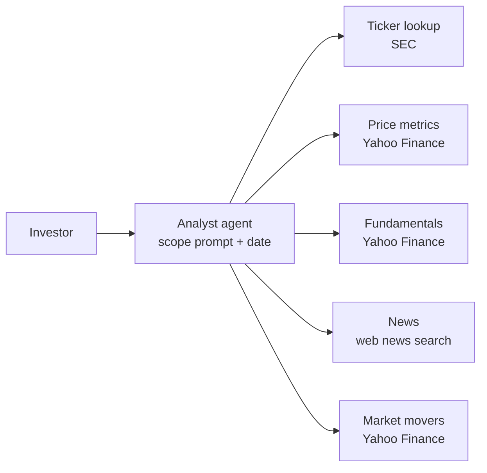
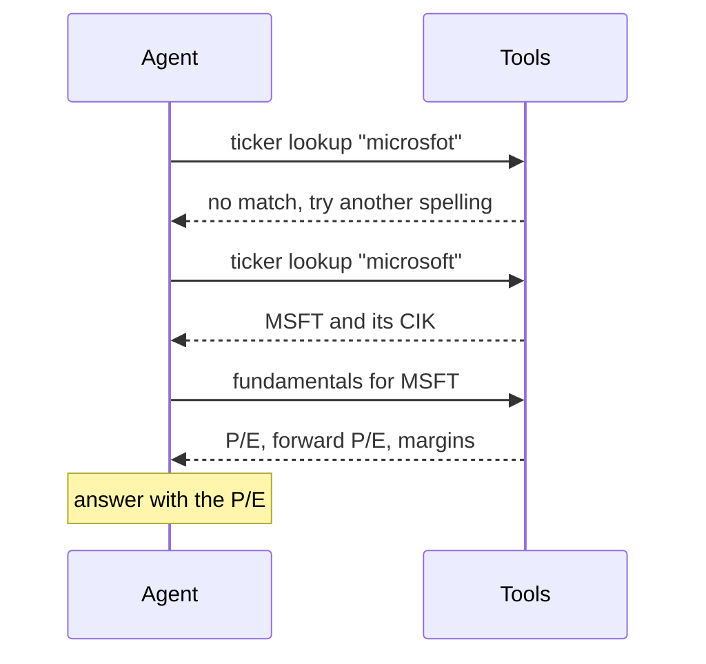

# M27.3 Theory: Financial analyst agent

*[M27 theory](../../../mandatory/theory/README.md) · Lesson 27.3 · Notebooks: [`03a_financial_analyst_agent.ipynb`](../../notebook/03a_financial_analyst_agent.ipynb) (optional) · [All theory pages](../../../../../THEORY.md)*
<!-- subtitle: A small project: a scoped agent over market-data tools, with arithmetic in code and every number checked -->

## The project: a scoped financial analyst

> **What you'll build**
>
> - **Five market-data tools** for ticker lookup, price performance, fundamentals, news and market movers, none of which needs a market-data key.
> - **Compact tool output** that summarises a year of daily prices in code before the model sees it.
> - **A scope** written into the system prompt as two flows and a polite refusal, checked on one request of each kind.
> - **Follow-up questions** on one thread, with the numbers in the answers checked against the provider.

Lesson 27.2's agents answered from web pages, where a claim can only be traced to a URL. This agent answers from structured market data, where every number has a source to compare against. The machinery is unchanged: a `create_agent` agent from M23, M22-style tools and an M09 checkpointer for follow-ups.

What changes is the discipline around numbers. The model should read figures and never compute them, a missing value must say it is missing, and the agent must decline questions outside its job. On Larkspur the same shape would fit a billing analyst over invoice data. The notebook is an engineering exercise, not investment advice.

## Architecture

The agent sits between an investor and five tools, each backed by a free data provider:

*Figure 1: The analyst and its tools. OpenBB routes each market-data call to a provider, and news comes from a web search.*

| Piece | What it does | Built on |
|---|---|---|
| **Ticker lookup** | Company name to ticker, SEC name and CIK, best five matches. A failed lookup returns a hint to fix the spelling | M22 tool errors as messages |
| **Price metrics** | Latest quote, returns over 1, 3, 6 and 12 months, 52-week range and moving averages, computed from a year of daily closes | |
| **Fundamentals** | P/E, forward P/E, market cap, margins and growth, with an explicit NOT AVAILABLE line for any missing key metric | |
| **News** | Up to five headlines from the last month, with dates and links | Lesson 27.2's search tool |
| **Market movers** | Most active stocks, top gainers and top losers, ten of each | |
| **Scope prompt** | Today's date, then Flow 1 for market overviews, Flow 2 for a named company, and a friendly refusal for anything else | M23 `create_agent` |
| **Memory** | An in-memory checkpointer keyed by a thread id | M09 checkpointers |

*Table 1: The project's pieces.*

The price tool is where the arithmetic moves out of the model. Here is what each design hands over per call:

| Design | What the model receives | Who computes returns |
|---|---|---|
| Raw history | About 250 daily closes for a year | The model |
| The notebook's tool | 14 fields: quote, day range, 52-week high and low, two moving averages, four returns | Code |

*Table 2: One year of prices, two ways. Returns use 21 trading days per month.*

## Following a misspelled question

The notebook checks the scope with one request per path, and passes each on what the agent called, not on its wording:

| Request | Expected path | Passes when |
|---|---|---|
| *Tell me some stocks I could potentially look into today.* | Flow 1 | The market-movers tool was called |
| *What is the P/E ratio of microsfot?* | Flow 2, with a spelling fix | Fundamentals were fetched for `MSFT` |
| *Can you recommend a good pasta recipe for tonight?* | Out of scope | No tool was called |

*Table 3: Three planted requests and their pass conditions.*

The misspelled request exercises the recovery rule in the prompt. The values change daily, and the trace shows only the call order:

*Figure 2: A failed lookup becomes a hint the agent acts on, then the ticker feeds the next call.*

The follow-up conversation then asks *What is the P/E ratio of Nvidia?*, *And Intel?* and *Which of the two looks better on valuation?* on one thread. The check fetches the same metrics from the provider directly. Nvidia's answer must contain its trailing P/E, rounded to one or two decimals. If the provider has no trailing P/E for Intel (the notebook was written while Intel's trailing earnings were negative), the answer must say so or quote the forward P/E, and any other P/E figure counts as invented.

## Design choices worth copying

| Choice | Why |
|---|---|
| **Compute returns and ranges in code** | The model reads numbers well and calculates them unreliably. Fourteen fields also cost far less context than 250 rows |
| **Name missing values** | A missing P/E stated as NOT AVAILABLE cannot be mistaken for zero or filled in by the model |
| **Turn a failed lookup into a hint** | The agent retries with a corrected or shorter name instead of stopping (lesson 22.5) |
| **Scope with a refusal path** | Off-topic requests get a friendly decline and no tool calls, and a test proves it |
| **Check numbers against a direct fetch** | The answer is compared with the provider's own figures, never with the model's summary |
| **Key-less providers** | SEC and Yahoo Finance need no key. The notebook runs with no extra accounts |

*Table 4: Six choices and what each one protects against.*

## Limits

- **Live data.** Every run sees different prices. The checks test agreement with the provider at run time, never fixed values.
- **Scope lives in the prompt.** Nothing in code blocks an off-topic tool call, and one request per path is a sample. A determined user can talk the agent around.
- **A loose number match.** The check accepts any number within 0.051 of the provider's value, so an unrelated figure that happens to be close also passes.
- **Advice.** The prompt allows recommendations with a do-your-own-research caveat. A production version would need compliance review.

The notebook needs OpenAI and Tavily keys and the course's `finance` dependency group, which cannot share an environment with the protocol groups.

## Key Takeaways

- Do the arithmetic in the tool and hand the model a short table, so it reads figures instead of computing them from hundreds of rows.
- Make missing values explicit in tool output, and treat any figure the provider did not return as invented.
- Test a scoped agent on one request per path, judging each by the tools it called, and check its numbers against a direct fetch from the same provider.

## Check yourself

1. Why does the price tool compute returns and the 52-week range in code instead of passing a year of prices to the model?

A year of daily prices is about 250 rows. The tool reduces them to 14 fields, which costs far less context, and the model only reads the returns and range rather than calculating them, which it does unreliably.

2. The provider has no trailing P/E for a company with negative earnings. What does the fundamentals tool return, and what does the answer check accept?

The tool ends its output with an explicit NOT AVAILABLE line naming the missing metric. The check accepts an answer that says the trailing P/E is unavailable or quotes the forward P/E, and treats any other P/E figure as invented.

3. How does the notebook show that the analyst's scope works, and what does the out-of-scope request prove?

It sends one request per path and passes each on the tools called: market movers for the overview, fundamentals for MSFT after the misspelled lookup, and no tools for the pasta recipe. The last proves the refusal path declines without touching any tool.

---
*Previous: [27.2 Research and competitive-intelligence agents](../../../mandatory/theory/02_research_and_competitive_intelligence_agents/README.md). Next: [27.4 Text-to-SQL: workflow vs ReAct agent](../../../mandatory/theory/04_text_to_sql_workflow_vs_react_agent/README.md).*
