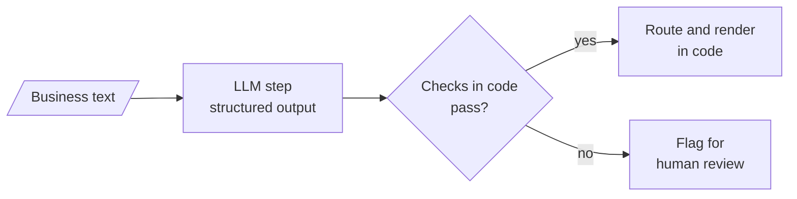
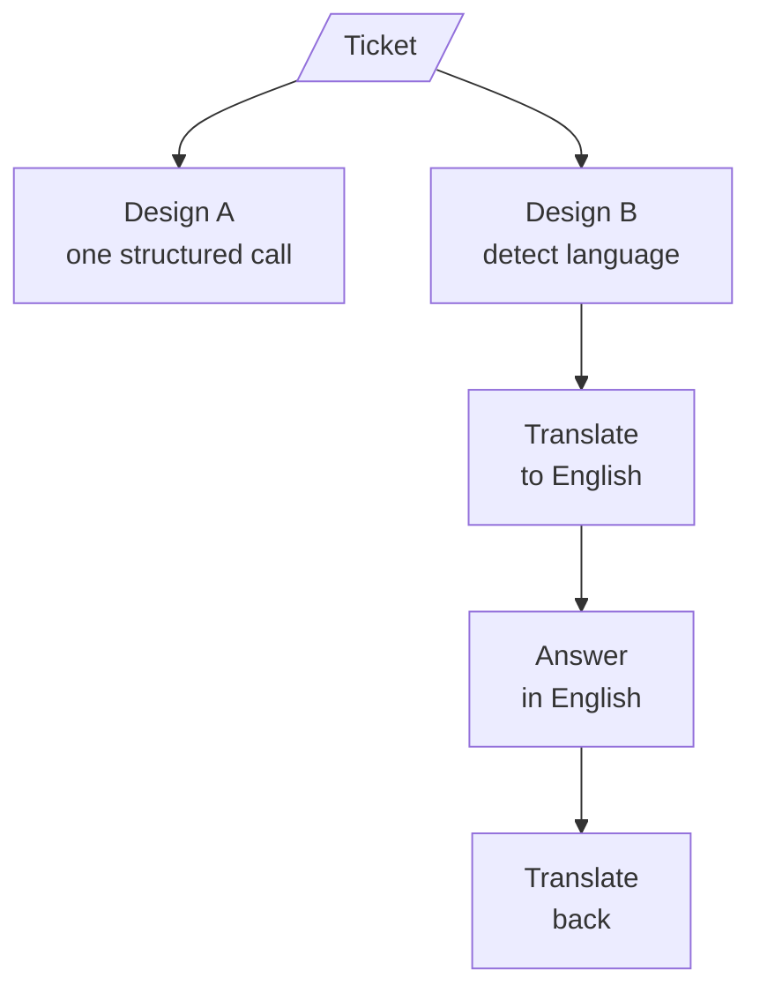

# M27.5 Theory: LLM workflow apps: review analyst, IT support desk, tailored writer, quiz generator

*[M27 theory](../../../mandatory/theory/README.md) · Lesson 27.5 · Notebooks: [`05a_review_analyst.ipynb`](../../notebook/05a_review_analyst.ipynb) (optional), [`05b_multilingual_it_support_desk.ipynb`](../../notebook/05b_multilingual_it_support_desk.ipynb) (optional), [`05c_audience_tailored_writer.ipynb`](../../notebook/05c_audience_tailored_writer.ipynb) (optional), [`05d_quiz_generator.ipynb`](../../notebook/05d_quiz_generator.ipynb) (optional) · [All theory pages](../../../../../THEORY.md)*
<!-- subtitle: The model fills typed fields, and code routes, checks and renders everything with a right answer -->

## A reply that invents a number

> **What you'll learn**
>
> - **Explain** the shape every workflow app shares: typed LLM steps, then checks and rendering in code.
> - **Compare** four applications of that shape by what the model fills and what code verifies.
> - **Diagnose** the planted failures each check catches: a wrong route, an invented figure, an unsupported quote.
> - **Choose** between one structured call and a chain of calls by measuring both on the same inputs.

Lesson 27.4 compared a fixed SQL workflow with an agent and found the workflow cheaper, more predictable and easier to test. This lesson applies the fixed workflow to business text: reviews, support tickets, a fact sheet, a PDF.

Larkspur's support queue gets tickets in several languages. A model can read each one, sort it and draft a reply, and most drafts are good. The bad ones read just as well. A draft that tells a customer the refund window is 14 days, when the handbook says 30, looks exactly like a correct draft until someone checks the number.

So the model's output needs a shape that code can inspect, and the decisions with a right answer need to move out of the model.

## Workflow apps

**A workflow app runs a fixed sequence of LLM steps over business text, with no tool loop.** The model fills typed fields, and code does everything that has a right answer: routing, checking and assembling the final document. Anything that fails a check goes to a person instead of the customer:

*Figure 1: The shared shape. Only the first box is a model call.*

Four notebooks apply that shape to four jobs:

- **Review analyst.** The model returns one typed analysis per review, for six reviews in one batch, then writes one email per review. Code picks the email writer by a dictionary lookup on the sentiment field: a thank-you for positive and neutral reviews, an apology for negative ones. Code checks the sentiment against hand labels, and each email for "Dear Customer", the "Service Agent" sign-off, an apology only when the review is negative, and at most 140 words (the prompt asks for under 120).
- **IT support desk.** Design A makes one structured call per ticket that returns six fields. Design B chains four calls: detect the language, translate to English, answer, translate back. Both run on the same ten tickets in nine languages. Code checks the detected language, that each reply differs from its English version, that no prompt scaffolding leaks into the text, and the calls and wall time.
- **Audience-tailored writer.** Three advert prompts, then three audience reports, each set run in parallel. Code checks the headings, a two-column table limited to five features, a 60-word limit, and that every number in the output appears in the source fact sheet.
- **Quiz generator.** The model summarises a PDF on prompt engineering, then writes questions from the material and the summary. Code checks for five questions with four distinct options and a valid answer index, checks that every evidence quote appears in the cleaned PDF text, and renders the study sheet from a template.

### Five rules for the model's output

The four apps differ in content and agree on these rules:

- **Ask for a closed type.** A sentiment that can only be positive, negative or neutral gives code a value to branch on. An answer index points at an option instead of restating it, so the answer cannot drift from the options.
- **Route in code when the signal is already structured.** The review analyst picks the email writer with a dictionary and no extra model call. When the input is free text, as in its instruction router, classify into a closed set of intents and keep an `other` intent for requests the tool does not handle.
- **Check every output with code that cannot be talked round.** String and number checks are cheap enough to run on every call.
- **Render the final document in code.** Asking the model to merge a checked summary and checked questions into a report would let it reword them after the checks. Call that **post-check rewording**. A template cannot do it.
- **Measure the design choice** on the same inputs before picking it, as the support desk does below.

### Planted failures the checks catch

Each notebook plants at least one bad output to prove its check works. The first three rows below were rerun from the notebooks' own check functions:

| Planted output | Check | Result |
|---|---|---|
| "Dear Customer, we are sorry to hear about your experience. Regards, Support", sent for a positive review | Email rules | Fails signature and tone |
| An advert table listing a 50 MP camera, when the fact sheet gives RAM, screen sizes, resolution and battery rating but no camera resolution | Every number in the source | Flags 50 as unsupported |
| A quiz question whose evidence is "Fine-tuning always requires at least 50 examples." | Evidence quote in the PDF | Evidence not found in the PDF |
| *What's the capital of France?* sent to the instruction router | Closed intents | Expected intent `other` (a live model call) |

*Table 1: One planted failure per check. Rows 1 to 3 come from running the notebooks' check functions in a scratch copy.*

The second row is an **invented figure**, a plausible number with no source. A schema checks the table's shape and cannot know the number is false. Only the comparison with the source catches it.

## One call or four: the support desk

The support desk is the one app that measures two designs against each other. Both start from the same ticket:

*Figure 2: The two designs. Design A returns all six fields at once, and Design B makes one call per step.*

The call count follows from the shapes:

| Design | Calls per ticket | Calls for the 10 tickets |
|---|---|---|
| A: one structured call | 1 | 10 |
| B: four-step chain | 4 | 40 |

*Table 2: Model calls per design. Wall time depends on the provider and is measured in the notebook.*

Design A makes a quarter of the calls. Design B has a second weakness: its steps exchange free text, and a step can leak a code fence or a line such as "The customer message in English is:" into the customer's reply. A typed field leaves no room for that. The notebook measures language accuracy, leaks, calls and wall time on the same tickets before choosing.

## In practice: Larkspur's support queue

Here is the same shape on Larkspur's tickets:

1. **One structured call per ticket** returns the language, a category (refund, outage, sizing) and a draft reply.
2. **Code routes** outage tickets to the incident template.
3. **Code checks** that every number in a reply appears in the handbook, such as the 30-day refund window and the 99.95% availability target. The 14-day draft from the opening fails here.
4. **A person sees** any reply that fails a check before the customer does.
5. **Actions go through the gate.** A reply that issues a refund is an action. It goes through the [approval gate from lesson 27.1](../../../mandatory/theory/01_dry_run_harness_and_human_approval/README.md#approval-gates), which binds the approval to the previewed action.

These apps are workflows in the sense of lesson 27.4: the same steps every time, cheap and testable. Choose an agent only when the next step depends on what the model finds.

## Key Takeaways

- In a workflow app the model fills typed fields and code does everything that has a right answer. Ask for closed types, such as a three-value sentiment, so code can branch on them without another LLM call.
- Check every output with code that cannot be talked round, such as confirming each number appears in the source. Render the final document from a template so nothing is reworded after the checks.
- Measure a design choice on the same inputs before picking it. Send actions such as issuing a refund through an approval gate, and choose an agent only when the next step depends on what the model finds.

## Check yourself

1. Why do the workflow apps render the final document from a template instead of asking the model to merge the checked parts?

A model asked to merge a checked summary and checked questions could reword them after the checks ran. A template cannot, so what the user reads is exactly what passed the checks.

2. The writer's fact sheet gives RAM, screen sizes and a battery rating but no camera figure, and an advert claims 50 MP. What catches it?

The code check that every number in the output appears in the source flags "50" as unsupported. String and number checks are cheap enough to run on every call. The Larkspur triage version runs the same check against the handbook's numbers, such as the 30-day refund window.

3. For the multilingual support desk, should you use one structured call per ticket or the four-step translate chain?

Measure both on the same tickets before choosing. One structured call makes a quarter of the LLM calls (10 against 40 for ten tickets), and the chain's free-text steps can leak a code fence or "The customer message in English is:" into the reply.

---
*Previous: [27.4 Text-to-SQL: workflow vs ReAct agent](../../../mandatory/theory/04_text_to_sql_workflow_vs_react_agent/README.md). Next: [M27 interview questions](../../../mandatory/theory/README.md#interview-spotlight-5-questions-you-might-get-asked).*
