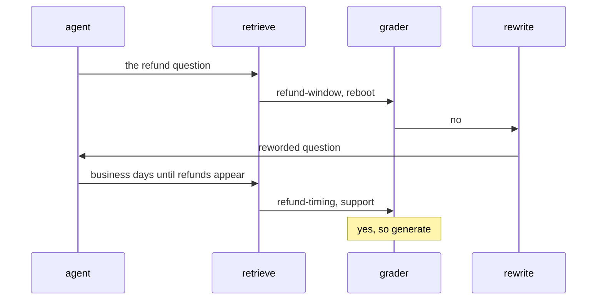
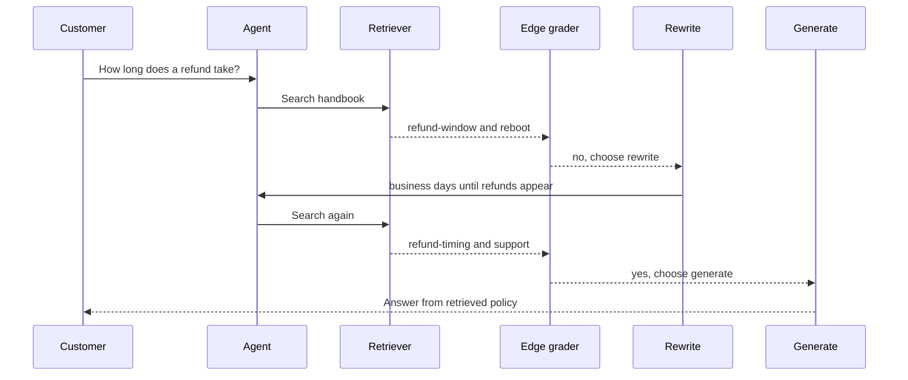
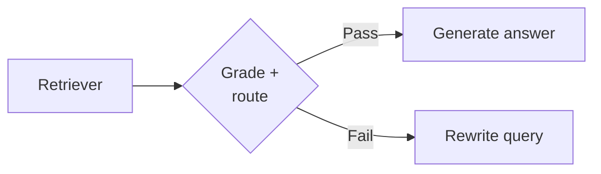
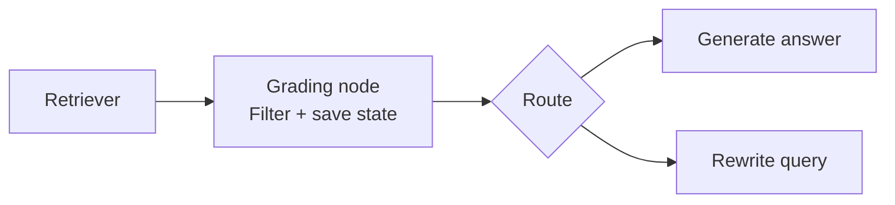
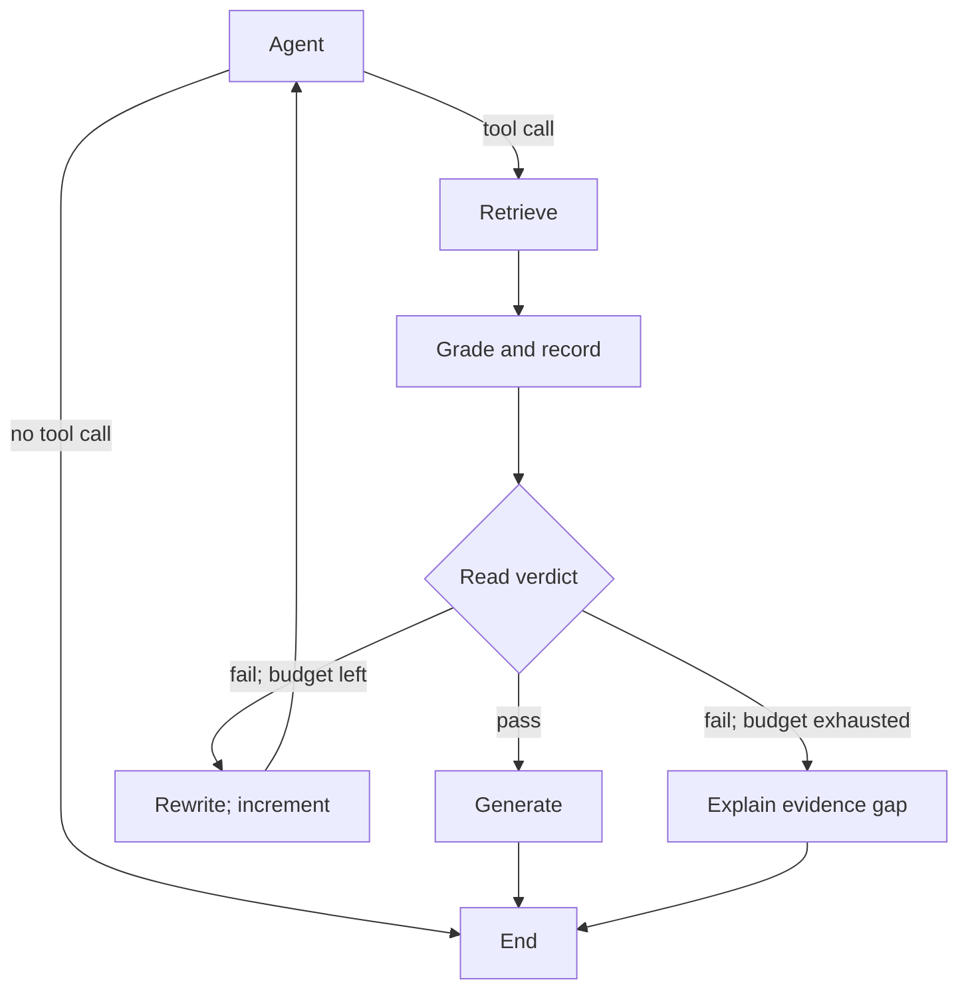

# M28.1 Theory: Retriever as a tool; grade then rewrite in LangGraph

*[M28 theory](../README.md) · Lesson 28.1 · Notebooks: [`01a_simple_agentic_rag.ipynb`](../../notebook/01a_simple_agentic_rag.ipynb) · [All theory pages](../../../../../THEORY.md)*
<!-- subtitle: Trace retrieval, grading and rewrite decisions through shared state. -->
<!-- format: approved -->

## Start with the refund near miss

> **What you'll learn**
>
> - **Explain** when the agent chooses a retriever tool.
> - **Trace** retrieval, grading and rewriting through the same request.
> - **Compare** routing inside an edge with a grading node that updates state.
> - **Choose** label contracts, stopping rules and evidence checks.

A Larkspur customer asks *How long does a refund take?* The handbook's first hit, `refund-window`, says an annual plan can get a full refund within 30 days. That is an eligibility window. It does not say when the money arrives.

The one-shot RAG chain from [M10](../../../../../p04_rag_foundations/m10_rag_lifecycle/mandatory/theory/README.md) hands `refund-window` to the model, which answers the wrong question confidently. We call this **answering from a near miss**. This lesson joins that chain to the tool loop from [M22](../../../../../p06_agent_foundations/m22_agent_loop_and_tools/mandatory/theory/README.md): the agent chooses to search, and a grader routes the run to generation or to a rewrite.

## Conditional edges

### Let the model choose the retriever tool

The retriever becomes a tool with a name, a description and an argument schema, the only things the model knows about it. The `agent` node binds it to the model, which decides whether to call it and with what query. A customer who writes *hello* gets a greeting with no search. The notebook searches a research paper.

### Fixed transitions and runtime routing

A **conditional edge** is an edge whose destination is chosen at run time: after its source node runs, LangGraph calls a routing function on the state, and the value it returns names the next node. A fixed edge always goes the same way, as the edge from `rewrite` back to `agent` does. The graph has two conditional edges:

| After node | Routing function | Returns | Goes to |
|---|---|---|---|
| `agent` | `tools_condition`, prebuilt in LangGraph | `"tools"` if the model's last reply has a tool call, otherwise the end marker | `retrieve` through a path map that translates `"tools"`, or the end |
| `retrieve` | `grade_documents` | `"generate"` or `"rewrite"` | The node with that name, with no path map, because the function returns node names |

*Table 1: The two routing decisions and how each return value becomes a node.*

Put together, the edges form this graph:

*Figure 1: The grade-then-rewrite graph. Two edges branch, and the rest are fixed.*

### Trace the refund question through a rewrite

The [M28 lab](../03_guardrails_query_optimisation_and_a_retry_loop/interactive/grade-rewrite-retry-lab.html) supplies this trace: one failed grade, then one rewrite finds the timing evidence.

*Figure 2: One failed grade and one rewrite. Chunks and reworded question come from the lab.*

The first search misses `refund-timing` because TF-IDF matches exact words: "refund" in the question, "Refunds" in the chunk. The rewrite uses the chunk's own words and scores 0.720.

The rewrite returns to `agent`, not straight to `retrieve`. The model decides again whether and how to search, at one more model call per round.

Follow the request. Inspect the input, decision and state at each stage.

<button type="button" data-step="0" aria-pressed="false" aria-controls="request-step-0">1. Ask</button><button type="button" data-step="1" aria-pressed="false" aria-controls="request-step-1">2. Retrieve</button><button type="button" data-step="2" aria-pressed="false" aria-controls="request-step-2">3. Grade</button><button type="button" data-step="3" aria-pressed="false" aria-controls="request-step-3">4. Rewrite</button><button type="button" data-step="4" aria-pressed="false" aria-controls="request-step-4">5. Retry</button><button type="button" data-step="5" aria-pressed="false" aria-controls="request-step-5">6. Answer</button>

<section id="request-step-0" class="step-panel" aria-labelledby="request-heading-0"><h4 id="request-heading-0">1. Ask the original question</h4><dl><dt>Owner</dt><dd>Agent</dd><dt>Input</dt><dd>How long does a refund take?</dd><dt>Next action</dt><dd>Search the handbook</dd><dt>State and evidence</dt><dd>Keep the original question as the answer target.</dd></dl></section><section id="request-step-1" class="step-panel" aria-labelledby="request-heading-1"><h4 id="request-heading-1">2. Inspect the first retrieval</h4><dl><dt>Owner</dt><dd>Retriever</dd><dt>Input</dt><dd>refund-window and reboot</dd><dt>Next action</dt><dd>Grade the returned context</dd><dt>State and evidence</dt><dd>First hit scores 0.227 and describes eligibility, not arrival time.</dd></dl></section><section id="request-step-2" class="step-panel" aria-labelledby="request-heading-2"><h4 id="request-heading-2">3. Reject the near miss</h4><dl><dt>Owner</dt><dd>Edge grader</dd><dt>Input</dt><dd>Question plus retrieved context</dd><dt>Next action</dt><dd>Choose rewrite</dd><dt>State and evidence</dt><dd>Answerability fails. The returned route saves no verdict.</dd></dl></section><section id="request-step-3" class="step-panel" aria-labelledby="request-heading-3"><h4 id="request-heading-3">4. Change the search wording</h4><dl><dt>Owner</dt><dd>Rewrite</dd><dt>Input</dt><dd>No timing evidence</dd><dt>Next action</dt><dd>Return to agent</dd><dt>State and evidence</dt><dd>"business days until refunds appear", same intent.</dd></dl></section><section id="request-step-4" class="step-panel" aria-labelledby="request-heading-4"><h4 id="request-heading-4">5. Decide again, then search</h4><dl><dt>Owner</dt><dd>Agent and retriever</dd><dt>Input</dt><dd>Reworded query</dd><dt>Next action</dt><dd>Retrieve and grade again</dd><dt>State and evidence</dt><dd>The lab finds refund-timing at 0.720, alongside support.</dd></dl></section><section id="request-step-5" class="step-panel" aria-labelledby="request-heading-5"><h4 id="request-heading-5">6. Answer from sufficient evidence</h4><dl><dt>Owner</dt><dd>Generate</dd><dt>Input</dt><dd>Timing evidence passes grading</dd><dt>Next action</dt><dd>Generate, then end</dd><dt>State and evidence</dt><dd>Answer from the timing policy. Scripted trace, not a live run.</dd></dl></section>

<button type="button" data-walk="previous">Previous</button>

<button type="button" data-walk="next">Next step</button>

### Follow the request as a transaction

*Added explanation.* Here a transaction is one request's lifecycle, not a refund or a database transaction. Figure 3 separates what each step returns from the decision that follows:

*Figure 3: Added transaction trace. The stricter answerability criterion drives the no and yes outcomes. Edge-local verdicts select routes without becoming state updates.*

## Document grader

A **document grader** is one LLM call that reads retrieved text next to the question and says whether the text helps answer it. Structured output makes the reply match a declared schema, and the router compares a typed field instead of parsing free text. The prompt sets the bar. The schema decides what the router can trust.

### Test answerability as well as relatedness

This lesson's grader passes a document that "contains keyword(s) or semantic meaning related to the user question". Lesson 28.3's also accepts "context that helps understand the topic". Both approve the `refund-window` near miss, because it is about refunds. A grader that asks "does this text answer the question?" fails it and sends the query to rewrite. "Related" maximises recall into the prompt. "Answers" protects what the model reads.

### Validate the grader label

In this lesson's grader the score is a plain string, and the router compares it exactly with `"yes"`. Three contracts give different outcomes:

| Model's label | Exact match with `"yes"` | Trimmed and lower-cased first | Field typed as a fixed set of values |
|---|---|---|---|
| `yes` | generate | generate | accepted |
| `Yes` | **rewrite** | generate | rejected by validation |
| ` yes` (leading space) | **rewrite** | generate | rejected by validation |
| `maybe` | rewrite | rewrite | rejected by validation |

*Table 2: Planted labels under three contracts. The bold rows are relevant retrievals sent to rewrite.*

We call the bold rows the **capital-Y rewrite**: the grader agreed, and the graph still discarded the evidence. Normalising fixes capitals and whitespace. A fixed set of values (a `Literal` in Pydantic) makes any other label fail validation instead of choosing a branch, as in lesson 28.3's topic check. That error still needs a handler.

### Similarity scores cannot certify an answer

A top-k retriever returns `k` chunks for every query, whatever they score. The lab's TF-IDF scores over the M10 handbook chunks show that no score threshold can replace the grader:

| Query | Top chunk and score | Answers the question? |
|---|---|---|
| *How long does a refund take?* | `refund-window`, 0.227 | No |
| Its rewrite | `refund-timing`, 0.720 | Yes |
| *Do you offer a student discount?* | `billing` and `cancel`, both 0.000 | No |
| Its rewrite *Student discount pricing for plans* | `support` 0.503, then `billing` 0.461 | No |
| *Larkspur outage availability guarantee and incident updates* | `sla` 0.470, then `incidents` 0.253 | Yes |

*Table 3: Retrieval scores from the M28 lab. A non-answer at 0.503 outscores a real answer at 0.470.*

The discount question shares no word with the handbook and still retrieves two chunks. Its rewrite scores 0.503 without finding a discount. A threshold above 0.503 rejects the outage answer at 0.470, and one below it lets the non-answer through.

## Compare an edge grader with a grading node

### Start with the same three documents

*Added illustrative example.* Ask *Can I get a refund after 30 days?* over three invented snippets, not Larkspur policy:

| Document | Text | Role in this question |
|---|---|---|
| Doc 1 | Refunds are allowed within 30 days. | Eligibility context, incomplete alone |
| Doc 2 | Shipping takes 5 to 7 business days. | Irrelevant |
| Doc 3 | Refunds after 30 days require manager approval. | Direct evidence about the exception |

*Table 4: One shared illustrative input. Doc 3 supplies the requested fact.*

### Approach A: grade inside the conditional edge

The edge's grading function judges the batch and returns `generate`, because Doc 3 answers the question. The return value chooses a destination. It does not save the verdict or remove Doc 2, and generation receives all three chunks. In this lesson's graph the verdict is only a printed line. We call this the **invisible verdict**: tracing may capture the call, but shared state and a checkpointer never see the result.

*Figure 4: Edge grading combines the evidence check and the route choice. Returning a route does not save a verdict or filter documents.*

### Approach B: grade in a dedicated node

The node returns an explicit state update: accepted Docs 1 and 3, rejected Doc 2, a verdict and reasons. A router reads that state and chooses `generate`. Generation sees only accepted evidence when you wire it to that field. Placement alone does not filter documents or improve judgment. With a checkpointer, the state is saved at each step boundary.

*Figure 5: A separate grading node filters evidence and updates state before a small router chooses the next action. Generation must read the accepted-evidence field.*

Compare what the generator receives from the same three documents.

<button type="button" data-mode="edge" aria-pressed="false" aria-controls="edge-result">Edge grader</button>
<button type="button" data-mode="node" aria-pressed="false" aria-controls="node-result">Grading node</button>

<section id="edge-result" class="mode-panel" data-announcement="Edge example selected. All three documents reach generation."><h4>Edge grader result</h4><ul><li>Doc 1, eligibility: remains in retrieved context.</li><li>Doc 2, shipping: remains in retrieved context.</li><li>Doc 3, manager approval: remains in retrieved context.</li></ul>
Route: generate. The batch contains an answer, but the route return has not saved a filtered evidence set.

Generator input in this illustration: all three documents.
</section>
<section id="node-result" class="mode-panel" data-announcement="Node example selected. Only accepted Docs 1 and 3 reach generation."><h4>Grading node result</h4><ul><li>Doc 1, eligibility: keep as supporting context.</li><li>Doc 2, shipping: reject.</li><li>Doc 3, manager approval: keep as direct evidence.</li></ul>
State update: accepted Docs 1 and 3, rejected Doc 2, answer evidence available. A small edge router chooses generate.

Generator input in this illustration: accepted Docs 1 and 3, because the generator reads the filtered state field.
</section>

### Separate placement from grading granularity

Either architecture can grade the batch or each chunk. Moving a call into a node adds a boundary, not an LLM call. The module's two graders differ in both:

| | Edge grader (this lesson) | Node grader (lesson 28.3) |
|---|---|---|
| Place in the graph | Routing function on the edge after `retrieve` | Node, followed by a separate router |
| What it reads | Everything the tool returned, as one message | One chunk per call |
| Output schema | A score field described as `'yes'` or `'no'` | A relevance label (`RELEVANT` or `IRRELEVANT`) and a reasoning field |
| Decision | Exact match with `"yes"` | Match with `"RELEVANT"` after trimming and upper-casing |
| What reaches the answer | Every retrieved chunk, relevant or not | Only the chunks that pass |
| Grader calls per retrieval | 1 | `k`, the number of chunks retrieved (2 in lesson 28.3) |

*Table 5: The two graders side by side.*

Grading the block is cheap, but one relevant chunk carries the irrelevant ones into the prompt. Per-chunk grading costs `k` calls and filters what the model reads.

Choose an edge grader for a compact branch decision. Choose a grading node when verdict reuse, evidence filtering, inspection or a node retry policy earns the boundary. Fixed edges stay active beside dynamic routing, and a leftover unconditional edge can schedule a second destination.

## Bound retries and diagnose failures

Nothing on this lesson's `rewrite` path counts the trips. The loop ends only when the grader says yes, which never happens for a question the handbook cannot answer: the run continues until an execution limit or an error stops it. Lesson 28.3 adds a counter, persisted passing chunks, a should-generate flag and a topic check, at one graph step per retrieval.

Figure 6 adds a bound, checking for a pass before the budget:

*Figure 6: Added node-based alternative. The fallback needs both a failed grade and an exhausted budget.*

Diagnose failures by their effect on the request:

| Failure | What happens | Guard |
|---|---|---|
| Near miss approved | Eligibility text answers a duration question | Test whether the chunk covers the requested fact |
| Capital-Y rewrite | Good evidence takes the wrong branch | Normalise or constrain labels, and handle validation errors |
| Stale pass | A previous verdict approves new documents | Refresh the verdict for each retrieval |
| Rewrite exhaustion | No supporting policy is found | Stop with an evidence-gap response |
| Unfiltered context | Shipping text reaches generation | Write accepted evidence and have generation read that field |

*Table 6: Added diagnosis guide.*

An API retry repeats a failed call, and a rewrite changes the search. Each rewrite adds an agent call, a retrieval and a grade: budget attempts, time and model use, and test on answerable, unanswerable and near-miss questions.

## Limits of this evidence

- **Notebook corpus.** The notebook runs on a research paper. The Larkspur paths and scores come from the M28 lab.
- **TF-IDF scores.** Table 3 uses exact-word TF-IDF. Embedding scores differ. Filters, thresholds and corpus size can reduce how many chunks a retriever returns.
- **Planted labels.** Table 2 tests the comparison, not how often a model writes `Yes`.
- **Illustrations.** The walkthrough and comparison are scripted. The three-document example is fictional.

## References

1. [LangGraph Graph API](https://docs.langchain.com/oss/python/langgraph/graph-api), accessed 13 November 2026.
2. [Thinking in the Graph API](https://docs.langchain.com/oss/python/langgraph/thinking-in-graph-api), accessed 13 November 2026.

## Key Takeaways

- Let the agent choose the retriever tool, and route after retrieval on the grader's verdict. After a rewrite the model decides again whether and how to search.
- Grade whether the evidence answers the requested fact, and make the verdict a typed field with a fixed set of values. Similarity scores and topical overlap cannot certify an answer.
- An edge only chooses a route. A grading node can record verdicts and filtered evidence for generation to read. Choose batching separately from placement, and bound the rewrite loop with an evidence-gap exit.

## Check yourself

1. Why does the rewrite node send the new question back to the agent instead of straight to the retriever?

The model reads the reworded question as the newest message and decides again whether to call the tool and with what query. That keeps it in charge of the search. Nothing on this path counts the trips, and lesson 28.3 adds the counter that ends the loop.

2. The refund-duration question retrieves the refund-window chunk first. Does a grader that accepts related text pass it, and what follows?

Yes. The chunk describes the 30-day eligibility window, not how long a refund takes, and the model answers from a near miss. A grader that asks whether the text answers the question rejects it and sends the query to rewrite, which finds `refund-timing` at 0.720.

3. The grader sends a clearly relevant retrieval to rewrite, and its label was Yes with a capital letter. Why, and what are two fixes?

The score is a plain string compared exactly with `"yes"`, so `"Yes"` takes the rewrite branch: the capital-Y rewrite. Trim and lower-case the label before comparing, or type the field as a fixed set of values so any other label fails validation instead of silently choosing a branch.

---
*Previous: [M28 overview](../README.md). Next: [28.2 The same agent on Databricks Vector Search](../../../optional/theory/02_the_same_agent_on_databricks_vector_search/README.md).*
