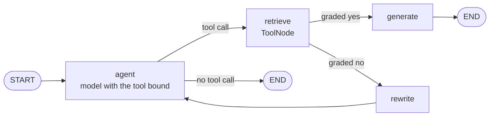
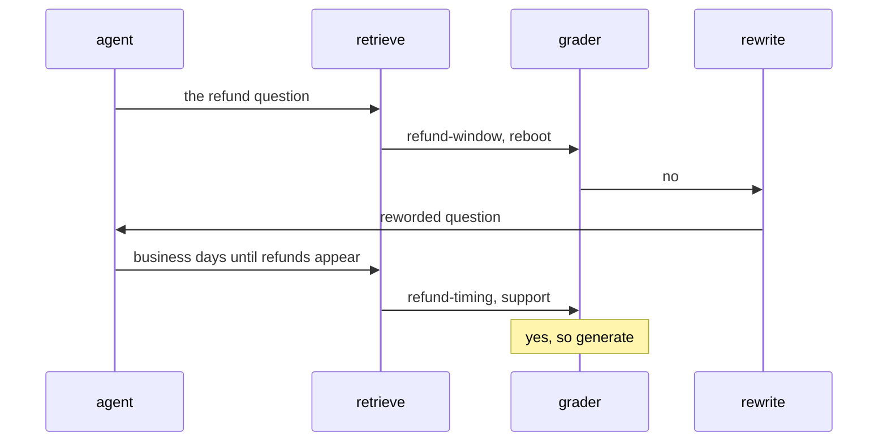

# M28.1 Theory: Retriever as a tool; grade then rewrite in LangGraph

*[M28 theory](../README.md) · Lesson 28.1 · Notebooks: [`01a_simple_agentic_rag.ipynb`](../../notebook/01a_simple_agentic_rag.ipynb) · [All theory pages](../../../../../THEORY.md)*
<!-- subtitle: Turn a RAG chain into a graph that reads what it retrieved and asks again when the evidence does not answer -->

## Conditional edges

> **What you'll learn**
>
> - **Explain** how a retriever becomes a tool the model chooses to call, and what the model sees of it.
> - **Trace** a question through the two conditional edges that decide between retrieving, answering and rewriting.
> - **Compare** a grader on the edge with a grader that is a node, and say what each leaves in the state.
> - **Diagnose** a grader that passes related text which does not answer the question.

[M22](../../../../../p06_agent_foundations/m22_agent_loop_and_tools/mandatory/theory/README.md) built the loop where a model asks for a tool and your code runs it; M10 built a RAG chain that retrieves once and answers from whatever came back. This lesson joins them: retrieval becomes a tool in a LangGraph graph that checks what the tool returned before the model answers.

A Larkspur customer asks *How long does a refund take?* The handbook's first hit is the `refund-window` chunk. It is about refunds, and it says an annual plan can get a full refund within 30 days. It never says how long the money takes to arrive. A plain RAG chain hands that chunk to the model, and the model writes a confident answer about the wrong thing. We call this **answering from a near miss**: the retrieval looked fine by every number the chain had.

The fix has three jobs: let the model decide when to search (the retriever tool), read the retrieved text against the question (the grader, next section), and route elsewhere when the text fails (the conditional edge).

### The retriever as a tool

The graph wraps the vector store's retriever as a tool with a name and a description, the only things the model knows about it. The `agent` node binds the tool to the model, which decides whether to call it and with what query. For Larkspur the description says the tool searches the handbook, so a customer who writes *hello* gets a greeting with no search. The notebook does the same over a research paper.

### Fixed and conditional edges

A **conditional edge** is an edge whose destination is chosen at run time: after its source node runs, LangGraph calls a routing function on the state, and the value it returns names the next node. A fixed edge always goes the same way, as the edge from `rewrite` back to `agent` does. The graph has two conditional edges:

| After node | Routing function | Returns | Goes to |
|---|---|---|---|
| `agent` | `tools_condition`, prebuilt in LangGraph | `"tools"` if the model's last reply has a tool call, otherwise the end marker | `retrieve` through a path map that translates `"tools"`, or the end |
| `retrieve` | `grade_documents` | `"generate"` or `"rewrite"` | The node with that name, with no path map, because the function returns node names |

*Table 1: The two routing decisions and how each return value becomes a node.*

Put together, the edges form this graph:

*Figure 1: The grade-then-rewrite graph. Two edges branch; the rest are fixed.*

### Following the refund question

Here is the refund question through the graph, with the retrievals the [M28 lab](../03_guardrails_query_optimisation_and_a_retry_loop/interactive/grade-rewrite-retry-lab.html) shows for it: the first one fails the grade and one rewrite finds the timing chunk.

*Figure 2: One failed grade and one rewrite. The retrieved chunks are the lab's; the reworded question is the lab's hand-written rewrite.*

The first search misses `refund-timing` for a reason worth knowing. TF-IDF matches exact words, and the question says "refund" while the chunk says "Refunds". The reworded question uses "refunds" and "business days", the chunk's own words, and scores 0.720.

The rewrite goes back to `agent`, not straight to `retrieve`, so the model reads the reworded question and decides again whether and how to search. That keeps the model in charge of the search, at one more model call per round.

### Where the verdict lives

Here the grader is the routing function itself, not a node, so it writes nothing to the state. The history shows a rewrite but not the verdict behind it; the only record is a printed line. We call this the **invisible verdict**. Lesson 28.3 splits the job: a grading node writes the passing chunks and a should-generate flag to the state, and a small router reads them. That costs one graph step per retrieval and makes every decision visible in the state, a checkpointer and a trace.

> **Pitfall: the unbounded rewrite loop.** Nothing on the `rewrite` path counts the trips. The loop ends only when the grader says yes. For a question the handbook cannot answer, that never happens, and lesson 28.3 adds the counter that stops it.

The routing is only as good as the verdict it reads, so the next section looks at the call that produces it.

## Document grader

A **document grader** is one LLM call that reads retrieved text next to the question and says whether the text helps answer it. It uses structured output: the reply must match a declared schema, so the router compares a typed field instead of parsing free text. This module has two graders:

| | Edge grader (this lesson) | Node grader (lesson 28.3) |
|---|---|---|
| Place in the graph | Routing function on the edge after `retrieve` | Node, followed by a separate router |
| What it reads | Everything the tool returned, as one message | One chunk per call |
| Output schema | A score field described as `'yes'` or `'no'` | A relevance label (`RELEVANT` or `IRRELEVANT`) and a reasoning field |
| Decision | Exact match with `"yes"` | Match with `"RELEVANT"` after trimming and upper-casing |
| What reaches the answer | Every retrieved chunk, relevant or not | Only the chunks that pass |
| Grader calls per retrieval | 1 | `k`, the number of chunks retrieved (2 in lesson 28.3) |

*Table 2: The two graders side by side.*

Grading the block is cheap, but one relevant chunk carries the irrelevant ones into the prompt. Grading each chunk costs `k` calls per retrieval and filters what the model reads.

### The label contract

The schema decides what the router can trust. In this lesson's grader the score is a plain string and the router compares it exactly with `"yes"`. Here is what each label does under three ways of reading it:

| Model's label | Exact match with `"yes"` | Trimmed and lower-cased first | Field typed as a fixed set of values |
|---|---|---|---|
| `yes` | generate | generate | accepted |
| `Yes` | **rewrite** | generate | rejected by validation |
| ` yes` (leading space) | **rewrite** | generate | rejected by validation |
| `maybe` | rewrite | rewrite | rejected by validation |

*Table 3: Planted labels under three contracts. The bold rows are relevant retrievals sent to rewrite.*

We call the bold rows the **capital-Y rewrite**: the grader agreed, and the graph still discarded the evidence. Normalising fixes those rows. Typing the field as a fixed set of values (a `Literal` in Pydantic) goes further: any other label fails loudly as a validation error instead of quietly choosing a branch, as in lesson 28.3's topic check.

### Related text or an answer

The prompt sets the bar. This lesson's grader calls a document relevant if it "contains keyword(s) or semantic meaning related to the user question"; lesson 28.3's also accepts "context that helps understand the topic". Both pass `refund-window` for *How long does a refund take?*, because it is about refunds: the near miss, now approved by the grader. A grader that asks "does this text answer the question?" fails it and sends the query to rewrite. "Related" maximises recall into the prompt; "answers" protects what the model reads.

### Why a score cannot do the grader's job

A retriever returns `k` chunks for every query, whatever they score. The lab's TF-IDF scores over the M10 handbook chunks show that no score threshold can replace the grader:

| Query | Top chunk and score | Answers the question? |
|---|---|---|
| *How long does a refund take?* | `refund-window`, 0.227 | No |
| Its rewrite | `refund-timing`, 0.720 | Yes |
| *Do you offer a student discount?* | `billing` and `cancel`, both 0.000 | No |
| Its rewrite *Student discount pricing for plans* | `support` 0.503, then `billing` 0.461 | No |
| *Larkspur outage availability guarantee and incident updates* | `sla` 0.470, then `incidents` 0.253 | Yes |

*Table 4: Retrieval scores from the M28 lab. A non-answer at 0.503 outscores a real answer at 0.470.*

The discount question shares no word with the handbook and still retrieves two chunks, and its rewrite scores 0.503 without either chunk mentioning a discount. A threshold above 0.503 would reject the outage answer at 0.470; one below it lets the discount non-answer through. Only reading the chunk next to the question separates them.

## In practice: the refund question at Larkspur

Put the graph on the Larkspur support assistant and follow the refund question once more:

1. The model reads the handbook tool's description, sees a policy question and calls the tool.
2. The tool returns `refund-window` first. An "answers the question" grader says no.
3. The conditional edge sends the run to `rewrite`, which rewords the question and hands it back to the model.
4. The model searches again, the tool returns `refund-timing` at 0.720, the grader says yes and `generate` answers from it.

> **Key distinction:** this graph corrects a bad retrieval but cannot give up, and its verdicts leave no record. Lesson 28.3 adds the counter that ends the loop, a node that records each verdict, and a topic check before retrieval.

## Limits of this evidence

- **Notebook corpus.** The notebook runs on a research paper; the Larkspur paths and scores come from the M28 lab.
- **TF-IDF scores.** Table 4 uses exact-word TF-IDF. Embedding scores differ, though an embedding retriever still returns `k` chunks for every query.
- **Planted labels.** Table 3 tests the comparison, not how often a model writes `Yes`.

## Key Takeaways

- Wrap the retriever as a tool whose name and description tell the model when to call it, then put a conditional edge after retrieval that sends the run to `generate` or `rewrite` on the grader's verdict.
- Make the verdict a typed field with a fixed set of values, and prefer a grading node that writes it to the state, so a wrong label fails loudly and every decision can be traced.
- Ask the grader whether a chunk answers the question, not whether it is related. A similarity score cannot do this, because the retriever returns `k` chunks for every query whatever they score.

## Check yourself

1. Why does the rewrite node send the new question back to the agent instead of straight to the retriever?

The model reads the reworded question as the newest message and decides again whether to call the tool and with what query, so it stays in charge of the search. Nothing on this path counts the trips, so the loop ends only when the grader says yes, which lesson 28.3 fixes with a counter in the state.

2. The refund-duration question retrieves the refund-window chunk first. Does a grader that accepts related text pass it, and what follows?

Yes. The chunk is about refunds, but it only says an annual plan can get a full refund within 30 days, not how long a refund takes, so the model answers from a near miss. A grader that asks whether the text answers the question fails it and sends the query to rewrite, which finds `refund-timing` at 0.720.

3. The grader sends a clearly relevant retrieval to rewrite, and its label was Yes with a capital letter. Why, and what are two fixes?

The score is a plain string compared exactly with `"yes"`, so `"Yes"` takes the rewrite branch: the capital-Y rewrite. Trim and lower-case the label before comparing, or type the field as a fixed set of values so any other label fails validation instead of silently choosing a branch.

---
*Previous: [M28 overview](../README.md). Next: [28.2 The same agent on Databricks Vector Search](../../../optional/theory/02_the_same_agent_on_databricks_vector_search/README.md).*
