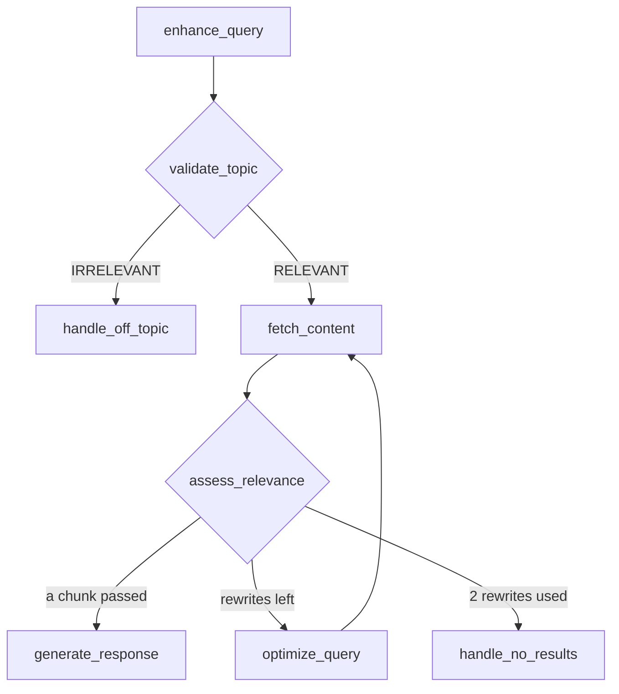
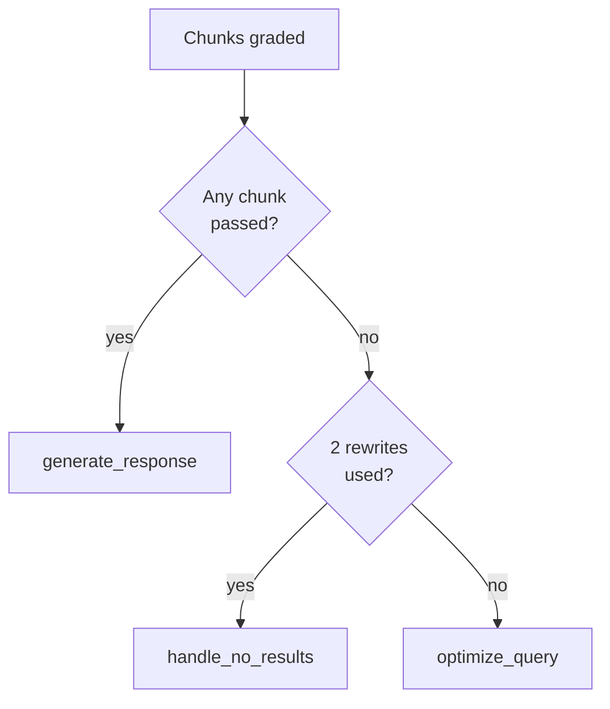

# M28.3 Theory: Guardrails, query optimisation and a retry loop

*[M28 theory](../README.md) · Lesson 28.3 · Notebooks: [`03a_advanced_rag_agent.ipynb`](../../notebook/03a_advanced_rag_agent.ipynb) · [All theory pages](../../../../../THEORY.md)*
<!-- subtitle: Keep off-topic questions out of retrieval, stop the rewrite loop on purpose, and price every extra attempt -->

## Topic guardrails

> **What you'll learn**
>
> - **Distinguish** an off-topic question from one the handbook cannot answer, and the check that catches each.
> - **Calculate** what a question costs in LLM calls for any rewrite bound.
> - **Choose** a rewrite bound from the golden set.

Lesson 28.1's graph rewrites when the grade fails, but it cannot stop. Two Larkspur questions show the cost. *Do you offer a student discount?* is about pricing, but the handbook has no discount policy. *What's the weather like today?* has nothing to do with Larkspur. In lesson 28.1's graph both rewrite again and again and never get a reply. Even with a counter, both would end in the same "I couldn't find that" message, which is wrong for the weather question.

### The eight-node support agent

The notebook builds this agent for a fictional company's support documents; these pages run it on the Larkspur handbook. Before retrieving, it asks whether the question belongs to the assistant at all:

*Figure 1: The support agent. Three nodes end the turn; the two handlers reply with fixed text and make no LLM call.*

A **topic guardrail** is a classification step before retrieval that decides whether a question is in scope. Here it is one structured-output call whose schema has a classification (`RELEVANT` or `IRRELEVANT`) and a confidence (`HIGH`, `MEDIUM` or `LOW`), both typed as fixed sets of values. Its prompt lists what is on topic (services, pricing, support procedures, company information) and what is not (general technology, other companies, weather and news). `RELEVANT` goes to retrieval; anything else goes to the off-topic handler, which lists what the assistant can help with.

### Off topic or unanswered

The check comes before retrieval because the grader cannot tell "off topic" from "not in the handbook": both look like a retrieval where nothing passes. The [lab](interactive/grade-rewrite-retry-lab.html) shows the difference with two rewrites allowed:

| Question | Topic check | Grader | Ends in | LLM calls |
|---|---|---|---|---|
| *Can I export my data after I cancel my plan?* | on topic | 2 of 2 pass on the first retrieval | answer | 4 |
| *Do you offer a student discount?* | on topic | 0 of 2 on each of 3 retrievals | no-results reply | 9 |
| *What's the weather like today?* | off topic | not reached | off-topic reply | 1 |
| *What's the weather like today?*, check off | none | 0 of 2 on each of 3 retrievals | no-results reply | 8 |

*Table 1: Three golden questions, two rewrites allowed. The guardrail and the grader catch different failures.*

The student-discount question passes the topic check, so only the grader and the bound stop it. The weather question stops for 1 call instead of 8, and the customer reads "I can help with pricing, refunds and servers" instead of "I couldn't find that in the handbook".

### What the check costs

The check costs one call on every question, so it does not always pay. Over the lab's five golden questions it costs 3 calls at zero rewrites (14 with the check, 11 without), breaks even at one (24 and 24) and saves 3 at two (31 and 34). The check pays when the off-topic share of traffic times the cost of a full retry loop exceeds one call per question, and it pays in reply quality at any bound.

### The classification boundary

Three details matter in production:

- **It classifies the enhanced query.** The enhancement node first folds the conversation history into a standalone question, so a follow-up such as *What about annual plans?* carries the refund question it follows.
- **Confidence is computed and ignored.** The router reads only the classification. Asking a clarifying question on `LOW` confidence needs a third branch.
- **A false rejection is silent.** An on-topic question classified `IRRELEVANT` never reaches retrieval or its logs. We call this the **silent rejection**: track the off-topic rate and sample those replies.

The guardrail keeps one kind of question out of the loop; the next section bounds the loop for the rest.

## Bounded retries

**Bounded retries** means the graph counts its rewrites in the state and takes a different exit when the count reaches a limit. Lesson 28.1's graph has no counter, so when the handbook has no answer, LangGraph's recursion limit (a cap on graph steps per run) is the only stop.

### The runaway rewrite loop

In the pinned `langgraph` 1.2.18 the default recursion limit is 10,007 steps. Lesson 28.1's graph, run with stub nodes and a grader that always says no:

| Recursion limit | Retrievals | LLM calls | How it ended |
|---|---|---|---|
| Default, 10,007 | 3,336 | 10,007 | `GraphRecursionError` |
| 25, set in the run's config | 8 | 25 | `GraphRecursionError` |

*Table 2: Lesson 28.1's graph on a question nothing can answer, with stub nodes.*

We call this the **runaway rewrite loop**. Each round costs three LLM calls (agent, grader, rewrite) and three graph steps, so calls track the step limit, and the run still ends in an error, not a reply.

### A counter in the state

This lesson's graph bounds the loop in the state:

- **The count**: a rewrite counter that the enhancement node resets to 0 at the start of every turn, so the bound is per question, not per conversation.
- **The router**: after grading, it picks one of three exits in a fixed order, shown in Figure 2.
- **The guard**: the rewrite node repeats the limit check and does nothing if it is reached, in case a later edge reaches it directly.

*Figure 2: The router's check order. Evidence is checked before the budget, so a hit on the last retrieval is still answered.*

With a limit of 2 rewrites, a turn makes at most 3 retrievals. Swapping the two checks would discard a passing chunk on the third retrieval and reply "not found" to a question the graph had just answered.

### The cost of each attempt

The bound also caps the cost. With `k = 2` chunks per retrieval, a question costs one call for the topic check, two grader calls per retrieval, one per rewrite and one for the answer if there is one; the handlers and a first-turn enhancement make none. Answered on the first retrieval, a question costs 1 + 2 + 1 = 4. Never answered with a bound of `m`, it costs `1 + 2(m + 1) + m`: 9 at a bound of 2. The [interactive lab](interactive/grade-rewrite-retry-lab.html) runs the loop on the five golden questions with real TF-IDF retrieval over the M10 handbook chunks and the bound as its slider:

| Rewrites allowed | Answered | No-results reply | Off-topic reply | Retrievals | LLM calls |
|---|---|---|---|---|---|
| 0 | 1 | 3 | 1 | 4 | 14 |
| 1 | 2 | 2 | 1 | 7 | 24 |
| **2** | **3** | **1** | **1** | **9** | **31** |
| 3 | 3 | 1 | 1 | 10 | 34 |

*Table 3: The golden set at each bound. The bold row is the notebook's bound.*

<!-- lab: interactive/grade-rewrite-retry-lab.html -->

### Choosing the bound

Each step up the bound reaches one more question until 2, where the outage question is answered on its second rewrite. Going to 3 answers nothing new: the extra retrieval and three calls all go to the student-discount question, which no bound can answer. Unanswerable questions always pay the full bound, so set it where the answered count stops rising.

> **Pitfall: the counter as the only stop.** Keep the recursion limit as a backstop under the counter. The counter bounds the loop you designed; the recursion limit bounds the one a later edit creates by accident.

The counter decides how many rewrites a question gets; what they say decides whether they help.

## Two rewrites, two jobs

The graph rewrites the query in two places, for different reasons:

| | `enhance_query` | `optimize_query` |
|---|---|---|
| Runs | Once per turn, before the topic check | After a retrieval where no chunk passed |
| Reads | The conversation history and the new question | The current query |
| Job | Make a follow-up standalone | Find words that retrieve better |
| On the first turn | Passes the question through, no LLM call | Same as any turn |

*Table 4: Enhancement repairs the conversation; optimisation repairs the retrieval.*

### When a rewrite helps

A rewrite helps only if it moves toward the documents' words. The outage question shows both cases:

| Attempt | Query | Top two chunks | Passes? |
|---|---|---|---|
| Original | *What happens if my server goes down?* | `reboot` 0.416, `sizing` 0.389 | No |
| Rewrite 1 | *What happens when my server is unavailable?* | `reboot` 0.416, `sizing` 0.389 | No |
| Rewrite 2 | *Larkspur outage availability guarantee and incident updates* | `sla` 0.470, `incidents` 0.253 | Yes |

*Table 5: The outage question's three retrievals. The rewrites are the lab's hand-written ones.*

TF-IDF matches exact words, and "unavailable" is not in the handbook (only "availability" is), so the first rewrite retrieves the same chunks at the same scores. We call this the **synonym swap**: new wording that never reaches the documents' vocabulary. The second rewrite uses the handbook's words, "outage" and "availability".

### Drift across rewrites

Each optimisation reads the current query and writes back to the same field, so the second rewrite rewrites the first, and two rounds can drift from what the customer asked. Lesson 28.1's rewrite node rewords the original question every time instead, at the cost of never building on a near miss. M17 covers rewriting before retrieval as a stage of its own, including HyDE and multi-query.

## In practice: the student-discount question at Larkspur

Follow *Do you offer a student discount?* with a bound of 2:

1. The topic check says `RELEVANT`: 1 call.
2. Three retrievals, the first scoring 0.000 on both chunks, and all six chunks fail: 6 calls.
3. Two rewrites between them, then the fixed no-results reply: 2 calls, 9 in all.

This question needs new handbook content, which no rewrite can supply. The no-results rate lists the handbook's gaps, and a jump after a change points at the index or the grader.

> **Key distinction:** this graph knows when to stop, but it never checks its own answer. M29 adds a web-search fallback when grading fails and a check on the generated answer.

## Limits of this evidence

- **Stand-ins in the lab.** Retrieval is real TF-IDF, but the grader passes only the golden set's answer chunks, the topic check reads the golden label and the rewrites are hand-written. Real LLMs make mistakes these do not.
- **Five questions.** A larger golden set may keep gaining answers past a bound of 2.
- **Stub nodes.** Table 2 measures graph steps, not a model's behaviour.

## Key Takeaways

- A topic check before retrieval costs one call per question and keeps off-topic questions out of the retry loop. Track the off-topic rate, because a silent rejection leaves no retrieval log.
- Bound rewrites with a per-question counter in the state, check evidence before the budget, and keep the recursion limit as a backstop. Unanswerable questions always pay the full bound, so set it where the golden set's answered count stops rising.
- Enhancement makes a follow-up standalone; optimisation looks for words that retrieve better. A rewrite helps only when it reaches the documents' vocabulary, and rewriting a rewrite can drift from the question.

## Check yourself

1. Why does the topic check run before retrieval instead of leaving off-topic questions to the document grader?

The grader cannot tell "off topic" from "not in the handbook": both look like a retrieval where nothing passes, spend the retry budget and end in the same no-results reply. In the lab the weather question costs 1 call with the check and 8 without.

2. With two rewrites allowed and two chunks per retrieval, how many LLM calls does a question the handbook cannot answer cost?

Nine: 1 for the topic check, 6 grader calls (2 per retrieval over 3 retrievals) and 2 rewrites, with no answer call. In general it is `1 + 2(m + 1) + m` for a bound of `m`, because unanswerable questions always pay the full bound.

3. The outage question's first rewrite retrieves exactly the same two chunks as the original. What went wrong, and should you raise the bound to compensate?

It is a synonym swap: "unavailable" is no more a handbook word than "goes down", so TF-IDF returns the same chunks at the same scores. A higher bound only buys more attempts; the fix is a rewriter that reaches the documents' vocabulary, as the second rewrite does with "outage" and "availability".

---
*Previous: [28.2 The same agent on Databricks Vector Search](../../../optional/theory/02_the_same_agent_on_databricks_vector_search/README.md). Next: [M28 interview questions](../README.md#interview-spotlight-5-questions-you-might-get-asked).*
