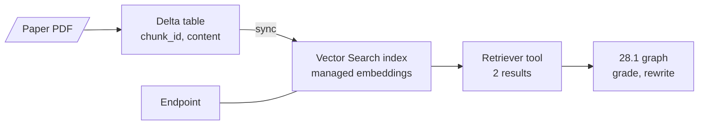
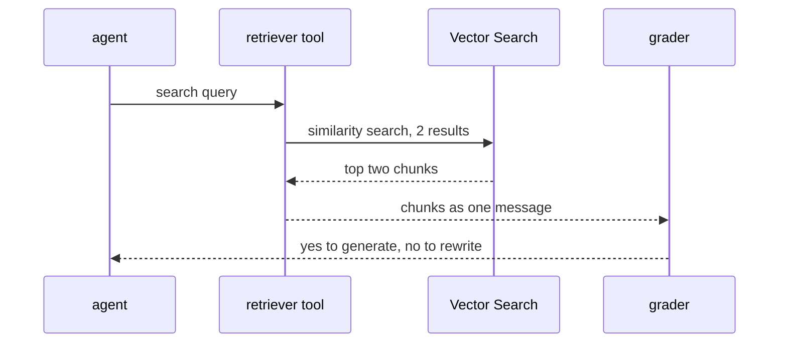

# M28.2 Theory: The same agent on Databricks Vector Search

*[M28 theory](../../../mandatory/theory/README.md) · Lesson 28.2 · Notebooks: [`02a_simple_agentic_rag_databricks.ipynb`](../../notebook/02a_simple_agentic_rag_databricks.ipynb) (optional) · [All theory pages](../../../../../THEORY.md)*
<!-- subtitle: A platform project: lesson 28.1's grade-then-rewrite graph with a managed index behind the retriever tool -->

## The project: the same agent on Databricks Vector Search

> **What you'll build**
>
> - **A Delta table of chunks** with a primary key, the source the index is built from.
> - **A Vector Search endpoint and index** that embed the table's text for you and stay in sync with it.
> - **A retriever tool** over that index that returns two chunks per call.
> - **Lesson 28.1's graph**, unchanged: agent, retrieve, grade, rewrite, generate, with models served on Databricks.

Lesson 28.1 kept its chunks in an in-memory vector store that the notebook rebuilt on every run. This project moves the retriever behind a managed index on Databricks. The graph, grader, rewrite and generate nodes stay the same; only the tool points somewhere new.

What changes is who owns the index. The chunks live in a governed table, the platform computes the embeddings and serves the search, and the agent sees only a tool. That suits a Larkspur team: the support writers update a table, and the assistant searches the latest handbook without anyone rebuilding a vector store.

## Architecture

The pieces, from document to answer:

*Figure 1: The managed retrieval path. The graph talks only to the tool; the table and index sit behind it.*

| Piece | What it does | Built on |
|---|---|---|
| **Chunk table** | One row per chunk with an integer id and its text, saved as a Delta table with change data feed on, so the index can see which rows changed | M10's load and chunk stages |
| **Endpoint** | The serving resource that hosts indexes and answers search requests | |
| **Delta Sync index** | Built on the table's text column with an embedding model the platform calls for you; refreshed when a sync is triggered | M14's embeddings and M15's vector stores |
| **Retriever tool** | Wraps the index as a tool with a name, a description and a fixed number of results | Lesson 28.1's retriever tool |
| **The graph** | Agent, retrieve, edge grader, rewrite, generate, wired as in lesson 28.1 | Lesson 28.1 |

*Table 1: The project's five pieces and the earlier lesson each one reuses.*

Databricks offers three kinds of index, and the notebook uses the first:

- **Managed embeddings**: the platform embeds a text column and keeps the index in sync with the table.
- **Self-managed embeddings**: you compute the vectors, store them in the table, and the platform syncs them.
- **Direct access**: no table; you write vectors to the index yourself.

## Following one question

The notebook asks how the paper's authors set up the collaboration between the human and the LLMs. It travels lesson 28.1's graph, with the search now a call to the platform:

*Figure 2: One retrieval. The platform embeds the query with the index's model; the graph never sees a vector.*

The answer depends on the served models, so the notebook prints no fixed result; the order of the steps is what stays the same. Before building the agent, the notebook queries the index directly once, a check that it answers before the graph depends on it.

## Design choices worth copying

| Choice | Why |
|---|---|
| **A table as the source of truth** | Chunks are rows with ids, so an edit to one policy updates one row, and the index follows on the next sync |
| **Change data feed on the table** | The sync reads only the rows that changed instead of re-embedding the whole corpus |
| **Managed embeddings** | The same embedding model indexes the chunks and the queries, so they cannot drift apart. Lesson 28.1's notebook used the same model, computed by the notebook |
| **Create only if missing, then wait** | The setup waits until the endpoint and index report online, and a rerun neither fails nor duplicates them |
| **A small, fixed result count** | Two chunks per call keeps the grader's block small (lesson 28.1's block-grade risk) |

*Table 2: Five choices and what each protects against.*

The graph code did not change, which is the point of the tool boundary from [M22](../../../../../p06_agent_foundations/m22_agent_loop_and_tools/mandatory/theory/README.md): the model sees a name and a description, so the backend behind them can move.

## Limits

- **A misleading tool name.** The description talks about the paper, but the name refers to a company policy document. A name that contradicts the description can make the model skip the tool or call it for the wrong questions.
- **Lesson 28.1's flaws come along.** The grader still compares its label exactly with `"yes"` (the capital-Y rewrite), still grades the block, and nothing counts rewrites.
- **Mixed providers.** The rewrite node calls an OpenAI model while every other node uses a model served on Databricks, so one run needs two providers' credentials.
- **A triggered sync.** A table edit is invisible to the agent until a sync runs, so whatever writes the table must also trigger the sync.
- **Standing cost.** The endpoint is billed while it exists, whether or not anyone asks a question.

The notebook runs only inside a Databricks workspace, with permission to create a catalog, a schema and a Vector Search endpoint. The rewrite node also needs an OpenAI key, and the generate node pulls a public RAG prompt from LangSmith.

## Key Takeaways

- Behind the tool boundary the retriever can move from an in-memory store to a managed index without touching the graph: the model sees only the tool's name and description.
- A managed index makes the chunk table the source of truth. Turn on change data feed and trigger a sync after every write, or the agent searches yesterday's handbook.
- Moving platforms carries the graph's flaws with it. The exact-match label, the block grade and the missing rewrite counter need the same fixes as in lessons 28.1 and 28.3.

## Check yourself

1. The project swaps an in-memory vector store for Databricks Vector Search. Which parts of lesson 28.1's graph had to change, and why so few?

Only the retriever tool: the agent, grader, rewrite and generate nodes are the same. The model knows the retriever only through the tool's name and description, so the store behind the tool can change without the graph noticing.

2. A Larkspur writer fixes the refund-timing row in the chunk table, but the assistant keeps quoting the old text an hour later. What is the likely cause?

The index uses a triggered sync, so it refreshes only when a sync is started. Until then it serves the embeddings of the old row. The pipeline that writes the table should trigger the sync, and change data feed lets that sync re-embed only the changed row.

3. The retriever tool is named for a policy document but described as a search over a research paper. What can go wrong, and what is the fix?

The model reads both strings to decide when to call the tool, so a contradiction can make it skip the search for paper questions or call it for policy questions it cannot answer. Name the tool for what it actually searches, and make the description agree.

---
*Previous: [28.1 Retriever as a tool; grade then rewrite in LangGraph](../../../mandatory/theory/01_retriever_as_a_tool_grade_then_rewrite_in_langgraph/README.md). Next: [28.3 Guardrails, query optimisation and a retry loop](../../../mandatory/theory/03_guardrails_query_optimisation_and_a_retry_loop/README.md).*
