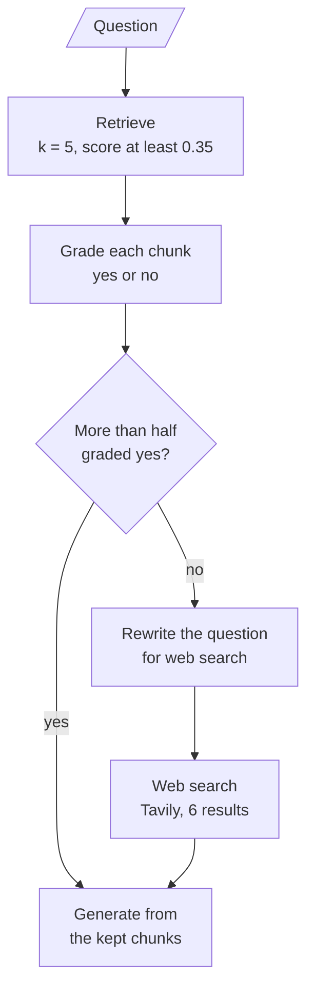
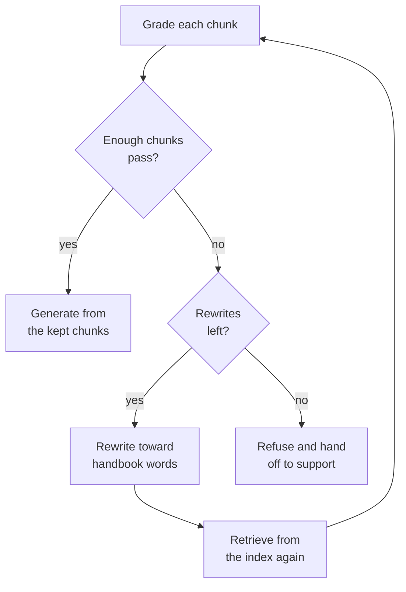
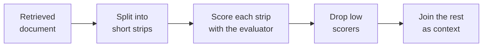
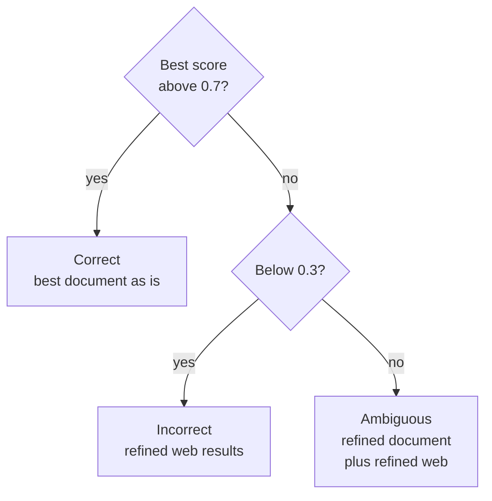

# M29.1 Theory: Corrective RAG in LangGraph with web-search fallback

*[M29 theory](../README.md) · Lesson 29.1 · Notebooks: [`01a_agentic_corrective_rag_langgraph.ipynb`](../../notebook/01a_agentic_corrective_rag_langgraph.ipynb), [`01b_crag_rag_techniques.ipynb`](../../../optional/notebook/01b_crag_rag_techniques.ipynb) (optional) · [All theory pages](../../../../../THEORY.md)*
<!-- subtitle: Grade the retrieved chunks before the model reads them, and decide where missing evidence may come from -->
<!-- format: approved -->

## Start with an answer nobody checked

> **What you'll learn**
>
> - **Explain** what a retrieval evaluator decides and the three verdicts the CRAG paper gives it.
> - **Trace** one question through the CRAG graph, from retrieval to the fallback.
> - **Diagnose** a fallback that fires with both evidence chunks in hand, and one that never fires with half the evidence missing.
> - **Choose** where missing evidence may come from: the web, the index again, or a refusal.

Take the Larkspur question *What happens if my server goes down?* The M10 baseline's TF-IDF retrieval at `k = 3` returns three chunks about reboots, server sizing and exports, and the model writes an answer from them. Nothing in that pipeline notices that none of the three is about outages. We call this **blind generation**: the generator answers from whatever retrieval returned, because nobody checked it first.

[M28](../../../../m28_retrieval_grading_rewriting/mandatory/theory/README.md) graded each retrieved chunk and rewrote the question when none passed. Corrective RAG keeps that grader and adds a second exit: when too few chunks pass, it goes outside the index for evidence.

## Retrieval evaluator

Corrective RAG (Yan et al., *Corrective Retrieval Augmented Generation*, 2024, [arXiv:2401.15884](https://arxiv.org/abs/2401.15884)) adds one component to the baseline. **A retrieval evaluator is a check that judges the retrieved documents before the generator sees them, and its verdict picks the next step.** The paper gives it three verdicts:

- **Correct**: retrieval looks right: generate from it.
- **Incorrect**: retrieval looks wrong: find other context.
- **Ambiguous**: the evaluator is unsure: use both.

The paper trains a small model (T5-large) as the evaluator. Both M29 implementations prompt an LLM instead, which costs one call per judgment.

### The CRAG graph

The LangGraph implementation turns the evaluator into a node and a conditional edge. Here is the graph it builds:

*Figure 1: The CRAG graph. Its nodes are `retrieve`, `grade_documents`, `rewrite_query`, `web_search` and `generate_answer`.*

The grader keeps the chunks graded yes and drops the rest. When nothing is retrieved at all, the graph also takes the web branch. The graph runs once, with no loop back to retrieval.

### Trace the export question through the graph

The [M29 lab](../03_trade_offs_when_correction_is_worth_the_extra_calls/interactive/correction-cost-lab.html) runs this graph on the handbook with TF-IDF retrieval and a stand-in grader that agrees with the golden labels. Follow *Can I export my data after I cancel my plan?* at `k = 5`:

Follow the export question through the CRAG graph. Each stage shows the chunks in hand and the running call count.

<button type="button" data-step="0" aria-pressed="false" aria-controls="crag-step-0">1. Retrieve</button><button type="button" data-step="1" aria-pressed="false" aria-controls="crag-step-1">2. Grade</button><button type="button" data-step="2" aria-pressed="false" aria-controls="crag-step-2">3. Decide</button><button type="button" data-step="3" aria-pressed="false" aria-controls="crag-step-3">4. Fall back</button><button type="button" data-step="4" aria-pressed="false" aria-controls="crag-step-4">5. Generate</button>

<section id="crag-step-0" class="step-panel" aria-labelledby="crag-heading-0"><h4 id="crag-heading-0">1. Retrieve five chunks</h4><dl><dt>Node</dt><dd>retrieve</dd><dt>Chunks</dt><dd>retention 0.372, export 0.369, cancel 0.261, refund-window 0.087, sizing 0.069</dd><dt>LLM calls so far</dt><dd>0</dd></dl></section><section id="crag-step-1" class="step-panel" aria-labelledby="crag-heading-1"><h4 id="crag-heading-1">2. Grade each chunk</h4><dl><dt>Node</dt><dd>grade_documents</dd><dt>Chunks</dt><dd>retention and export graded yes. The other three are dropped.</dd><dt>LLM calls so far</dt><dd>5, one per chunk</dd></dl></section><section id="crag-step-2" class="step-panel" aria-labelledby="crag-heading-2"><h4 id="crag-heading-2">3. Apply the majority rule</h4><dl><dt>Decision</dt><dd>2 of 5 is 0.40, not more than half: take the web branch</dd><dt>Chunks</dt><dd>Both evidence chunks are already kept</dd><dt>LLM calls so far</dt><dd>5</dd></dl></section><section id="crag-step-3" class="step-panel" aria-labelledby="crag-heading-3"><h4 id="crag-heading-3">4. Rewrite and search the web</h4><dl><dt>Node</dt><dd>rewrite_query, then web_search</dd><dt>Chunks</dt><dd>The two kept chunks, plus up to six web pages nobody graded</dd><dt>LLM calls so far</dt><dd>6, plus one search</dd></dl></section><section id="crag-step-4" class="step-panel" aria-labelledby="crag-heading-4"><h4 id="crag-heading-4">5. Generate</h4><dl><dt>Node</dt><dd>generate_answer</dd><dt>Result</dt><dd>An answer from the right chunks and someone else's pages.</dd><dt>LLM calls so far</dt><dd>7, plus one search</dd></dl></section>

<button type="button" data-walk="previous">Previous</button>

<button type="button" data-walk="next">Next step</button>

### Two evaluators side by side

The two implementations build the evaluator differently:

| | CRAG graph, LangGraph | CRAG function variant, plain functions (optional) |
|---|---|---|
| Retriever | Chroma, `k = 5`, similarity score threshold 0.35 | FAISS, `k = 3` |
| Evaluator output | Yes or no per chunk (`gpt-4o`, temperature 0) | A relevance score from 0 to 1 per chunk (`gpt-4o-mini`) |
| Decision | Relevant fraction above 0.5: generate. At 0.5 or below, or nothing retrieved: rewrite and search the web | Best score above 0.7: Correct, use that document. Below 0.3: Incorrect, search the web. Otherwise Ambiguous: refine the document and add web results |
| Web search | Tavily, 6 results, advanced depth, full page text | DuckDuckGo results, refined to bullet points |
| LLM calls | One per retrieved chunk, plus a rewrite on the fallback, plus generation | One per retrieved chunk, plus rewrite and refinement on the fallback, plus generation |

*Table 1: The two CRAG implementations in this module.*

The graph collapses the paper's three verdicts into two, because a yes-or-no grade has no middle. The function variant keeps all three, because a score has room for a band between the thresholds.

## Where the majority rule breaks

The rule is a fraction of the retrieved set. Hold the number of relevant chunks fixed and vary how many were retrieved:

| Retrieved | Graded relevant | Fraction | Route |
|---|---|---|---|
| 3 | 2 | 0.67 | generate |
| 5 | 2 | 0.40 | web search |
| 1 | 1 | 1.00 | generate |

*Table 2: The majority rule on three retrieval sizes. Arithmetic only, no grader or search involved.*

Every Larkspur golden question has two evidence chunks. A perfect grader keeps those two, and 2 of `k` is more than half only when `k` is 3 or less. The lab's grader agrees with the golden labels: each case below is a routing effect, not a grader mistake:

| Case | Question, `k` | Chunks kept | Route | LLM calls |
|---|---|---|---|---|
| Normal pass | *Can I export my data after I cancel my plan?*, 3 | `retention`, `export` | generate | 4 |
| **Diluted majority** | Same question, 5 | `retention`, `export` | web search | 7, plus the search |
| **Thin pass** | Same question, 1 | `retention` | generate | 2 |
| **Wrong fix** | *What happens if my server goes down?*, 3 | none of `reboot`, `sizing`, `export` | web search | 5, plus the search |

*Table 3: Planted failures of the majority rule, from the M29 lab.*

- **Diluted majority**: extra low-ranked chunks lower the fraction, so CRAG falls back with both evidence chunks in hand. The threshold moves with `k`.
- **Thin pass**: one relevant chunk out of one passes the rule, and CRAG answers without the `export` chunk that says how to export. The evaluator grades chunks, not whether the set is complete.
- **Wrong fix**: the grader rightly rejects all three outage chunks, and CRAG searches the web for a private handbook's outage policy. The answer was in the corpus all along, under the words "outage" and "availability".

> **Key distinction:** the evaluator says whether the context is good enough. It says nothing about where better context lives, and the fallback is a separate design choice.

## Where missing evidence may come from

A correct verdict of "not good enough" still needs a fix that can reach the evidence. The options differ by where they look:

- **Web search**: suits a corpus of public facts that go stale, such as the research papers the CRAG graph indexes.
- **Rewrite and retry inside the index**: suits a miss caused by wording, like the outage question (M17 rewriting, M28 retry loop).
- **Refusal**: suits a question the corpus cannot answer, where any answer would be invented.

Figure 1 is the web design. Figure 2, an added alternative, keeps the evaluator and replaces the fallback with a bounded retry against the index that ends in a refusal:

*Figure 2: Added alternative. The fallback stays inside the index and ends in a refusal.*

Compare the two fallback designs on two questions the evaluator rightly rejects: one missed on wording, one the handbook cannot answer.

<button type="button" data-mode="web" aria-pressed="false" aria-controls="fallback-web">Web search (Figure 1)</button>
<button type="button" data-mode="index" aria-pressed="false" aria-controls="fallback-index">Retry, then refuse (Figure 2)</button>

<section id="fallback-web" class="mode-panel" data-announcement="Web search selected. Both questions go to the web."><h4>Web search</h4><ul><li>Outage question: the search cannot see the handbook, so the answer can quote another provider's availability guarantee.</li><li>GPU question: the search can return another provider's GPU plans, which the generator may present as Larkspur's.</li></ul>
Both answers come from pages nobody graded.
</section>
<section id="fallback-index" class="mode-panel" data-announcement="Retry then refuse selected. The outage question is answered and the GPU question is refused."><h4>Retry, then refuse</h4><ul><li>Outage question: a rewrite using the handbook's words "outage" and "availability" retrieves sla at 0.470 in the M28 lab, and the answer comes from Larkspur's own guarantee.</li><li>GPU question: no rewrite finds a GPU policy, and the loop ends in a refusal and a handoff to support.</li></ul>
Each extra round costs a rewrite and another round of grades.
</section>

For a private handbook, replace the web branch or guard it so it runs only for questions about public facts. Knowledge refinement, the other half of CRAG, works on the context the evaluator lets through.

## Knowledge refinement

Retrieval returns whole chunks, and a chunk can mix the sentence that answers the question with sentences that do not. **Knowledge refinement cuts the context down to the parts that answer the question before generation.** The CRAG paper does it with decompose-then-recompose:

*Figure 3: Decompose-then-recompose, the paper's refinement step.*

The function variant uses a simpler version. Its refinement step sends one document to the LLM with the prompt "Extract the key information from the following document in bullet points" and returns the bullets. Where it runs depends on the verdict:

| Verdict | Best score | Context sent to the generator |
|---|---|---|
| Correct | above 0.7 | the best retrieved document, as is |
| Incorrect | below 0.3 | refined bullets from the web results |
| Ambiguous | 0.3 to 0.7 | refined bullets from the best document, plus refined web results |

*Table 4: Where the function variant refines its context.*

The verdicts form a short chain of decisions on the best score:

*Figure 4: The function variant's three verdicts as a chain of thresholds.*

The LangGraph graph has no refinement step. It filters at chunk level, keeping only chunks graded yes, and passes web pages as full text. A fallback can put six whole pages into the prompt. We call that **context flood**: the evaluator removes bad chunks from the index, then the fallback adds pages nobody graded.

### Strips on the export question

On the export question at `k = 3`, the retriever returns `retention`, `export` and `cancel`. Chunk-level filtering keeps the first two whole. Strip-level refinement would go one step further, as this hand-written illustration shows:

| Strip | Keep? |
|---|---|
| `retention`: After a plan is cancelled, its data is kept for 30 days and then permanently deleted. | yes, it answers "after I cancel" |
| `retention`: Export it before that window closes. | yes |
| `export`: Export your data at any time from Settings, then Data. | yes, it says how |
| `export`: Exports include databases, object storage and server snapshots. | borderline, it answers a different question |
| `cancel`: You can cancel any plan from the Billing page. | no |

*Table 5: Strip-level refinement on the export question (illustrative, written by hand, not a measured output).*

Refinement has two costs. It adds one LLM call per document it rewrites, and an LLM that rewrites evidence can also change it. We call the second one **rewritten evidence**: a bullet that reads well and no longer says what the chunk said. Keep the original chunk id beside each bullet so the answer can still cite its source, and so a reviewer can compare the bullet with the text.

## Choosing the evaluator and the fallback

Two questions about your corpus settle the design. Retune the fraction whenever `k` changes:

| Question | If yes | If no |
|---|---|---|
| Can the answer live outside your corpus? | A web fallback is worth having | Retry inside the index, then refuse |
| Do retrieved chunks mix answers with noise? | Refine to strips or bullets, with chunk ids | Chunk-level filtering is enough |

*Table 6: Design choices for a CRAG pipeline.*

Log every route with the chunks graded, the chunks kept and the branch taken.

> **Interview tip:** when a CRAG answer is wrong, read the route before the prompt. Which chunks came back, how each was graded and whether the web branch fired usually explain the answer.

## Limits of this evidence

- **Stand-in grader.** The lab's retrieval is real TF-IDF over the M10 handbook chunks, but its grader agrees with the golden labels. A real grader makes mistakes these cases do not.
- **Different corpus.** The notebook's graph indexes research papers, where a web fallback can help. The Larkspur cases test the same routing on a private corpus.
- **Illustrations.** The strip table is written by hand, and the retry design in Figure 2 is an addition, not the notebook's graph.

Lesson 29.2 adds the check CRAG lacks: one that runs after generation and looks at the answer itself.

## References

1. Yan et al., [Corrective Retrieval Augmented Generation](https://arxiv.org/abs/2401.15884), 2024.

## Key Takeaways

- CRAG grades the retrieved chunks before generation and falls back to a rewritten web search when too few pass. It grades chunks, not answers, so a passing set can still miss the evidence, and a fraction-based rule moves with `k`.
- A web fallback suits public facts that go stale. For a private handbook, replace it with a retry inside the index and then a refusal, because the web cannot see your documents.
- Knowledge refinement cuts chunks down to the parts that answer the question before generation. An LLM that rewrites evidence can also change it, so carry the source chunk id with every bullet.

## Check yourself

1. Why does the LangGraph CRAG graph fall back to web search more often as k grows, even with a perfect grader?

Its rule is a fraction: generate only when more than half of the retrieved chunks are graded relevant. Every golden question has two evidence chunks, and 2 of `k` is more than half only when `k` is 3 or less. At `k = 5` the export question keeps both evidence chunks and still falls back, spending 7 calls plus a web search instead of 4.

2. On the outage question, retrieval returns the reboot, sizing and export chunks, and the grader rightly rejects all three. What does CRAG do next, and what should it have done?

It searches the web for a private handbook's outage policy, which the web cannot see. The answer was in the corpus all along, under the words "outage" and "availability". A rewrite and retry against the index (M17, M28) would have found it, so for a private handbook, retry inside the index and then refuse.

3. You add knowledge refinement that rewrites each retrieved document into bullet points. What does it cost, and how do you keep answers citable?

It costs one more LLM call per document it rewrites, and an LLM that rewrites evidence can also change it. Keep the original chunk id beside each bullet so the answer can still cite its source and a reviewer can check the bullet against the chunk.

---
*Previous: [M29 overview](../README.md). Next: [29.2 Self-RAG: retrieve-or-not, relevance, groundedness, utility](../02_self_rag_retrieve_or_not_relevance_groundedness_utility/README.md).*
