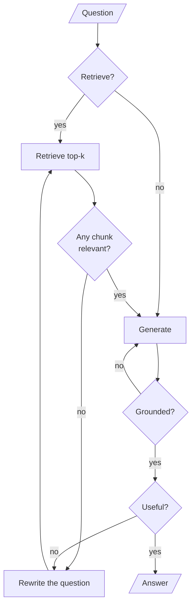
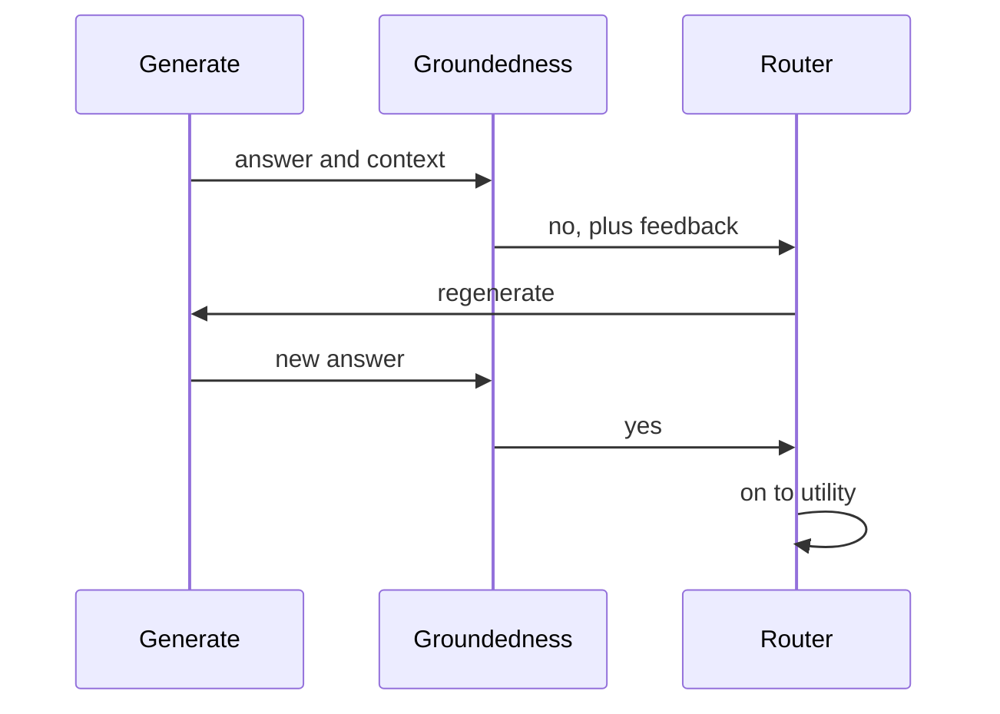
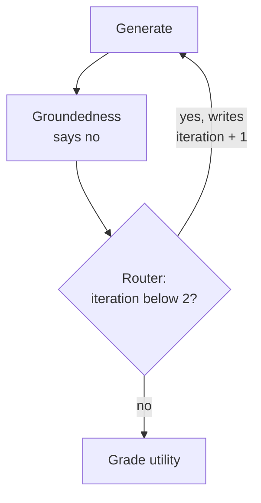
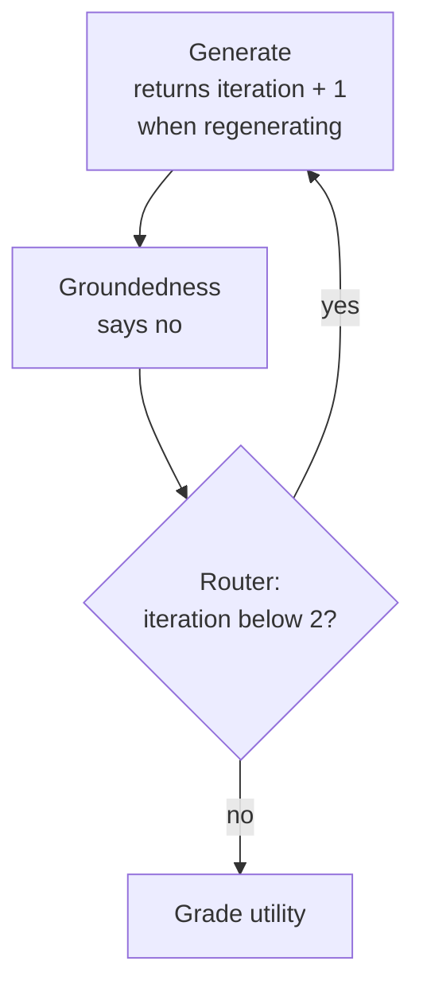

# M29.2 Theory: Self-RAG: retrieve-or-not, relevance, groundedness, utility

*[M29 theory](../README.md) · Lesson 29.2 · Notebooks: [`02a_self_rag_langgraph.ipynb`](../../notebook/02a_self_rag_langgraph.ipynb), [`02b_self_rag_rag_techniques.ipynb`](../../../optional/notebook/02b_self_rag_rag_techniques.ipynb) (optional) · [All theory pages](../../../../../THEORY.md)*
<!-- subtitle: Four checks around retrieval and generation, and the two places the hallucination guard does not run -->
<!-- format: approved -->

## Start with an answer that is grounded and still wrong

> **What you'll learn**
>
> - **Explain** the four reflection decisions of Self-RAG and the question each one answers.
> - **Trace** a question the handbook cannot answer through every loop, and count its LLM calls.
> - **Diagnose** a groundedness check that passes without running, and a retry cap that never bites.
> - **Choose** where a loop counter must be updated in a LangGraph graph.

Lesson 29.1 checked the context before generation and never looked at the answer. Self-RAG checks both, and it can also skip retrieval when a question does not need it.

A Larkspur answer can cite real policy and still miss the question. As an *illustrative* case, ask *Can I export my data after I cancel my plan?*, retrieve only the `export` chunk, and the model can write a well-supported paragraph on how to export that never mentions the 30-day retention window. Every sentence is grounded in the context, and the customer still loses their data. Relevance, support and usefulness are three separate properties, and a pipeline that checks one of them misses the other two.

## Reflection tokens

Self-RAG (Asai et al., *Self-RAG: Learning to Retrieve, Generate, and Critique through Self-Reflection*, 2023, [arXiv:2310.11511](https://arxiv.org/abs/2310.11511)) trains one model to emit special tokens that judge its own pipeline. **Reflection tokens are labels the model produces about its own retrieval and output: whether to retrieve, whether a passage is relevant, whether the answer is supported, and whether it is useful.** The table lists the four kinds and how each implementation in this module represents them:

| Token | Question it answers | Values in the paper | Self-RAG graph (LangGraph) | Self-RAG function variant (optional) |
|---|---|---|---|---|
| Retrieve | Do I need documents for this? | yes, no, continue | `need_retrieval`: yes or no | Yes or No |
| ISREL | Is this passage relevant? | relevant, irrelevant | yes or no, per chunk | Relevant or Irrelevant |
| ISSUP | Is the answer supported by the passage? | fully, partially, no support | yes or no, plus feedback | Fully supported, Partially supported or No support |
| ISUSE | Is the answer useful for the question? | a score from 1 to 5 | yes or no, plus feedback | an integer from 1 to 5 |

*Table 1: The four reflection tokens in the paper and in the two implementations.*

In the paper the tokens are part of the model's vocabulary and come out of the same decoding pass as the answer. Neither implementation trains a model. Each judgment is a separate LLM call with a structured-output schema, so "reflection token" here means one more call that returns a label.

> **Key distinction:** in the paper a reflection costs a few extra tokens. In these implementations it costs a full model round trip, and that changes which checks are worth running.

### How the graph wires the four checks

The LangGraph implementation wires each judgment to its own conditional edge:

<!-- animated: diagrams/self-rag-loop.anim.html -->

*Figure 1: The Self-RAG graph. Two loops go back through a rewrite, one goes straight back to generation.*

The three loops have different exits:

- **No relevant chunk**: rewrite the question and retrieve again.
- **Answer not useful**: rewrite the question and retrieve again, with the utility feedback as a hint.
- **Answer not grounded**: generate again, with the groundedness feedback in the prompt.

`max_iterations = 2` bounds the rewrite loops, because the rewrite node increments the counter each time it runs. After two rewrites the relevance router sends the question to generation even with no relevant chunk, and the utility router ends the run.

The first token is the one CRAG lacks. *What is 9 plus 10?* gets `need_retrieval = no` in the graph and skips the vector store. Every Larkspur question is about the handbook. On this corpus the Retrieve token saves nothing and costs one call.

### Trace a question the handbook cannot answer

The loops make the cost depend on the question. The [M29 lab](../03_trade_offs_when_correction_is_worth_the_extra_calls/interactive/correction-cost-lab.html) replays the graph on the handbook with stand-in graders. On *How much does the starter plan cost per month?* at `k = 5` no chunk is ever relevant:

Follow the starter-plan question through every Self-RAG loop. Each stage shows the counter and the running call total.

<button type="button" data-step="0" aria-pressed="false" aria-controls="starter-step-0">1. Decide</button><button type="button" data-step="1" aria-pressed="false" aria-controls="starter-step-1">2. Pass 1</button><button type="button" data-step="2" aria-pressed="false" aria-controls="starter-step-2">3. Pass 2</button><button type="button" data-step="3" aria-pressed="false" aria-controls="starter-step-3">4. Pass 3</button><button type="button" data-step="4" aria-pressed="false" aria-controls="starter-step-4">5. Generate</button>

<section id="starter-step-0" class="step-panel" aria-labelledby="starter-heading-0"><h4 id="starter-heading-0">1. Decide to retrieve</h4><dl><dt>Decision</dt><dd>need_retrieval: yes</dd><dt>Counter</dt><dd>0</dd><dt>LLM calls so far</dt><dd>1</dd></dl></section><section id="starter-step-1" class="step-panel" aria-labelledby="starter-heading-1"><h4 id="starter-heading-1">2. First pass finds nothing</h4><dl><dt>Decision</dt><dd>Five chunks graded, none relevant. Rewrites are left.</dd><dt>Counter</dt><dd>0</dd><dt>LLM calls so far</dt><dd>6</dd></dl></section><section id="starter-step-2" class="step-panel" aria-labelledby="starter-heading-2"><h4 id="starter-heading-2">3. Rewrite, second pass</h4><dl><dt>Decision</dt><dd>One rewrite, five chunks graded, none relevant</dd><dt>Counter</dt><dd>1</dd><dt>LLM calls so far</dt><dd>12</dd></dl></section><section id="starter-step-3" class="step-panel" aria-labelledby="starter-heading-3"><h4 id="starter-heading-3">4. Rewrite, third pass</h4><dl><dt>Decision</dt><dd>One rewrite, five chunks graded, none relevant. The cap is reached.</dd><dt>Counter</dt><dd>2</dd><dt>LLM calls so far</dt><dd>18</dd></dl></section><section id="starter-step-4" class="step-panel" aria-labelledby="starter-heading-4"><h4 id="starter-heading-4">5. Generate with no documents</h4><dl><dt>Decision</dt><dd>Generate anyway. Groundedness passes with no call, utility is graded.</dd><dt>Counter</dt><dd>2</dd><dt>LLM calls so far</dt><dd>20: 1 decision, 15 relevance grades, 2 rewrites, 1 generation, 1 utility grade</dd></dl></section>

<button type="button" data-walk="previous">Previous</button>

<button type="button" data-walk="next">Next step</button>

On the export question the same graph stops after one pass in 9 calls. The expensive question is the one the handbook cannot answer, and the run ends with a generation that has nothing to be grounded in. The groundedness check is where that generation should have been caught.

## Groundedness check

**A groundedness check asks whether every claim in the answer is supported by the context the answer was generated from.** It is Self-RAG's hallucination guard. In the graph, the groundedness node sends the context and the answer to a "strict fact-checker" prompt. The schema returns a yes only if every claim is supported, and a feedback string naming the unsupported claims.

On a no, the router sends the run back to generation, and the feedback goes into the prompt as "a previous attempt at this answer was rejected for this reason". The regenerate loop is shown here as a sequence of calls:

*Figure 2: One regeneration after an unsupported answer.*

Groundedness and utility are separate checks because they fail separately. The export answer in the opening example is fully grounded and still not useful. An answer that quotes the retention window correctly and adds an invented export fee (again illustrative) sounds useful and is not grounded.

### Planted failures in the hallucination guard

Two details in the graph decide what the check actually catches. Planting one failing case against each shows them:

| Planted case | What the graph does | Why |
|---|---|---|
| No relevant chunk after the cap, starter-plan question | Generates with no context; groundedness returns yes with no call | The node treats "no documents" as grounded by default |
| A groundedness grader that always says no | Regenerates until LangGraph raises a recursion error | The regenerate loop's counter update is discarded |
| The same question in the function variant | Generates from "No relevant context found." with a prompt that asks only for a response, and runs no support check | No instruction to refuse, so the model answers from memory |

*Table 2: Three planted failures of the groundedness check.*

The first row is the **empty-context pass**. On the starter-plan question, Self-RAG exhausts its rewrites, generates with no context, and the check waves the answer through. The only guard left is the generation prompt's line "If the context does not contain enough information to answer confidently, say so plainly". The function variant is weaker still: its own low-relevance test asks a climate-change corpus *how did harry beat quirrell?*, and nothing stops the model from answering.

> **Pitfall: the empty-context pass.** A check that returns yes when it has nothing to check guards only the cases where it was least needed. Route "no documents after the cap" to a fixed refusal instead.

### The counter that never moves

The second row is the **stuck counter**. The groundedness router writes `iteration + 1` into the state inside the routing function. In LangGraph a conditional-edge router only returns the name of the next node. Only what nodes return is merged into the state. A write inside a router is discarded. The rewrite loops stay bounded because the rewrite node returns the new iteration. The regenerate loop has no node that does:

*Figure 3: The notebook's regenerate loop. The router's write is discarded: the counter stays where it was and the yes branch repeats.*

The cap still bites if earlier rewrites already pushed the counter to 2, because the router reads that value. On a question that passes relevance on the first pass, the counter starts at 0 and stays there. The fix is to count in a node: have generation return the new iteration when it is regenerating, or add a small regenerate node before it.

*Figure 4: Added fix. The node returns the count, and LangGraph merges it into the state.*

We replayed the notebook's routers with stub nodes in langgraph 1.2.18 on the export question at `k = 5`, with a groundedness grader that always says no and `recursion_limit = 200`:

Compare where the regenerate loop counts, with a groundedness grader that always says no.

<button type="button" data-mode="router" aria-pressed="false" aria-controls="counter-router">In the router (Figure 3)</button>
<button type="button" data-mode="node" aria-pressed="false" aria-controls="counter-node">In the node (Figure 4)</button>

<section id="counter-router" class="mode-panel" data-announcement="Counter in the router selected. The run ends in a recursion error."><h4>In the router</h4><ul><li>Counter after each regeneration: 0, every time.</li><li>98 regenerations, 203 LLM calls, then GraphRecursionError.</li></ul>
With the default config it runs to the limit that release reports, 10,007 steps.
</section>
<section id="counter-node" class="mode-panel" data-announcement="Counter in the node selected. The run ends after two regenerations."><h4>In the node</h4><ul><li>Counter after each regeneration: 1, then 2.</li><li>2 regenerations, 13 LLM calls, then the cap sends the run to the utility grade.</li></ul>
The loop ends, but the cap accepts the ungrounded answer as final. Route it to a refusal instead.
</section>

A test with a grader that always says no proves the fix, and a per-request call budget catches the next loop nobody bounded.

### Keeping three support levels

The paper's three support levels are worth keeping when you build this yourself. The function variant generates one candidate answer per relevant passage and ranks them by "fully supported" first and utility second. A yes-or-no grade cannot rank candidates that way, because a partially supported answer and an unsupported one both come back as no.

## A Self-RAG policy for Larkspur

On Larkspur's questions the cost and the gaps line up: 9 calls for the export question, 20 and an **empty-context pass** for the starter-plan question, and a **stuck counter** on any first-pass question when a grader outage returns no on every call. For Larkspur, the out-of-corpus route ends in a refusal and a handoff to support, the regenerate counter moves in a node, and every request carries a call budget. Lesson 29.3 puts these call counts next to CRAG's and the baseline's.

## Limits of this evidence

- **Stand-in graders.** The lab's relevance grader agrees with the golden labels and its rewrite repeats the question. Its counts are a ceiling for questions a better rewrite could reach.
- **Stub nodes.** The counter replay measures graph steps and calls, not a model's judgments.
- **Illustrations.** The opening export answer and the invented export fee are illustrative. Figure 4 is an added fix, not the notebook's graph.

## References

1. Asai et al., [Self-RAG: Learning to Retrieve, Generate, and Critique through Self-Reflection](https://arxiv.org/abs/2310.11511), 2023.
2. [LangGraph Graph API](https://docs.langchain.com/oss/python/langgraph/graph-api), accessed 13 November 2026.

## Key Takeaways

- Self-RAG judges four things: whether to retrieve, whether each chunk is relevant, whether the answer is supported and whether it is useful. In these implementations each judgment is one more LLM call that returns a label.
- The loops make cost depend on the question, from 9 calls on the export question to 20 on an out-of-corpus price question at `k = 5`. With no documents, the groundedness check passes without running.
- Groundedness and utility fail separately, so check both, and make "no documents" a refusal rather than a pass.
- Update loop counters in a node, because LangGraph discards state written inside a routing function, and back every loop with a per-request call budget.

## Check yourself

1. How do the reflection labels in these implementations differ from the ones in the Self-RAG paper?

In the paper one trained model emits the tokens from its vocabulary, in the same decoding pass as the answer. Neither implementation trains a model: each judgment is a separate LLM call with a structured-output schema. So "reflection token" here means one more call that returns a label, and each check costs a full round trip.

2. On the starter-plan price question at k equal to 5, no chunk is ever relevant. How many LLM calls does Self-RAG make, and where do they go?

Twenty: 1 retrieve decision, 15 relevance grades over three passes, 2 rewrites, 1 generation and 1 utility grade. The groundedness check makes no call, because with no documents it returns yes without running. The export question stops after one pass in 9 calls.

3. With a groundedness grader that always says no, the graph regenerates until LangGraph raises a recursion error, despite its iteration cap. Why, and what is the fix?

The groundedness router writes the new iteration inside the routing function, and LangGraph keeps only what nodes return, so the counter never moves. With `recursion_limit = 200` the replay made 98 regenerations and 203 LLM calls. Count in a node instead: have generation return the new iteration, or add a small regenerate node.

---
*Previous: [29.1 Corrective RAG in LangGraph with web-search fallback](../01_corrective_rag_in_langgraph_with_web_search_fallback/README.md). Next: [29.3 Trade-offs: when correction is worth the extra calls](../03_trade_offs_when_correction_is_worth_the_extra_calls/README.md).*
