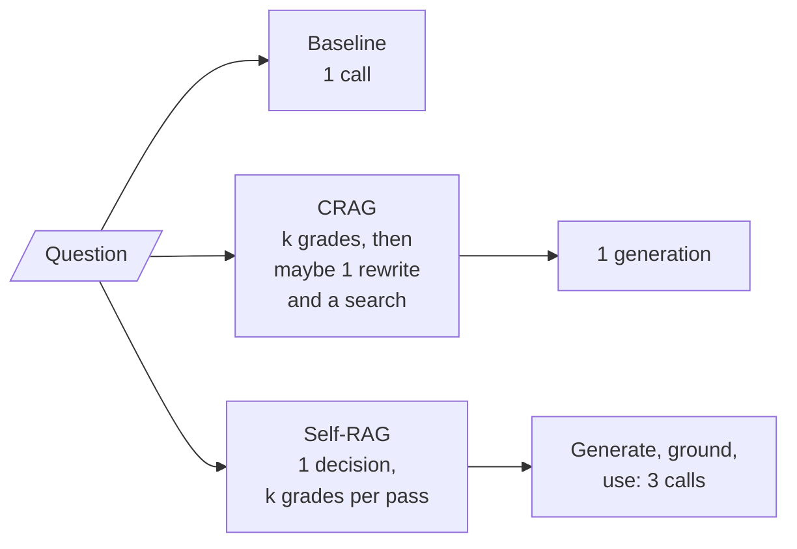
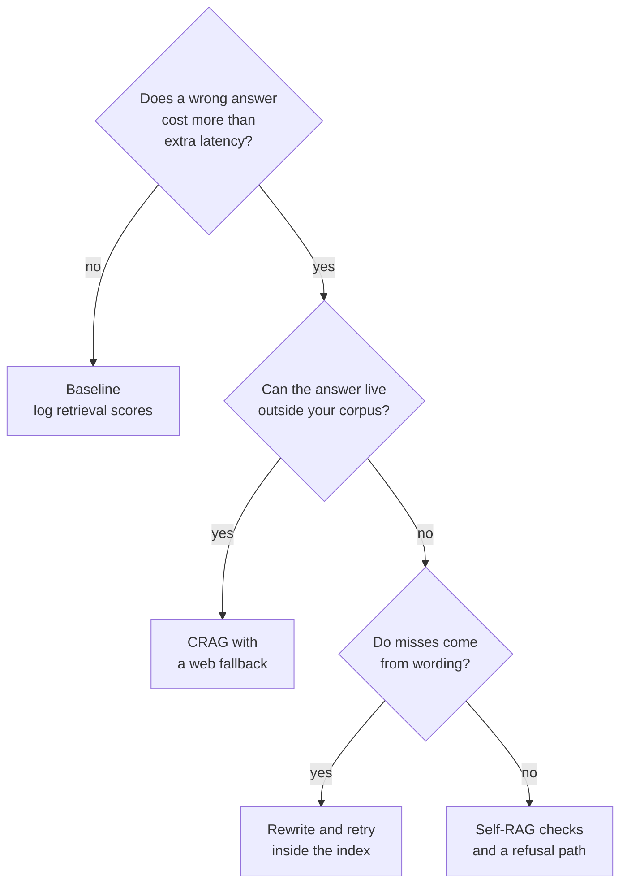

# M29.3 Theory: Trade-offs: when correction is worth the extra calls

*[M29 theory](../README.md) · Lesson 29.3 · [All theory pages](../../../../../THEORY.md)*
<!-- subtitle: Count the calls each pipeline spends per question, then add correction only where the fix can reach the evidence -->

## Cost per question

> **What you'll learn**
>
> - **Count** the LLM calls the baseline, CRAG and Self-RAG spend on a question, from the shape of each graph.
> - **Compare** the three pipelines on the five Larkspur questions at two values of `k`.
> - **Diagnose** a correction loop that spends calls on evidence it can never reach.
> - **Choose** a correction design for a private handbook, question type by question type.

Lessons 29.1 and 29.2 built two ways to catch a bad answer: CRAG grades the context before generation, and Self-RAG also checks the answer after it. Both are paid for in model calls, and neither was free on the questions we traced.

Larkspur's product team wants Self-RAG on every support question "to stop hallucinations". The assistant already handles most of Larkspur's support traffic, and on the refund question Self-RAG spends 18 calls and still never sees the chunk that answers it. More calls bought nothing there. This page counts what each pipeline spends, finds where the spending goes, and turns that into a rule for when correction is worth it.

### Calls by path

Every check in CRAG and Self-RAG is an LLM call, and every failed check sends the question round again. The calls can be counted from the graphs themselves:

| Pipeline | LLM calls per question |
|---|---|
| Baseline | 1: generate |
| CRAG (LangGraph graph) | One grade per retrieved chunk, plus 1 rewrite if it falls back, plus 1 generation; the web search is a tool call on top |
| Self-RAG (LangGraph graph) | 1 retrieve decision, one grade per retrieved chunk on every pass, 1 rewrite per extra pass, and per generation 1 call, 1 groundedness grade (skipped with no documents) and 1 utility grade |

*Table 1: How each pipeline's call count is built.*

Where the calls fall along each path is easier to see as a figure:

*Figure 1: Where the calls fall. CRAG runs once; Self-RAG repeats its grading on every pass.*

### The five questions, measured

The [interactive lab](interactive/correction-cost-lab.html) runs those graphs on the M10 handbook with TF-IDF retrieval, keeping up to `k` chunks with a score above zero. Its graders are stand-ins:

- **Relevance** agrees with the golden labels.
- **Groundedness** says yes.
- **Utility** says yes only when every evidence chunk reached the generator.
- **A rewrite** repeats the question unchanged.

The last rule makes the Self-RAG figures a worst case, since a real rewrite can find the evidence and end the loop early. The lab's counts were checked against the reference implementations' own LangGraph code with the same stand-ins: 50 runs, 0 mismatches.

| Question | Baseline | CRAG, `k = 3` | Self-RAG, `k = 3` | CRAG, `k = 5` | Self-RAG, `k = 5` |
|---|---|---|---|---|---|
| *Can I export my data after I cancel my plan?* | 1 | 4 | 7 | 7 + web | 9 |
| *How long does a refund take?* | 1 | 4 + web | 18 | 4 + web | 18 |
| *What happens if my server goes down?* | 1 | 5 + web | 14 | 5 + web | 14 |
| *Does Larkspur offer GPU servers?* (not in the handbook) | 1 | 5 + web | 14 | 5 + web | 14 |
| *How much does the starter plan cost per month?* (not in the handbook) | 1 | 5 + web | 14 | 7 + web | 20 |
| Mean | 1.0 | 4.6 | 13.4 | 5.6 | 15.0 |

*Table 2: LLM calls per question in the M29 lab. "+ web" marks a web search on top of the LLM calls.*

<!-- lab: interactive/correction-cost-lab.html -->

The refund row shows how retrieval shapes the count. Only two chunks score above zero for that question, so CRAG grades two, rewrites and generates, for 4 calls at either `k`. Self-RAG makes 1 retrieve decision, then three passes of two grades, a generation, a groundedness grade and a utility grade, with a rewrite before the second and third: 1 + 15 + 2 = 18.

### Where the calls go

Three patterns hold across Table 2, and each is a failure mode worth naming:

- **Expensive dead end**: correction costs most where it helps least. The two questions the handbook cannot answer cost Self-RAG 14 to 20 calls, and they end with a generation that has no context to be grounded in. CRAG sends both to the web, which cannot see a private handbook.
- **Unreachable evidence**: some misses no check can repair. On the refund question, `refund-timing` shares no term with "How long does a refund take?", so it is never retrieved and never graded. Self-RAG's utility check sees the gap and spends 18 calls on three passes that return the same chunks. The fix is upstream, in retrieval (M13, M16) or in a rewrite that changes the words (M17).
- **Overhead on easy questions**: at `k = 3` the export question is answered from both evidence chunks by all three pipelines. CRAG pays 4 calls and Self-RAG 7 for the same context the baseline read in 1.

> **Pitfall: the expensive dead end.** A loop that looks for evidence the corpus does not hold spends its whole budget and then answers anyway. The cheapest fix is a refusal path that ends the loop early.

### Billed calls and waiting time

Call counts measure the bill. Latency depends on how the calls are scheduled, and the reference implementations make them one after another: both graphs grade chunks in a Python loop, so `k` grades add `k` round trips of waiting. Here is the arithmetic for the export question at `k = 5`, under an assumed round trip:

| Self-RAG, export question, `k = 5` | Calls | Sequential round trips | Round trips with batched grading |
|---|---|---|---|
| Retrieve decision | 1 | 1 | 1 |
| Relevance grades | 5 | 5 | 1 |
| Generate, groundedness, utility | 3 | 3 | 3 |
| Total | 9 | 9 | 5 |

*Table 3: Batching the grades cuts waiting time and leaves the bill unchanged (illustrative: assumes every call takes one equal round trip).*

Batching the grader calls cuts the wait from nine round trips to five. It does not cut the bill: all nine calls are still made. The next question is which of those calls are worth paying for at all.

## When correction pays

**Correction earns its calls when a wrong answer costs more than the extra latency and tokens, and when the fix it reaches for can supply the missing evidence.** Both halves matter: a check on a low-stakes question is overhead, and a check whose fix cannot reach the evidence is an **expensive dead end**. A short chain of questions settles most cases:

*Figure 2: Choosing a correction design. Each yes or no narrows where the missing evidence can come from.*

The same choice as a comparison, with the evidence from Table 2:

| | Baseline | CRAG | Self-RAG |
|---|---|---|---|
| Mean calls, `k = 3` | 1.0 | 4.6 | 13.4 |
| Mean calls, `k = 5` | 1.0 | 5.6 | 15.0 |
| Checks the context | ✗ | ✓ | ✓ |
| Checks the answer | ✗ | ✗ | ✓ |
| Repairs a wording miss | ✗ | ✗ (rewrites for the web) | Only if a rewrite changes the words |
| Main risk | Blind generation | Wrong fix, diluted majority | Expensive dead end, empty-context pass |

*Table 4: The three pipelines compared on the Larkspur golden set.*

In the lab, none of the three repairs the refund miss. That row is the strongest argument for fixing retrieval before adding checks.

## In practice: a correction policy for Larkspur

For the Larkspur assistant the decision chain gives one policy per question type:

1. **Billing and refund questions get a check**, because a wrong refund window turns into a support ticket. A relevance grade per chunk and one groundedness check on the answer add `k + 1` calls.
2. **The web fallback stays off.** Every Larkspur fact lives in the handbook. A question the handbook cannot answer gets a refusal and a handoff to support, never a search.
3. **Retrieval misses are fixed in retrieval.** The outage question fails on wording. One rewrite against the index is cheaper than three Self-RAG passes or a web search.
4. **Every loop gets a counter and a budget.** `max_iterations` caps the rewrite loops in the Self-RAG graph; the regenerate loop needs a counter updated in a node (lesson 29.2), and a per-request limit on LLM calls catches the next loop nobody bounded.

> **Interview tip:** answer "should we add Self-RAG everywhere?" with a count. Table 2 shows 15.0 calls per question against 1 at `k = 5`, and the refund row shows calls that changed nothing.

### What the lab leaves out

The lab's numbers are call counts under stand-in graders, so some questions stay open:

- **Answer quality.** The lab does not judge whether any pipeline's answer is right. The M29 lab notebook's out-of-corpus run counts refusals and hallucinated answers; add it when you need accuracy next to cost.
- **Real grader errors.** The stand-in relevance grader is perfect. A real one makes mistakes in both directions, which changes both routes and counts.
- **Rewrites that work.** The lab's rewrite repeats the question, so Self-RAG's counts are a ceiling for questions a better rewrite could reach.
- **Tokens and price.** A grading call over one chunk is far smaller than a generation over five chunks plus six web pages. Weight calls by tokens before quoting a cost in money.

## Key Takeaways

- Count the calls before adding correction. On the lab's golden set at `k = 3`, the mean was 1 call for the baseline, 4.6 for CRAG and 13.4 for Self-RAG.
- No check repairs a chunk that retrieval never returns, and questions the corpus cannot answer cost the most. Fix wording misses upstream, with better retrieval or a rewrite against the index.
- Add correction where a wrong answer costs more than the extra latency, such as refund questions. Keep the web fallback off for a private corpus, and give every loop a counter and a per-request call budget.

## Check yourself

1. Why does correction cost the most on the questions where it helps the least?

The two questions the handbook cannot answer are the most expensive for Self-RAG, 14 to 20 calls, and they still end with a generation that has no context to be grounded in. CRAG sends both to the web, which cannot see a private handbook. The checks spend their budget looking for evidence that does not exist, so a refusal path is the cheaper fix.

2. At k equal to 3, all three pipelines answer the export question from both evidence chunks. How many LLM calls does each one pay?

The baseline pays 1, CRAG 4 and Self-RAG 7, all for the same context. On an easy question the checks are pure overhead.

3. Self-RAG spends 18 calls on the refund question and never retrieves the refund-timing chunk. Where should the fix go?

Upstream, in retrieval. `refund-timing` shares no term with "How long does a refund take?", so it is never retrieved and never graded, and three passes return the same chunks. Fix it with better retrieval (M13, M16) or a rewrite that changes the words (M17), not with more checks.

---
*Previous: [29.2 Self-RAG: retrieve-or-not, relevance, groundedness, utility](../02_self_rag_retrieve_or_not_relevance_groundedness_utility/README.md). Next: [M29 interview questions](../README.md#interview-spotlight-5-questions-you-might-get-asked).*
