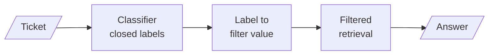
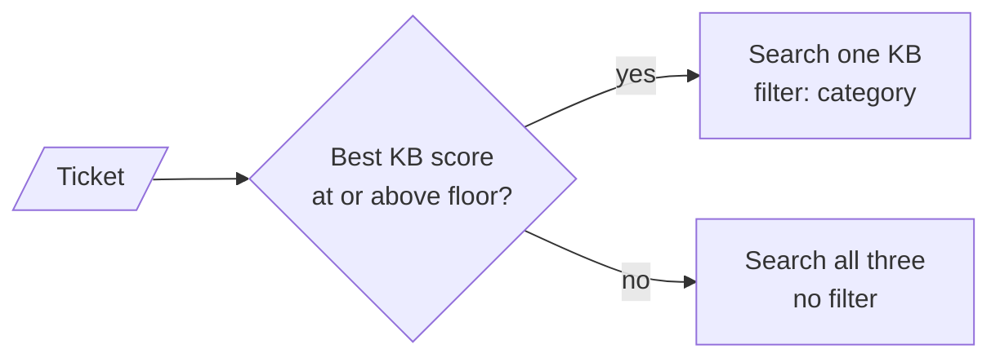
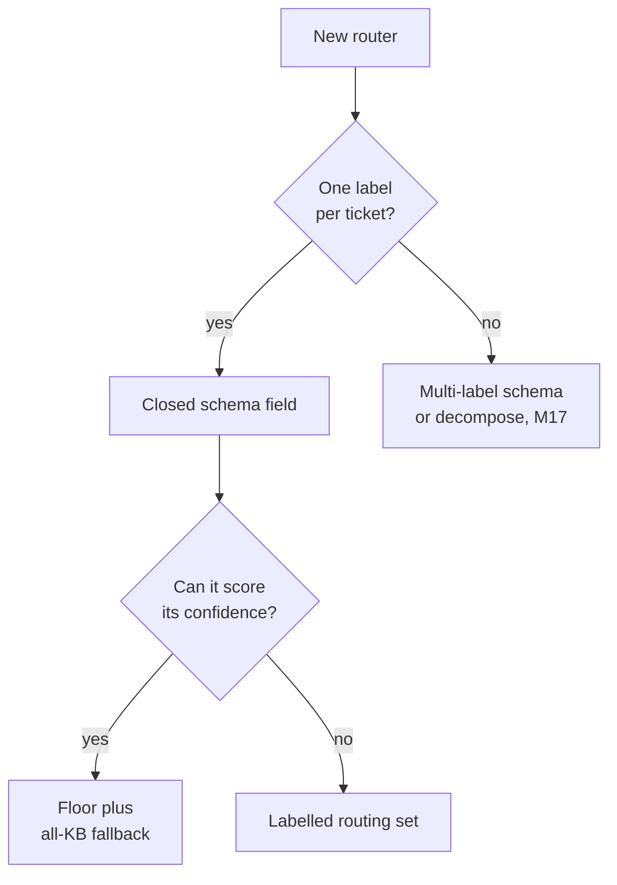

# M30.1 Theory: Router agentic RAG over multiple knowledge bases

*[M30 theory](../README.md) · Lesson 30.1 · Notebooks: [`01a_router_agentic_rag.ipynb`](../../notebook/01a_router_agentic_rag.ipynb), [`01b_router_agentic_rag_modular.ipynb`](../../../optional/notebook/01b_router_agentic_rag_modular.ipynb) (optional) · [All theory pages](../../../../../THEORY.md)*
<!-- subtitle: A closed label set, an exact filter, and a fallback for the routes the classifier gets wrong -->

## Right answer, wrong knowledge base

> **What you'll learn**
>
> - **Explain** why a router's output must come from a closed label set, and what breaks when it does not.
> - **Trace** a support ticket from its label to the metadata filter that limits retrieval.
> - **Diagnose** a silent misroute, a case mismatch and a shared-filter race.
> - **Choose** a confidence floor for an all-knowledge-base fallback, and say what it costs.

M17 introduced routing as one step inside a retrieval pipeline. This module moves the router to the front of the whole graph, so its decision limits everything that runs after it.

A Larkspur customer writes *How long do you keep my data after I cancel?* The retention policy sits in the general knowledge base. The router reads "data", calls the ticket technical, and retrieval searches only the technical chunks. It finds the data-export chunk or nothing, and the customer gets a confident wrong answer or an apology.

Nothing raised an error. The router chose where retrieval was allowed to look, and the answer was somewhere else.

That one failure sets three jobs for the rest of the page:

- **Classify**: turn free text into one label from a fixed set.
- **Filter**: turn the label into the exact metadata value the index stores.
- **Hedge**: decide what to do when the router is unsure.

Every router in this module has the same skeleton:

*Figure 1: The router skeleton. Each arrow is a place where the ticket can be sent the wrong way without an error.*

## Query classification

**A router is a classifier whose output decides where a question goes.** In the 01a notebook it is one LLM call with structured output: the model must fill a schema whose only field is the category, and the field's type lists the three allowed values, Technical, Billing and General.

That type is what makes the label set **closed**. The parser accepts only those three strings, so the routing function downstream can compare against them with no defensive parsing. Here is what the schema does with two candidate outputs:

| Model output | What the schema does | What reaches the router |
|---|---|---|
| `Billing` | Accepts it | Billing |
| `billing` | Rejects it with a literal error | Nothing; the call fails before routing |

*Table 1: A closed label set rejects a near-miss before the router sees it.*

The prompt gives each label a one-line definition, such as "Billing queries will focus more on payment and purchase related aspects". Those definitions are the router's whole specification. A ticket that fits two of them gets whichever label the model leans toward that day.

### Six routers, one shape

Every M30 lesson puts a classifier of this kind in front of something:

| Router | Labels | Field type | What the label decides |
|---|---|---|---|
| General support (30.1) | Technical, Billing, General | Closed | Which knowledge base filter to apply |
| General support (30.1) | Positive, Neutral, Negative | Closed | Escalate to a human or answer |
| Clinic (30.2) | Billing, Appointments, Records, Insurance | Closed | Which department's documents to search |
| Clinic (30.2) | Positive, Neutral, Negative, Distress | Closed | Human support, on-call team or answer |
| Source (30.3) | vectordb, web_search | Closed | Vector store or web search |
| Strategy (30.4) | Factual, Analytical, Opinion, Contextual | Free text | Which retrieval strategy runs |

*Table 2: The M30 routers. Five close their label set; one does not.*

### Planted failure: the open label set

The last row of Table 2 is the one that breaks. The strategy router's field is plain text, and its value is used as a key into a table of four strategies. If the model writes `factual` or `Factual query`, the lookup fails with a key error and the request crashes. We call this an **open label set**: the classifier is allowed to say something the code has no branch for. A closed field turns the same mistake into a rejected parse, which you can retry or default.

### Two calls or one

The 01a notebook classifies category and sentiment in two sequential LLM calls. One call with a two-field schema, as in the lab solution, halves the classification cost; two prompts are easier to test and change separately. Either way, keep the labels you route on in the schema, never in free text you parse afterwards.

### Logical and semantic routing

An LLM classifier is **logical routing** in M17's terms. **Semantic routing** instead compares the question with example text for each route and takes the closest; this page's lab uses it with TF-IDF, because its scores can be checked exactly.

A label is only useful once it reaches the index, which is where the next set of failures hides.

## Multi-KB routing

**Multi-KB routing means each label selects a different knowledge base, and retrieval sees only that one.** In the notebook, the three knowledge bases are not three stores. They are one Chroma collection, compared by cosine distance, where every document carries a `category` field in its metadata. A response node sets a metadata filter on that field before retrieving. The retriever then returns at most three chunks scoring 0.2 or more.

The clinic notebook in lesson 30.2 notes the other design, one vector store per category. Both trust the label equally.

### The label must match the stored value

Chroma compares metadata values exactly. The classifier returns `Technical` and the documents store `technical`, so each response node lowercases the label first. The notebook runs the refund question under three filters:

| Filter value | What the search can return | Why |
|---|---|---|
| `general` | The refund chunks | Matches the stored value |
| `General` | Nothing | Capital G matches no document |
| `technical` | Whatever clears 0.2 among technical chunks, or nothing | This is what a misroute retrieves |

*Table 3: The refund question under three filters.*

Lowercasing works only while labels and stored values differ by case alone; lesson 30.2 needs an explicit mapping.

### Planted failure: the silent misroute

Filtered to the wrong knowledge base, the retriever behaves correctly: it returns whatever clears the threshold there, or nothing, and with no chunks the prompt makes the model apologise. Nothing records that the route was wrong. We call this a **silent misroute**, the default failure of every router in this module. It shows up only downstream: empty retrievals, apology answers, reopened tickets.

### Planted failure: the shared-filter race

The notebook writes the filter onto the retriever object itself, which every request shares. Two requests served at the same time can overwrite each other's filter, so a billing ticket can retrieve technical chunks. We call this the **shared-filter race**. The fix is to pass the filter with each search call, which the LangChain retriever merges over its defaults, and leave the shared object unchanged.

The optional modular notebook binds one response function to all three response nodes, so three prompts become one template. A fourth knowledge base then needs one prompt entry, one node and one routing branch.

### Giving an uncertain route a fallback

The notebook's schema has no "unsure" label, so its classifier must always answer. A router that can abstain needs a confidence score and a rule for what happens below it:

*Figure 2: The confidence floor. Below it, the ticket searches every knowledge base.*

The [interactive lab](interactive/kb-router-lab.html) runs this rule on eighteen Larkspur tickets. Each knowledge base is scored by its best chunk under TF-IDF (scikit-learn's weighting, the M10 lab's index), and the ticket goes to the highest. A fallback always includes the right knowledge base but costs three searches instead of one:

| Floor | Misrouted | Fall back | Reach the right KB | Searches per ticket |
|---|---|---|---|---|
| 0.00 | 3 | 0 | 15 of 18 | 1.00 |
| 0.01 | 2 | 1 | 16 of 18 | 1.11 |
| 0.30 | 2 | 4 | 16 of 18 | 1.44 |
| 0.42 | 0 | 11 | 18 of 18 | 2.22 |

*Table 4: The lab's eighteen tickets at four floors.*

The three misroutes at floor 0.00 fail for three different reasons:

| Ticket | Routed to, score | Why it misroutes | Smallest floor that catches it |
|---|---|---|---|
| *The dashboard keeps logging me out.* | Billing, 0.000 | Shares no term with any chunk; billing is first in the list | Any floor above zero |
| *How long do you keep my data after I cancel?* | Technical, 0.320 | "data" matches the export chunk; the retention chunk says "cancelled", not "cancel", and scores 0.184 | 0.32, when three correct tickets also fall back |
| *My server went down for an hour. Will I be compensated?* | Technical, 0.416 | Reduces to the single word "server" once stop words go ("down" is one), exactly like *How do I restart a server that stopped responding?* | None that spares the right ones: at 0.42, 8 correct tickets fall back with it |

*Table 5: Three misroutes, three causes.*

<!-- lab: interactive/kb-router-lab.html -->

The first row is a **no-signal route**, and its score says so. The third is a **confident misroute**: it scores as high as a correct route, so the router's own confidence cannot find it.

> **Key distinction:** a floor removes no-signal routes cheaply. Confident misroutes need a better classifier (embeddings, an LLM, or several example tickets per route) and a labelled routing set to find them.

## Choosing a router and a floor

The decisions on this page reduce to a short sequence:

*Figure 3: Close the labels first, then decide how to catch the misroutes.*

| | Always route | Floor and fallback | Better classifier |
|---|---|---|---|
| Searches per ticket | 1 | 1.11 to 2.22 in the lab | 1 |
| Catches no-signal routes | ✗ | ✓ | Sometimes |
| Catches confident misroutes | ✗ | Only at high cost | ✓, if the labelled set shows it |
| Main risk | Silent misroute | Fallback swallows correct routes | Cost of labelling and evaluating |

*Table 6: Three ways to live with misroutes.*

The two combine: a low floor such as 0.01 catches tickets that match nothing, and the labelled set shows which confident routes need a better classifier.

## In practice: the Larkspur retention ticket

Back to *How long do you keep my data after I cancel?*, followed through a router built from this page:

1. The closed schema returns Technical, because "data" pulls toward exports.
2. The label maps to the stored value `technical`, and the filter travels with this one search call.
3. Technical scores 0.320, above a floor of 0.01, so the route stands; the router logs the label, the score and the chunks.
4. The answer comes from the export chunk, and the reopened ticket surfaces in the per-route signals.
5. The ticket joins the labelled routing set, and the fix goes into the classifier: an example retention ticket for the general route, or embeddings that match "cancel" to "cancelled".

> **Next lesson:** 30.2 adds a second check in front of the category. Some tickets should not reach any knowledge base at all.

## Key Takeaways

- Close the router's label set in its output schema so code never meets a value it cannot handle. The prompt's one-line label definitions are the router's whole specification.
- Map each label to its exact stored metadata value and pass the filter per call, not onto a shared retriever. A silent misroute leaves no trace, because the wrong knowledge base just returns weaker chunks or none.
- A confidence floor with an all-KB fallback catches no-signal routes, in the lab for 0.11 extra searches per ticket. Confident misroutes need a better classifier and a labelled routing set.

## Check yourself

1. Why can the query-type classifier crash on a label such as factual, while the knowledge-base classifier never returns a label the code cannot handle?

The knowledge-base classifier's field lists the three allowed values, so the parsed output can only be Technical, Billing or General. The query-type classifier's field is free text used as a key into a table of strategies, so `factual` or `Factual query` fails the lookup and crashes the request. A closed field turns the same mistake into a rejected parse instead.

2. The outage-compensation ticket scores 0.416 for technical, the same as a genuine restart ticket. Can a confidence floor catch this misroute?

Not without heavy cost. Once stop words are removed both tickets reduce to "server", so they score the same and no floor separates them; catching it at 0.42 sends 8 correct tickets to the fallback too. It is a confident misroute, so it needs a better classifier and a labelled routing set, since the router's own score cannot find it.

3. Under load, two requests sometimes retrieve from each other's knowledge base. What in the notebook causes this, and what is the fix?

The notebook writes the category filter onto the shared retriever object, so concurrent requests overwrite each other's filter: the shared-filter race. Pass the filter with each search call instead, which the retriever merges over its defaults, and leave the shared object unchanged.

---
*Previous: [M30 overview](../README.md). Next: [30.2 Customer-facing routing with sentiment and human escalation](../../../optional/theory/02_customer_facing_routing_with_sentiment_and_human_escalation/README.md).*
