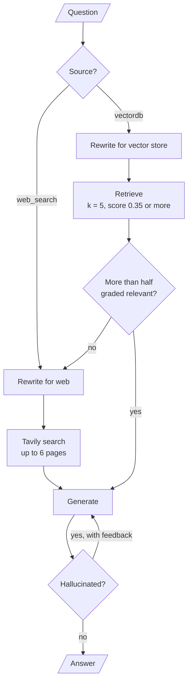
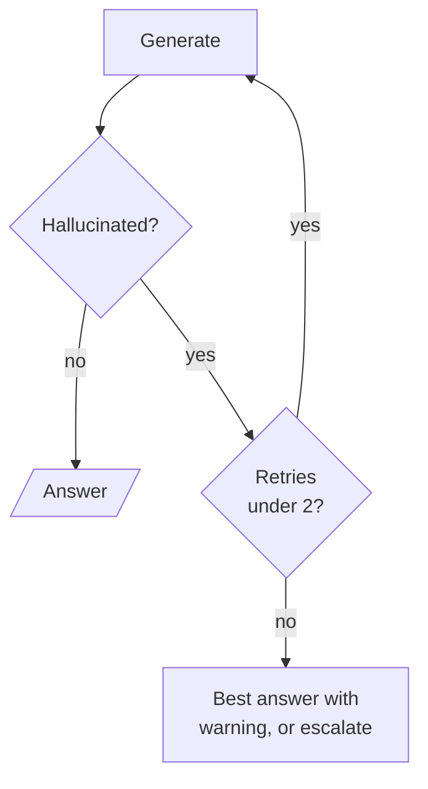

# M30.3 Theory: Adaptive RAG: vector store vs web, with hallucination grading

*[M30 theory](../README.md) · Lesson 30.3 · Notebooks: [`03a_adaptive_rag_langgraph.ipynb`](../../notebook/03a_adaptive_rag_langgraph.ipynb) · [All theory pages](../../../../../THEORY.md)*
<!-- subtitle: Pick a source before retrieving, then check the evidence and the answer, with a limit on every retry -->
<!-- format: approved -->

## Start with a question the handbook only half covers

> **What you'll learn**
>
> - **Explain** how a source router decides between the vector store and the web, and what it knows about the index.
> - **Trace** the relevant-fraction rule that sends a weak retrieval to the web.
> - **Diagnose** an inverted grade and an unbounded regeneration loop.
> - **Compare** the LLM calls each path through the graph spends.

Lessons 30.1 and 30.2 chose a knowledge base or a person. This lesson chooses between two sources, the vector store and the web, and then adds the two checks from M28 and M29 behind that choice.

A Larkspur customer asks how to tune Postgres memory on a Larkspur server. The handbook covers server sizing and memory, and a fixed pipeline retrieves those chunks and answers from them. The chunks say how much memory each plan has, and nothing about Postgres settings. The answer sounds grounded and does not help.

A fixed pipeline does the same work for every question. It has no way to say that the evidence is weak, or to look somewhere else. The graph in this lesson does four jobs a fixed pipeline cannot:

- **Choose a source** before retrieving.
- **Check the evidence** and fall back to the web when it is weak.
- **Check the answer** against the evidence and regenerate when it is unsupported.
- **Stop**, which the notebook's graph leaves out.

## Vector store or web

Adaptive-RAG (Jeong et al., NAACL 2024, [arXiv:2403.14403](https://arxiv.org/abs/2403.14403)) starts from the observation that a fixed pipeline does the same work for an easy question and a hard one. The paper routes by question complexity: no retrieval, one retrieval step or several, chosen by a small classifier trained for the job. The 03a notebook keeps the idea of deciding up front and routes by source instead.

**A source router is a classifier whose labels are data sources.** Here it is one LLM call with a closed schema whose only field allows `vectordb` or `web_search`, the same closed-label pattern as lesson 30.1.

### What the router knows about the index

The router's system prompt lists what the vector store holds: chain-of-thought prompting, transformers and attention, the DINO vision model, diffusion models and parameter-efficient fine-tuning. It asks the model to choose `vectordb` when the question relates to any of them.

That list is the router's only knowledge of the index. Add documents on a new topic and the router keeps sending those questions to the web until someone edits the prompt. We call this the **stale topic list**. For Larkspur, the list would be the handbook's sections: pricing, refunds, exports, outages and server sizing.

### Each route rewrites for its own engine

Each route rewrites the question before searching. The vector-store rewriter makes it concise for semantic search; the web rewriter makes it a search-engine query. The two paths are set up differently:

| Path | How the notebook configures it |
|---|---|
| Vector store | Research-paper PDFs split at 4,000 characters with 300 overlap; Chroma with cosine distance; up to 5 chunks scoring 0.35 or more |
| Web | Tavily search returning up to 6 pages with their full text, at its advanced depth; pages with no content are dropped |

*Table 1: The two retrieval paths in the 03a notebook.*

The whole graph puts the router first and the two graders after retrieval:

<!-- animated: diagrams/adaptive-rag.anim.html -->

*Figure 1: The adaptive RAG graph. A failed document grade joins the web path; a failed answer check loops back to generation.*

The router can be wrong in both directions, and the document grader is what catches the vector-store side of that.

## Grading documents and answers

The graph checks its work twice, once on the evidence and once on the answer. M28 and M29 teach each check on its own; here they sit behind a router.

### The relevant-fraction rule

**The document grader asks the LLM, once per retrieved chunk, whether the chunk is relevant**, and gets a yes or no. The grading node keeps the chunks graded yes and computes the share that passed. If that share is 0.5 or less, the graph sets a web-search flag:

| Chunks retrieved | Graded relevant | Fraction | Next step |
|---|---|---|---|
| 5 | 3 | 0.60 | Generate from the 3 |
| 4 | 2 | 0.50 | Web search, keeping the 2 |
| 5 | 2 | 0.40 | Web search, keeping the 2 |
| 0 | 0 | none | Web search |

*Table 2: The relevant-fraction rule with a threshold of 0.5.*

Exactly half counts as failure. On the web route, the search node appends the pages to the chunks that passed, and the answer can draw on both sources.

### Planted failure: the inverted grade

The hallucination grader reads the answer and the documents and returns a score and a line of feedback. The score is inverted from what most graders use: `yes` means the answer may contain unsupported or contradicting content, and `no` means it is grounded.

| Grader returns | Meaning in this notebook | What the graph does |
|---|---|---|
| `no` | Grounded in the documents | Ends with the answer |
| `yes` | May be unsupported | Returns to generation with the feedback added to the prompt |

*Table 3: The hallucination grader's two outcomes.*

We call this the **inverted grade**. Reuse this grader in a graph that expects `yes` to mean "pass" and every good answer loops while every bad one ships.

### Planted failure: the unbounded regeneration loop

Nothing counts the retries in Figure 1. The regeneration edge has no limit, and a grader that keeps saying `yes` loops until LangGraph's recursion limit stops the graph. In the version this repo locks (langgraph 1.2.18) that limit is 10,007 steps by default. Each round costs two LLM calls, a generation and a check. We call this the **unbounded regeneration loop**.

The fix is a counter in the graph state and a terminal branch:

*Figure 2: The bounded version. Stop after one or two retries and hand the result on.*

Compare the two loops on one question whose answer the grader never accepts.

<button type="button" data-mode="unbounded" aria-pressed="false" aria-controls="loop-unbounded">Unbounded (Figure 1)</button>
<button type="button" data-mode="bounded" aria-pressed="false" aria-controls="loop-bounded">Bounded (Figure 2)</button>

<section id="loop-unbounded" class="mode-panel" data-announcement="Unbounded loop selected. The graph loops until the recursion limit."><h4>Unbounded</h4><ul><li>Rounds: until the recursion limit, 10,007 steps by default.</li><li>Cost: two LLM calls a round, with nothing to stop the bill.</li><li>Result: a recursion error, and the customer gets no answer at all.</li></ul></section>
<section id="loop-bounded" class="mode-panel" data-announcement="Bounded loop selected. The graph stops after two retries."><h4>Bounded</h4><ul><li>Rounds: the first answer plus two retries.</li><li>Cost: four extra LLM calls beyond the first generation and check.</li><li>Result: the best answer with a warning, or lesson 30.2's handoff, triggered by a rejected answer.</li></ul></section>

The notebook tests the loop by uncommenting a hard-coded wrong answer in the generation node. That line sits in the first-attempt branch only, and the retry, which takes the feedback branch, runs the real chain. The test exercises one rejection and one retry with feedback, never a second rejection.

## What each path costs

Counting the LLM calls per path from the graph, before any regeneration:

| Path | LLM calls | Web searches |
|---|---|---|
| Vector store, grading passes | Route, rewrite, up to 5 grades, generate, check: up to 9 | 0 |
| Vector store, grading fails | The same plus a web rewrite: up to 10 | 1 |
| Web from the start | Route, rewrite, generate, check: 4 | 1 |

*Table 4: LLM calls per path, counted from the graph's nodes.*

Each regeneration adds 2 more. A question the router sends to the vector store and the grader then rejects is the most expensive path. We call that the **store-then-web detour**. If many questions take it, the router's topic list is wrong or the index is missing content, and both are cheaper to fix than to grade around.

### Trace the Postgres memory question

Follow the customer tuning Postgres memory through the graph, with a Larkspur topic list in the router's prompt (illustrative; the notebook indexes research papers):

Follow a half-covered question through the router, both graders and the web fallback. Each stage shows the running LLM call count.

<button type="button" data-step="0" aria-pressed="false" aria-controls="pg-step-0">1. Route</button><button type="button" data-step="1" aria-pressed="false" aria-controls="pg-step-1">2. Retrieve</button><button type="button" data-step="2" aria-pressed="false" aria-controls="pg-step-2">3. Grade</button><button type="button" data-step="3" aria-pressed="false" aria-controls="pg-step-3">4. Web</button><button type="button" data-step="4" aria-pressed="false" aria-controls="pg-step-4">5. Generate</button><button type="button" data-step="5" aria-pressed="false" aria-controls="pg-step-5">6. Check</button>

<section id="pg-step-0" class="step-panel" aria-labelledby="pg-heading-0"><h4 id="pg-heading-0">1. Choose a source</h4><dl><dt>Decision</dt><dd>vectordb: "server" and "memory" match the handbook's server-sizing topic</dd><dt>LLM calls so far</dt><dd>1</dd></dl></section><section id="pg-step-1" class="step-panel" aria-labelledby="pg-heading-1"><h4 id="pg-heading-1">2. Rewrite and retrieve</h4><dl><dt>Search</dt><dd>A concise rewrite for semantic search, up to 5 chunks scoring 0.35 or more</dd><dt>LLM calls so far</dt><dd>2</dd></dl></section><section id="pg-step-2" class="step-panel" aria-labelledby="pg-heading-2"><h4 id="pg-heading-2">3. Grade each chunk</h4><dl><dt>Result</dt><dd>Half or fewer pass: plan memory sizes say nothing about Postgres settings</dd><dt>Decision</dt><dd>Set the web flag and keep only the chunks that passed</dd><dt>LLM calls so far</dt><dd>up to 7</dd></dl></section><section id="pg-step-3" class="step-panel" aria-labelledby="pg-heading-3"><h4 id="pg-heading-3">4. Rewrite for the web and search</h4><dl><dt>Search</dt><dd>A search-engine query; Tavily returns up to 6 pages, appended to the surviving chunks</dd><dt>LLM calls so far</dt><dd>up to 8, plus one search</dd></dl></section><section id="pg-step-4" class="step-panel" aria-labelledby="pg-heading-4"><h4 id="pg-heading-4">5. Generate</h4><dl><dt>Context</dt><dd>Handbook chunks and web pages together</dd><dt>LLM calls so far</dt><dd>up to 9, plus one search</dd></dl></section><section id="pg-step-5" class="step-panel" aria-labelledby="pg-heading-5"><h4 id="pg-heading-5">6. Check the answer</h4><dl><dt>On no</dt><dd>The graph ends: the store-then-web detour, at up to 10 LLM calls</dd><dt>On yes</dt><dd>Regenerate with the feedback; with Figure 2's counter, stop after two retries</dd><dt>Cheaper fix</dt><dd>If Postgres questions are common, add a database-tuning page to the handbook and its topic to the router's list</dd></dl></section>

<button type="button" data-walk="previous">Previous</button>

<button type="button" data-walk="next">Next step</button>

> **Interview tip:** asked how to cut this graph's cost, start with the grades. Five per-chunk grading calls are the largest single item, and one call that grades all chunks together, or skipping grading when the top score is high, removes most of them.

## Limits of this evidence

- **Counted, not measured.** Table 4 counts calls from the graph's nodes. The notebook ships without outputs, and how often each path fires depends on the questions and the model.
- **Different corpus.** The notebook indexes research papers. The Postgres trace applies the same graph to the handbook as an illustration.
- **Added design.** The counter in Figure 2 is an addition; the notebook's graph has none.

The next lesson keeps one index and routes the question to a retrieval method instead of a source.

## References

1. Jeong et al., [Adaptive-RAG: Learning to Adapt Retrieval-Augmented Large Language Models through Question Complexity](https://arxiv.org/abs/2403.14403), NAACL 2024.
2. LangGraph, [Graph API: recursion limit](https://langchain-ai.github.io/langgraph/concepts/low_level/#recursion-limit).

## Key Takeaways

- A source router picks the vector store or the web before retrieving. Its prompt's topic list is all it knows of the index: update the prompt whenever you index a new topic.
- The document grader falls back to the web when half or fewer chunks pass. Frequent store-then-web detours mean the topic list or the index is wrong, which is cheaper to fix than to grade around.
- Bound the regeneration loop with a counter in the graph state, because each round costs two LLM calls and nothing else stops it before the recursion limit. A `yes` from this hallucination grader means unsupported.

## Check yourself

1. You index documents on a new topic, but the source router keeps sending questions about it to the web. Why?

The topic list in the router's system prompt is its only knowledge of the index: a stale topic list. Until someone edits that prompt, questions on the new topic do not match the list and go to web search. For Larkspur, the list would be the handbook's sections.

2. Four chunks are retrieved and two are graded relevant. Does the graph generate from them or search the web?

It searches the web, keeping the 2 chunks that passed. The fraction is 0.50 and the rule sends anything at or below 0.5 to the web, so exactly half counts as failure. The web pages are appended to those 2 chunks, so the answer can draw on both sources.

3. The hallucination grader keeps returning yes for one question. What happens, and what should you add?

In this grader `yes` means the answer may contain unsupported content, so the graph returns to generation every time. Nothing counts the retries, so it loops until the recursion limit (10,007 steps by default), at two LLM calls a round. Add a counter to the graph state, stop after one or two retries, and return the best answer with a warning or escalate it.

---
*Previous: [30.2 Customer-facing routing with sentiment and human escalation](../../../optional/theory/02_customer_facing_routing_with_sentiment_and_human_escalation/README.md). Next: [30.4 Strategy per query type](../04_strategy_per_query_type/README.md).*
