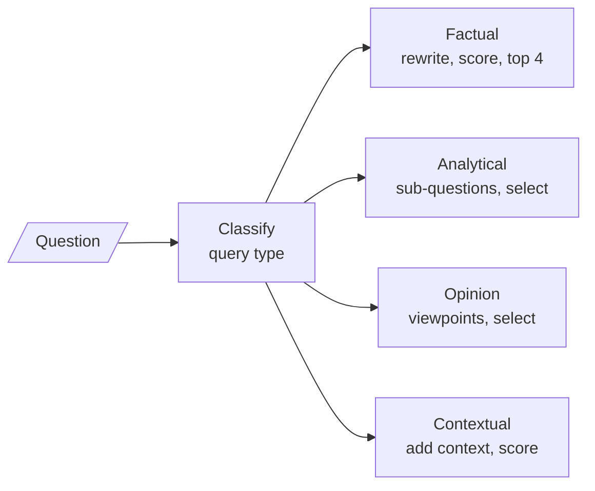

# M30.4 Theory: Strategy per query type

*[M30 theory](../README.md) · Lesson 30.4 · Notebooks: [`04a_adaptive_retrieval_rag_techniques.ipynb`](../../notebook/04a_adaptive_retrieval_rag_techniques.ipynb) · [All theory pages](../../../../../THEORY.md)*
<!-- subtitle: Route the question to a retrieval method, spend LLM calls where it needs them, and prove it helps -->

## One index, four kinds of question

> **What you'll learn**
>
> - **Explain** how a type router differs from the routers that pick a place.
> - **Compare** the four strategies by what they retrieve and how many LLM calls they spend.
> - **Diagnose** four faults in the notebook's code before you reuse it.
> - **Choose** a corpus and a baseline that can show whether the routing helps.

Lessons 30.1 to 30.3 route a question to a place: a knowledge base, a person, the web. This lesson keeps one index and routes the question to a method.

Three Larkspur questions reach the same handbook index. *How long does a refund take?* needs one chunk, found precisely. *Should we move from monthly to annual billing?* needs the billing cycle, the refund window and cancellation, three chunks a single query may not reach together. *Which server size do I need?* depends on the customer's peak memory use, which is not in the question at all.

Plain top-k retrieval runs the same search for all three. It serves the first well, the second partly, and the third with a size table and no way to choose from it.

The jobs for this page:

- **Classify** the question by what kind of answer it wants.
- **Retrieve** with a method that fits that kind.
- **Pass the user's situation** to the method that needs it.
- **Measure** whether any of this beats plain top-k.

## Per-query strategy

**A per-query strategy router labels each question Factual, Analytical, Opinion or Contextual, and runs a different retrieval strategy for each label over the same index.** The idea is to spend retrieval work where the question needs it: precision for a fact, coverage for an analysis, spread for an opinion, the user's situation for a contextual question.

The router is one classifier call in front of four strategies:

*Figure 1: The type router. Every branch searches the same index; only the method changes.*

Each strategy turns the question into searches differently:

| Type | What the question wants | How the strategy retrieves |
|---|---|---|
| Factual | One verifiable fact | Rewrites the query, retrieves 8 chunks, has the LLM score each from 1 to 10, keeps the top 4 |
| Analytical | An explanation that covers several aspects | Generates 4 sub-questions, retrieves 2 chunks for each, has the LLM pick the 4 most diverse and relevant |
| Opinion | Several viewpoints | Has the LLM name 3 viewpoints, retrieves 2 chunks for each, has the LLM pick 3 representative ones |
| Contextual | An answer for this user | Rewrites the query with the user's context, retrieves 8 chunks, scores each against query and context, keeps the top 4 |

*Table 1: The four strategies in the 04a notebook.*

### What each strategy costs

The strategies differ most in how they spend LLM calls. Counting from the code, with the classifier and the final answer included:

| Type | Classify | Plan or rewrite | Per-chunk scores | Select | Answer | Total |
|---|---|---|---|---|---|---|
| Factual | 1 | 1 | up to 8 | 0 | 1 | Up to 11 |
| Analytical | 1 | 1 | 0 | 1 | 1 | 4 |
| Opinion | 1 | 1 | 0 | 1 | 1 | 4 |
| Contextual | 1 | 1 | up to 8 | 0 | 1 | Up to 11 |

*Table 2: LLM calls per question by type.*

The factual and contextual strategies score chunks one call at a time, so their cost grows with the number retrieved. The analytical and opinion strategies spend one call to plan the searches and one to select, whatever the number of chunks. We call the first pattern **per-chunk scoring**: it is the most precise and the most expensive, and it is the line to cut first when cost matters.

### The four types on the Larkspur handbook

Applied to the running example, the labels pick these methods:

| Question | Type | What the strategy needs to find |
|---|---|---|
| *How long does a refund take?* | Factual | The one refund-timing chunk; precision matters more than coverage |
| *Should we move from monthly to annual billing?* | Analytical | Billing cycle, refund window and cancellation together |
| *Is the starter plan good enough for a small shop?* | Opinion | Little: a handbook states policies, not opinions, so the honest answer lists the facts that bear on the choice |
| *Which server size do I need?* | Contextual | The size table, read against the customer's peak memory use passed in as context |

*Table 3: Four handbook questions and the strategy each one gets.*

The opinion row is a useful warning. A strategy built to find viewpoints finds little in a corpus that has none, so the label set should match what the corpus can answer.

## Four faults to fix before reuse

The notebook's code runs the idea, but four faults stop it working as written. Each is a planted failure worth knowing:

| Fault | What happens | Fix |
|---|---|---|
| **Open label set** | The classifier's label is free text used as a key into the table of strategies; any other spelling raises a key error | A closed field, as in lesson 30.1 |
| **The split crash** | The opinion selection call already returns a list of integers, and the code then splits it as if it were text, which raises an attribute error | Iterate over the list |
| **Dropped context** | The contextual strategy accepts the user's context, but the wrapper calls every strategy with the query alone, so it always runs with "No specific context provided" | Pass the context through the wrapper |
| **Four indexes** | Each strategy splits the texts at 800 characters with no overlap, embeds them and builds its own FAISS index, so the corpus is embedded four times at start-up | Build one index and share it |

*Table 4: The four faults in the 04a code.*

The opinion strategy has one more quirk. It splits the LLM's viewpoint reply on line breaks, so the number of searches follows the number of lines the model writes, not the 3 it was asked for.

Dropped context is the quietest of the four. The contextual path runs, returns chunks and answers, so nothing looks broken; it has simply stopped being contextual.

## A corpus that can show a difference

The notebook's demo corpus is one sentence about the Earth. Every search returns that one chunk, so the four strategies cannot retrieve different evidence and the demo cannot show that the routing helps. It also hides the cost: with one chunk, per-chunk scoring makes one call where a real corpus would make up to 8.

To see a difference, run the four sample questions over a real corpus and compare each strategy against plain top-k retrieval on the same golden set, the way M10 sets a baseline. We call a test that cannot fail a **flat demo**: whatever the strategy, the output is the same.

### Two axes of routing

The Adaptive-RAG paper behind lesson 30.3 routes on a different axis, question complexity: no retrieval, one step or several. The two combine:

| Router | Decides | Example on the handbook |
|---|---|---|
| Complexity | How many rounds of retrieval to run | One round for the refund question, several for the billing comparison |
| Type | What each round looks for | Precision for the refund question, coverage for the billing comparison |

*Table 5: Complexity routing and type routing answer different questions.*

## In practice: the Larkspur server-size question

A customer asks *Which server size do I need?* and their account shows a peak of 16 GB of memory. Followed through a type router with the four faults fixed (illustrative; the notebook does not run this case):

1. The closed classifier returns Contextual.
2. The wrapper passes the question and the customer's context, so the rewrite reads "which server size fits a peak memory use of 16 GB".
3. The strategy retrieves 8 chunks from the shared index and scores each against the question and the context, keeping the top 4. The size table ranks first.
4. The answer reads the table against 16 GB and names a size.
5. The evaluation compares this answer with plain top-k on the same golden question. Top-k returns the size table too, but answers without the customer's memory, so it cannot pick a size.

That comparison is the evidence the notebook's demo cannot give, at the price of up to 11 LLM calls against plain top-k's 1.

## Key Takeaways

- A type router sends each question to a retrieval method over the same index. Factual questions get precision, analytical ones coverage, opinions spread and contextual questions the user's situation.
- Cost follows the method. Per-chunk scoring takes up to 11 LLM calls per question, while planning the searches and selecting once takes 4.
- Before reusing the notebook, close the label set, pass the user's context through and share one index. Prove the routing helps by comparing each strategy with plain top-k on a golden set.

## Check yourself

1. What does the per-query strategy router choose, compared with the routers in the earlier lessons of this module?

The earlier routers send a question to a place: a knowledge base, a person or the web. This one sends it to a method over the same index, spending retrieval work where the question needs it: precision for a fact, coverage for an analysis, spread for an opinion, the user's situation for a contextual question.

2. A Larkspur customer asks whether to move from monthly to annual billing. Which query type is it, and how does that strategy retrieve?

Analytical. The answer needs the billing cycle, the refund window and cancellation, three chunks a single query may not reach together. The strategy generates 4 sub-questions, retrieves 2 chunks for each and has the LLM pick the 4 most diverse and relevant, for 4 LLM calls in all.

3. In the notebook's demo all four strategies return the same evidence. Does that show routing by query type does not help?

No. The demo corpus is one sentence about the Earth, so every search returns that one chunk and the strategies cannot differ: a flat demo. Run the four sample questions over a real corpus and compare each strategy with plain top-k retrieval on the same golden set, the way M10 sets a baseline.

---
*Previous: [30.3 Adaptive RAG: vector store vs web, with hallucination grading](../03_adaptive_rag_vector_store_vs_web_with_hallucination_grading/README.md). Next: [M30 interview questions](../README.md#interview-spotlight-5-questions-you-might-get-asked).*
