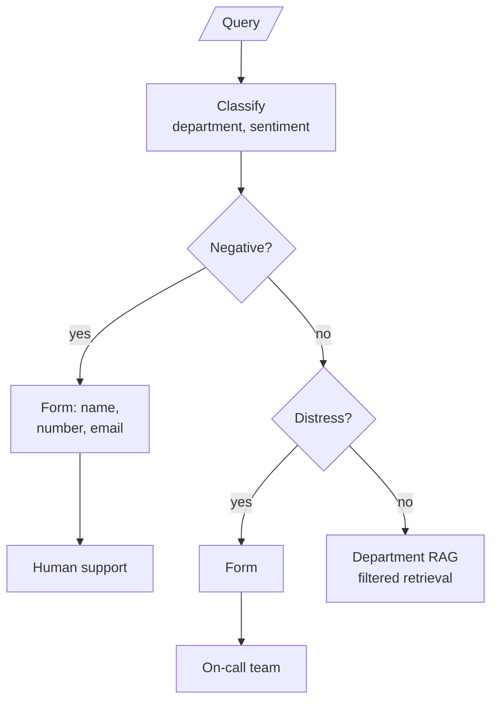

# M30.2 Theory: Customer-facing routing with sentiment and human escalation

*[M30 theory](../../../mandatory/theory/README.md) · Lesson 30.2 · Notebooks: [`02a_healthcare_router_agentic_rag.ipynb`](../../notebook/02a_healthcare_router_agentic_rag.ipynb) (optional) · [All theory pages](../../../../../THEORY.md)*

## Human-in-the-loop escalation

An unhappy Larkspur customer and a customer with a production outage need different handoffs. You will apply escalation before knowledge-base routing, inspect the context sent to a person, and replace a waiting form loop with a resumable decision.

### Step 1: Apply escalation before answering

Some tickets should not be answered by retrieval at all. An angry customer wants a person. A customer in an emergency needs one now. Both routers handle this by classifying sentiment as well as topic and checking sentiment first.

In this implementation, `determine_route` reads:

Implementation excerpt from the configured application. The practice material supplies its models, data and session setup:

```text
if support_state["query_sentiment"] == "Negative":
    return "escalate_to_human_agent"
elif support_state["query_category"] == "Technical":
    ...
```

The order is the policy. A negative billing ticket never reaches the billing knowledge base, however well the router would have classified it. the implementation's `escalate_to_human_agent` returns a fixed apology and notifies nobody; it marks where a real handoff goes.

### Step 2: Separate the handoff targets

The clinic support router builds that handoff for a clinic's support desk. It routes four departments (Billing, Appointments, Records, Insurance) and four sentiments, with a rule in the sentiment prompt that "Distress" applies "only when the customer is facing a health emergency":



Three parts of the design carry over to any support desk:

- **Two escalation targets.** Negative goes to the support queue; Distress goes to on-call doctors. For Larkspur the same split separates an unhappy customer (support) from a production server down right now (the on-call engineer). Each target gets its own form and its own message back to the customer.
- **Each label maps to a filter value.** The classifier returns `Records`; the documents are stored under `medical_records`. `generate_department_response` holds an explicit mapping from label to filter value, which is safer than lowercasing and hoping the strings agree.
- **The handoff carries context.** The form collects name, number and email into `escalation_cust_info` (or `oncall_cust_info`), and the escalation node writes them into the reply. A production handoff should also pass the query, both labels and anything already retrieved, so the person does not start from zero.

### Step 3: Pause without holding a worker

The implementation's form node displays Jupyter widgets and then loops, polling UI events with a 0.3-second sleep, until the Submit button sets a flag. The node holds the graph open the whole time. That works in a notebook. In a service it ties up a worker per waiting customer, and a restart loses every form in progress.

Both implementations already compile their graphs with a `MemorySaver` checkpointer and run each conversation under a `thread_id`. That is what LangGraph's `interrupt()` needs (M09): the node calls `interrupt(...)` with the form it wants filled, the graph saves its state and returns, and a later call with `Command(resume=form_values)` on the same thread continues from that node. Nothing waits in memory, and with a persistent checkpointer the paused ticket survives a restart.

### Step 4: Test missed and needless escalation

Sentiment is a proxy for "a person should handle this". It misses a calm customer with an urgent problem and catches a sarcastic one with a simple question. Count both errors on labelled tickets before trusting it:

| Error | What it costs at Larkspur | How to see it |
|---|---|---|
| Missed escalation | A customer with a production outage gets a handbook answer | Tickets reopened or escalated by the customer after an automated answer |
| Needless escalation | An agent's time on a question the handbook answers | Escalated tickets an agent closes with a handbook link |

Other triggers belong beside sentiment: a router that fell back to searching every knowledge base, an answer the hallucination grader rejected (lesson 30.3), or the same customer asking the same question twice.

### Try it yourself

Use a calm report of a production outage and an angry question whose answer is in the handbook. Decide what sentiment alone would miss or over-escalate. Check the design against both errors in the table, then name the query, labels and contact details a real handoff must retain.

### Practice notebook

Run the complete implementation from the practice material after checking the trace or calculation above. Use its stated environment for live model or server calls; recorded model choices and timings are observations, not guaranteed outputs.

- [Healthcare router agentic RAG](../../notebook/02a_healthcare_router_agentic_rag.ipynb).

## Key Takeaways

- Check sentiment before topic so an angry or distressed customer reaches a person, not the knowledge base. Give each kind of escalation its own target, such as support for unhappy customers and on-call for live outages.
- Pass the query, both labels and anything retrieved with the handoff. Wait for the person with `interrupt()` and a checkpointer, not a polling loop that holds a worker open.
- Sentiment is only a proxy for needing a person. Count missed and needless escalations on labelled tickets, and add triggers such as a fallback search, a rejected answer or a repeated question.

## Check yourself

<details>
<summary>1. Why does the router check sentiment before it checks the topic?</summary>

The order is the policy. Checked first, a negative ticket goes to a person and never reaches the knowledge base, however well the router would have classified its topic. An angry customer wants a person, not a retrieved answer.

</details>

<details>
<summary>2. A calm Larkspur customer writes that their production server is down right now. Where should it go, and what risk does sentiment-only routing carry?</summary>

To the on-call engineer, the Larkspur equivalent of the clinic's Distress route. Sentiment misses a calm customer with an urgent problem, so this ticket may get a handbook answer: a missed escalation. Count it from tickets the customer reopens or escalates after an automated answer, and add triggers beside sentiment.

</details>

<details>
<summary>3. The clinic notebook's form node polls widgets in a loop until Submit is pressed. Why does that fail in a service, and what replaces it?</summary>

The node holds the graph open, so it ties up a worker per waiting customer, and a restart loses every form in progress. Use `interrupt()`: the node pauses with the form it needs, the state is saved under the `thread_id`, and `Command(resume=form_values)` continues later. With a persistent checkpointer the paused ticket survives a restart.

</details>

---
*Previous: [30.1 Router agentic RAG over multiple knowledge bases](../../../mandatory/theory/01_router_agentic_rag_over_multiple_knowledge_bases/README.md). Next: [30.3 Adaptive RAG: vector store vs web, with hallucination grading](../../../mandatory/theory/03_adaptive_rag_vector_store_vs_web_with_hallucination_grading/README.md).*
