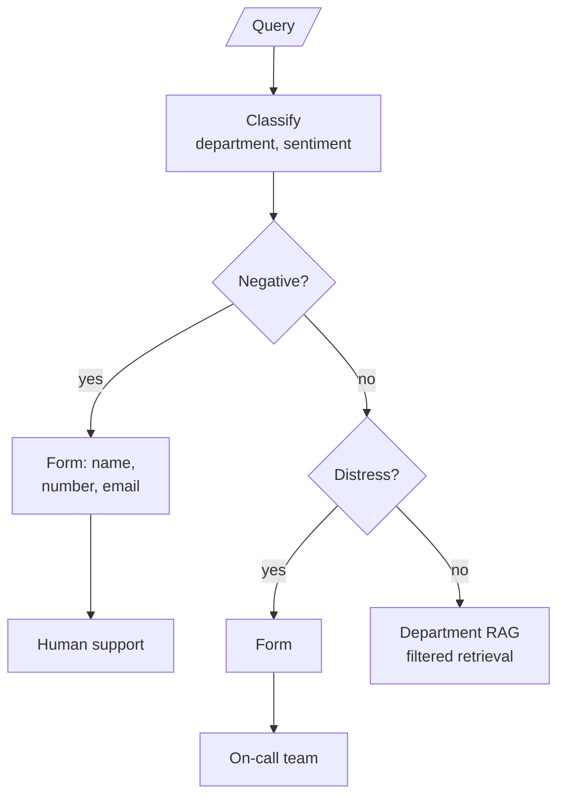
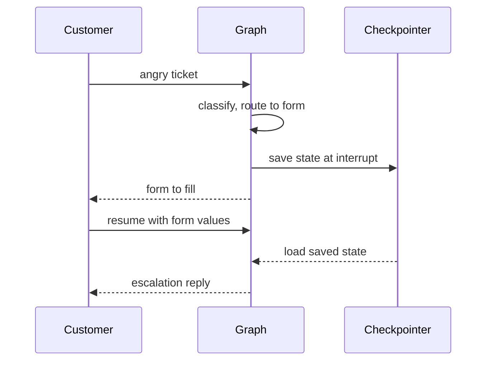

# M30.2 Theory: Customer-facing routing with sentiment and human escalation

*[M30 theory](../../../mandatory/theory/README.md) · Lesson 30.2 · Notebooks: [`02a_healthcare_router_agentic_rag.ipynb`](../../notebook/02a_healthcare_router_agentic_rag.ipynb) (optional) · [All theory pages](../../../../../THEORY.md)*
<!-- subtitle: Check who should answer before checking what the ticket is about, and hand off without blocking -->

## Tickets that need a person

> **What you'll learn**
>
> - **Explain** why escalation is checked before the topic, and why that order is the policy.
> - **Compare** two escalation targets and what each handoff must carry.
> - **Diagnose** a form loop that blocks a worker, and replace it with a pause that survives a restart.
> - **Choose** escalation triggers by counting missed and needless escalations.

Lesson 30.1 sent every ticket to a knowledge base. That assumes the right reply is always a retrieved answer.

Two Larkspur tickets break the assumption. One customer writes, angrily, that they were billed twice; the billing knowledge base explains double charges perfectly, and the customer wants a person. Another writes, calmly, that their production server has been down for an hour. The technical knowledge base has a restart guide, and the customer needs the on-call engineer now.

A topic router sends both to retrieval and both get a polite handbook answer. The topic was right each time. The question of who should reply was never asked.

So this lesson adds four jobs in front of the topic route:

- **Detect**: decide whether a person should handle the ticket.
- **Direct**: pick which person, since an unhappy customer and an emergency need different teams.
- **Hand off**: pass what the person needs to start without asking again.
- **Wait**: pause the graph until the person or the customer responds, without tying anything up.

## Human-in-the-loop escalation

**Human-in-the-loop escalation means the graph hands a ticket to a person instead of answering it, based on a check that runs before retrieval.** Both routers in this module classify sentiment as well as topic, and the routing function reads sentiment first: a Negative ticket goes to escalation, and only the rest are routed by category.

The order is the policy. A negative billing ticket never reaches the billing knowledge base, however well the router would have classified it. In the 01a notebook the escalation node returns a fixed apology and notifies nobody; it marks where a real handoff goes.

The optional clinic notebook builds that handoff for a clinic's support desk. It routes four departments (Billing, Appointments, Records, Insurance) and four sentiments, with a rule in the sentiment prompt that Distress applies "only when the customer is facing a health emergency":

*Figure 1: The clinic router. Two sentiment checks come before any department is searched.*

Four tickets show how the checks resolve. The labels are what the prompts are written to produce; the run itself depends on the model:

| Ticket | Department | Sentiment | Where it goes |
|---|---|---|---|
| A complaint about a wrong bill | Billing | Negative | Human support form |
| Chest pain while waiting for an appointment | Appointments | Distress | On-call form |
| A request for test results | Records | Neutral | Records documents |
| A question about coverage | Insurance | Positive | Insurance documents |

*Table 1: Four clinic tickets through the two checks (illustrative).*

### Two escalation targets

Negative goes to the support queue; Distress goes to on-call doctors. Each target gets its own form and its own message back to the customer. For Larkspur the same split separates an unhappy customer (support) from a production server down right now (the on-call engineer).

### Each label maps to an explicit filter value

The clinic classifier returns `Records`, while the documents are stored under `medical_records`. Lowercasing the label, as in lesson 30.1, would produce `records` and match nothing. The department response node holds an explicit mapping instead:

| Label | Filter value | Department named in the prompt |
|---|---|---|
| Billing | `billing` | Billing |
| Appointments | `appointments` | Appointments |
| Records | `medical_records` | Medical Records |
| Insurance | `insurance` | Insurance |

*Table 2: The clinic's label-to-filter mapping. Only the Records row would fail under lowercasing.*

An explicit table is safer than lowercasing and hoping the strings agree, because a new label with no row fails loudly at the mapping step.

### The handoff carries context

Each form writes what the person needs into the graph state, and the escalation node writes it into the reply:

| Target | Form fields | State key | Reply to the customer |
|---|---|---|---|
| Human support | Name, number, email | `escalation_cust_info` | Someone will email, and call if needed |
| On-call team | Name, number | `oncall_cust_info` | A doctor will call shortly |

*Table 3: What each escalation path collects.*

The emergency form asks for less, because the callback is the point. A production handoff should also pass the query, both labels and anything already retrieved, so the person does not start from zero.

### Planted failure: the blocking form

The clinic notebook's form node displays Jupyter widgets and then loops, polling UI events with a 0.3-second sleep, until the Submit button sets a flag. The node holds the graph open the whole time. That works in a notebook. In a service it ties up a worker per waiting customer, and a restart loses every form in progress. We call this the **blocking form**.

Both notebooks already compile their graphs with a `MemorySaver` checkpointer and run each conversation under a `thread_id`. That is what LangGraph's `interrupt()` needs (M09). The node calls it with the form it wants filled, the graph saves its state and returns, and a later call on the same thread resumes with the form values:

*Figure 2: The interrupt pattern. Nothing waits in memory between the two calls.*

With a persistent checkpointer in place of the in-memory one, the paused ticket survives a restart.

| | Polling loop | `interrupt()` and resume |
|---|---|---|
| Worker held while waiting | ✓ | ✗ |
| Survives a restart | ✗ | ✓, with a persistent checkpointer |
| Works outside a notebook | ✗ | ✓ |
| Needs a `thread_id` | ✗ | ✓ |

*Table 4: Two ways to wait for a person.*

## Counting missed and needless escalations

Sentiment is a proxy for "a person should handle this". It misses a calm customer with an urgent problem and catches a sarcastic one with a simple question. Count both errors on labelled tickets before trusting it:

| Error | What it costs at Larkspur | How to see it |
|---|---|---|
| **Missed escalation** | A customer with a production outage gets a handbook answer | Tickets reopened or escalated by the customer after an automated answer |
| **Needless escalation** | An agent's time on a question the handbook answers | Escalated tickets an agent closes with a handbook link |

*Table 5: The two escalation errors and where each shows up.*

The two errors pull in opposite directions. A looser trigger cuts missed escalations and raises needless ones, so the threshold is a staffing decision as much as a model decision.

### Triggers beside sentiment

Sentiment is one signal among several the graph already has:

- **Sentiment**: Negative or an emergency label, as in both notebooks.
- **Fallback search**: the router fell back to searching every knowledge base (lesson 30.1), so it was unsure of the topic.
- **Rejected answer**: the hallucination grader rejected the answer (lesson 30.3).
- **Repeat**: the same customer asked the same question twice.

Each extra trigger reduces missed escalations and adds some needless ones, which Table 5's counts will show.

## In practice: the calm outage report

A Larkspur customer writes *Our production server has been unreachable since 9am, can you look?* Followed through a router built from this page:

1. The sentiment check reads a polite message and returns Neutral. A Negative-only rule would send it on to the technical knowledge base.
2. A Larkspur version of the clinic's Distress label, "a production service is down now", catches it and routes to the on-call engineer.
3. The graph interrupts with a short form, name and callback number, and returns. No worker waits.
4. The customer submits; the graph resumes on the same thread and passes the query, both labels and the contact details to on-call.
5. If the first rule had missed it, the reopened ticket would count as a missed escalation in Table 5, and the label definition would be the thing to fix.

> **Next lesson:** 30.3 routes between two sources instead of two audiences, and checks the evidence and the answer after retrieval.

## Key Takeaways

- Check escalation before topic so an angry or distressed customer reaches a person, not the knowledge base. Give each kind of escalation its own target, such as support for unhappy customers and on-call for live outages.
- Map each label to its filter value explicitly, and pass the query, both labels and anything retrieved with the handoff. Wait for the person with `interrupt()` and a checkpointer, not a blocking form.
- Sentiment is only a proxy for needing a person. Count missed and needless escalations on labelled tickets, and add triggers such as a fallback search, a rejected answer or a repeated question.

## Check yourself

1. Why does the router check sentiment before it checks the topic?

The order is the policy. Checked first, a negative ticket goes to a person and never reaches the knowledge base, however well the router would have classified its topic. An angry customer wants a person, not a retrieved answer.

2. A calm Larkspur customer writes that their production server is down right now. Where should it go, and what risk does sentiment-only routing carry?

To the on-call engineer, the Larkspur equivalent of the clinic's Distress route. Sentiment misses a calm customer with an urgent problem, so this ticket may get a handbook answer: a missed escalation. Count it from tickets the customer reopens or escalates after an automated answer, and add triggers beside sentiment.

3. The clinic notebook's form node polls widgets in a loop until Submit is pressed. Why does that fail in a service, and what replaces it?

The node holds the graph open, so it ties up a worker per waiting customer, and a restart loses every form in progress. Use `interrupt()`: the node pauses with the form it needs, the state is saved under the `thread_id`, and a later call on the same thread resumes with the form values. With a persistent checkpointer the paused ticket survives a restart.

---
*Previous: [30.1 Router agentic RAG over multiple knowledge bases](../../../mandatory/theory/01_router_agentic_rag_over_multiple_knowledge_bases/README.md). Next: [30.3 Adaptive RAG: vector store vs web, with hallucination grading](../../../mandatory/theory/03_adaptive_rag_vector_store_vs_web_with_hallucination_grading/README.md).*
