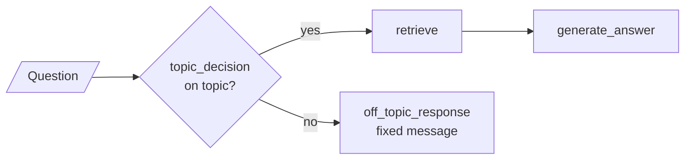
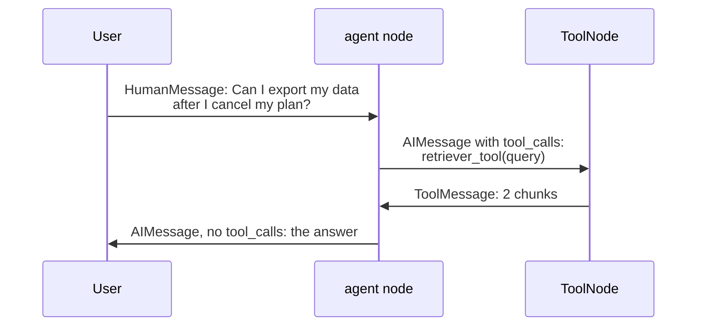
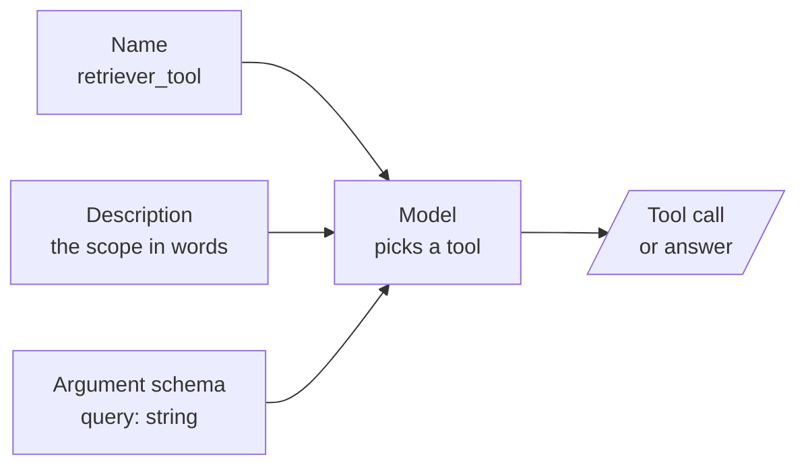

# M31.1 Theory: RAG as a tool inside a LangGraph agent

*[M31 theory](../README.md) · Lesson 31.1 · Notebooks: [`01a_rag_as_tool_in_agents.ipynb`](../../notebook/01a_rag_as_tool_in_agents.ipynb) · [All theory pages](../../../../../THEORY.md)*
<!-- subtitle: Who decides to search, what the model reads before it does, and how to measure a tool description -->
<!-- format: approved -->

## Start with a refund answer that cites nothing

> **What you'll learn**
>
> - **Compare** a graph where the pipeline decides to retrieve with one where the model decides through a tool call.
> - **Explain** what a retriever tool hands back to the model, and why the sources go missing.
> - **Measure** tool descriptions on a routing golden set and on held-out questions.
> - **Diagnose** the planted routing failures: a vocabulary miss, a scope gap and an overfitted description.

M22 built the agent loop, and [M30](../../../../m30_adaptive_rag_routing/mandatory/theory/README.md) routed questions inside a fixed graph where code decided whether to retrieve. This lesson puts the retriever inside the loop and hands that decision to the model.

A Larkspur customer asks *How long does a refund take?* The support agent has a `handbook_search` tool, and the handbook says refunds take 5 to 10 business days. The agent gives a confident, generic answer with no citation. The trace shows one model call and no tool call.

Two things can cause it. Either the graph gave the model the decision and the model declined it, or the description gave the model no reason to pick the tool. This page takes them in that order.

## Agent-decided retrieval

### Two graphs over one retriever

The notebook builds two graphs over one retriever: four short documents about a fictional cafe in Chroma, searched with `k = 2`. In the first, the pipeline decides. A classifier node, `topic_decision`, asks the model a yes or no question with structured output. A conditional edge then sends the question either to `retrieve` and `generate_answer` or to a fixed off-topic reply:

*Figure 1: The pipeline decides. Every on-topic question is retrieved exactly once, with the user's words as the query.*

### The model decides

**Agent-decided retrieval** means the retriever is one of the model's tools, and the model chooses whether to call it, how often and with which query. In the second graph the retriever becomes `retriever_tool`, beside an `off_topic` tool for unrelated questions. The `agent` node calls the model and `ToolNode` runs the tools it asked for. The run loops back to `agent` while the reply carries tool calls and ends when it carries none:

*Figure 2: The model decides. The retriever runs only because the model's reply asked for it.*

Both graphs spend two model calls on a handbook question: classify then generate in the first, tool call then answer in the second. They differ in who decides and in what the retriever receives:

| | Pipeline decides | Model decides |
|---|---|---|
| The retrieval decision | `topic_decision`, then fixed edges | the model, through `tool_calls` |
| What the decision reads | the classifier's system prompt | each tool's name, description and argument schema |
| Query sent to the retriever | the user's message, unchanged | the `query` argument the model writes |
| Retrievals per question | 0 or 1 | 0, 1 or more, because `tools` loops back to `agent` |
| Unrelated questions | `off_topic_response`, a fixed message | the `off_topic` tool, or a direct answer |

*Table 1: The two graphs compared on the same retriever.*

The model-decided graph handles small talk with no retrieval, rewrites a follow-up into a better query, and searches again when the first chunks miss. It pays with a decision you no longer control in code. Each graph has its own way to miss the handbook on the opening question:

Send the refund question through each graph and compare where the handbook can be missed. Scripted illustration on the Larkspur handbook.

<button type="button" data-mode="pipeline" aria-pressed="false" aria-controls="decider-pipeline">Pipeline decides</button>
<button type="button" data-mode="model" aria-pressed="false" aria-controls="decider-model">Model decides</button>

<section id="decider-pipeline" class="mode-panel" data-announcement="Pipeline decides. The classifier can veto retrieval."><h4>Pipeline decides</h4><ul><li>The classifier answers yes, and retrieve searches with the user's exact words.</li><li>If it answers no, the handbook is never searched and the customer gets the fixed off-topic reply.</li></ul>
Failure: a <strong>classifier veto</strong>. Two model calls when it passes, one when it vetoes.
</section>
<section id="decider-model" class="mode-panel" data-announcement="Model decides. The model can skip the tool."><h4>Model decides</h4><ul><li>The model reads the tool descriptions and may call handbook_search with a query it writes, such as "refund timing".</li><li>If nothing in the descriptions points at refunds, it answers from its training data.</li></ul>
Failure: a <strong>silent skip</strong>. One model call and nothing to cite, the trace from the opening.
</section>

We call the second failure a **silent skip**: the model answers a policy question without calling `handbook_search`, from its training data, with nothing to cite. Its mirror in the fixed graph is the **classifier veto**: a no from `topic_decision`, and the handbook is never searched.

### What the tool hands back

A retriever tool turns a list of Documents into one message, and that step can lose the sources. The standard wrapper, `create_retriever_tool`, joins the chunk texts with a blank line and drops each Document's metadata. We wrapped a fixed retriever that returns one chunk, *Refunds take 5 to 10 business days.*, tagged `refund-timing`, three ways:

| Wrapper setting | What the model receives | Source visible to |
|---|---|---|
| Default | the chunk text only | nobody |
| A document prompt that prints the source | `refund-timing: Refunds take 5 to 10 business days.` | the model |
| Content plus artifact | the chunk text, with the full Documents kept beside it | your code, not the model |

*Table 2: One chunk through three wrapper settings (run against the installed `langchain_core` 1.7.0).*

We call the default row's failure the **lost source**: the model quotes a correct policy and cannot say where it came from. Print the source into each chunk when the answer must cite, and keep the artifact when your code checks citations.

Getting the evidence back intact matters only once the model has chosen the tool, and that choice rests on the description.

## Tool descriptions

A **tool description** is the short text the model reads to decide whether a tool fits the question. When the model picks a tool it sees three things per tool and nothing else:

*Figure 3: The model's whole view of a tool. It never sees the documents behind it.*

In the notebook the description reads *Information related to pricing, hours, or the founder of Cafe Lumiere*, over one `query` string argument. That sentence now carries the scope the first graph kept in its classifier prompt. It also has to separate the retriever from every other tool the model can call.

### Measuring routing with a stand-in router

The [interactive lab](interactive/tool-routing-lab.html) gives the Larkspur agent `handbook_search` and `web_search` and routes twenty golden questions (ten for the handbook, six for the web, four for no tool) plus five held out. Its router stands in for the model: the M10 TF-IDF retriever scores each question against the two descriptions and picks the higher, or no tool when neither shares a word. On all 100 preset and question pairs its scores match scikit-learn's `TfidfVectorizer` to within 2e-16:

| Descriptions | Golden set, of 20 | Sent to the wrong tool | Held out, of 5 | Tokens per call |
|---|---|---|---|---|
| Names only: "Search tool." for both | 4 | 0 | 0 | 6 |
| Vague: "Information related to Larkspur Cloud plans and pricing." | 5 | 0 | 0 | 20 |
| Specific: the topics each tool covers | 15 | 1 | 2 | 84 |
| Tuned: Specific plus words taken from the golden questions | 19 | 0 | 4 | 133 |

*Table 3: Routing scores for the four description presets. Tokens are the lab's estimate of four characters per token.*

- **Names only** gets right only the four questions that needed no tool. The other sixteen are silent skips.
- **Vague** catches *When are monthly plans billed?* on "plans" and nothing else. *Can I export my data after I cancel my plan?* misses because TF-IDF treats "plan" and "plans" as different words.
- **Specific** gets three handbook questions right for a thin reason: *goes down*, *reboot* and *size* match nothing, and the word "server" carries them.

<!-- lab: interactive/tool-routing-lab.html -->

### Planted failures in the Specific preset

We reran the lab's router against scikit-learn to see why Specific misses its five golden questions:

| Question | Routed to | Why |
|---|---|---|
| *How long does a refund take?* | no tool | the description says "refunds"; the question says "refund" |
| *Is there a major AWS outage right now?* | no tool | the web description says "other cloud providers" and never names AWS or outages |
| *What is the latest stable PostgreSQL release?* | no tool | the description says "releases" and never names PostgreSQL |
| *Who won the Champions League final this year?* | no tool | "sports" is in the web description; no word of the question is |
| *What does Hetzner charge for a 4 GB server?* | `handbook_search` | "server" appears only in the handbook description |

*Table 4: Specific's five golden misses, read from the router's scores.*

The first four are **vocabulary misses**: the description covers the topic in words the question does not use, and a model would catch most of them. The last is a **scope gap**: neither description says which tool owns other providers' prices. The router guessed, and a model would have to guess too. It is the worst miss in the set, because a competitor's price gets answered from Larkspur's handbook. Adding "refund" to the handbook description takes Specific to 16 of 20 and leaves the Hetzner question wrong. More Larkspur words cannot draw a boundary neither description states.

### Planted failure: the overfitted description

Tuned copies the golden questions' own words (PostgreSQL, AWS, Hetzner, Docker, Ubuntu) into the descriptions and fixes every golden row but one. On the held-out five, *What is the newest Node.js version?* still gets no tool. We call this an **overfitted description**: it scores well on the questions it was written against and worse on the next one a user types, like a retriever tuned on its own test set.

### From the stand-in to a real model

Descriptions also cost tokens, because each one is sent with every model call. Tuned carries 133 to Specific's 84, which is 49 more per call. A handbook question takes two calls (Table 1), or 98 more tokens per question. A model forgives vocabulary misses but fails on a scope gap the same way the stand-in does. A description that earns its tokens states four things:

- **What it searches, and whose data**: "the Larkspur Cloud handbook" against "the public web".
- **The topics, in the words users type**: refunds, cancelling, data export, outages, server sizing.
- **Where it stops**: Larkspur's own prices and policies belong to `handbook_search`; other providers' prices belong to `web_search`.
- **What it returns**: handbook passages as plain text, so the model knows what comes back and that it should quote it.

Treat the descriptions as a retrieval setting. Keep a routing golden set of questions with the tool each should use, a held-out set, and the misses from production traces added over time.

### The refund question, fixed

Back to the customer, with both fixes in place:

Follow the refund question through the model-decided graph after the description and wrapper fixes. Scripted illustration.

<button type="button" data-step="0" aria-pressed="false" aria-controls="refund-step-0">1. Read tools</button><button type="button" data-step="1" aria-pressed="false" aria-controls="refund-step-1">2. Call</button><button type="button" data-step="2" aria-pressed="false" aria-controls="refund-step-2">3. Return</button><button type="button" data-step="3" aria-pressed="false" aria-controls="refund-step-3">4. Answer</button>

<section id="refund-step-0" class="step-panel" aria-labelledby="refund-heading-0"><h4 id="refund-heading-0">1. Read the descriptions</h4><dl><dt>Model sees</dt><dd>handbook_search lists refunds among Larkspur's own policies; web_search says it covers other providers</dd><dt>Model calls so far</dt><dd>0</dd></dl></section><section id="refund-step-1" class="step-panel" aria-labelledby="refund-heading-1"><h4 id="refund-heading-1">2. Call the tool</h4><dl><dt>Message</dt><dd>AIMessage with tool_calls: handbook_search("refund timing")</dd><dt>Model calls so far</dt><dd>1</dd></dl></section><section id="refund-step-2" class="step-panel" aria-labelledby="refund-heading-2"><h4 id="refund-heading-2">3. Return the chunk with its source</h4><dl><dt>Message</dt><dd>ToolMessage: refund-timing: Refunds take 5 to 10 business days.</dd><dt>Model calls so far</dt><dd>1</dd></dl></section><section id="refund-step-3" class="step-panel" aria-labelledby="refund-heading-3"><h4 id="refund-heading-3">4. Answer and log</h4><dl><dt>Result</dt><dd>5 to 10 business days, citing refund-timing</dd><dt>Model calls</dt><dd>2</dd><dt>Golden set</dt><dd>The question joins the routing golden set with handbook_search as its expected tool</dd></dl></section>

<button type="button" data-walk="previous">Previous</button>

<button type="button" data-walk="next">Next step</button>

Hand the decision to the model only once that routing golden set exists. Without it, a silent skip is invisible.

> **Key distinction:** the routing golden set scores which tool was called; the M10 golden set scores the answer. A right tool with a wrong answer is a retrieval or generation failure. Keep both sets.

## Limits of this evidence

- **The router is a stand-in**, stricter about wording than a model. Its scores show how descriptions fail, not how often a model does.
- **No model routing scores yet.** The module's lab solution measures a real model's tool choice on 20 labelled questions. Its results are pending a run.
- **The notebook ships without outputs.** Figures 1 and 2 come from its graph code; Table 2 comes from our own run of the installed wrapper.

## References

1. Yao et al., [ReAct: Synergizing Reasoning and Acting in Language Models](https://arxiv.org/abs/2210.03629), 2022.
2. Schick et al., [Toolformer: Language Models Can Teach Themselves to Use Tools](https://arxiv.org/abs/2302.04761), 2023.
3. scikit-learn, [`TfidfVectorizer`](https://scikit-learn.org/stable/modules/generated/sklearn.feature_extraction.text.TfidfVectorizer.html), the reference the lab's router is checked against.

## Key Takeaways

- Retrieval as a tool lets the model skip it for small talk, rewrite the query and search again. The cost is a silent skip: a model that answers from memory has nothing to cite.
- The default retriever tool drops each chunk's source. Print the source into the chunk text, or keep the Documents beside the text, before you ask the model to cite.
- Write each description to say what it searches, its topics in users' words, where it stops and what it returns. Score every change on a routing golden set and on held-out questions, because a description copied from the golden set overfits.

## Check yourself

1. What does letting the model decide when to retrieve gain over a fixed classifier, and what does it give up?

It handles small talk with no retrieval, rewrites a follow-up into a better query, and searches again when the first chunks miss. It gives up a decision you control in code. A model that answers a refund question without calling `handbook_search` makes a silent skip: the answer comes from its training data, with nothing to cite.

2. With the Specific descriptions, the question about Hetzner's price for a 4 GB server goes to the handbook tool. Why, and what fixes it?

"server" appears only in the handbook description, and neither description says which tool owns other providers' prices, so the router guessed. That is a scope gap, and adding more Larkspur words does not close it. State where each tool stops: Larkspur's own prices and policies belong to `handbook_search`, other providers' prices to `web_search`.

3. The Tuned descriptions route 19 of 20 golden questions because they copy words from those questions. What else must you check before trusting them?

The held-out questions, where they reach 4 of 5 and still give the Node.js question no tool, which marks an overfitted description. Check the cost too: 133 tokens on every model call against 84. Score each description change against the golden set and the held-out set, and add misses from production traces.

---
*Previous: [M31 overview](../README.md). Next: [31.2 Managed RAG platforms: Contextual AI](../../../optional/theory/02_managed_rag_platforms_contextual_ai/README.md).*
