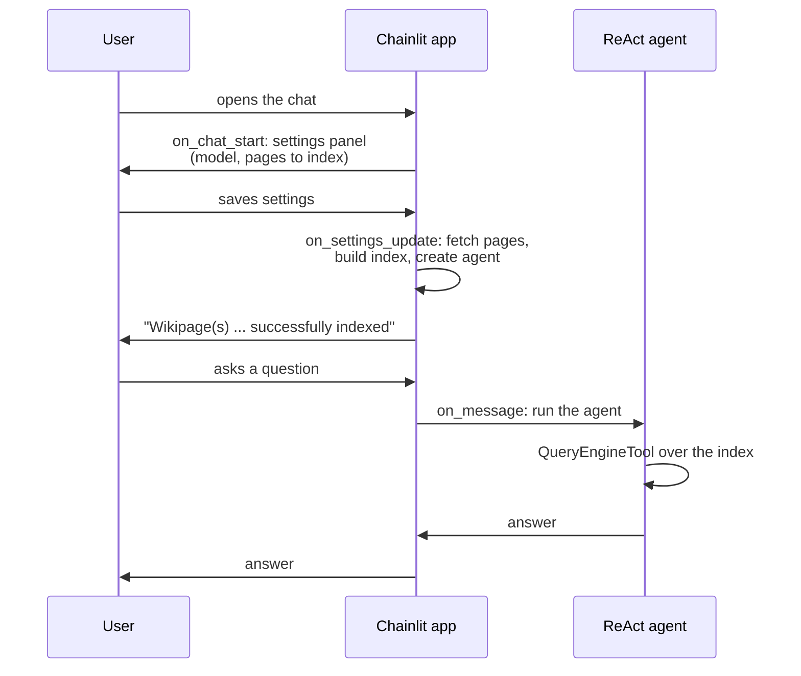
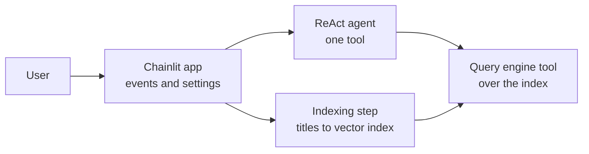
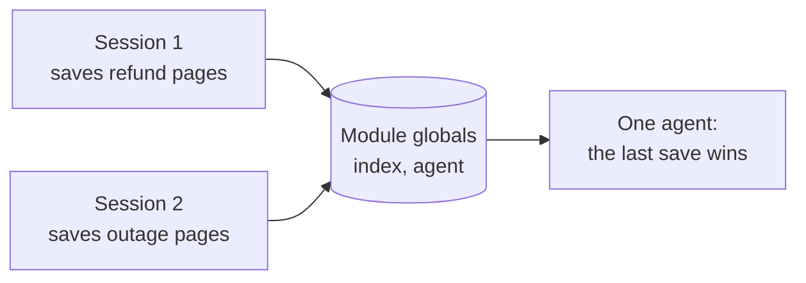
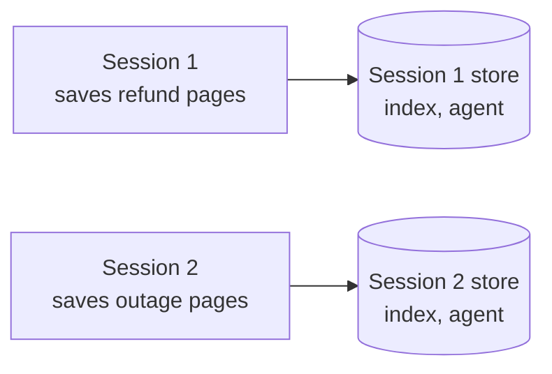

# M31.3 Theory: Exercise: LlamaIndex Wikipedia agent with Chainlit

*[M31 theory](../../../mandatory/theory/README.md) · Lesson 31.3 · Notebooks: [`03a_llamaindex_wikipedia_agent`](../../notebook/03a_llamaindex_wikipedia_agent/README.md) (optional) · [All theory pages](../../../../../THEORY.md)*
<!-- subtitle: A small build: the retriever-as-a-tool agent from lesson 31.1 behind a chat window, with state kept per session -->
<!-- format: approved -->

## Start with two support leads in one chat app

> **What you'll build**
>
> - **A ReAct agent** in LlamaIndex with one tool: a query engine over a vector index of Wikipedia pages.
> - **An indexing step** that turns a free-text request such as *paris, lagos, lao* into a list of page titles and indexes them.
> - **A Chainlit chat app** that builds the index and the agent when the user saves settings, and runs the agent on every message.
> - **Per-session state**: two people in the app never share an index or an agent.

Lesson 31.1 put a retriever behind a tool inside a LangGraph agent. This exercise builds the same pattern in a second framework and puts it behind a chat window. It adds no new retrieval idea; it shows what changes when the agent has users.

Picture two Larkspur support leads in the same chat app. The first indexes the refund pages and asks about annual refunds. The second indexes the outage pages a moment later. The first lead's next answer comes from the outage pages, because both sessions were reading one agent.

## Chat UI

A **chat UI** is an event-driven host for the agent. The framework calls one of your functions per event (chat opened, settings saved, message sent), and your code decides what each event does to the index and the agent. Chainlit is the framework here, and the scaffold fills three of its events:

*Figure 1: One session from open to answer. The index is built while the user waits, between saving settings and the confirmation.*

| Event | Scaffold function | What it does |
|---|---|---|
| Chat opens | `on_chat_start` | Sends a settings panel with a model choice and an input for the pages to index |
| Settings saved | `setup_agent` | Turns the request into a page list, fetches and indexes the pages, builds the agent, then confirms in the chat |
| Message sent | `main` | Runs the agent on the message and sends its reply back |

*Table 1: The three events and what each one does to the agent.*

## Architecture

The pieces sit in two files plus the framework:

*Figure 2: The exercise's pieces. The chat app owns both the indexing step and the agent.*

| Piece | What it does | Built on |
|---|---|---|
| **Page-list program** | An LLM call with structured output fills a list of page titles from the user's free text | Structured output, as in lesson 31.1's classifier |
| **Indexing step** | Fetches the pages from Wikipedia and builds a vector index | M10's indexing |
| **Query engine tool** | Wraps the index as a tool with a name and a description | Lesson 31.1's retriever tool |
| **ReAct agent** | Decides when to call the tool and writes the answer | M23's ReAct loop |
| **Chat app** | Calls the indexing step and the agent from its event functions | |

*Table 2: The five pieces and the earlier lesson each one reuses.*

The tool description matters here exactly as in lesson 31.1: it is all the ReAct agent knows about what the index holds.

## Where the agent lives

The scaffold keeps `index` and `agent` in module globals. Chainlit serves every connected user from one Python process. A global is one value shared by every session:

*Figure 3: Globals. The second save replaces the first session's index and agent.*

The alternative stores both in Chainlit's user session, which keeps one value per connection:

*Figure 4: Per-session state. Each connection reads only its own index and agent.*

Replay the opening scenario under each design: lead 1 saves the refund pages, lead 2 saves the outage pages, then lead 1 asks about annual refunds.

<button type="button" data-mode="globals" aria-pressed="false" aria-controls="state-globals">Module globals</button>
<button type="button" data-mode="session" aria-pressed="false" aria-controls="state-session">User session</button>

<section id="state-globals" class="mode-panel" data-announcement="Module globals. Lead 1 gets an answer from the outage pages."><h4>Module globals</h4><ul><li>Lead 2's save rebinds the global index and agent to the outage pages.</li><li>Lead 1's message runs that agent.</li></ul>
Lead 1 gets an answer from the outage pages, and nothing in it says so.
</section>
<section id="state-session" class="mode-panel" data-announcement="User session. Lead 1 gets an answer from the refund pages."><h4>User session</h4><ul><li>Lead 2's save writes only to lead 2's session.</li><li>Lead 1's message reads lead 1's agent, still over the refund pages.</li></ul>
Each lead gets answers from the pages they indexed.
</section>

We call the globals failure the **shared agent**. Chainlit keeps a session for 3,600 seconds after its connection drops: the scaffold's configuration sets it, and so does the default file Chainlit 2.x generates.

## Three more things the UI changes

Moving the agent behind a chat window adds problems a notebook never shows. Each has a planted case and a guard:

| Planted case | What goes wrong | Guard |
|---|---|---|
| The user saves new pages and asks at once | the question reaches no agent, or the agent for the previous pages | confirm in the chat only after indexing finishes |
| Each user indexes different pages | a fixed description says nothing about this session's index | build the description from the session's settings |
| A reviewer checks an answer | the tool calls behind it are hidden | show each tool call as a step in the chat |

*Table 3: Three planted cases and the guard for each.*

**The premature question.** The index is built when settings are saved, not offline as in M10. A question sent before the first confirmation finds no agent. The scaffold sets `index = None` at module level but never `agent`. Its `if agent:` check raises a `NameError` instead of staying quiet until you add `agent = None`. On a later save, the question reaches the agent still holding the previous pages. That case is the dangerous one: the answer looks normal and comes from the wrong pages.

**The generic description.** The tool takes a name and a description through its metadata. When each user indexes different pages, write the description from their settings ("Wikipedia articles on London, Barcelona and Paris"). Then the agent knows what this session's index holds. A fixed "Wikipedia pages" tells it nothing about which ones.

**Hidden steps.** Chainlit can show the agent's intermediate steps in the chat. For Larkspur's support chat, a visible step per `handbook_search` call lets a support lead check the answer against what was retrieved.

## Design choices worth copying

| Choice | Why |
|---|---|
| **Index on settings save, confirm when done** | The user knows when questions can be answered; a confirmation sent early would hide the premature question |
| **Index and agent per session** | One process serves every user: globals leak one user's data into another's answers |
| **Description built from settings** | The agent's routing reads the description, as lesson 31.1 measured |
| **Tool calls shown as steps** | A reviewer can compare the answer with its evidence, as lesson 31.2's retrieval contents allow |

*Table 4: Four choices and the failure each one prevents.*

### The Larkspur support chat

The same three events host the Larkspur agent from lesson 31.1:

1. On chat open, build the agent for this session with `handbook_search` and `web_search`, and store it in the session.
2. On each message, read the session's agent, run it, and send the reply.
3. Show each `handbook_search` call as a step. A support lead then sees the chunks behind every refund answer.

The handbook index is built once, offline, as in M10. The premature question disappears. The shared-agent risk does not: the conversation history still belongs to one session.

## Limits of this evidence

- **The scaffolds are incomplete on purpose.** Both files have gaps to fill. The exercise has no expected output to quote. Test it by behaviour: open two sessions with different pages and check that each answers from its own.
- **Version drift in the scaffold.** Its configuration file was generated by Chainlit 0.7.0 and switches visible steps on with `hide_cot = false`. Chainlit 2.x, which the course installs (2.12.0), reads `.chainlit/config.toml` and uses `cot` (`"full"`, `"tool_call"` or `"hidden"`, default `"full"`) instead. The old setting does nothing. The folder's README also notes that the legacy OpenAI program package does not support `llama-index-core` 0.14; its function-calling or text-completion programs replace it.
- **What it needs to run.** An OpenAI API key and the course's `llamaindex` dependency group. There is no notebook: the app runs with Chainlit from its own folder.

## References

1. Yao et al., [ReAct: Synergizing Reasoning and Acting in Language Models](https://arxiv.org/abs/2210.03629), 2022.
2. [Chainlit documentation](https://docs.chainlit.io), for chat settings, the user session and steps.
3. [LlamaIndex documentation](https://docs.llamaindex.ai), for query engine tools and the ReAct agent.

## Key Takeaways

- A chat UI calls one function per event. Build the index and agent when settings are saved, confirm only once indexing finishes, and run the agent on each message.
- Keep the index and agent per session, not in module globals, because one Python process serves every connected user.
- Build each session's tool description from its settings so the agent knows what its index holds, and show tool calls as steps so a reviewer can check answers against retrieval.

## Check yourself

1. Why does keeping the index and agent in module globals break the Chainlit app as soon as two people use it?

Chainlit serves every connected user from one Python process, so the second user to save settings replaces the first user's index and agent. The first user's next answer comes from the second user's pages. Store both in the user session, which keeps one value per connection.

2. A user indexes the Wikipedia pages on London, Barcelona and Paris. What tool description should that session's agent get?

One built from the user's settings, such as "Wikipedia articles on London, Barcelona and Paris", passed in the tool's metadata. A fixed description such as "Wikipedia pages" tells the agent nothing about what this session's index holds, and the description is all the agent reads when it decides to call the tool.

3. A user who had indexed London saves Lagos instead and asks about Lagos straight away, and the answer comes from the London page. What went wrong, and what guards against it?

The question arrived before the new index was built, so it reached the agent that still held the previous pages. Build the new index and agent in the settings event, store them in the session, and send the confirmation only after both are ready, so the user knows when questions about the new pages can be answered.

---
*Previous: [31.2 Managed RAG platforms: Contextual AI](../02_managed_rag_platforms_contextual_ai/README.md). Next: [M31 interview questions](../../../mandatory/theory/README.md#interview-spotlight-5-questions-you-might-get-asked).*
