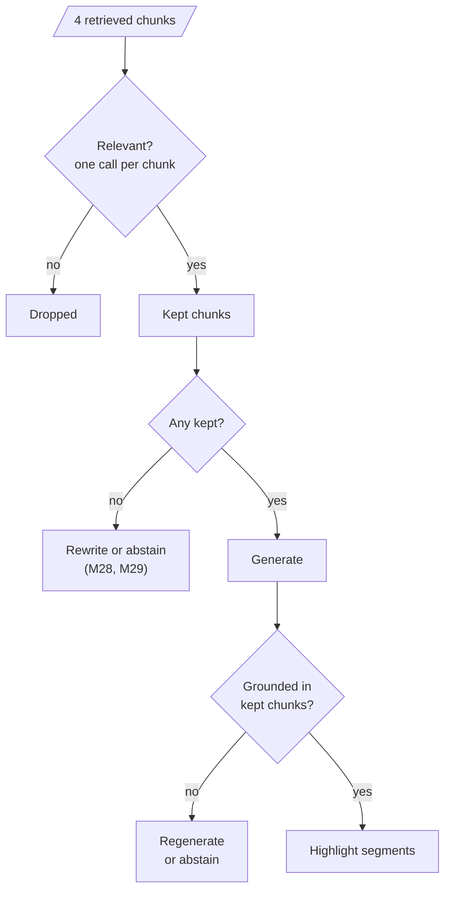
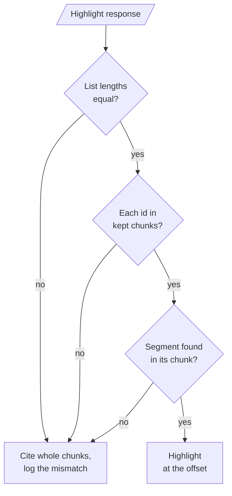

# M32.1 Theory: Reliable RAG: relevance checks, hallucination checks, source highlighting

*[M32 theory](../README.md) · Lesson 32.1 · Notebooks: [`01a_reliable_rag.ipynb`](../../notebook/01a_reliable_rag.ipynb) · [All theory pages](../../../../../THEORY.md)*
<!-- subtitle: Three checks around one answer: drop off-topic chunks, test the answer against what was kept, and prove every quote -->

## Relevance grading

> **What you'll learn**
>
> - **Explain** what a relevance grader removes before generation, and why it can never add the chunk that holds the answer.
> - **Diagnose** an answer that states a number its kept chunks do not contain.
> - **Verify** highlighted quotes against their source text, and handle the ones that fail.
> - **Count** the extra model calls the three checks add to every answer.

M31 made the retriever a tool the agent calls when it decides to. This module asks what happens after the call returns: whether the chunks are on topic, whether the answer stays inside them, and whether the user can see where each claim came from.

A Larkspur customer asks *How long does a refund take?* The answer comes back fluent and confident, with a number of business days that differs from the handbook's 5 to 10. That duration sits in the `refund-timing` chunk, and that chunk was never retrieved. The model found a related passage about refunds, saw no duration in it, and filled the gap from memory. Nothing in a plain RAG pipeline notices.

Lesson 32.1 adds three checks around generation, each catching a different failure:

*Figure 1: The reliable RAG pipeline. A grader filters chunks before generation, a second grader checks the answer after it, and highlighting ties each claim to a quote.*

### A grader before generation

A **relevance grader** is a small model call that reads one retrieved chunk together with the question and returns a structured verdict, `yes` or `no`. Chunks graded `no` are dropped; only the kept ones reach the generator.

The notebook indexes five posts on agentic design patterns from DeepLearning.AI's *The Batch* (500-token chunks, no overlap, OpenAI's `text-embedding-3-small`, Chroma) and retrieves 4 chunks per question. Every grader runs Llama 3.1 8B on Groq at temperature 0 with structured output, so the verdict is a field the code can branch on.

The grading prompt sets a low bar on purpose: a chunk counts as relevant if it shares keywords or meaning with the question, because "The goal is to filter out erroneous retrievals." A strict grader would drop borderline chunks that still help.

### What grading can and cannot fix

Run the refund question against the M10 TF-IDF index of the Larkspur handbook and the grader's job becomes concrete:

| Rank | Chunk | Why it was retrieved | What the grader should do |
|---|---|---|---|
| 1 | `refund-window` | Shares "refund" with the question | Keep: it is about refunds |
| 2 | `reboot` | Both texts contain "does" | Drop: it is about servers |
| none | `refund-timing` | Never retrieved | Nothing: it never reaches the grader |

*Table 1: The refund question on the M10 index, and what a relevance grader sees.*

Dropping `reboot` removes a distractor. But the chunk that holds the answer is absent, and no grader can add it. We call this the **candidate ceiling**: every check downstream of retrieval works on the candidates retrieval returned, so recall stays where retrieval left it. Fixing the missing chunk is retrieval work (M13 to M18).

> **Pitfall: the empty-context answer.** The notebook passes the kept chunks to generation without checking whether any survived. If all four are graded `no`, the model gets no documents and answers anyway, from memory. Branch on the empty case: rewrite the query and retry a bounded number of times (M28), fall back to another source (M29), or say the handbook does not cover the question.

The grader cleans the input. The next check looks at the output.

## Hallucination detection

**Hallucination detection** here means a second grader that reads the kept chunks and the finished answer, and returns `yes` when the answer is "grounded in / supported by the set of facts". A `no` means the answer says something the chunks do not.

### Three limits of one verdict

Three properties decide how far to trust it:

- **It checks support, not usefulness.** The question is not in the grader's input, so a grounded answer can still miss the question; Self-RAG (M29) adds a check for that.
- **It returns one verdict for the whole answer.** One unsupported sentence fails the answer, and the grader does not say which one. Per-claim checks split the answer into statements and verify each against a cited chunk, so they give the location as well as the verdict.
- **It is a model judgment.** The same 8B model writes and grades here, so the two can share blind spots. Before relying on it, label a sample of answers by hand and measure how often the grader agrees, for `yes` and `no` separately, because a lenient grader fails in one direction.

### Planted failure: the remembered number

Back to the refund question. Suppose only `refund-window` survives grading. That chunk states the 30-day window for an annual plan's refund and says nothing about how long the refund takes. The table shows what the grader should return for three possible answers:

| Answer | Supported by `refund-window`? | Correct verdict |
|---|---|---|
| "An annual plan can get a full refund within 30 days of purchase." | Yes, stated in the chunk | `yes` (grounded, though it misses the question) |
| "Refunds take a number of business days to arrive." | No, the chunk gives no duration | `no` |
| "The handbook passage I have does not say how long a refund takes." | Yes, it claims nothing beyond the chunk | `yes` |

*Table 2: Three answers to the refund question when only `refund-window` is kept (illustrative answers).*

The first row is the usefulness gap: grounded, and still no answer. The second row is the **remembered number**, a fact the model brought from its training data. The notebook's generation prompt invites it, because it says "Answer the question based upon your knowledge". A prompt that says "answer only from the documents, and say so when they do not cover the question" produces the third row instead, and stops most remembered numbers before the grader has to catch them.

### What a `no` leads to

The notebook prints the verdict and stops. In production a `no` has to go somewhere: regenerate once with the stricter prompt, then retry retrieval with a rewritten query, then answer that the handbook does not say and offer a person. Cap the retries, because each one is another generation call and another grading call on top of these:

| Check | Calls per answer at k = 4 |
|---|---|
| Relevance grading, one per chunk | 4 |
| Hallucination grading | 1 |
| Source highlighting | 1 |
| Added to the one generation call | 6 |

*Table 3: Model calls the three checks add to one answer, before any retry.*

Those calls add latency as well as cost (the four chunk grades can run in parallel; the rest run one after another), so the graders belong on the same dashboard as the answer time. Once an answer passes, the last check shows the user which words it rests on.

## Source highlighting

**Source highlighting** asks the model which exact passages of the kept chunks the answer used, so the reader can check the answer against the handbook at a glance.

The notebook asks for the result as four parallel lists, one entry per highlighted passage:

| Field | What it holds |
|---|---|
| `id` | The id of each chunk used |
| `title` | That chunk's title |
| `source` | Where the chunk came from |
| `segment` | The quoted passage that supports the answer |

*Table 4: The highlight schema.*

The prompt asks for segments that are "verbatim snippets from the documents, ensuring a word-for-word match", and tells the model to leave out documents the answer did not use. For *Can I export my data after I cancel my plan?*, a correct highlight returns two exact sentences:

| Chunk | Segment |
|---|---|
| `export` | Export your data at any time from Settings, then Data. |
| `retention` | After a plan is cancelled, its data is kept for 30 days and then permanently deleted. |

*Table 5: A correct highlight for the export question.*

### The parser checks shape, not truth

A structured-output parser checks that the response has the four lists with strings in them. It does not check that a segment appears in its chunk. A model can paraphrase, merge two sentences or quote a chunk it was never given, and the output still parses.

So check every segment in your own code with an exact substring search of the cited chunk. A hit returns the character offset where the quote starts, which is what the interface needs to draw the highlight. A miss returns nothing:

| Segment checked against the `export` chunk | Result |
|---|---|
| "Export your data at any time from Settings, then Data." | Found at offset 0 |
| "You can always export in Settings." (a paraphrase) | Not found |

*Table 6: An exact quote and a paraphrase, checked against the source text.*

This checks quotation, not whether the sentence answers the customer. That judgment stays with the hallucination grader.

### Planted failures in a highlight

Each way a highlight can go wrong needs its own response:

| Planted failure | What the parser says | What to do |
|---|---|---|
| Paraphrased segment | Valid | Not found: cite the whole chunk, log the miss |
| Two sentences merged into one quote | Valid | Not found: same fallback |
| Segment from a chunk not in the kept set | Valid | Reject: the id is not a kept chunk |
| Three ids and two segments | Valid | Compare list lengths first: pairing the lists stops at the shorter one and silently drops a row |

*Table 7: Highlight failures that pass the parser.*

*Figure 2: Validating a highlight, one check per planted failure.*

A rising miss rate in that log means the highlighting prompt or the model has drifted. And a chunk that is retrieved often and never highlighted is a candidate for the grader to drop or for retrieval to stop returning.

## Key Takeaways

- Grade each retrieved chunk before generation, at one call per chunk. Grading drops noise but cannot add a chunk retrieval missed (the candidate ceiling), so branch on an empty kept set instead of answering anyway.
- The hallucination grader checks support, not usefulness, and gives one verdict for the whole answer. Measure its agreement with hand labels, prompt the generator to answer only from the documents, and send a `no` to a capped retry or an abstention.
- A parser checks only the shape of a highlight. Find every segment in its cited chunk, check the ids and list lengths, and fall back to citing the whole chunk when a check fails.

## Check yourself

1. The relevance grader drops off-topic chunks before generation. Why can it not raise recall?

It only sees the chunks retrieval returned. On the refund question it should drop `reboot`, which ranked second only because both texts contain "does", but it cannot add `refund-timing`, which was never retrieved. Grading removes noise and leaves recall where retrieval put it.

2. Only the refund-window chunk survives grading, and the answer states how many days a refund takes. What should the hallucination grader return, and what prevents such answers?

It should return `no`: that chunk states the 30-day window and nothing about how long a refund takes, so any duration is unsupported. The notebook's prompt, "Answer the question based upon your knowledge", invites the remembered number. A prompt that says to answer only from the documents, and to say when they do not cover the question, stops most of these answers before they are written.

3. A highlighted segment parses correctly but is not found in the chunk it cites. What should the app do?

The parser checks only the shape, so the model may have paraphrased or merged sentences. Fall back to citing the whole chunk and log the miss, because a rising miss rate means the highlighting prompt or model has drifted. Also compare the list lengths before pairing them, since pairing stops at the shorter list and silently drops a row.

---
*Previous: [M32 overview](../README.md). Next: [32.2 Retrieval with a user-feedback loop](../02_retrieval_with_a_user_feedback_loop/README.md).*
