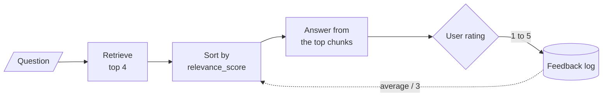
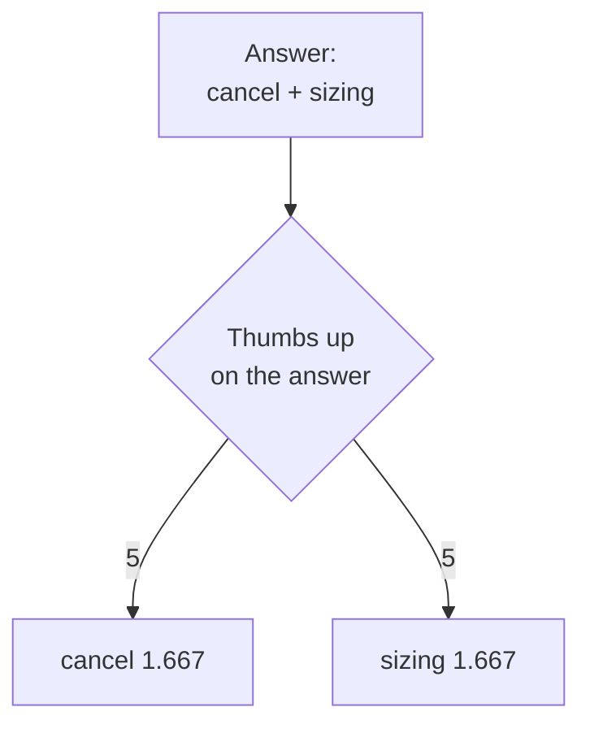
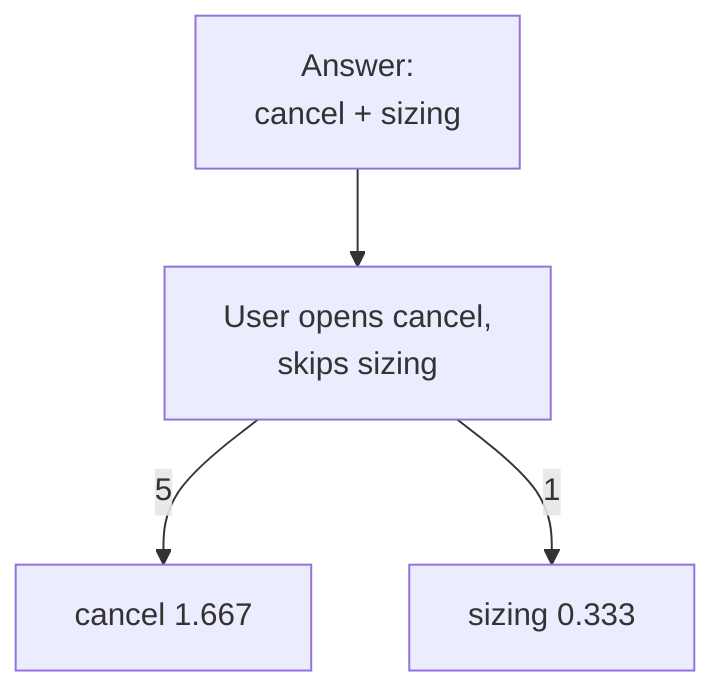
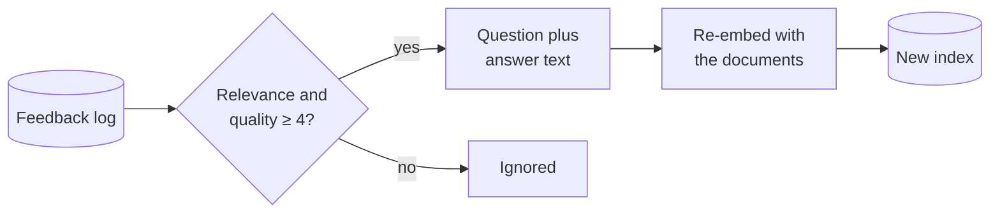

# M32.2 Theory: Retrieval with a user-feedback loop

*[M32 theory](../README.md) · Lesson 32.2 · Notebooks: [`02a_retrieval_with_feedback_loop.ipynb`](../../notebook/02a_retrieval_with_feedback_loop.ipynb) · [All theory pages](../../../../../THEORY.md)*
<!-- subtitle: What a thumbs-down can reorder, what it can never reach, and why the rating lands on the wrong chunks -->
<!-- format: approved -->

## Start with a thumbs-down that changes nothing

> **What you'll learn**
>
> - **Explain** how an average rating becomes a score multiplier, and why it stays between 1/3 and 5/3.
> - **Trace** one thumbs-down that fixes a question, and one that changes nothing.
> - **Compare** a rating on the whole answer with a signal on each source.
> - **Diagnose** what goes wrong when highly rated answers are folded back into the index.

Lesson 32.1 checked one answer at a time and could only remove. This lesson learns across many answers.

A Larkspur customer asks *How long does a refund take?* and gives the answer a thumbs-down. Twenty askings later the answer is still incomplete, because the chunk with the answer, `refund-timing`, was never among the candidates the ratings could touch. Another customer's thumbs-down on a credit question fixes it for good after one rating. The difference is where the evidence sits when the rating arrives.

## The feedback re-ranker

The notebook builds a question-answering chain with `gpt-4o` over a climate-change PDF and stores one **feedback record** per answer, appended to a log file as a line of JSON:

| Field | What it holds |
|---|---|
| `query` | The question asked |
| `response` | The answer given |
| `relevance` | The user's 1 to 5 rating of how relevant the answer was |
| `quality` | The user's 1 to 5 rating of its quality |
| `comments` | Free text, often empty |

*Table 1: One feedback record.*

On the next query a **feedback re-ranker** re-weights the retrieved chunks. For each chunk and each stored record, it asks `gpt-4o` whether that record is relevant to the current query and that chunk. It averages the `relevance` of the records judged relevant, multiplies the chunk's score by that average divided by 3 (3 is the neutral middle of the scale), and sorts by the new score:

<!-- animated: diagrams/credit-flywheel.anim.html -->

*Figure 1: The feedback loop. Ratings re-weight the next retrieval's candidates; they never change which candidates come back.*

### Four properties of the rule

The arithmetic is short:

| Average rating | Multiplier | Chunk score |
|---|---|---|
| 1 (every rating a thumbs-down) | 1/3 | 0.333 |
| 3 (neutral) | 1 | 1.000 |
| 5 (every rating a thumbs-up) | 5/3 | 1.667 |

*Table 2: The multiplier at the ends and the middle of the scale.*

- **Feedback sets the order on its own.** Every chunk starts at a score of 1.0, and after the multiplication ratings alone decide the order. Similarity only breaks ties, because a stable sort keeps the retriever's order for equal scores.
- **The multiplier is bounded.** It uses the average, and a chunk sits between 0.333 and 1.667. The first rating moves a chunk as far as it will go; later ratings only move the average.
- **It reorders the candidates and nothing else.** The retriever returns 4 chunks by default, and a chunk outside those 4 never receives a rating: the **candidate ceiling** from lesson 32.1 again.
- **It costs one model call per pair.** Every retrieved chunk is checked against every stored record: 4 chunks and 1,000 records make 4,000 `gpt-4o` calls for one query.

### One hundred ratings on the handbook

The [interactive lab](interactive/feedback-flywheel-lab.html) runs this rule on the Larkspur handbook with the M10 TF-IDF retriever. Five golden questions take turns, 20 times each over 100 events. Each answer uses the top 2 of the 4 candidates, and the simulated user gives a 5 when every evidence chunk is in the answer and a 1 otherwise. The lab replaces the `gpt-4o` relevance call with a fixed rule: a record counts for a chunk when it was given on the same question and its answer used that chunk. Its port of the rule matches the Python function on all 202 settings it offers.

| Golden question | Recall@2 before | After 100 events | Wrong answers |
|---|---|---|---|
| *Can I export my data after I cancel my plan?* | 1.00 | 1.00 | 0 |
| *How long does a refund take?* | 0.50 | 0.50 | 20 |
| *What happens if my server goes down?* | 0.00 | 0.00 | 20 |
| *Is there a credit if my server plan has an outage?* | 0.00 | **1.00** | 1 |
| *Can I still use my server after I cancel the plan?* | 1.00 | 1.00 | 0 |
| Mean recall@2, and total wrong answers | 0.50 | 0.70 | 41 |

*Table 3: The lab after 100 rated answers, ratings on the whole answer.*

<!-- lab: interactive/feedback-flywheel-lab.html -->

The credit question is the one the loop fixes. The walkthrough follows it event by event:

Follow the credit question through the lab's first rated answers. Each stage shows the candidates' scores and what the user saw.

<button type="button" data-step="0" aria-pressed="false" aria-controls="credit-step-0">1. Retrieve</button><button type="button" data-step="1" aria-pressed="false" aria-controls="credit-step-1">2. Event 4</button><button type="button" data-step="2" aria-pressed="false" aria-controls="credit-step-2">3. Re-rank</button><button type="button" data-step="3" aria-pressed="false" aria-controls="credit-step-3">4. Event 9</button><button type="button" data-step="4" aria-pressed="false" aria-controls="credit-step-4">5. Events 10 to 100</button>

<section id="credit-step-0" class="step-panel" aria-labelledby="credit-heading-0"><h4 id="credit-heading-0">1. Retrieve four candidates</h4><dl><dt>Similarity</dt><dd>sizing 0.290, reboot 0.221, sla 0.184, export 0.115</dd><dt>Scores</dt><dd>All 1.000: no feedback yet</dd></dl></section><section id="credit-step-1" class="step-panel" aria-labelledby="credit-heading-1"><h4 id="credit-heading-1">2. Event 4: a thumbs-down</h4><dl><dt>Answer used</dt><dd>sizing and reboot. The evidence chunk sla is missing.</dd><dt>Rating</dt><dd>1, recorded against sizing and reboot</dd></dl></section><section id="credit-step-2" class="step-panel" aria-labelledby="credit-heading-2"><h4 id="credit-heading-2">3. Re-rank</h4><dl><dt>Scores</dt><dd>sla 1.000, export 1.000, sizing 0.333, reboot 0.333</dd><dt>Top 2</dt><dd>sla and export: the evidence is now in the answer</dd></dl></section><section id="credit-step-3" class="step-panel" aria-labelledby="credit-heading-3"><h4 id="credit-heading-3">4. Event 9: a thumbs-up</h4><dl><dt>Answer used</dt><dd>sla and export. Complete.</dd><dt>Scores</dt><dd>sla 1.667, export 1.667, sizing 0.333, reboot 0.333</dd></dl></section><section id="credit-step-4" class="step-panel" aria-labelledby="credit-heading-4"><h4 id="credit-heading-4">5. Events 10 to 100</h4><dl><dt>Change</dt><dd>None. No ranking moves after event 8 and no score after event 9, for any question.</dd><dt>Wrong answers on this question</dt><dd>1 of 20</dd></dl></section>

<button type="button" data-walk="previous">Previous</button>

<button type="button" data-walk="next">Next step</button>

The other two failing questions never improve. `refund-timing` scores 0 for the refund question, and `sla` and `incidents` score 0 for the outage question: none of them is ever a candidate. Those two questions account for 40 of the 41 wrong answers. On the outage question, every candidate has an average of 1 by event 8, all sit at 0.333, and the order is the retriever's again.

### Three defects to fix before the loop works

The notebook's loop does not yet behave as described. Each defect fails quietly:

| Defect | What happens | Fix |
|---|---|---|
| The relevance check compares the model's reply with lowercase "yes", while the prompt asks for "Yes" or "No" | No record ever counts, and no score moves | Normalise case and whitespace before comparing |
| The vector store returns its stored chunk objects, and the score is multiplied in place | The adjustment persists and compounds: one rating of 5 gives 1.667 on the first query and 2.778 on the second | Adjust copies of the chunks |
| The re-ranked list is handed to the retriever as a search setting it ignores | The retriever searches the index again, and the re-ranked order is lost | Pass the re-ranked chunks to the answer step directly |

*Table 4: Three defects in the notebook's feedback loop.*

All three leave the pipeline answering. Test the order itself.

## Implicit vs explicit feedback

**Explicit feedback** is a judgment the user states: a thumbs-up, a star rating, the 1 to 5 `relevance` and `quality` fields above. **Implicit feedback** is inferred from what the user does next. The two differ on every axis that matters:

| | Explicit | Implicit |
|---|---|---|
| Examples | Thumbs up or down, a 1 to 5 rating, a comment | Opening a cited source, copying the answer, asking the same question again in other words, opening a support ticket |
| Meaning | Clear: the user said it | Inferred: a rephrased question probably means the answer missed |
| Volume | Only from users who choose to rate | From every session |
| What it rates | The whole answer | Often one source, such as the one the user opened |
| Bias | Raters choose themselves and may not be typical users | Users click what is shown first, and top-ranked chunks collect more signal |

*Table 5: Explicit and implicit feedback compared.*

### Where the rating lands

The lab's second setting shows why granularity matters. Answer-level ratings produce **ride-along credit**: a chunk that happens to sit next to the evidence collects the evidence's rating.

*Figure 2: Thumbs on the answer. Every chunk in the answer gets the same rating, evidence or not.*

*Figure 3: Clicks on each source. Each chunk is rated on its own: 5 for evidence the user opened, 1 for a chunk they skipped.*

The same 100 events, under each signal:

Compare where the ratings land on the cancel and refund questions after 100 events.

<button type="button" data-mode="answer" aria-pressed="false" aria-controls="signal-answer">Thumbs on the answer</button>
<button type="button" data-mode="source" aria-pressed="false" aria-controls="signal-source">Clicks on each source</button>

<section id="signal-answer" class="mode-panel" data-announcement="Thumbs on the answer selected. sizing rides up, refund-window is pushed down."><h4>Thumbs on the answer</h4><ul><li>Cancel question: cancel 1.667, and sizing, which is not evidence, also 1.667.</li><li>Refund question: refund-window, the evidence, falls to 0.333 with the distractor reboot, because every answer is incomplete.</li></ul>
The order settles at event 8. Mean recall@2 0.70, 41 wrong answers.
</section>
<section id="signal-source" class="mode-panel" data-announcement="Clicks on each source selected. sizing falls, refund-window rises."><h4>Clicks on each source</h4><ul><li>Cancel question: cancel 1.667, sizing 0.333.</li><li>Refund question: refund-window rises to 1.667, reboot falls to 0.333.</li></ul>
The order settles at event 15. Mean recall@2 0.70, 41 wrong answers.
</section>

The sharper signal puts credit on the right chunks and still leaves the lab's totals unchanged, because neither signal reaches a chunk the retriever does not return.

> **Interview tip:** Collect both signals. Implicit ones give volume and per-source detail once corrected for position (compare clicks at the same rank, or occasionally shuffle the sources). Explicit ratings are fewer but mean what they say, and every thumbs-down is a golden-set candidate.

Re-ranking leaves the index alone. The notebook's second half changes the index itself.

## Folding good answers into the index

The notebook's second use of feedback is a periodic job, run "daily or weekly". It keeps the records rated 4 or more on both `relevance` and `quality`, joins each question and answer into one text, appends that text to the original document, and re-encodes everything (1,000-character chunks, 200 overlap) into a new vector store.

*Figure 4: The fold-back job. Only answers that were already good enter the new index.*

This adds chunks worded the way users ask, which helps questions phrased like past ones. It has three limits:

- **Only answers that were already good get in.** In the lab, the refund and outage questions never earn a thumbs-up, and nothing about them would be added. The questions that most need new text get none.
- **Past answers become retrievable facts.** When Larkspur changes its refund rule, the stored answers still quote the old one, and they match refund questions better than the handbook because they were written as answers to them. We call this **stale-answer echo**. Tag each added chunk with its date and the handbook chunks it came from, drop it when those change, and rank feedback chunks below primary documents.
- **It rebuilds the whole index.** Every run re-embeds the full corpus plus the feedback text. Incremental upserts (M14) avoid that.

## Limits of this evidence

- **A scripted user.** The lab's user rates 5 exactly when the answer holds every evidence chunk. Real users rate mood, length and speed too, and many never rate.
- **A rule in place of `gpt-4o`.** The lab decides which records count for a chunk with a fixed rule. The notebook's model call can match records across differently worded questions, and can also miss.
- **Five questions, twelve chunks.** The totals in Table 3 come from one small handbook and TF-IDF retrieval; the notebook itself prints no ranking figures.

## References

1. Joachims et al., [Unbiased Learning-to-Rank with Biased Feedback](https://arxiv.org/abs/1608.04468), 2017.
2. Diamant, [RAG Techniques: retrieval with feedback loop](https://github.com/NirDiamant/RAG_Techniques), the source of the notebook.

## Key Takeaways

- The feedback re-ranker multiplies each chunk's score by its average rating over 3: a chunk stays between 0.333 and 1.667 and ratings alone set the order. It costs one model call per chunk and stored record.
- Feedback only reorders the candidates retrieval returns. In the lab, mean recall@2 rose from 0.50 to 0.70, but 40 of the 41 wrong answers came from chunks that were never candidates.
- Combine implicit and explicit feedback, and rate sources rather than whole answers where you can, so credit does not ride along to the chunk beside the evidence. Each thumbs-down is a golden-set candidate.

## Check yourself

1. Why can the feedback re-ranker never fix the refund and outage questions in the lab?

It only reorders the 4 candidates the retriever returns. `refund-timing`, `sla` and `incidents` score 0 for those questions, so they are never candidates and never receive a rating. The two questions account for 40 of the 41 wrong answers.

2. For the question about using a server after cancelling, how do thumbs on the answer and clicks on each source treat the sizing chunk?

`sizing` is not evidence but sits in every good answer next to `cancel`. Rated through the answer it rides along to 1.667; rated per source it falls to 0.333. Either way the lab's totals stay at mean recall@2 0.70 and 41 wrong answers, because neither signal reaches a chunk the retriever does not return.

3. You plan to fold highly rated answers back into the index every week. What happens when Larkspur changes a policy, and how do you guard against it?

The stored answers still quote the old policy and compete with the corrected handbook as retrievable facts, often winning because they were written as answers to those questions. Tag each added chunk with its date and the handbook chunks it was answered from, and drop it when those change.

---
*Previous: [32.1 Reliable RAG: relevance checks, hallucination checks, source highlighting](../01_reliable_rag_relevance_checks_hallucination_checks_source_highlighting/README.md). Next: [32.3 Dartboard RAG: relevance and diversity together](../../../optional/theory/03_dartboard_rag_relevance_and_diversity_together/README.md).*
