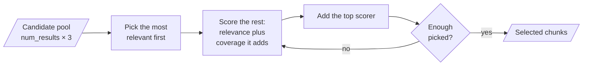
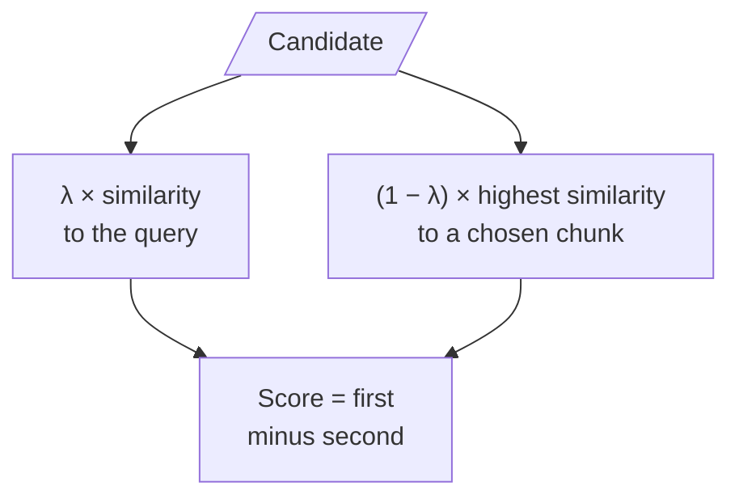
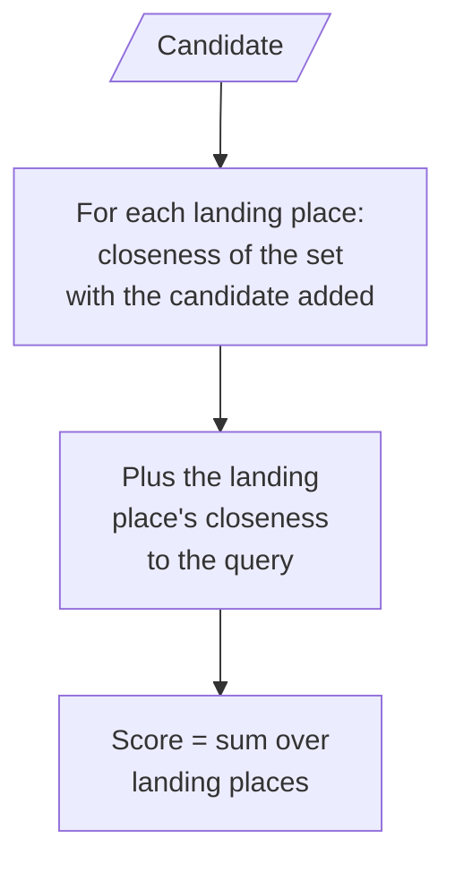
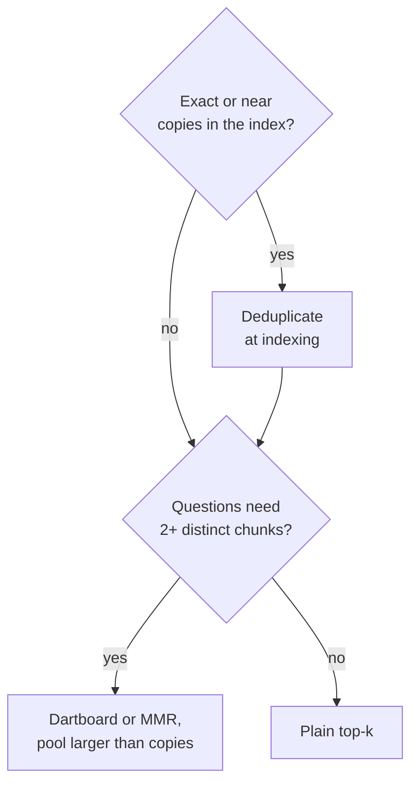

# M32.3 Theory: Dartboard RAG: relevance and diversity together

*[M32 theory](../../../mandatory/theory/README.md) · Lesson 32.3 · Notebooks: [`03a_dartboard_rag.ipynb`](../../notebook/03a_dartboard_rag.ipynb) (optional) · [All theory pages](../../../../../THEORY.md)*
<!-- subtitle: When the index holds copies, top-k returns the same passage three times; a set score that rewards coverage fixes it, inside the pool it is given -->
<!-- format: approved -->

## Start with three copies of one answer

> **What you'll learn**
>
> - **Explain** why top-k fills every slot with copies when the index holds duplicates.
> - **Trace** the dartboard method's greedy choice, one chunk at a time.
> - **Size** the candidate pool so a diverse answer is possible at all.
> - **Choose** between deduplication, Dartboard and MMR.

Lesson 32.2 showed that feedback can only reorder the candidates retrieval returns. This lesson stays inside that limit: a better way to choose among the candidates, when many of them say the same thing.

Larkspur ingests its handbook from three places: the help centre, the PDF export and the internal wiki. Every rule is now stored several times. A customer asks *Can I export my data after I cancel my plan?* The answer needs two chunks, `export` (how to export) and `retention` (how long data is kept after cancelling). Plain top-3 retrieval returns `export`, `export`, `export`, and the answer never mentions the 30-day deadline. The runs below store each chunk five times, which makes the effect easy to see.

## Diversity-aware selection

**Top-k** scores each chunk against the query on its own and keeps the best k. Copies of one passage score identically, and whichever passage scores best takes every slot. We call this **duplicate crowding**. The notebook creates it on purpose: it loads its climate-change PDF five times over, splits it into 1,000-character chunks with 200 overlap, and shows that the top 3 results for *What is the main cause of climate change?* are repetitions of one chunk.

The fix is to score the set rather than each chunk. **Diversity-aware selection** picks chunks so that the set, taken together, covers the query well: a chunk adds value only when it brings something the chosen ones do not.

### The dartboard picture

The notebook's method comes from *Better RAG using Relevant Information Gain*, the dartboard method. Picture the query as the centre of a dartboard and darts thrown around it, landing more often near the centre. A set of chunks scores by how close its nearest member lies to where each dart lands.

A second copy of a chunk already in the set lies exactly where the first one does. It brings no landing place any closer and adds nothing. A chunk that covers ground nearby, close to the query but away from the chosen chunks, adds the most.

### The greedy rule

Finding the best set exactly is expensive. The method builds it one chunk at a time from a candidate pool of `num_results × oversampling_factor` nearest chunks (the factor is 3 by default):

1. Turn distances (1 minus cosine similarity) into log probabilities with a normal curve of width `SIGMA = 0.1`, for query to chunk and for chunk to chunk.
2. Pick the chunk most probable under the query.
3. Treat every candidate as a place a dart can land, weighted by how close it is to the query (`RELEVANCE_WEIGHT`). For each remaining candidate, measure how close the set would come to each landing place if that candidate joined (`DIVERSITY_WEIGHT`), and sum over the landing places. Both weights are 1.0.
4. Add the highest scorer and repeat until `num_results` are picked.

*Figure 1: Greedy dartboard selection. Every pick after the first is scored on the coverage it adds to the set so far.*

`SIGMA` sets how quickly closeness stops counting: a small width means only near neighbours of a landing place matter, and two chunks a little apart already count as covering different ground.

### Trace the export question

We ran the notebook's selection function, unchanged, on the twelve Larkspur chunks stored five times (60 chunks, TF-IDF vectors), for the export question with `num_results = 3` and an oversampling factor of 4:

Follow the greedy rule through three picks from a pool of 12. Each stage shows the pool or the set chosen so far.

<button type="button" data-step="0" aria-pressed="false" aria-controls="dart-step-0">1. Pool</button><button type="button" data-step="1" aria-pressed="false" aria-controls="dart-step-1">2. First pick</button><button type="button" data-step="2" aria-pressed="false" aria-controls="dart-step-2">3. Second pick</button><button type="button" data-step="3" aria-pressed="false" aria-controls="dart-step-3">4. Third pick</button>

<section id="dart-step-0" class="step-panel" aria-labelledby="dart-heading-0"><h4 id="dart-heading-0">1. Fetch a pool of 12</h4><dl><dt>Pool</dt><dd>5 copies of export (0.353), 5 of retention (0.350), 2 of cancel (0.261)</dd><dt>Plain top-3</dt><dd>export, export, export</dd></dl></section><section id="dart-step-1" class="step-panel" aria-labelledby="dart-heading-1"><h4 id="dart-heading-1">2. Pick the most relevant</h4><dl><dt>Set</dt><dd>export</dd><dt>Score</dt><dd>A fixed placeholder of 1.0</dd></dl></section><section id="dart-step-2" class="step-panel" aria-labelledby="dart-heading-2"><h4 id="dart-heading-2">3. Score the coverage each candidate adds</h4><dl><dt>Set</dt><dd>export, retention</dd><dt>Why</dt><dd>Another copy of export brings no landing place closer. retention covers the retention copies.</dd></dl></section><section id="dart-step-3" class="step-panel" aria-labelledby="dart-heading-3"><h4 id="dart-heading-3">4. Pick again</h4><dl><dt>Set</dt><dd>export, retention, cancel</dd><dt>Recall</dt><dd>1.00, against 0.50 for plain top-3</dd></dl></section>

<button type="button" data-walk="previous">Previous</button>

<button type="button" data-walk="next">Next step</button>

## Where the pool runs out

The same run at four pool sizes shows both the gain and its limit:

| Oversampling factor | Pool | Distinct chunks in pool | Plain top-3 | Dartboard top-3 |
|---|---|---|---|---|
| 1 | 3 | 1 | `export` × 3 | `export`, `export`, `export` |
| 2 | 6 | 2 | `export` × 3 | `export`, `retention`, `export` |
| 3 (default) | 9 | 2 | `export` × 3 | `export`, `retention`, `export` |
| 4 | 12 | 3 | `export` × 3 | `export`, `retention`, `cancel` |

*Table 1: Dartboard against plain top-3 on the handbook stored five times, export question.*

Plain top-3 has recall 0.50 on this question at every pool size. Dartboard reaches 1.00 once the pool holds `retention`, from an oversampling factor of 2. At the default of 3 its third pick is still a copy of `export`, because a pool of 9 drawn from five copies of each chunk holds only two distinct chunks.

That is the **pool ceiling**, the candidate ceiling of lessons 32.1 and 32.2 in a new form: a selector can only choose among the candidates it is given. The arithmetic for sizing the pool is direct when copies rank side by side:

| Copies per chunk | Distinct chunks wanted | Smallest pool that holds them |
|---|---|---|
| 5 | 2 | 6 |
| 5 | 3 | 11 |
| 3 | 3 | 7 |

*Table 2: Pool size needed when every chunk has the same number of copies, (copies × (wanted − 1)) + 1.*

The default pool of 9 sits between the first two rows, which is exactly why Table 1 shows two distinct picks at factor 3 and three at factor 4 (pool 12). Real duplication is uneven. The reliable fix is to remove the copies before retrieval and keep oversampling for the overlap that remains.

## Dartboard or MMR

Dartboard and MMR, maximal marginal relevance ([lesson 16.4](../../../../../p05_retrieval_quality_and_rag_apps/m16_retrievers_hybrid_search/mandatory/theory/04_maximal_marginal_relevance_for_diversity/README.md#mmr-λ)), solve the same problem the same greedy way and differ in the score each candidate gets.

MMR scores a candidate by its similarity to the query, minus a penalty for its similarity to the closest chunk already chosen. One weight, λ, sets the balance:

*Figure 2: The MMR score. A copy of a chosen chunk has similarity 1 to it and takes the full penalty.*

Dartboard adds instead of subtracting: the log probability of covering each landing place, summed over the pool, with the query's pull counted in:

*Figure 3: The dartboard score. A copy changes no landing place's closeness and adds nothing over the set without it.*

| | MMR | Dartboard |
|---|---|---|
| Score for the next pick | Relevance minus a redundancy penalty | Log probability of covering the landing places |
| Balance control | One linear weight, λ | `SIGMA`, plus a relevance weight and a diversity weight |
| Usually run on | Embedding similarities | Any distance: dense, hybrid or cross-encoder scores |

*Table 3: Two greedy selectors compared.*

Because Dartboard needs only distances, the notebook's notes point out that it works the same on dense, hybrid or cross-encoder scores. Neither selector replaces deduplication: a content hash at indexing time catches exact copies cheaply, and every later step then works on fewer, distinct chunks.

*Figure 4: Choosing a fix for redundant results.*

Measure the choice on golden questions that need two or more distinct chunks, such as the export question, and check that single-fact questions do not lose their second supporting chunk.

## Limits of this evidence

- **The first score is a placeholder.** The notebook records the first pick with a fixed score of 1.0, not a computed one. It cannot be compared with the scores after it.
- **The last example call fails.** It passes the result count under the name `k`, while the function names that parameter `num_results`. Python raises a type error until the name is corrected.
- **One question, one corpus.** Table 1 is one question on a twelve-chunk handbook with uniform copies and TF-IDF vectors. Uneven duplication, near-duplicates in other words and dense embeddings were not tested.

## References

1. Pickett et al., [Better RAG using Relevant Information Gain](https://arxiv.org/abs/2407.12101), 2024.
2. Carbonell and Goldstein, [The Use of MMR, Diversity-Based Reranking for Reordering Documents and Producing Summaries](https://doi.org/10.1145/290941.291025), SIGIR 1998.

## Key Takeaways

- Top-k fills every slot with copies of the best match when the corpus holds duplicates. Dartboard selection scores a set by how close its nearest member lies to each landing place, and a copy adds nothing.
- The selector only chooses among its `num_results × oversampling_factor` candidates. With five copies per chunk the default pool of 9 holds two distinct chunks: enlarge the pool past the copy count or deduplicate at indexing.
- Dartboard and MMR both select greedily and differ in the score. MMR subtracts a linear redundancy penalty, while Dartboard adds log probabilities and needs only distances, which lets it run on dense, hybrid or cross-encoder scores.

## Check yourself

1. Why does a second copy of a chunk already in the set add nothing to the dartboard score?

A set scores by how close its nearest member lies to where the darts land. The copy lies exactly where the first one does, so it brings no landing place any closer. A chunk that covers ground nearby adds the most.

2. With the Larkspur chunks stored five times and the default oversampling factor of 3, what does dartboard return for the export question, and why?

`export`, `retention`, `export`. Recall reaches 1.00 against 0.50 for plain top-3, but the pool of 9 drawn from five copies of each chunk holds only two distinct chunks, so the third pick is a copy. At a factor of 4 the pool holds three and the picks become `export`, `retention`, `cancel`.

3. Your retriever scores with a cross-encoder rather than embeddings. Can you still use dartboard selection, and how does it differ from MMR?

Yes: the method needs only distances, so it works the same on dense, hybrid or cross-encoder scores. Both pick greedily; MMR subtracts a redundancy penalty with a linear λ, while Dartboard adds log probabilities, with `SIGMA` setting how quickly closeness stops counting.

---
*Previous: [32.2 Retrieval with a user-feedback loop](../../../mandatory/theory/02_retrieval_with_a_user_feedback_loop/README.md). Next: [M32 interview questions](../../../mandatory/theory/README.md#interview-spotlight-5-questions-you-might-get-asked).*
