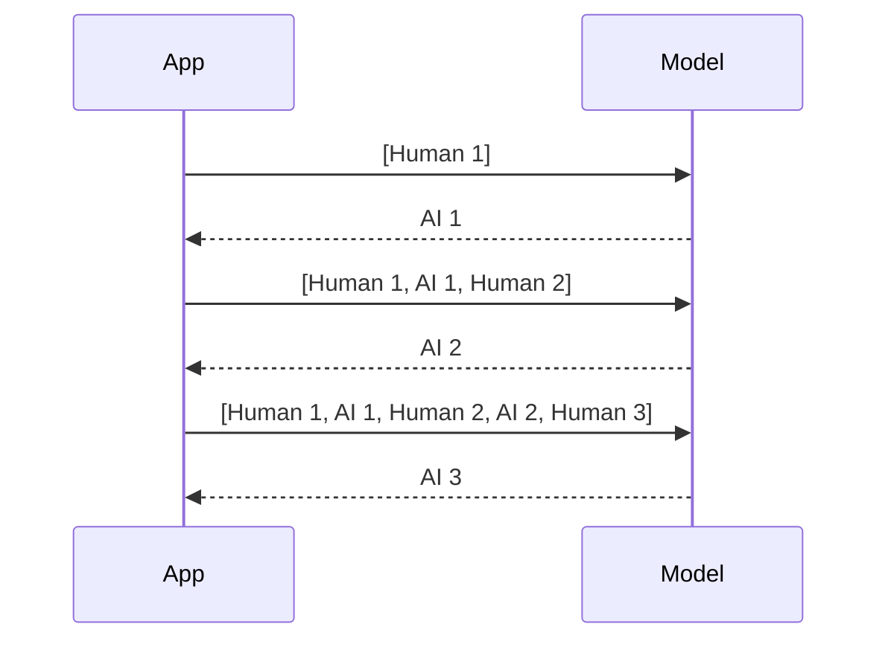

# M33.1 Theory: Why LLMs forget; classic memory classes

*[M33 theory](../README.md) · Lesson 33.1 · Notebooks: [`01a_why_llms_forget.ipynb`](../../notebook/01a_why_llms_forget.ipynb), [`01b_classic_memory_classes_and_chains.ipynb`](../../../optional/notebook/01b_classic_memory_classes_and_chains.ipynb) (optional) · [All theory pages](../../../../../THEORY.md)*

## Message history

The customer tells Larkspur which plan they use, then asks the assistant to recall it. A new model call cannot see that fact unless the application resends it. You will build the message list and calculate how full-history replay grows.

### Step 1: Resend the facts the next turn needs

A chat model call is a function of the messages sent in that call and nothing else. Tell the Larkspur assistant *I'm on the annual Team plan*, then ask *Which plan am I on?* in a second call, and the second call receives only the question. The example shows the same thing with a name: the stateless chain `prompt | llm | parser` cannot answer *What's my name?*.

The fix is to send the earlier turns back. A **message history** is the ordered list of typed messages that make up the conversation so far:

| Type | Who wrote it | Stored in the history? |
|---|---|---|
| `SystemMessage` | You, the developer: instructions for the model | Usually not; the prompt adds it on every call |
| `HumanMessage` | The user | Yes |
| `AIMessage` | The model | Yes |

Each turn appends the user's message, sends the whole list, and appends the reply:

### Step 2: Append both sides of the exchange

The example's hand-rolled loop is the whole idea in four lines: append the `HumanMessage`, `llm.invoke(history)`, append the reply, return it. `InMemoryChatMessageHistory` gives the same list a standard interface (`add_user_message`, `add_ai_message`, `messages`, `clear`) that file, SQLite and Redis backends share, which is what lesson 33.2 relies on.

### Step 3: Count replayed messages

The price is that a history which keeps everything resends everything. Turn N sends 2N - 1 messages: 1, 3, 5, 7, 9 and 11 over six turns, 36 messages in total, where six independent calls would send 6. Token cost and latency grow with the length of the conversation, and a long enough chat no longer fits the context window. Lessons 33.3 and 33.6 bound that growth.

## The classic memory classes

### Step 1: Inspect the load and save boundary

### Step 2: Inspect the older load-and-save contract

Before `RunnableWithMessageHistory` and LangGraph checkpointers, LangChain packaged memory as classes that a chain loaded before each call and saved after it. The optional implementation runs them through the load, invoke and save loop. Forgetting the save step is the classic bug: the chain runs, and the next turn has no history.

| Class | What the prompt receives | Keeps early facts | Extra LLM calls | Where the idea lives now |
|---|---|---|---|---|
| `ConversationBufferMemory` | Every message | Yes | None | A message history (this lesson) |
| `ConversationBufferWindowMemory` | The last `k` exchanges (2k messages) | No | None | A window or `trim_messages` (33.3, 33.6) |
| `ConversationSummaryMemory` | One running summary | Yes, compressed | One per turn | Summary memory (33.3) |
| `ConversationSummaryBufferMemory` | Summary plus recent turns | Yes, compressed | When over `max_token_limit` | Summary memory (33.3) |
| `VectorStoreRetrieverMemory` | The past exchanges most similar to the question | Only if retrieved | None | Long-term memory (M34) |

These classes live in `langchain_classic` now. You will meet them in older code; new code uses the patterns in lessons 33.2 to 33.6.

### Try it yourself

Write the messages sent on the first three turns when each turn adds one user and one assistant message. Check input lengths of one, three and five. Then omit saving the assistant reply and describe the incomplete transcript the next call receives. Compare that bug with omitting all history.

### Practice notebook

Run the complete implementation from the practice material after checking the trace or calculation above. Use its stated environment for live model or server calls; recorded model choices and timings are observations, not guaranteed outputs.

- [Why llms forget](../../notebook/01a_why_llms_forget.ipynb).
- [Classic memory classes and](../../../optional/notebook/01b_classic_memory_classes_and_chains.ipynb).

## Key Takeaways

- A chat model call sees only the messages sent in that call. Keep an ordered history of `HumanMessage` and `AIMessage` turns and send the whole list each time, with the prompt adding the system message.
- A history that keeps everything resends everything. Turn N sends 2N − 1 messages, so six turns send 36 against 6 for independent calls, and cost, latency and context use grow with the chat.
- The classic memory classes load before each call and save after it, and a missing save leaves the next turn with no history. Expect them in older code; new code uses the newer patterns.

## Check yourself

1. A customer gives their plan in one call and asks for it in the next. Why can a stateless chain not answer, and what fixes it?

A chat model call depends only on the messages sent in that call, so the second call receives the question and nothing else. A message history fixes it: append each `HumanMessage` and `AIMessage` to an ordered list and send the whole list on every turn, so the earlier turn travels with the new question.

2. A history that keeps everything runs a six-turn chat. How many messages does turn 6 send, and how many over all six turns?

Turn N sends 2N − 1 messages, so turn 6 sends 11, and the six turns send 1 + 3 + 5 + 7 + 9 + 11 = 36 messages. Six independent calls would send 6. Token cost and latency grow with the conversation, which is why lessons 33.3 and 33.6 bound the history.

3. A legacy chain using ConversationBufferMemory runs without errors, but every turn behaves as if the conversation just started. What is the likely bug?

The save step is missing from the load, invoke and save loop. The classic memory classes load the history before each call and save the exchange after it; skip the save and the next turn loads nothing. New code avoids the manual loop with the patterns in lessons 33.2 to 33.6.

---
*Previous: [M33 overview](../README.md). Next: [33.2 RunnableWithMessageHistory, multi-user sessions and persistence](../02_runnablewithmessagehistory_multi_user_sessions_and_persistence/README.md).*
