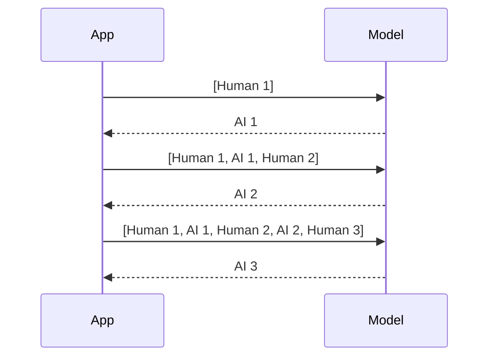
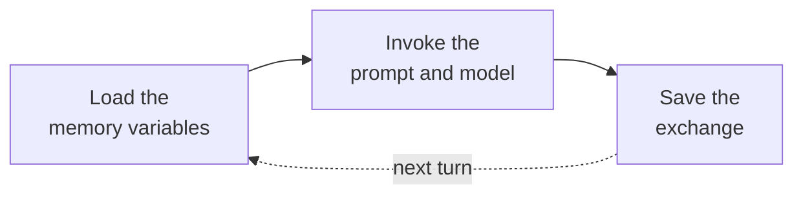

# M33.1 Theory: Why LLMs forget; classic memory classes

*[M33 theory](../README.md) · Lesson 33.1 · Notebooks: [`01a_why_llms_forget.ipynb`](../../notebook/01a_why_llms_forget.ipynb), [`01b_classic_memory_classes_and_chains.ipynb`](../../../optional/notebook/01b_classic_memory_classes_and_chains.ipynb) (optional) · [All theory pages](../../../../../THEORY.md)*
<!-- subtitle: A chat model keeps nothing between calls, and memory is the list of messages the application chooses to resend -->

## Why the second call forgets

> **What you'll learn**
>
> - **Explain** why one chat model call cannot see another, and what a message history adds.
> - **Trace** the messages a full-history chat sends on each turn, and do the arithmetic on its cost.
> - **Diagnose** a half-saved history and the missing save.
> - **Map** LangChain's classic memory classes to the patterns that replaced them.

Part IX starts here. Earlier modules built chains and agents that answered one question at a time. From this lesson on, the Larkspur Cloud support assistant has to hold a conversation.

A customer writes *I'm on the annual Team plan* and gets a friendly reply. Their next message is *Which plan am I on?*, and the assistant has no idea. Nothing crashed and the model works. The second call carried only the second question.

A chat model call is a function of the messages sent in that call and nothing else. The provider keeps nothing between calls, so a stateless chain of prompt, model and parser treats every message as the first one. The notebook shows the same thing with a name: told *My name is Sourav* in one call, the chain cannot answer *What's my name?* in the next. Anything that looks like memory in a chatbot is the application resending earlier messages.

## Message history

**A message history is the ordered list of typed messages that make up the conversation so far, and the application sends it with every call.** The model then reads the earlier turns as part of the current input, exactly as it reads the new question.

Three message types share the list:

| Type | Who wrote it | Stored in the history? |
|---|---|---|
| `SystemMessage` | You, the developer: instructions for the model | Usually not; the prompt adds it on every call |
| `HumanMessage` | The user | Yes |
| `AIMessage` | The model | Yes |

*Table 1: The three message types. Because the prompt template adds the system message each time, the stored history holds only the human and AI turns.*

Each turn appends the user's message, sends the whole list and appends the reply. Figure 1 shows three turns:

*Figure 1: Full-history replay. Every call carries every earlier message plus the new one.*

The notebook's hand-rolled version does four things per turn: append the human message, call the model with the whole list, append the reply, return it. LangChain gives the same list a home in `InMemoryChatMessageHistory`, with operations to add a user message, add an AI message, read the messages and clear them. File, SQLite and Redis backends implement that same interface, and lesson 33.2 relies on it.

### What full replay costs

A history that keeps everything resends everything. Turn N carries the N questions so far and the N − 1 replies before it, which is 2N − 1 messages:

| Turn | Messages sent | Running total | Independent calls, running total |
|---|---|---|---|
| 1 | 1 | 1 | 1 |
| 2 | 3 | 4 | 2 |
| 3 | 5 | 9 | 3 |
| 4 | 7 | 16 | 4 |
| 5 | 9 | 25 | 5 |
| 6 | 11 | 36 | 6 |

*Table 2: Messages sent by a full-history chat over six turns, not counting the system message. The running total is N squared.*

Six turns send 36 messages where six independent calls would send 6. Every earlier message is read again on every later turn, and token cost and latency follow that curve. A long enough chat stops fitting in the context window at all. We will call this **replay cost**; lessons 33.3 and 33.6 bound it.

### Planted failures: what the second call receives

Having a history is half the job. Which messages get into it decides what the model can use. Table 3 replays the Larkspur exchange with the history kept in three ways:

| History kept | Second call receives | Can it name the plan? |
|---|---|---|
| Full history | Human 1, AI 1, Human 2 | Yes |
| None (stateless chain) | Human 2 | No |
| Human turns only: the reply was never appended | Human 1, Human 2 | Usually, but the model has lost its own earlier answers and can contradict or repeat them |

*Table 3: Three histories for the same two turns. Only the first gives the model a faithful transcript.*

The third row is a **half-saved history**. It looks healthy in a demo, because the customer's facts survive. It fails later, when the customer asks *What did you just tell me about refunds?* and the reply that answered it was never stored. The older memory classes had a worse version of this bug, as the next section shows.

## The classic memory classes

Before `RunnableWithMessageHistory` and LangGraph checkpointers, LangChain packaged memory as classes that a chain loaded before each call and saved after it. An LCEL chain has no memory slot. The optional notebook drives them through a loop of three steps:

*Figure 2: The load, invoke and save loop. The chain never writes to memory; the caller's save step does.*

The save is the step people forget. Skip it and the chain still runs without an error, but the next load returns nothing and every turn behaves like the first. This is the **missing save**. In the healthy case, the notebook asks *What are the first four colors of a rainbow?* and then *And the other 3?*. The second question only makes sense because the first exchange was loaded, and after two turns memory holds 4 messages, both pairs written by the explicit save.

Each class decides which messages the prompt receives. Table 4 lines them up with the patterns that replaced them:

| Class | What the prompt receives | Keeps early facts | Extra LLM calls | Where the idea lives now |
|---|---|---|---|---|
| `ConversationBufferMemory` | Every message | Yes | None | A message history (this lesson) |
| `ConversationBufferWindowMemory` | The last `k` exchanges (2k messages) | No | None | A window or `trim_messages` (33.3, 33.6) |
| `ConversationSummaryMemory` | One running summary | Yes, compressed | One per turn | Summary memory (33.3) |
| `ConversationSummaryBufferMemory` | Summary plus recent turns | Yes, compressed | When over `max_token_limit` | Summary memory (33.3) |
| `VectorStoreRetrieverMemory` | The past exchanges most similar to the question | Only if retrieved | None | Long-term memory (M34) |

*Table 4: The five classic classes. Each one is a policy for choosing which earlier messages to resend.*

Three details from the notebook are worth carrying forward:

- **The window hides old turns without deleting them.** The window class still stores every message underneath and returns only the last `k` exchanges. With `k = 1`, a favourite colour given in the first exchange is invisible by the third question, although it is still stored.
- **Choosing `k` is a guess about the conversation.** The notebook suggests 1 to 2 exchanges for quick questions, 3 to 5 for support chats and 6 to 10 for long technical threads. Whatever the value, early facts leave without warning.
- **The format is separate from the policy.** A memory can hand the prompt one "Human: … AI: …" string for completion-style prompts or a list of message objects for chat prompts. The choice changes formatting and leaves what is remembered alone.

These classes now live in `langchain_classic`. You will meet them in older code; new code uses the patterns in lessons 33.2 to 33.6.

## In practice: Larkspur's plan question

Following the Larkspur customer through a full-history chat:

1. **Turn 1.** The app appends *I'm on the annual Team plan*, sends one message and appends the reply. The history holds 2 messages.
2. **Turn 2.** The app appends *Which plan am I on?* and sends 3 messages. The model reads the plan from Human 1 and answers.
3. **Turn 6.** The same chat now sends 11 messages per call and has sent 36 in total. Each message the customer adds will be paid for again on every later turn.

> **What changes next:** one list works for one customer. Lesson 33.2 keys a history to each conversation, and the same chain then serves every Larkspur customer without mixing their turns.

## Key Takeaways

- A chat model call sees only the messages sent in that call. Keep an ordered history of human and AI turns, send the whole list each time, and let the prompt add the system message.
- A history that keeps everything resends everything: turn N sends 2N − 1 messages, and six turns send 36 against 6 for independent calls. That replay cost is what later lessons bound.
- The classic memory classes load before each call and save after it. A missing save leaves every turn with an empty history and raises no error; expect these classes in older code only.

## Check yourself

1. A customer gives their plan in one call and asks for it in the next. Why can a stateless chain not answer, and what fixes it?

A chat model call depends only on the messages sent in that call, so the second call receives the question and nothing else. A message history fixes it: append each human and AI message to an ordered list and send the whole list on every turn. The earlier turn then travels with the new question.

2. A history that keeps everything runs a six-turn chat. How many messages does turn 6 send, and how many over all six turns?

Turn N sends 2N − 1 messages, so turn 6 sends 11, and the six turns send 1 + 3 + 5 + 7 + 9 + 11 = 36 messages. Six independent calls would send 6. Token cost and latency grow with the conversation, which is why lessons 33.3 and 33.6 bound the history.

3. A legacy chain using ConversationBufferMemory runs without errors, but every turn behaves as if the conversation just started. What is the likely bug?

The save step is missing from the load, invoke and save loop. The classic memory classes load the history before each call and save the exchange after it; skip the save and the next turn loads nothing. New code avoids the manual loop with the patterns in lessons 33.2 to 33.6.

---
*Previous: [M33 overview](../README.md). Next: [33.2 RunnableWithMessageHistory, multi-user sessions and persistence](../02_runnablewithmessagehistory_multi_user_sessions_and_persistence/README.md).*
